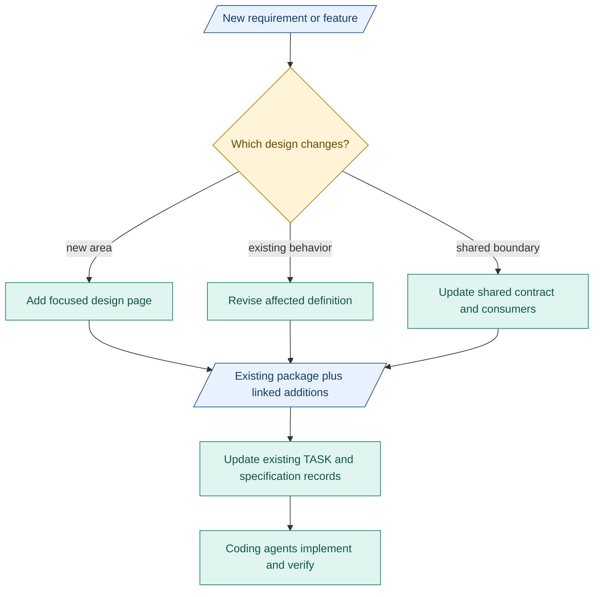

# 3. Package growth

**Append linked detail to the existing package.** Keep the package as the foundation.

## Package structure

Blue: records. Teal: work/tools. Amber: human decisions. Red: unresolved.

| Each addition needs | Simple content |
|---|---|
| Purpose | What changes and why |
| Foundation | Existing package/revision and required context |
| Impact | Area, file or section. Quote or link the relevant design. Mark suspected impacts. |
| Boundaries | Inputs, outputs, affected components/contracts |
| Completion | Expected behavior, examples and checks |

A change may take several paths. Link additions from the index. Keep one authoritative definition. Record what a revision replaces. Git preserves earlier versions.

## Work granularity

- One-shot: clear path with an end-to-end check.
- Several PRs: useful independent changes. Check uncertain boundaries early.
- Split or combine when clarification, rework or integration failures show friction. No fixed size rule or extra approval stage.

## Evidence for detail

Compare equal scope, pinned PRD/design, matched models/settings and isolated contexts. Measure failures, clarification and total effort. Intent-only results cannot establish full-M1 sufficiency. Preserve frozen inputs and [trade-offs](../decision-review.md).
