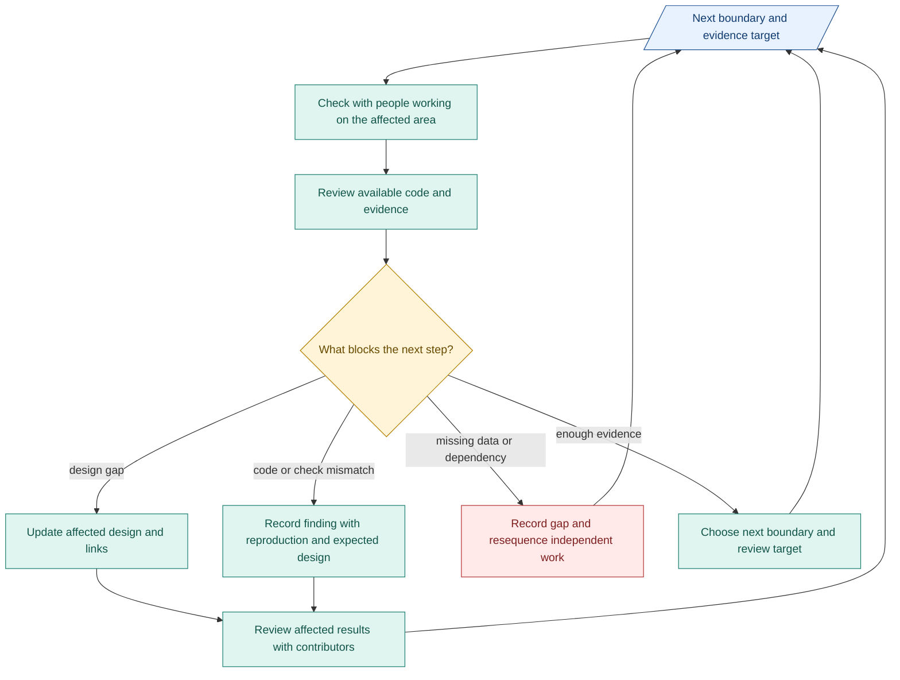

# Architecture actions toward M1

**Prioritize implementation blockers and timely evidence.** We have broken down part of the M1 path. Check the remaining dependencies with people working on each area.

## Targets and checkpoints

| Target timing | Our action | Data we aim to have |
|---|---|---|
| Next week | Check with people working on compiler and verification. Review AI-built verifiers. Prepare labelled unclear, valid and failure cases. | Original request, candidate output, checks, assessment and gate decision. Record false acceptance/refusal and untested branches. |
| With each CC build | Check with people working on that capsule. Clarify inputs, outputs and verifier criteria. Review actual results. | Pinned CC, contract and review evidence. [Node/CC view](07-m1-capsules-and-rsi.md#inside-a-node). |
| Before the next connected boundary | Check with people working on producer, consumer and checks. Resolve interface gaps. | Connected-case evidence or a named blocker. |
| Throughout the build | Track RSI prerequisites with people working on RSI. Keep shared interfaces ready for parallel preparation. | Parent/fixture readiness and available paired evidence. [RSI view](07-m1-capsules-and-rsi.md#rsi-can-prepare-alongside-product-work). |
| By the next progress review | Update affected design, evidence gaps and next targets. | Links in existing issues/PRs and TASK records. Full M1 readiness follows [phase exits](../delivery-phases.md). |

**Set the evidence target early:** case, expected behavior, relevant build/configuration and where results will be retained. Check availability before the review, so missing files do not stall decisions.

## Where our effort goes

Starting allocation of **architecture effort**, adjusted at each progress review:

| Share | Focus |
|---|---|
| About 50% | Verifier review, evidence gaps and design questions blocking implementation |
| About 30% | CC boundaries, connected-path review and M1 dependencies |
| About 15% | Focused design updates, glossary and diagrams |
| At most 5% initially | Cheap AI CI trial. Expand only when it saves review/rework effort. |

These are working budgets, not delivery estimates. Use the [runner/sidecar design](05-coordination-support.md#runner-and-sidecar-in-ai-ci) where available within separate tooling scope.

## Review and update flow

Blue: records. Teal: work. Amber: decision with affected contributors. Red: unresolved.

**Late work alone changes planning.** Change design when its assumptions, behavior or boundaries are wrong. Check with people working on requirements before changing product scope or exits. Preserve required checks and old evidence. [Diagnosis detail](02-changes-decisions-timelines.md#bugs-and-issues).
