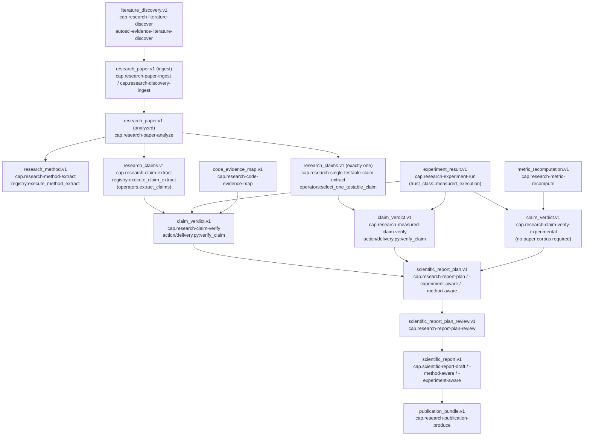

# AI4Research / OpenSolar — Scientific Evidence ABI and Claim Pipeline

Scope: `harness/schemas/evidence/*.schema.json`, `harness/plugins/autosci/operators/scientific_lifecycle/`,
`harness/evaluators/scientific/`, `harness/capability-capsules/cap.research-*.yaml` and
`cap.scientific-*.yaml`, plus the pre-scheduler-stabilization log and semantic-retrieval-contract doc.
Repo: `/home/muk/work/AI4Research`, branch `openJiuwen-Solar`, HEAD `b0bf165f9`.

All claims below are tagged `[VERIFIED]` (read directly in code/YAML/schema), `[DOC-CLAIM]`
(asserted only in a markdown log/doc, not independently re-derived from code), or `[INFERRED]`
(my synthesis across multiple verified facts).

## Summary

- The scientific evidence ABI is a family of ~30 versioned JSON Schemas under
  `harness/schemas/evidence/`, each following a common envelope
  (`schema/task_id/sprint_id/node_id/status/inputs/outputs/artifacts/provenance/limitations`);
  the claim pipeline proper uses `research_paper.v1 -> research_method.v1 -> research_claims.v1 ->
  claim_verdict.v1 -> scientific_report_plan.v1 -> scientific_report.v1`. `[VERIFIED]`
- Claims are structurally required to carry a `source_anchor`, `evidence_ids`, and (when present)
  `citation_span` objects with a SHA-256 hash (`source_text_sha256`) of the exact quoted source
  text — provenance is hash-bound to source text, not just a claimed citation string. `[VERIFIED]`
- Verdicts (`claim_verdict.v1`) are a closed enum (`supported | partially_supported |
  not_supported | insufficient | inconclusive`) and the `claim_verdict_gate.py` evaluator actively
  refuses to let a verdict "upgrade" weak/insufficient/failed evidence into `supported`, refuses
  `supported` when `overclaim_risks` is unresolved, and requires evidence beyond the claim's own id. `[VERIFIED]`
- There are three claim-verify capsule variants distinguished by evidentiary source
  (literature-only vs. experimental-only vs. literature+measured), and two claim-extract capsule
  variants distinguished by cardinality (bounded-many vs. exactly-one, deterministically selected). `[VERIFIED]`
- Anti-fabrication is enforced at multiple layers: capsule invariants ("does not generate a
  synthetic claim…", "never falls back to fixtures, synthetic candidates, or memory-only
  candidates"), extraction code that raises rather than invents claims, and a documented,
  *unresolved* discovery-gate defect where an empty/incomplete discovery shortlist was still
  accepted as a completed artifact until a downstream fail-closed boundary caught it. `[VERIFIED]`/`[DOC-CLAIM]`

## Claim lifecycle (mermaid)



## Full evidence ABI — every schema in `harness/schemas/evidence/`

| Schema file | Purpose | Key required/notable fields |
|---|---|---|
| `artifact_review.v1` | Independent review verdict on a produced artifact | review verdict, findings |
| `autosci_feature_parity.v1` | Parity check between AutoSci backend features and Solar capsules | parity rows |
| `autosci_operator_smoke.v1` | Smoke-test evidence for AutoSci operators | smoke pass/fail per operator |
| `autosci_runtime_evidence.v1` | Generic runtime evidence emitted by AutoSci bridge | runtime status |
| `autosci_skill_run.v1` | Evidence of one AutoSci skill invocation | skill id, exit status |
| `claim_verdict.v1` | Verdict for one or more claims after verification | `outputs.verdicts[]` — see Q4 below |
| `code_evidence_map.v1` | Maps claims/methods to code locations | mapping rows with `mapping_status`, `relevance_label`, `relevance_reason` |
| `dataset_manifest.v1` | Declares a prepared dataset's provenance | dataset id, source, checksum |
| `experiment_approval.v1` | Human/gate approval before running an experiment | approval decision |
| `experiment_plan.v1` | Plan for a designed experiment | steps, expected metrics |
| `experiment_result.v1` | Measured result of running an experiment (`trust_class=measured_execution` producer) | outcome, metrics |
| `experiment_status.v1` | In-flight experiment status/monitoring | status enum |
| `fixed_research_human_approval.v1` | Human approval gate for the "fixed research POC" path | approval fields |
| `fixed_research_part_b.v1` | Fixed research proof-of-concept "Part B" evidence bundle | POC-specific fields |
| `idea_candidate.v1` | Candidate research idea | idea text, rationale |
| `idea_evaluation.v1` | Evaluation/scoring of an idea candidate | score, rationale |
| `literature_discovery.v1` | Ranked literature shortlist + study protocol | `outputs.query`, `outputs.candidates[]` (`candidate_id, title, source_channels, ranking_score, ranking_rationale, dedup_status, fetch_status`) |
| `metric_recomputation.v1` | Independent recomputation of a claimed/measured metric | recomputed value, agreement status |
| `publication_bundle.v1` | Final publication package | bundle manifest |
| `research_claims.v1` | Source-anchored candidate/verified claims | `outputs.claims[]` — see Q3 below |
| `research_evidence_import.v1` | Import of externally supplied evidence into the ABI | imported evidence refs |
| `research_final_evaluation.v1` | Final acceptance evaluation of the whole research run | acceptance verdict |
| `research_graph_update.v1` | Proposed edges into durable research memory graph | `edges[]` with `relation: supported_by`, `evidence_ids` — proposal only, no mutation |
| `research_memory_update.v1` | Proposed durable-memory update | update payload |
| `research_method.v1` | Extracted reusable method/procedure | `outputs.methods[]` (`method_id, name, summary, procedure[], source_papers[], evidence_ids[]`), `method_evidence_status` enum (`explicitly_extracted, extracted_with_inference, insufficient_evidence`) |
| `research_node_result.v1` | Generic per-node execution result envelope used by the Scheduler | node outcome, evidence pointer |
| `research_paper.v1` | Normalized ingested paper | `outputs.paper` (`paper_id, title, source_type, source_ref, parse_status, sections[]`) |
| `research_run_state.v1` | Whole-run state snapshot | run-level bookkeeping (largest schema, 9976 bytes) |
| `research_source_assessment.v1` | Quality/credibility assessment of a candidate source | assessment fields |
| `scientific_report_plan_review.v1` | Review of a report plan before drafting | review verdict |
| `scientific_report_plan.v1` | Plan for the final report, bound to claims | `outputs.report_plan` — see Q9 below |
| `scientific_report.v1` | Final drafted report | `outputs.report` (`report_id, title, sections[], evidence_ids[], unsupported_claims[]`) |
| `workflow_evolution.v1` | Proposed workflow/process improvement from a completed run | proposal fields |
| `fixtures/` (dir) | Example/fixture payloads used by schema regression tests | n/a |

All schemas in this directory share `additionalProperties:false` at the top level and a common
`artifact` def (`type, path, sha256` with `^[A-Fa-f0-9]{64}$`) and `provenance` def
(`operator_id, implementation_package, timestamp`), i.e. every evidence artifact is
independently hash-checkable and provenance-stamped. `[VERIFIED]`

## Q1 — Full evidence ABI enumeration

See table above; 33 top-level `.schema.json` files plus a `fixtures/` subdirectory, confirmed via
`ls harness/schemas/evidence/`. `[VERIFIED]`

## Q2 — Claim lifecycle end to end

| Step | Capsule | Operator entrypoint | Emits |
|---|---|---|---|
| Discover | `cap.research-literature-discover` | `plugins.autosci.operators.scientific_lifecycle.evidence.registry:execute_literature_discover` → `operators.literature_discovery` | `literature_discovery.v1` |
| Ingest | `cap.research-paper-ingest` / `cap.research-discovery-ingest` | `evidence/registry.py` node `paper_ingest` / `discovery_ingest` → `operators.ingest_source` / `ingest_discovered_sources` | `research_paper.v1` |
| Analyze | `cap.research-paper-analyze` | node `paper_analyze` → `operators.analyze_papers` | `research_paper.v1` (enriched) |
| Extract method | `cap.research-method-extract` | `registry:execute_method_extract` → `operators.extract_methods` | `research_method.v1` |
| Extract claim(s) | `cap.research-claim-extract` (bounded many) or `cap.research-single-testable-claim-extract` (exactly one) | `registry:execute_claim_extract` → `operators.extract_claims` / `operators.select_one_testable_claim` (`evidence/operators.py`) | `research_claims.v1` |
| Verify | `cap.research-claim-verify` / `cap.research-claim-verify-experimental` / `cap.research-measured-claim-verify` | `plugins.autosci.operators.scientific_lifecycle.action.delivery:verify_claim` | `claim_verdict.v1` |
| Plan report | `cap.research-report-plan` (+ `-method-aware-report-plan`, `-experiment-aware-report-plan`) | `action/delivery.py:REPORT_PLANNER_ID` (`autosci-report-planning-physical`) | `scientific_report_plan.v1` |
| Review plan | `cap.research-report-plan-review` | — | `scientific_report_plan_review.v1` |
| Draft report | `cap.scientific-report-draft` (+ method/experiment-aware variants), `cap.scientific-report-synthesize` | `REPORT_DRAFTER_ID` | `scientific_report.v1` |
| Deliver | `cap.scientific-report-deliver`, `cap.research-publication-produce` | `PUBLICATION_PRODUCER_ID` | `publication_bundle.v1` |

`harness/plugins/autosci/operators/scientific_lifecycle/evidence/registry.py:39-108` is the single
node_id→operator dispatch table (`OPERATOR_SPECS`) for the evidence-transform operators
(`claim_extract` v1.2.0, `claim_select_one` v1.0.0, `method_extract` v1.3.0, etc.). Verification
(`verify_claim`) lives in a separate module, `action/delivery.py:41`, not the evidence registry,
because it is classified as an "action" operator that also produces report/publication artifacts
(`action/delivery.py:1-33` defines `CLAIM_VERIFIER_ID`, `REPORT_PLANNER_ID`, `REPORT_DRAFTER_ID`,
`ARTIFACT_REVIEWER_ID`, `PUBLICATION_PRODUCER_ID`, `WORKFLOW_EVOLVER_ID`, `FINAL_EVALUATOR_ID`).
`[VERIFIED]`

Every capsule's `implementation.trust_class` in the pipeline above is `evidence_transform`
(deterministic/LLM-assisted transform over supplied evidence), except `cap.research-experiment-run`
which is `measured_execution` (see Q8). `[VERIFIED]`

## Q3 — What is a claim structurally (`research_claims.v1`)

Full `claim` object (`$defs.claim`, required fields marked *):

- `claim_id`* (string)
- `text`* (string) — the claim statement
- `source_anchor`* (string) — pointer into the source paper's section/anchor space
- `testability`* — enum `testable | partially_testable | not_testable | unknown`
- `verification_status`* — enum `unverified | verified | refuted | inconclusive`
- `evidence_ids`* (array of strings) — must be non-empty
- `citation_spans` (optional array of `citation_span`)
- (`additionalProperties: true` — the gate also checks a `claim_type` field and, for
  `not_testable` claims, `non_testable_reason`/`limitations`, which are not in the base JSON
  Schema but are enforced by `claims_gate.py`)

`citation_span` object (required, `additionalProperties:false`):
- `source_ref`* — the anchor/section identifier this span was taken from
- `coordinate_space`* — pinned to the const `"section_text_whitespace_normalized"`
- `start_char`* / `end_char`* — integer offsets into that normalized text
- `quote`* — the literal quoted text
- `source_text_sha256`* — `^[A-Fa-f0-9]{64}$` SHA-256 of the source text the span was cut from

So a claim is tied back to its source via (a) `source_anchor`/`evidence_ids` referencing a paper
section id, and (b) an optional but schema-defined `citation_span` that hash-binds the exact
character range and quoted text to a specific source text hash — i.e. provenance is not just "cite
paper X" but "this exact substring, at this exact offset, of a text whose hash is Y."
`research_claims.v1.schema.json:47-77`. `[VERIFIED]`

`claims_gate.py:32-43` (`harness/evaluators/scientific/claims_gate.py`) enforces at the gate level
that: `claim_id` and `claim_type` are non-empty strings; testable/partially_testable claims must
carry a `source_anchor`; not_testable claims must carry `non_testable_reason` or `limitations`;
`verification_status` **must equal `"unverified"`** at the extraction stage (line 40-41: "claims[i]
.verification_status must remain unverified at extraction stage"); and `evidence_ids` must be
non-empty. `[VERIFIED]`

The extraction implementation (`evidence/operators.py:1178-1256`, function `_extract_claim_rows`)
builds claims from real paper section text: it regex-matches result/finding "cue" words
(`show|shows|demonstrat|improv|reduc|increas|achiev|outperform|result|found|find`), computes
sentence spans via `_source_sentence_spans`, and for each selected sentence emits a `citation_span`
with `source_text_sha256` taken from that call. If no claim-like sentence is found anywhere, the
code raises `_product_error("No claim-like source sentences were found; synthetic claims were not
generated")` (`operators.py:1256`) rather than inventing a claim. `[VERIFIED]`

## Q4 — What is a claim verdict (`claim_verdict.v1`)

`verdict` object (required fields marked *):
- `claim_id`*
- `verdict`* — enum `supported | partially_supported | not_supported | insufficient | inconclusive`
- `confidence`* — number in `[0,1]`
- `basis`* — non-empty string explanation
- `evidence_ids`* — non-empty array
- `limitations` (optional array)
- `citation_spans` (optional array of the same hash-bound `citation_span` def)
- `scope_comparison` (optional object) — a structured claim/evidence-scope comparator: required
  sub-fields `schema_version` (const `solar.claim_evidence_scope_comparison.v1`), `status`
  (`aligned | mismatch | insufficient | unscoped`), `dimensions`, `mismatched_dimensions`,
  `missing_evidence_dimensions`, `lexical_guardrail`, `risks`.

`claim_verdict_gate.py` (`harness/evaluators/scientific/claim_verdict_gate.py`) enforces, beyond
schema validity:
- `verdict` must be in `ALLOWED_VERDICTS` (the same 5-value enum).
- `evidence_ids` non-empty, **and must include the claim's own `claim_id`, and must also include at
  least one non-claim-id evidence entry** ("must include experiment, static, or code evidence in
  addition to the claim id", lines 42-46) — i.e. a verdict cannot cite only the claim itself as its
  own evidence.
- A verdict needs `limitations` unless top-level `outputs`/payload `limitations` are present (line 47-48).
- **Cannot upgrade weak evidence**: if `evidence_outcome` is `inconclusive|failed|insufficient|
  insufficient_evidence`, the verdict label must be `inconclusive` or `insufficient` — it cannot be
  `supported`/`partially_supported`/`not_supported` (lines 50-52, `NON_SUPPORTING_EVIDENCE_OUTCOMES`).
- Same rule for `support_classification == "insufficient_evidence"` (lines 53-55).
- **Cannot support an over-broad claim**: `if verdict.get("overclaim_risks") and verdict_label ==
  "supported": reasons.append("cannot support an over-broad claim without resolving
  overclaim_risks")` (line 56-57).
- **Scope-mismatch block**: if `scope_comparison.status` is `mismatch` or `insufficient`, the
  verdict cannot be `supported` (lines 58-64).
- **Low-confidence disclosure**: `confidence < 0.8` requires `limitations` (either on the verdict or
  the payload) (lines 65-68).

So the evidence a verdict must be backed by is: a non-empty, claim-id-inclusive-but-not-claim-id-only
`evidence_ids` list, a `basis` string, a `confidence`, and (functionally, via the gate) consistent
`evidence_outcome`/`support_classification`/`scope_comparison` metadata that cannot be silently
overridden by a rosier `verdict` label. `[VERIFIED]`

## Q5 — Capsule variant differences

**`cap.research-claim-verify`** (`harness/capability-capsules/cap.research-claim-verify.yaml`):
- Inputs required: `research_claims.v1`, `research_paper.v1`. Optional: `experiment_result.v1`,
  `code_evidence_map.v1`.
- General-purpose literature/code-grounded verifier; experiment evidence is optional.
- Invariant: "Does not convert inconclusive evidence into supported claims." / "Verdicts remain
  separate from experiment results."
- `requires_after: [cap.research-claim-extract]`.
- `external_verifier.required: true`.

**`cap.research-claim-verify-experimental`**:
- Inputs required: `research_claims.v1`, `experiment_result.v1`, `metric_recomputation.v1`. **No
  paper corpus required** ("without requiring a paper corpus").
- Invariant: "A measured claim is never marked supported without an independent metric
  recomputation that agrees."
- `requires_after: [cap.research-experiment-run, cap.research-metric-recompute]`.
- `cost: premium_model_quota`; `implementation.reasoning: deterministic`.

**`cap.research-measured-claim-verify`**:
- Inputs required: `research_claims.v1`, `research_paper.v1` **and** `experiment_result.v1`
  together — i.e. it demands *both* literature grounding and a measured result from "the same
  bounded lifecycle."
- Invariants: "Does not infer experimental support without measured result evidence." / "Does not
  promote a claim whose paper identifier or source anchor is unresolved." / "Preserves refuted,
  inconclusive, and scope-mismatched outcomes."
- `effects.network: forbidden` (stricter than the plain verifier's "none by default").
- `requires_after: [cap.research-experiment-run]`.

`[INFERRED]` summary: `-claim-verify` = literature/code verification, experiments optional;
`-claim-verify-experimental` = experiment-only verification (no paper needed), gated on an
*independent* recomputation agreeing; `-measured-claim-verify` = the strictest, requiring both
paper grounding *and* measured results, network-forbidden, and explicitly preserving negative
outcomes. All three share `implementation.trust_class: evidence_transform` and the same physical
entrypoint `action/delivery.py:verify_claim` — the differentiation is at the capsule contract level
(which inputs are required/available), not a different code path. `[VERIFIED]`

**`cap.research-claim-extract`** vs **`cap.research-single-testable-claim-extract`**:
- `-claim-extract`: "Extract a bounded collection of source-anchored scientific claims... across
  every normalized paper," output `research_claims` (many); invariant "Extracted claims default to
  unverified," "Claim extraction does not produce verdicts."
- `-single-testable-claim-extract`: "deterministically retain exactly one validation-priority
  testable claim using disclosed objective-alignment, evidence, and specificity criteria"; output
  `selected_research_claim` (postcondition `exactly_one_claim_selected`); invariants: "Does not
  generate a synthetic claim when no source claim is available," "Does not mark the selected claim
  verified," "Selection criteria and candidate count remain visible in the output evidence." Uses a
  distinct entrypoint `evidence/operators.py:select_one_testable_claim` vs. `extract_claims` for the
  bulk variant. `[VERIFIED]`

## Q6 — Anti-fabrication mechanisms (quoted invariants)

Capsule-level (`harness/capability-capsules/*.yaml`):

- `cap.research-literature-discover.yaml:47-52`:
  > "A completed result never falls back to fixtures, synthetic candidates, or memory-only
  > candidates." / "Scientific reliability is not self-certified at discovery; downstream ingestion
  > and claim verification decide evidentiary support." / "Does not ingest selected papers
  > directly." / "Does not mutate durable research memory directly." / "Missing protocol parameters
  > remain explicitly unresolved rather than being silently invented."
- Same capsule, postcondition `traceable_sources_recorded` (line ~34): "Completed discovery
  contains either a non-fixture online source channel or controller-frozen, hash-bound local
  sources; unavailable online providers remain explicit limitations."
- `cap.research-single-testable-claim-extract.yaml`: "Does not generate a synthetic claim when no
  source claim is available."
- `cap.research-claim-extract.yaml`: "Extracted claims default to unverified." / "Claim extraction
  does not produce verdicts."
- `cap.research-measured-claim-verify.yaml`: "Does not infer experimental support without measured
  result evidence." / "Does not promote a claim whose paper identifier or source anchor is
  unresolved."
- `cap.research-claim-verify-experimental.yaml`: "A measured claim is never marked supported
  without an independent metric recomputation that agrees."
- `cap.research-method-extract.yaml`: "Does not invent procedure steps not grounded in source
  evidence."
- `cap.research-paper-ingest.yaml`: "Does not update durable research memory directly." /
  "Preserves original source reference and parser status."

Code-level (`harness/plugins/autosci/operators/scientific_lifecycle/evidence/operators.py`):
- Line ~1256: `raise _product_error("No claim-like source sentences were found; synthetic claims
  were not generated")` — the extractor fails closed instead of fabricating a claim.
- Line ~1166: `raise _product_error("Graph update found no traceable evidence IDs in memory
  proposals")` — same fail-closed pattern for graph updates.

Gate-level (`harness/evaluators/scientific/claim_verdict_gate.py`): the "cannot upgrade
{evidence_outcome} evidence to {verdict}" and "cannot support an over-broad claim without resolving
overclaim_risks" checks (see Q4) are a second, independent layer that stops an LLM-authored verdict
from self-certifying support even if the producing operator tried to claim it.

Hash-binding: every `citation_span` in `research_claims.v1`/`claim_verdict.v1`/
`scientific_report_plan.v1.claim_status_mappings[].citation_spans` carries `source_text_sha256`
(64-hex-char pattern), which pins the quote to a specific byte-content of source text — a claim
cannot be re-anchored to different, retroactively-edited source text without changing the hash.
`[VERIFIED]`

Documented (not just designed) failure of this discipline: see Q10 — the discovery-gate defect
where the *documented* invariants above were not yet fully enforced in one code path, and an
`incomplete`/empty discovery artifact was accepted as "complete" until a downstream fail-closed
ingestion boundary rejected it. This shows the anti-fabrication invariants are aspirational
contract text that the project's own logs record as **not yet fully closed** in practice.
`[DOC-CLAIM]`

## Q7 — `study_protocol`

Defined inside `scientific_report_plan.v1.schema.json` (`outputs.report_plan.study_protocol`,
`additionalProperties:false`), required fields:

- `protocol_status` — enum `resolved | partially_resolved | unresolved`
- `search_strategy` (string, non-empty)
- `source_selection_criteria` (array of strings)
- `time_range` — object, required: `status` (`resolved|unresolved`), `start`/`end` (`string|null`),
  `rationale`
- `inclusion_criteria` (array of strings)
- `exclusion_criteria` (array of strings)
- `unresolved_fields` — array (uniqueItems) drawn from the enum `search_strategy,
  source_selection_criteria, time_range, inclusion_criteria, exclusion_criteria` — i.e. the schema
  forces the producer to explicitly *name* which of these five protocol dimensions it could not
  resolve, rather than silently omitting them.

`literature_discovery.v1` itself does not carry a first-class `study_protocol` object in its JSON
Schema (its `outputs` schema only requires `query`+`candidates`, with `additionalProperties:true`
allowing more), but `cap.research-literature-discover.yaml` requires `study_protocol_traceable` as
a postcondition and its `verification.self_check` requires "outputs.study_protocol records all
systematic-review protocol fields and identifies unresolved values" — so the protocol is a
capsule-level contractual requirement enforced against a schema-open `outputs` object at discovery
time, and formalized with a closed schema later in `scientific_report_plan.v1`. `[VERIFIED]`

`semantic-retrieval-contract.md:73-75` (`[DOC-CLAIM]`, doc-only): "With no explicit user count,
`minimum_candidates=1` is required for nonempty discovery handoff, not an invented user requirement
and not proof of report sufficiency" — i.e. the protocol's nonempty-handoff floor is a distinct,
program-owned policy layered onto whatever the LLM fills in for search_strategy/inclusion/exclusion.

## Q8 — `execution_trust` / `trust_class`

`harness/lib/capsule_composition.py:27-36` defines the canonical set:
```
EXECUTION_TRUST_CLASSES = {"measured_execution", "evidence_transform", "fixture_or_adapter_only", "unspecified"}
PLANNER_EXECUTION_TRUST_RANK = {"any": 0, "evidence_transform": 1, "measured_execution": 2}
```
Grep across `harness/capability-capsules/*.yaml` shows every research/scientific capsule declares
`implementation.trust_class`, and only `cap.research-experiment-run.yaml` is `measured_execution`;
all claim/method/paper/discovery/report capsules examined are `evidence_transform`. `[VERIFIED]`

`harness/lib/elastic_planner.py:530-533` rejects any capsule declaring a `trust_class` not in
`EXECUTION_TRUST_CLASSES` at plan-composition time ("capsule ... declares unknown execution trust
...!r"). `harness/lib/capsule_composition.py:86-108` (`minimum_execution_trust_for_artifacts`) and
the `artifact-types.v1.json` registry can pin a **minimum required trust class per output artifact
type** (e.g. an artifact type could require `measured_execution` and reject a plan that would
produce it via a mere `evidence_transform` capsule) — though the specific rows I checked
(`artifact.claim_verification`, `schema:...research_claims.v1`, `schema:...claim_verdict.v1`) had
`minimum_execution_trust: None`, i.e. no floor is currently pinned for claim/verdict artifacts
specifically. `[VERIFIED]`

Why the distinction matters for claims: `evidence_transform` capsules (claim extraction, claim
verification, method extraction, report planning) *read and recombine already-produced evidence* —
they do not themselves generate new empirical measurements, so their trust ceiling is "at most as
trustworthy as their inputs." `measured_execution` (only `cap.research-experiment-run`) is the one
step in the whole pipeline that actually *runs code/experiments and measures new numbers* — it is
the evidentiary root that `cap.research-claim-verify-experimental` and `cap.research-measured-claim-verify`
require via `requires_after: [cap.research-experiment-run]`. The planner's trust ranking
(`any(0) < evidence_transform(1) < measured_execution(2)`) lets the composition layer refuse to
satisfy an artifact type that demands measured grounding using a chain of transforms alone.
`[INFERRED]`

## Q9 — Report planning vs. drafting; why two schemas

`scientific_report_plan.v1` (`schemas/evidence/scientific_report_plan.v1.schema.json`) is the
larger, more structured schema (13.4 KB) — its `report_plan` requires `report_id, title, audience,
sections[], supported_claim_ids[], excluded_claim_ids[], evidence_ids[]`, and optionally carries
`reportable_claim_ids`, `requirement_bindings[]` (requirement→acceptance-check traceability),
`unknown_resolution_traces[]`, `claim_status_mappings[]` (per-claim `verdict,
support_classification, evidence_outcome, evidence_ids, contradiction_status
(contradicted|no_recorded_contradiction), tested_status (tested|not_tested), limitations`, plus
optional `citation_spans`), and the `study_protocol` object (Q7). Its `provenance` additionally
requires `operator_version`, `input_sha256`, `output_sha256` (stronger provenance than the base
envelope used elsewhere) — i.e. the plan is the audit ledger that decides, claim by claim, what is
in/out of scope for the final report and why, before any prose is written.

`scientific_report.v1` is deliberately smaller: `report.report_id, title, sections[]
(section_id, title, evidence_ids[]), evidence_ids[], unsupported_claims[]`. It is the drafted prose
artifact, and it still must explicitly list `unsupported_claims` — i.e. even the final report is
required to carry forward a "known gaps" list rather than silently dropping claims that didn't make
the supported cut.

`[INFERRED]` reason for the split: separating plan from report lets the **claim-inclusion decision**
(which claims are reportable, how each verdict maps to a support classification, what remains
unresolved) be produced, reviewed (`scientific_report_plan_review.v1`), and gated
(`report_plan_gate.py`, `report_plan_review_gate.py`) *before* natural-language drafting happens —
so drafting (`report_gate.py`) only has to check that the prose is consistent with an
already-approved, claim-traceable plan, rather than re-deriving claim support decisions from
scratch inside free text. This mirrors the general pattern in this codebase of separating
structured decision evidence from generated prose everywhere else (report vs plan, verdict vs
extraction).

## Q10 — The discovery semantic defect (NOT resolved) / rapid_smoke PASS masking empty discovery

Source: `harness/metadata/pre-scheduler-stabilization-log-20260829.md` (a running defect/repair log;
`[DOC-CLAIM]` — this is project narrative, not independently re-run by me) and
`harness/metadata/semantic-retrieval-contract.md`.

Row 43 of the log ("Final unattended discovery-to-ingestion retest"):
> "The fresh run completed Intent, Requirement, Elastic Planner, Scheduler projection, and the
> first discovery node, then failed the ingestion node with `product_failure: Discovery evidence
> contains no candidates`; five downstream nodes were cancelled." Root cause: "Public providers
> returned 11 candidates and relevance accepted 3, but the discovery coverage gate treated the
> workflow instruction 'research-type end-to-end research undertaking; one-off answer' as mandatory
> paper-topic coverage. That impossible process-language coverage emptied the final shortlist. **The
> upstream deterministic discovery gate still accepted the `incomplete` artifact**, so ingestion was
> the first fail-closed boundary." Explicit classification: "Failure is a requirement/scope-
> classification plus **discovery-gate acceptance defect**, not a provider-empty or evaluator
> failure."

A related, more directly on-point entry (log line ~62, under a later repair):
> "Issue: rapid mode let an empty shortlist appear successful until ingestion failed. Action:
> structured Discovery now refuses successful handoff if its producer audit, candidate minimum,
> required coverage or provider evidence is missing."

And the very first row of the whole log (row 10, "Scheduler result observation") independently
records a rapid-smoke `PASS` that did not correspond to forward progress: "Scheduler consumed the
verified typed inputs, dispatched `discover_literature`, received worker exit 0, and **wrote a
rapid-smoke evaluator `PASS`**; the runtime task state then remained `reviewing` with no further
Scheduler tick," diagnosed as "Not fixed: this is the first Scheduler-stage defect and is outside
the authorized auto-fix boundary."

The "migration source closure" entry (row 45) explicitly preserves the open item:
> "...migration handoff documentation with dependency/setup guidance and **the unresolved semantic
> defect**." And a later status line: "current onboarding and new migration-handoff-20260831.md now
> state actual pipeline/schema paths, **this open blocker**, dependency/PATH limitations and
> new-host **NOT_TESTED** status."

**My reading of the actual failure mode** (`[INFERRED]` from the above `[DOC-CLAIM]` entries): the
discovery capsule's own `postconditions`/self-checks (see Q6/`cap.research-literature-discover.yaml`)
declare that a completed result must never fall back to empty/fixture candidates and must record a
traceable `study_protocol` — but the *coverage gate* that decides whether a discovery run counts as
"complete" was, in this documented episode, evaluating candidate sufficiency against the wrong
target (the full Planner instruction text, including process/workflow language like "one-off
answer," rather than just the topical retrieval clauses). That miscalibrated gate accepted an
`incomplete`-status discovery artifact as good enough to hand off downstream, even though its
candidate list had effectively been filtered to empty by the bad coverage check. The `rapid_smoke`
evaluator mode (used for fast E2E smoke passes) recorded a `PASS`/exit-0 at the discovery step
itself, which masked the fact that the *handoff* was empty — the actual detection of "no candidates"
only happened one step later, at the ingestion node's own defensive check
(`product_failure: Discovery evidence contains no candidates`), which the log explicitly calls "the
first fail-closed boundary." In other words: the smoke/PASS receipt at the producing step was not
sufficient evidence that the pipeline could proceed; only a downstream consumer's own guard caught
the emptiness. The `semantic-retrieval-contract.md` repair note (line 27-30) describes the intended
fix directly: "Empty candidates, missing audit, unmet required coverage or absent provider evidence
fail before successful handoff, including rapid smoke. Incomplete best-effort coverage remains a
visible limitation rather than fabricated evidence" — i.e. the documented intent is to make
`rapid_smoke` itself refuse to certify an empty handoff, but the stabilization log's row 43 shows a
live case, after multiple related repairs (rows 17, 22, 25, 28), where the discovery-gate acceptance
defect still slipped an incomplete artifact past the discovery step. I did not find, in this pass,
a log entry that both (a) is dated after row 43 and (b) claims this exact acceptance-gate defect
class is now closed with a passing live (non-offline) re-run — the log's own text repeatedly
distinguishes "offline/regression PASS" from "online/live E2E acceptance," and multiple later rows
still say "not yet synchronized to WSL" / "does not claim this has been verified online." Treat the
defect as documented-but-not-confirmed-closed rather than "still definitely broken today" — I did
not find a clear closing entry, and I did not execute anything to check current live behavior
myself, per this task's read-only constraint. `[DOC-CLAIM]`/`[INFERRED]`

## Key references (file:line)

- `harness/schemas/evidence/research_claims.v1.schema.json:47-77` — claim + citation_span defs.
- `harness/schemas/evidence/claim_verdict.v1.schema.json:47-95` — verdict + scope_comparison + citation_span defs.
- `harness/schemas/evidence/research_method.v1.schema.json:52-66` — method def, `method_evidence_status` enum.
- `harness/schemas/evidence/scientific_report_plan.v1.schema.json` — `study_protocol` (~lines 260-320), `claim_status_mappings` (~lines 195-260).
- `harness/schemas/evidence/scientific_report.v1.schema.json:48-65` — `unsupported_claims` field.
- `harness/evaluators/scientific/claims_gate.py:25-44` — extraction-time gate (`verification_status must remain unverified`).
- `harness/evaluators/scientific/claim_verdict_gate.py:28-70` — verdict gate (no-upgrade, overclaim, scope-mismatch, confidence rules).
- `harness/plugins/autosci/operators/scientific_lifecycle/evidence/registry.py:39-108,240-250` — OPERATOR_SPECS dispatch table incl. `claim_extract` v1.2.0, `claim_select_one` v1.0.0.
- `harness/plugins/autosci/operators/scientific_lifecycle/evidence/operators.py:1178-1265` — `_extract_claim_rows`/`extract_claims`, fail-closed "synthetic claims were not generated".
- `harness/plugins/autosci/operators/scientific_lifecycle/action/delivery.py:1-70` — `verify_claim`, `REPORT_PLANNER_ID`, `PUBLICATION_PRODUCER_ID`, etc.
- `harness/capability-capsules/cap.research-claim-extract.yaml`, `cap.research-single-testable-claim-extract.yaml`, `cap.research-claim-verify.yaml`, `cap.research-claim-verify-experimental.yaml`, `cap.research-measured-claim-verify.yaml`, `cap.research-method-extract.yaml`, `cap.research-literature-discover.yaml`, `cap.research-paper-ingest.yaml`, `cap.research-paper-analyze.yaml` — full text captured above.
- `harness/lib/capsule_composition.py:27-36,86-108,405-456,679-687` — `EXECUTION_TRUST_CLASSES`, `PLANNER_EXECUTION_TRUST_RANK`, `minimum_execution_trust_for_artifacts`.
- `harness/lib/elastic_planner.py:530-533` — rejects unknown `trust_class` at plan time.
- `harness/metadata/pre-scheduler-stabilization-log-20260829.md` rows 10, 17, 22, 25, 28, 43, 45 and the un-numbered "Issue: rapid mode let an empty shortlist appear successful..." entry.
- `harness/metadata/semantic-retrieval-contract.md:27-30,73-83` — intended discovery fail-closed contract and count-policy rules.

## Open questions

1. Whether the discovery-gate acceptance defect (log row 43) has since been closed by a *live,
   non-offline* E2E — the log itself repeatedly flags offline/regression PASS as insufficient
   evidence of online acceptance, and I found no later row unambiguously confirming a clean live
   re-run of exactly this scenario as of the HEAD commit inspected.
2. Whether any artifact type in `harness/config/artifact-types.v1.json` currently pins a nonzero
   `minimum_execution_trust` for claim/verdict outputs — the rows I sampled (`claim_verification`,
   `research_claims.v1`, `claim_verdict.v1`) all showed `None` (i.e. `any`), meaning the planner does
   not currently *require* `measured_execution` upstream evidence before allowing a claim-verdict
   artifact to be produced by pure `evidence_transform` capsules (like `cap.research-claim-verify`,
   which explicitly allows `experiment_result` to be optional). This is consistent with the capsule
   design (literature-only verification is a legitimate mode) but is worth flagging as a policy
   surface, not a bug.
3. The exact code path/line for the `literature_discovery` coverage gate referenced in log rows 17,
   22, 43 (I read the *log's description* of the defect and the intended contract in
   `semantic-retrieval-contract.md`, but did not locate and read the specific gate function in
   `harness/evaluators/scientific/literature_discovery_gate.py` or the compiler/planner code that
   currently implements the coverage-classification logic — that would need a follow-up pass focused
   specifically on `lib/requirement_compiler/semantic.py` and `literature_discovery_gate.py` line-level review).
