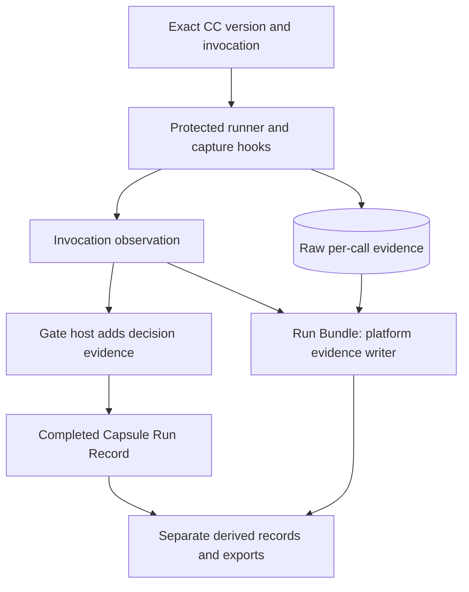
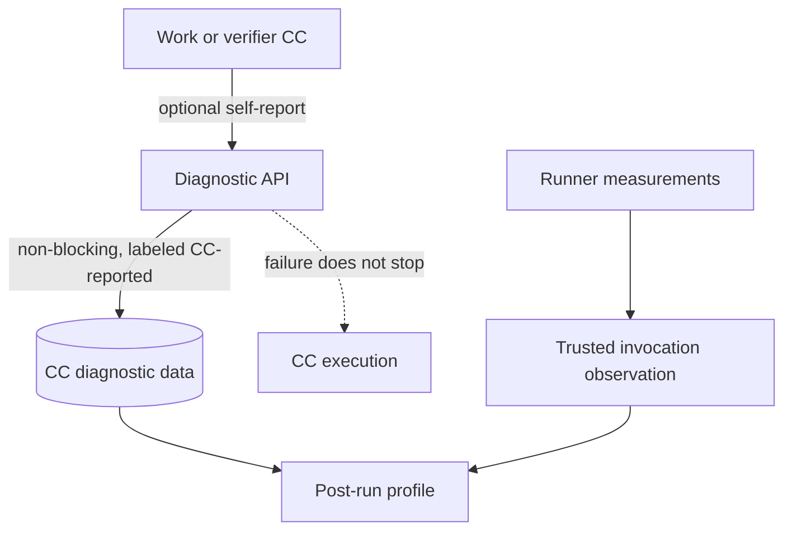

# Workload profiling in AI4Research

`Presentation draft · Current design and optional M1/M2 proposals · Awaiting design-package integration`

## Terms

| Term | Meaning |
|---|---|
| Workload profiling | Measuring time, calls and resource use across work. |
| Capability Capsule (CC) | Pinned reusable module; may wrap a tool, skill or bounded ephemeral agent. |
| Work CC | Produces node work. |
| Verifier CC | Assesses the pinned declaration and exact output. The protected gate releases. |
| Invocation | One bounded work or verifier CC run with its own identity, contract, budget and evidence. |

## 1. What is the relation of CCs to workload profiling?

**Our feature is Capability Capsules. Profiling observes each work and verifier invocation so we can understand and compare exact versions. It describes execution, not selection or release.** CCs wrap tools, skills and bounded ephemeral agents. Exact CC and invocation identities link work to traces and results. The platform owns run history, not the reusable CC declaration.

Arrows show data links, not creation order. Work and verifier invocations have separate records. Observations and Run Bundle evidence retain their required platform release rules. The verifier model sees only the pinned declaration and exact output. It does not receive runtime profiles.

| Connected item | Profiling relation and boundary |
|---|---|
| [Library and admission](../jiuwenswarm/docs/architecture/design-package/capability-capsules/library-and-checking.md) | Pin the exact version and checks that observations describe. A profile does not grant eligibility. |
| [Planner and binder](../jiuwenswarm/docs/architecture/design-package/platform/planning-and-freeze.md) | Freeze the selected CC pins and budgets. Profile-based selection would need a future input contract. |
| [RSI workbench](../jiuwenswarm/docs/architecture/design-package/side-systems/rsi-workbench.md) and [benchmark runner](../jiuwenswarm/docs/architecture/design-package/side-systems/benchmark-runner.md) | Compare available versions under matched tasks. Missing capture limits history. Retained run evidence currently has no automatic deletion policy. |

## 2. What are our thoughts on profiling, and what can we contribute?

**Our approach starts with M1's version-linked timing and call evidence. We can add optional CC diagnostics. Architecture defines capture, storage, access and failure rules.** M1's required evidence remains binding. Capture during execution and package afterward. For partial or stopped runs, retain what exists and mark missing evidence. Absence does not mean no invocation.

| Profile layer | What exists and who owns it | Status and limit |
|---|---|---|
| CC invocation and call detail | Runner observation records exact CC/version and code hashes, timing, model calls/route, outcome and effects. Per-call evidence includes prompt, trace, model/tool records, inputs/outputs, workspace, checks and verifier assessment. | M1 design, not a claim every hook is implemented. Work and verifier calls are separate. Optional token/cost usage is unavailable when not measured. |
| Run-level view | Data Foundation Run Bundle references per-call evidence and completed records; exports serve authorized consumers. | M1 design. RSI and the benchmark runner analyze it after execution. |
| Jiuwen agent telemetry | Existing code has configurable OpenTelemetry agent observability and a local OTLP trajectory store: [agent observability](../jiuwenswarm/jiuwenswarm/agents/harness/agent_observability.py), [OTLP store](../jiuwenswarm/jiuwenswarm/observability/store.py). | Existing code, separate from the M1 CC record design. It is not automatically correlated with exact CC invocation identity. |
| Host/container resources | Benchmark host collector records inventory before each test/repeat and execution peaks under B17. | Required benchmark evidence where contracted. Continuous product CPU/memory profiling is deferred. Shared-container samples do not identify one CC's use. |

### Optional M1 idea

Add a best-effort API for CCs to report internal phase labels or counters the runner cannot observe. The CC supplies a name and bounded attributes. The runner adds invocation identity, collection time and a `CC-reported` label. These messages are outside CC output ports and declaration guarantees. Admission, checks, verifiers and gates do not judge or consume them.

Bound event count and bytes per invocation. Use no synchronous exporter dependency, and give mandatory evidence storage priority. If the API is absent, broken or over limit, drop diagnostics and continue. Mark truncation or missing diagnostics so reports do not imply a complete profile. Spec Kit defines the limits.

This is low impact because CC identity, contracts, runner measurements, checks, verifier assignment, gate behavior and outputs remain intact. No IR, node or declaration change is needed. Spec Kit can define the interface and limits. Any implementation remains unverified; October 30 acceptance works without it.

Keep these quantities distinct:

| Quantity | What it measures | Owner / limit |
|---|---|---|
| Per-run evidence bytes | Files retained for one run on the app's persistent Docker volume. | Can be summed after the run; separate from shared volume usage. |
| Docker volume usage | Space occupied by a persistent volume, possibly shared by many runs. | Authorized host measurement; attribution needs separate accounting. |
| Container memory | Memory charged to the app container. | Host/runtime sample; shared by app processes and overlapping work. |
| Host physical memory | Time-varying memory in use on the server. | Host sample; CC attribution requires isolation and correlation. |

M2 could add CPU/memory samples, GPU measurements where supported, storage trends and trace-linked code profiles. It can reuse the [sidecar's job-scoped host executor](../jiuwenswarm/docs/architecture/design-package/development-tools/sidecar/README.md#host-executor). Sampling, retention, attribution and overhead need separate design. Collectors stay optional for core execution.

| Possible design edit later | Smallest change |
|---|---|
| [Derived records](../jiuwenswarm/docs/architecture/design-package/reference/derived-records.md) | Define optional CC diagnostics and separate storage; preserve required evidence rules. |
| [Checking](../jiuwenswarm/docs/architecture/design-package/checking/README.md) and CC authoring | State that diagnostic content is not verified or used for admission/release. |
| [Platform](../jiuwenswarm/docs/architecture/design-package/platform/README.md) | Define M2 resource sampling, scope and storage accounting. |

## 3. Owned Linux server: measure and trace real AI workloads

The target is an owned Linux server running AI4Research alongside inference and research workloads, including training. We need both a low-overhead timeline of resource consumption and occasional detailed traces that explain which operation used the resources. A sidecar can act as the collection and benchmark plane, but its host-level measurements alone cannot reliably split shared-device activity among simultaneous runs.

| Layer | Useful measurements | Candidate collection method |
|---|---|---|
| Host inventory | CPU model and logical/physical cores, RAM, GPU model/UUID and memory, driver/runtime versions | Capture once per host and whenever hardware/software identity changes; attach the inventory ID to each run. |
| CPU and system memory | Per-run CPU time in core-seconds, user/system split, throttling, memory current/peak, OOM events, disk and network I/O | Put each run or workload group in a distinct cgroup/container and sample its cgroup counters. On cgroup v2, `cpu.stat` includes usage/user/system time and throttling; `memory.current` reports current cgroup memory. Use `perf stat`/`perf record` for targeted process or command-level CPU counters and call stacks. |
| GPU and VRAM | Device utilization, framebuffer memory used, clocks/power, PCIe/NVLink traffic, supported SM/tensor-pipeline activity; per-process CUDA allocations and kernel activity when available | DCGM Exporter provides a Prometheus endpoint for selected NVIDIA GPU telemetry. Nsight Systems captures CUDA API, kernel, copy and (when enabled) allocation timelines. PyTorch Profiler adds operator-level CPU/CUDA activity and PyTorch allocator memory; Nsight Compute drills into selected kernels and hardware counters. |
| Application trace | Inference request, training step, data loading, model call, tool call, retries and outputs | Emit trace/span IDs and add stable AI4Research `run_id`, `invocation_id`, workload type, model/code/image versions and host/GPU identity. Add NVTX ranges around meaningful CUDA work so Nsight traces line up with application spans. |

These tools answer different questions. Cgroup counters are a good baseline for total CPU time and memory charged to a run/container; sampled CPU and device metrics show changes over time; profilers explain which functions, operators, CUDA calls and kernels account for time. GPU-wide utilization and VRAM samples are device-level measurements: if training and inference share a GPU, they do not by themselves establish each workload's share. For stronger attribution, isolate workloads onto separate GPU devices/MIG instances where available, or collect process/application traces and correlate them to run IDs. Record attribution quality and missing metrics explicitly.

### Standard workload units as a resource vector

Represent a standard workload unit as a **vector**, not a single blended score. A candidate vector is CPU core-seconds, CPU throttled time, system-memory peak and memory-time, GPU active time/utilization, VRAM peak and memory-time, and wall-clock time. Keep additive quantities (such as CPU core-seconds) distinct from peaks (such as peak RAM); they answer different capacity questions. The exact dimensions and normalization remain open.

Each unit is an encapsulation of historical measured workloads on a stated reference hardware/software configuration. A new workload can be estimated as a number of units and expected duration by matching it to relevant historical profiles. Retain the vector, sample count, distribution/range, reference hardware, workload class, software/runtime versions, and unit/profile version behind the estimate. Compare subsequent measured runs to the predicted vector and time so the team can judge where the historical estimate transfers to real hardware and where it does not. Do not imply that one unit converts identically across different CPU/GPU models or unlike workload classes without calibration evidence.

### Dockerized CC profiling as a discovery experiment

Outside M1, run selected worker CCs and verifier CCs in Dockerized, invocation-scoped experiments to learn what work occurs inside each Capsule and validate whether the historical workload vectors predict actual resource use. The profiling boundary should cover the CC's child processes and work, and carry the exact CC/version, invocation ID, workload type, hardware identity and profiler configuration. Preserve separate profiles for worker and verifier roles and for materially different work patterns; do not assume a verifier is cheap merely because its output is an assessment.

Treat the containerized profile as an instrumented observation, not automatically as uninstrumented production consumption. For matched tasks, compare a normal run, a containerized run with only lightweight accounting, and a detailed-profiled run. Record startup and image/runtime costs separately from CC execution, and measure profiling overhead rather than silently including it in the historical unit. Keep the observed resource vector and trace beside the original estimate. If historical estimates miss repeatedly, revise the relevant reference profile with a new version and retain the old one for comparison.

### Sidecar observability-plane idea

Run a host-aware collector beside the AI4Research application. It can collect host inventory, cgroup/container counters, and GPU telemetry; scrape or receive application metrics; start bounded benchmark/profile jobs; and attach observations to the benchmark campaign and AI4Research run records. Keep the sidecar an ordinary authenticated client for submitting work and retrieving records. Give the collector only the host/GPU read access required for its configured collectors; do not give workload containers authority to write their own trusted measurements.

For routine operation, prefer modest-interval counters and spans, with bounded retention and explicit per-run capture windows. Use detailed Nsight/PyTorch/`perf` capture for selected runs or a reproducible benchmark because stack traces, CUDA API tracing and hardware-counter collection can add overhead, need platform-specific permissions, or be unavailable on some hardware. Compare profiled and unprofiled runs to estimate that overhead. The collector should record sampling interval, tool/driver versions, enabled metrics, dropped samples and trace gaps so a quiet or unsupported collector is not reported as zero resource use.

### Open questions to resolve in a future design pass

- What is the canonical identity chain from AI4Research run and Capsule invocation to OS process, cgroup/container, GPU UUID/MIG instance, and profiler trace?
- Should inference requests and training jobs have separate containers/cgroups even when they share one AI4Research service?
- Which always-on metrics and sampling interval give useful peaks without excessive overhead or storage, and which high-detail traces are opt-in?
- How are GPU counters shared, multiplexed, or permission-gated on the selected server hardware and driver?
- What data may contain prompts, inputs, outputs, paths or model details, and what are the access, retention and deletion rules for raw traces?

This remains an exploratory working note. It does not change the maintained design's sidecar scope, product requirements, run contracts or October 30 acceptance boundary.

Reference patterns, not integrations or compatibility claims: [OpenTelemetry traces and spans](https://opentelemetry.io/docs/specs/semconv/general/trace/), [Linux cgroup v2 CPU and memory accounting](https://www.kernel.org/doc/html/latest/admin-guide/cgroup-v2.html), [`perf stat`](https://www.man7.org/linux/man-pages/man1/perf-stat.1.html), [NVIDIA DCGM Exporter](https://docs.nvidia.com/datacenter/dcgm/latest/gpu-telemetry/dcgm-exporter.html), [Nsight Systems CUDA and GPU traces](https://docs.nvidia.com/nsight-systems/UserGuide/index.html), [Nsight Compute](https://docs.nvidia.com/nsight-compute/ProfilingGuide/), [PyTorch Profiler](https://docs.pytorch.org/tutorials/beginner/profiler.html), and [PyTorch CUDA memory snapshots](https://docs.pytorch.org/docs/stable/torch_cuda_memory.html).
