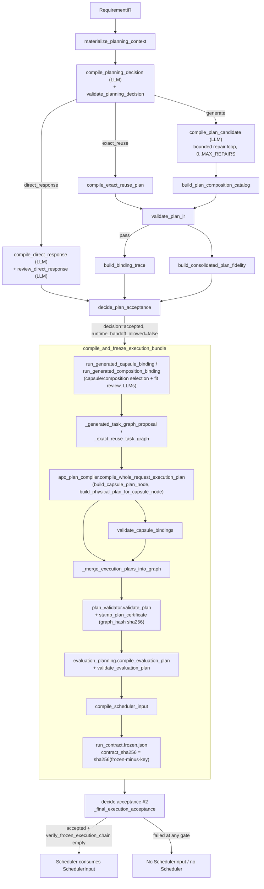

# Stage 4 — Elastic Planner and the Freeze

Repo: `/home/muk/work/AI4Research`, branch `openJiuwen-Solar`, HEAD `b0bf165f9`.
All line numbers refer to files at that commit. `[VERIFIED]` = read directly
in source; `[DOC-CLAIM]` = asserted only in a metadata/log file, not re-derived
from code; `[INFERRED]` = my synthesis across multiple verified facts.

## Summary

- The Elastic Planner (`harness/lib/elastic_planner.py`, ~8100 lines) is a
  single module that owns **both** semantic plan admission (LLM decision →
  PlanIR → deterministic validation → advisory fidelity review → binding
  trace) **and** the physical freeze (capsule binding → physical operator
  ranking → Solar Plan Validator → evaluation contract → `SchedulerInput` →
  `run_contract.frozen.json`). Nothing downstream may re-author these
  artifacts. `[VERIFIED]`
- Two module-level entry points matter most: `run_semantic_planning_pipeline`
  (semantic side, ends in `plan_acceptance.json` with
  `runtime_handoff_allowed: false`) and `compile_and_freeze_execution_bundle`
  (physical side, ends in `run_contract.frozen.json` with a
  `contract_sha256` and a second `plan_acceptance.json` where
  `runtime_handoff_allowed` can become `true`). `run_elastic_planning_request`
  chains the two and short-circuits on `direct_response`. `[VERIFIED]`
  (`elastic_planner.py:7547-7605`)
- **The freeze is a Merkle-like reference chain, not a lock file or file
  permission.** Every artifact after `PlanIR` embeds a `{"...": "...",
  "sha256": sha256_payload(previous_artifact)}` reference to the artifact(s)
  it was computed from, using canonical (`sort_keys=True`,
  `separators=(",",":")`) JSON + SHA-256
  (`intent_compiler.canonical_bytes`/`sha256_payload`,
  `elastic_planner.py:28`, used pervasively). The top-level
  `run_contract.frozen.json` itself carries `contract_sha256 =
  sha256_payload(frozen-minus-that-key)`. A separate function,
  `verify_frozen_execution_chain` (`elastic_planner.py:7748-8052`), **recomputes
  every one of these hashes and even recompiles `scheduler_input` and
  `evaluation_plan_validation` from scratch** and diffs the result against
  what's on disk — this is what "verifies the hash chain before runtime
  projection." `[VERIFIED]`
- `static_execution_compiler.compile_bundle` is a **standalone, unused-in-pipeline
  CLI tool** (only referenced by its own `main()`; grep across `harness/`
  found no caller in the production pipeline). Project docs
  (`harness/metadata/NEW-MACHINE-START-HERE.md:54-55`) explicitly warn: the
  Elastic Planner **now does the freeze compile internally**, and calling
  `static_execution_compiler.compile_bundle` afterward would be "a second
  authoritative compile" — i.e. it is legacy/parallel machinery that must not
  be re-invoked once `compile_and_freeze_execution_bundle` exists.
  `[VERIFIED + DOC-CLAIM]`
- The last recorded full E2E run (2026-08-31,
  `harness/metadata/migration-handoff-20260831.md`) **FAILED before reaching
  the Scheduler**: the Planner's `generate` decision produced a PlanIR
  generation call that the model provider rejected with HTTP 400
  `invalid_json_schema` ("Missing 'cpu_cores_min'") because
  `plan-ir.semantic.structured.v2.schema.json`'s `operator_requirements`
  sub-schema lists `cpu_cores_min`/`memory_mb_min`/`gpu_required` as
  *optional* properties but the OpenAI/Codex structured-output contract
  requires every declared property to appear in `required`. No PlanIR,
  SchedulerInput, frozen bundle, Scheduler tick, worker, or report was ever
  produced for that run. `[DOC-CLAIM, corroborated by schema inspection]`

## Diagram: plan → validate → bind → freeze



## Detailed findings

### Q1. Full sequence inside `run_elastic_planning_request`

`run_elastic_planning_request` (`elastic_planner.py:7547-7605`) does exactly two
calls:

1. `semantic = run_semantic_planning_pipeline(...)` (`:3812-4211`) — semantic
   admission only.
2. If `semantic.plan_acceptance.decision == "direct_response"` → return
   immediately, `execution: None`. If not `"accepted"` → return failed,
   `execution: None`. Otherwise call
   `execution = compile_and_freeze_execution_bundle(...)` (`:6888-7429`).
3. `verification_errors = verify_frozen_execution_chain(semantic_dir,
   execution_dir)` is always run afterward, and `accepted` requires **both**
   `execution.plan_acceptance.decision == "accepted"` **and** an empty
   verification-errors list (`:7596-7599`).

Inside `run_semantic_planning_pipeline` the sequence is:

1. `materialize_planning_context` — snapshots/canonicalizes upstream
   artifacts into `planning_context.json` + copies files under `output_dir`.
2. `compile_planning_decision` (LLM call) then `validate_planning_decision`
   (deterministic) — up to 2 generations (`decision_generation in (0,1)`),
   with one repair pass if all errors are `repairable: true` (`:3848-3898`).
3. Branch on `decision.decision`:
   - `direct_response` → `compile_direct_response` (LLM) +
     `review_direct_response` (LLM, independent reviewer) in a
     generation-0/1 loop (`:3914-3958`).
   - `exact_reuse` → `compile_exact_reuse_plan` (deterministic projection of a
     registered workflow, no LLM) → `validate_plan_ir` → (if pass)
     `build_binding_trace` → `build_consolidated_plan_fidelity`. A rejected
     registered workflow cannot be repaired; the code instead re-asks the
     strategy LLM once more with the rejection as a defect and, if it now
     picks `generate`, falls through to the generate branch (`:3983-4032`).
   - `generate` → bounded repair loop `for generation in range(MAX_REPAIRS +
     1)` (`:4051-4150`): `compile_plan_candidate` (LLM) →
     `build_plan_composition_catalog` (deterministic) → `validate_plan_ir`
     (deterministic) → if `validation.status == "pass"`: `build_binding_trace`
     — → `build_consolidated_plan_fidelity` (LLM-based fidelity reviewer,
     advisory) → if validation passed, also
     `run_generated_composition_binding` right here (pre-validating capsule
     binding *during* DAG repair, `maximum_repairs=0`) so that DAG repair can
     react to `CAPABILITY_IMPLEMENTATION_MISMATCH` feedback (`:4123-4148`).
4. `decide_plan_acceptance` (`:3721-3809`) computes the final semantic
   `outcome` (`direct_response` / `accepted` / `requirements_gap` / `failed`)
   from all of the above, and always sets `runtime_handoff_allowed: false` —
   literal comment: "This is semantic admission only. Runtime authority is
   granted later..." (`:3803-3806`).

### Q2. `direct_response`

`direct_response` is one of three values planning_decision.decision may take
(`MVP_DECISIONS = {"direct_response","exact_reuse","generate"}`,
`elastic_planner.py:86`). The Planner LLM chooses it when the RequirementIR
can be answered from already-admitted context with **no execution, retrieval,
or external effect** — `compile_direct_response`'s prompt instruction says
verbatim: "Answer the accepted RequirementIR directly. Do not claim execution,
retrieval, or external effects." (`:1187-1193`).

Representation: a `solar.direct_response.v1` artifact
(`direct-response.v1.schema.json`) with `response_id`, `requirement_ir_ref`,
`planning_decision_ref`, a `producer` block naming the planner model, plus the
LLM body (which must cover every `requirement_id` exactly once — checked by
raising `ElasticPlannerError` on mismatch, `:1214-1219`). It is independently
reviewed by `review_direct_response` (a **different** reviewer model) against
three named checks (`requirement_coverage`, `answer_fidelity`,
`factual_restraint`) producing `direct-response-review.v1`, which must fail
loudly if any check fails without a typed error (`:1285-1286`).

When `decide_plan_acceptance` sees `decision.decision == "direct_response"`
and the review's status isn't `"fail"`, `outcome = "direct_response"`
(`:3744-3751`). `run_elastic_planning_request` then returns
`{"status": "direct_response", "execution": None, ...}` — **no capsule
binding, no physical plan, no SchedulerInput, no Scheduler/worker involvement
at all** (`:7570-7577`).

### Q3. What `compile_and_freeze_execution_bundle` produces

Full artifact set written to `execution_dir` (`elastic_planner.py:6888-7429`),
in production order:

1. **Capsule binding artifacts** (mode-dependent — `direct_capsule` via
   `run_generated_capsule_binding`, or `capsule_composition` via
   `run_generated_composition_binding`, or the pre-validated binding computed
   during DAG repair reused as-is): `capsule_candidate_catalog.json` /
   `capsule_selection.json` / `capsule_selection_validation.json` /
   `capsule_fit_review.json` (direct mode), or
   `plan_composition_catalog.json` / `composition_selection.json` /
   `composition_selection_validation.json` / `composition_fit_review.json` /
   `artifact_type_registry.snapshot.json` /
   `artifact_conversion_registry.snapshot.json` (composition mode).
2. **`capsule_plan.json`** (schema `capsule-plan.v1`) — from
   `apo_plan_compiler.compile_whole_request_execution_plan` →
   `build_capsule_plan_ir`: per-node capsule identity (`capability_capsule_id`,
   `stages` for guard/resource/capability/verifier, `selected_skills`,
   `effect_union`, `proof_obligations`, `artifact_types`), plus top-level
   `unsatisfiable_nodes` and `verdict`.
3. **`capsule_binding_validation.json`** — from `validate_capsule_bindings`
   (`elastic_planner.py:6361-6429`); must have `status == "pass"`.
4. **`physical_plan.json`** (schema `physical-plan.v2`) — per node,
   `execution_candidates` (ranked operator IDs with score breakdown) plus
   `availability_boundary`, `unsatisfiable_nodes`, `verdict`.
5. **`task_graph.contract.json`** — `merged =
   _merge_execution_plans_into_graph(graph, capsule_plan, physical_plan)`,
   then validated by `plan_validator.validate_plan` against the capsule/
   operator registries and the workflow contract, then **stamped** with
   `plan_validator.stamp_plan_certificate` which writes a `plan_certificate`
   block (`{schema, validator, verdict: "PASS", graph_hash, validated_at}`)
   onto the graph itself.
6. **`evaluation_check_registry.snapshot.json`**,
   **`evaluation_plan.json`** (schema `evaluation-plan.v1`),
   **`evaluation_plan_validation.json`** — from
   `evaluation_planning.compile_evaluation_plan` /
   `validate_evaluation_plan`; both must show `verdict`/`status == "pass"`.
7. **`scheduler_input.json`** (schema `scheduler-input.v1`) — from
   `compile_scheduler_input(merged, capsule_plan, physical_plan,
   evaluation_contract, ...)`; validated against `SCHEDULER_INPUT_SCHEMA`,
   then `check_live_definitions` cross-checks it against the *live*
   capsule/physical-operator registries before it's ever written
   (`elastic_planner.py:7239-7242`).
8. **`run_contract.frozen.json`** (schema `run-contract-frozen.v2`) — the
   final artifact; see Q4.
9. **`plan_acceptance.json`** (second one, execution-stage) — from
   `_final_execution_acceptance`, with `decision` in
   `{"accepted","failed"}` and `runtime_handoff_allowed` becoming `True` only
   on full success.

Any deterministic gate failing along the way (`execution.verdict != "pass"`,
`binding_validation.status != "pass"`, plan-validator errors, evaluation
contract/validation failing) **returns early** with `run_contract_frozen:
None` and a `"failed"` `plan_acceptance.json` — the freeze artifact is
produced only at the very end, atomically, after every prior gate passed
(`:7067-7226`).

### Q4. THE FREEZE — mechanism, precisely

**What is hashed and how.** All hashing goes through
`intent_compiler.sha256_payload` (imported into `elastic_planner.py:28`):

```python
def canonical_bytes(payload):
    return (json.dumps(payload, ensure_ascii=False, sort_keys=True,
                        separators=(",", ":")) + "\n").encode("utf-8")

def sha256_payload(payload):
    return hashlib.sha256(canonical_bytes(payload)).hexdigest()
```

This is plain SHA-256 over canonical JSON (sorted keys, no whitespace, exact
byte serialization) — a deterministic content hash, not a cryptographic
signature (no key, no HMAC). `[VERIFIED]`

**What gets a ref.** Every artifact from `planning_decision.json` onward
carries a `*_ref: {..._id, "sha256": sha256_payload(<the referenced
artifact>)}` object pointing at the artifact(s) it was derived from. Examples
verified directly in code:
- `planning_decision.requirement_ir_ref.sha256` / `.planning_context_ref.sha256`
- `plan_acceptance.refs.{requirement_ir, planning_context, planning_decision,
  plan_ir, plan_validation, plan_fidelity, binding_trace, direct_response,
  direct_response_review, run_contract_frozen, capsule_binding_validation,
  evaluation_check_registry, evaluation_plan, evaluation_plan_validation, ...}`
- `run_contract.frozen.json` itself carries `requirement_ir_ref`,
  `planning_decision_ref`, `plan_ir_ref`, one of
  `{capsule_*_ref}`/`{composition_*_ref}` depending on binding mode,
  `capsule_plan_ref`, `capsule_binding_validation_ref`, `physical_plan_ref`,
  `evaluation_check_registry_ref`, `evaluation_plan_ref`,
  `evaluation_plan_validation_ref`, `scheduler_input_ref`, and a copy of the
  graph's `plan_certificate` (`elastic_planner.py:7243-7345`).

**The self-hash / seal.** The frozen contract is built as a plain dict, then:

```python
frozen["contract_sha256"] = sha256_payload(frozen)   # hash BEFORE adding this key
_assert_schema(frozen, FROZEN_CONTRACT_SCHEMA, "run_contract_frozen")
write_json(output_dir / "run_contract.frozen.json", frozen)
```
(`elastic_planner.py:7345-7347`) — `sha256_payload(frozen)` is computed on the
dict *before* `contract_sha256` is inserted, so `contract_sha256` is a hash of
everything else in the file: sprint id, all the `*_ref` hash pointers, and the
`plan_certificate`. This is the literal "seal": once written, any change to
any upstream artifact changes that artifact's own hash, which breaks the ref
in something downstream, which (transitively, because every artifact chains
to the next) breaks `contract_sha256` itself.

**What verifies the chain before runtime projection.**
`verify_frozen_execution_chain(semantic_dir, execution_dir)`
(`elastic_planner.py:7748-8052`) is the enforcement code, and it is
exhaustive, not spot-checking:
- Calls `verify_semantic_planning_chain(semantic_dir)` first (re-derives the
  catalog's own `catalog_sha256`, and every `plan_acceptance.refs.*`
  hash/id pair against the actual file on disk).
- Requires all ten frozen-stage files to exist (`capsule_plan`,
  `capsule_binding_validation`, `physical_plan`,
  `evaluation_check_registry.snapshot`, `evaluation_plan`,
  `evaluation_plan_validation`, `scheduler_input`, `task_graph.contract`,
  `run_contract.frozen`, `plan_acceptance`).
- For the binding-mode-specific artifacts (direct-capsule or composition), it
  **recomputes** `validate_composition_selection` from scratch and requires
  the result to equal byte-for-byte (`recomputed != composition_validation`
  → error) — i.e. it doesn't trust the stored verdict, it re-derives it.
- `physical.capsule_plan_ref` and `binding_validation.capsule_plan_ref` must
  both hash-match the actual `capsule_plan.json`, and
  `binding_validation.status` must be `"pass"`.
- Re-loads the evaluation check registry and compares it byte-for-byte to the
  snapshot (`evaluation_registry.snapshot_mismatch`); re-runs
  `evaluation_planning.validate_evaluation_plan` and requires equality with
  the stored result (`evaluation_plan_validation.recomputed_mismatch`).
- **Recompiles `scheduler_input` from scratch** via `compile_scheduler_input`
  and diffs it against the frozen one (with one narrow, explicitly-commented
  backward-compatibility carve-out for historical runs missing
  `execution_authority`/`minimum_context_tokens`) —
  `scheduler_input.recomputed_mismatch` (`:7930-7951`).
- Re-derives `contract_sha256` the same way it was produced
  (`sha256_payload(frozen-minus-that-key)`) and compares
  (`frozen.contract_sha256.hash_mismatch`, `:7987-7990`).
- Calls `plan_validator.check_plan_certificate(graph)` to re-derive
  `plan_certificate_hash` (governed subset: sprint id + workflow contract
  identity/version + per-node canonical executable-node projection,
  explicitly **excluding runtime/dispatch fields** so dispatch cannot
  self-invalidate its own certificate — `plan_validator.py:708-711`) and
  compares against the stamped verdict.
- Finally requires `acceptance.decision == "accepted"` **and**
  `acceptance.runtime_handoff_allowed` truthy
  (`acceptance.runtime_handoff_not_allowed`, `:8048-8051`) — this is the one
  gate that literally authorizes the Scheduler to consume the bundle.

`run_elastic_planning_request` treats **any single entry** in this error list
as a hard failure of the whole request (`accepted = ... and not
verification_errors`, `:7596-7599`) — there is no partial/soft acceptance of
a frozen bundle.

### Q5. Capsule selection/binding — logical operator → capability capsule → physical operator

Binding happens in two layers, both inside `apo_plan_compiler.py`:

**Layer 1 — logical → capsule (`build_capsule_plan_node`,
`apo_plan_compiler.py:569-837`).** For each PlanIR node:
- If the node already declares `capability_capsule_id` (planner-declared),
  that identity is trusted as-is (comment: "A certified planner node has
  already selected its admitted capsule ... Re-classifying the goal here can
  silently replace that identity with a different default capsule" —
  `:589-596`), *except* the generic skill-execution bridge capsule, which
  requires at least one selected skill or falls back to the logical
  operator's governed default.
- Otherwise `default_capability_plan_for_logical_operator(...)` picks one.
- If no capsule resolves at all, or the declared capsule isn't in the
  registry, the node comes back `"selected": False` with a typed
  `"unsatisfiable": {"code": "UNSATISFIABLE_CAPSULE", ...}` block
  (`:617-649`) — this is the origin of `unsatisfiable_nodes` (Q6).
- The resolved capsule manifest's `bindings.required_guard_capsules` /
  `required_resource_capsules` become extra pipeline **stages** (guard,
  resource, capability, verifier), each carrying its own
  `operator_constraints` (from `manifest.get("operator_compatibility")`),
  `artifact_types`, `effect_profile`, `proof_obligations`.
- `_operator_constraints_for_logical_operator` (`:172-190`) merges the
  capsule's declared `operator_compatibility` with a hard-coded
  `SCIENTIFIC_PHYSICAL_BY_LOGICAL_OPERATOR` exact-operator preference table,
  but an explicit `preferred` list on the capsule always wins over the
  logical-operator default.

**Layer 2 — capsule → physical operator
(`enumerate_physical_candidate_decisions`, `:962-1102`).** For every operator
in the physical-operator registry, the function builds an `excluded` /
`candidates` split:
- `forbidden_ops = set(constraints.get("forbidden", []) or [])`; any operator
  id in that set is excluded with reason `"CAPSULE_FORBIDDEN"`
  (`:983, 1002-1003`) — this is `operator_compatibility.forbidden`
  enforcement, verified directly.
- Trust-class rank: `operator_trust = spec.get("execution_trust")` must be
  one of `PHYSICAL_EXECUTION_TRUST_CLASSES`; if
  `required_execution_trust != "unspecified"` and it doesn't equal the
  operator's trust class, reason `"EXECUTION_TRUST_UNSATISFIED"`
  (`:990-999`). `required_execution_trust` comes from the capsule manifest's
  `implementation.trust_class`, threaded through the capability stage
  (`build_capsule_plan_node:726-729`) into
  `build_physical_plan_for_capsule_node` → `enumerate_physical_candidates`.
  There is no numeric "rank ordering" of trust classes beyond exact-match
  gating — trust class is a hard filter, not a soft score. `[VERIFIED]`
- Remaining candidates are scored (`priority`/`score_breakdown`: backend
  fit, task-class fit, logical-operator/role preference, explicit
  `capsule_preference` = 20, `default_profile_fit`), sorted descending by
  priority then operator id, and assigned `rank` 1..N (`:1053-1100`).
- The physical plan's `execution_candidates` list is the **ranked candidate
  list**, not a single choice — the Scheduler (out of scope here) is what
  actually attempts candidates in rank order at dispatch time.

### Q6. `unsatisfiable_nodes`, `effect_union`, `proof_obligations` in capsule-plan.v1

- **`unsatisfiable_nodes`** is built in `build_capsule_plan_ir`
  (`apo_plan_compiler.py:856-863`): every node where `not
  bool(node.get("selected"))` is projected into `{"node_id": ...,
  **node["unsatisfiable"]}`. `unsatisfiable` itself is populated at the two
  early-return points in `build_capsule_plan_node` (no matching capsule /
  capsule not registered — `:617-649`) with a typed `code` (currently only
  `UNSATISFIABLE_CAPSULE` observed in this module) and `message`. The
  top-level `verdict` is `"fail"` if that list is non-empty (`:893`).
  Physical-layer unsatisfiability is a second, parallel notion:
  `build_physical_plan_ir` (`:1192-1259`) also emits `unsatisfiable_nodes`,
  one entry per node whose capsule wasn't selected **or** whose physical
  candidate enumeration came back empty.
- **`effect_union`** = `_union_effect_profiles([stage.effect_profile for
  stage in stages])` per node (`:770`), then unioned again across all nodes
  at the plan level (`:884`). `_union_effect_profiles` (`:254-259`)
  concatenates each of the fixed `EFFECT_KEYS` across every stage's
  `effect_profile` and de-duplicates (`_dedupe`). A stage's `effect_profile`
  comes from `_capsule_type_bundle` → `_effect_profile(manifest's declared
  effects)` (`:247-252`) — i.e. it is a deterministic union of the effect
  vocabularies declared on every capsule manifest actually bound into the
  node (guard + resource + capability + verifier), **not** LLM-authored.
- **`proof_obligations`** likewise accumulate per-stage
  (`_proof_obligations(manifest)`, `:262-311`, not fully read in depth but
  invoked identically to `_effect_profile`) and are concatenated (not
  deduplicated by identity, only structurally per stage) across stages into
  the node's `proof_obligations`, then concatenated again across all nodes
  at the plan level (`:885-890`). Both fields are therefore **deterministic
  derivations from static capsule manifests**, computed by
  `apo_plan_compiler.py`, not emitted directly by the model.

### Q7. Repair budgets and bounded limits

- `MAX_REPAIRS` (`elastic_planner.py:89-100`):
  ```python
  def _configured_max_repairs() -> int:
      raw = str(os.environ.get("SOLAR_PLANNER_MAX_REPAIRS") or "").strip()
      try:
          value = int(raw) if raw else 1
      except ValueError:
          value = 1
      return max(0, min(value, 4))
  MAX_REPAIRS = _configured_max_repairs()
  ```
  Default **1** repair, hard-clamped to the range **[0, 4]** regardless of the
  env var value. This single constant governs:
  - the `generate` PlanIR loop: `for generation in range(MAX_REPAIRS + 1)`
    (`:4051`), i.e. up to `MAX_REPAIRS+1` total generation attempts;
  - the strategy-decision repair (only one extra generation is ever attempted
    regardless of `MAX_REPAIRS`, hard-coded `for decision_generation in (0,
    1)` — `:3848`, but the record it writes still reports
    `"maximum_repairs": MAX_REPAIRS`);
  - the direct-response repair loop (`for generation in (0, 1)` at `:3914`,
    same shape);
  - `run_generated_composition_binding`/`run_generated_capsule_binding`
    accept an explicit `maximum_repairs` argument; when called from within
    DAG repair it is forced to `maximum_repairs=0` (`:4134`) so pre-validation
    during DAG repair cannot itself recurse into further repair.
  - `plan_acceptance.repair = {"attempted": bool, "maximum_attempts":
    MAX_REPAIRS}` is recorded on every acceptance artifact (`:3800`,
    `elastic_planner.py`).
- Repair is only attempted when **all** reported defects are individually
  marked `repairable: True` (`:3878-3880` for strategy decision;
  `_repairable_errors` filters similarly for PlanIR/fidelity/direct-response
  defects) — a single non-repairable error terminates the loop immediately
  rather than retrying.
- Evaluation-budget / rapid-smoke-mode bounding is a **separate** mechanism
  (`evaluation_budget.apply_evaluation_budget`, applied to the task graph
  after binding, `:6916-6921` and `:7046-7050`) — not part of `MAX_REPAIRS`,
  scoped only when `test_policy.mode == evaluation_budget.RAPID_SMOKE_MODE`.

### Q8. `binding-trace.v2` purpose

`build_binding_trace` (`elastic_planner.py:3411-3453`) produces, for every
requirement in the RequirementIR, the set of PlanIR node ids that claim it
(`owners`), the artifact types those nodes actually `produce` **whose
declared `verifier_ids` include the requirement's expected verifier**
(`artifacts`), and the matching `verifiers`. Any requirement id that ends up
with an empty owners/artifacts/verifiers triple is listed under `uncovered`,
and the artifact's `verdict` is `"fail"` if `uncovered` is non-empty. This is
exactly the auditability object described in the prompt: it proves, per
requirement, *which* node was trusted to satisfy it, *which* artifact type
satisfies it, and *which* verifier is attached — and it is a hard gate:
`decide_plan_acceptance` refuses to accept the plan
(`"One or more requirements lack a truthful owner/artifact/verifier
binding."`) if `binding_trace.verdict != "pass"` (`:3765-3766`). Note this is
the **semantic** binding trace (requirement → PlanIR node), distinct from —
and produced earlier than — the physical capsule/operator binding artifacts
(`capsule_selection`/`composition_selection`, `capsule_fit_review`) that
justify *which capsule and operator* fulfil each node in the freeze stage.

### Q9. Known bugs / limitations — the E2E failure

Evidence trail:

- `harness/metadata/pre-scheduler-stabilization-log-20260829.md`: a table of
  prior issues fixed on the path to a working Planner (e.g. row 3: stale
  `Path.home()` default paths broke Requirement→Planner handoff; row 4: a
  scope-preservation bug in `_preserve_discovery_requirement_scope()` caused
  a Planner-removed requirement to be silently reinstated, failing
  independent fidelity review). Ends: "Pre-E2E identity: ... Offline results
  do not establish a live E2E PASS." `[DOC-CLAIM]`
- `harness/metadata/migration-handoff-20260831.md` (§1, §2) is the record of
  the **last** full E2E attempt, `sprint-20260831-070119-...`:
  - Line 13 (translated): "Intent passed on the first try. Requirement used
    the shared contract v2... total four Requirement model calls, passed.
    **Planner decision was `generate`; the DAG-generation model call was
    rejected by the model interface.** Final state: `failed` /
    `planning_failed`. No SchedulerInput, frozen execution bundle,
    Scheduler, worker, or report was produced."
  - §2 "Current unresolved blocker: Planner provider schema" gives concrete
    evidence: the actual wire schema sent to the model,
    `planning/semantic/generation-0/plan_call/model_output.schema.json`,
    has `$defs/operator_requirements/properties` containing
    `cpu_cores_min`, `memory_mb_min`, `gpu_required` — but its `required`
    array does **not** include them. The provider (Codex/OpenAI-style
    structured output) returned HTTP 400 `invalid_json_schema`, explicitly:
    `Missing 'cpu_cores_min'`. No PlanIR was ever generated. It names the
    root schema (`harness/schemas/planning/plan-ir.semantic.structured.v2.schema.json`)
    and the adapter function
    (`harness/lib/intent_compiler.py::codex_compatible_schema`) as not yet
    handling this optional-property-vs-provider-strict-schema mismatch. It
    explicitly states this is a **model-call contract compatibility
    defect**, not model degradation, a stale Requirement, insufficient
    resources, or service capacity, and that offline JSON-Schema validity
    checks did not cover the provider's narrower constraint. `[DOC-CLAIM]`

  This means: **"Planner model output schema admission" failed at the very
  first LLM call inside the `generate` branch** (`compile_plan_candidate`'s
  `model.generate(...)` call against `PLAN_BODY_SCHEMA` /
  `plan-ir.semantic.structured.v2.schema.json`, projected through
  `codex_compatible_schema` = `project_schema(schema, "openai")`) — before
  any PlanIR, capsule binding, physical plan, evaluation contract, or
  SchedulerInput could exist. The freeze machinery, the Scheduler, and every
  downstream stage were never reached in that run.

- **Cross-check against current code** (`[VERIFIED]`, this session): reading
  `harness/lib/structured_output.py:104-105` today shows:
  ```python
  out["required"] = list(out["properties"]) if profile == "openai" else list(required)
  ```
  i.e. for `profile == "openai"` the projector **currently** forces every
  property (including `cpu_cores_min`/`memory_mb_min`/`gpu_required`) into
  `required` on the wire schema, which is exactly the fix the migration-
  handoff doc says is still outstanding. Whether this line was the fix
  applied after 2026-08-31, or whether the 2026-08-31 failure happened via a
  different code path/cached schema than this projector, could not be
  determined from static reading alone — flagged as an **open question**
  below rather than asserted as resolved.

## Artifact reference table

| Artifact (file) | Schema | Contents (high level) | Produced by |
|---|---|---|---|
| `planning_context.json` | `planning-context.v1` | Canonicalized snapshot of upstream artifacts + provenance | `materialize_planning_context` |
| `planning_catalog_snapshot.json` | `planning-catalog-snapshot.v1` | Snapshot of logical operators, workflows, capsules, `catalog_sha256` self-hash | `build_planning_catalog_snapshot` |
| `planning_decision.json` | `planning-decision.v1` (body: `.semantic.v1`) | `decision ∈ {direct_response, exact_reuse, generate}`, refs to RequirementIR/context | `compile_planning_decision` (LLM) + `validate_planning_decision` |
| `direct_response.json` / `direct_response_review.json` | `direct-response.v1` / `direct-response-review.v1` | Direct answer body + independent review (3 named checks) | `compile_direct_response` / `review_direct_response` (LLMs) |
| `plan_ir.json` | `plan-ir.v2` (body: `.semantic.v2`/`.semantic.structured.v2`) | Node graph: logical_operator, depends_on, consumes/produces, `operator_requirements`, `requirement_ids`, `retrieval_contract_ref` | `compile_plan_candidate` (LLM, `generate`) or `compile_exact_reuse_plan` (deterministic) |
| `plan_composition_catalog.json` | `plan-composition-catalog.v1` | Candidate composition rows per node vs. artifact type/conversion registries | `build_plan_composition_catalog` |
| `plan_validation.json` | `plan-validation.v2` | Deterministic pass/fail + typed errors against RequirementIR/catalog | `validate_plan_ir` |
| `plan_fidelity.json` | `plan-fidelity.v1` (review body `.review.v1`) | Advisory LLM review of plan fidelity to requirements | `build_consolidated_plan_fidelity` / `review_plan_fidelity` |
| `binding_trace.json` | `binding-trace.v2` | Requirement → {owners, artifacts, verifiers}, `uncovered`, `verdict` | `build_binding_trace` |
| `plan_acceptance.json` (semantic) | `plan-acceptance.v1` | `decision`, `refs` (hash pointers to every artifact above), `runtime_handoff_allowed: false` | `decide_plan_acceptance` |
| `capsule_candidate_catalog.json` / `capsule_selection*.json` / `capsule_fit_review.json` | `capsule-candidate-catalog.v1`, `capsule-selection*.v1`, `capsule-fit-review.v1` | Direct-capsule binding mode: candidates, LLM selection, deterministic validation, independent fit review | `run_generated_capsule_binding` |
| `composition_selection*.json` / `composition_fit_review.json` | `composition-selection*.v1`, `capsule-fit-review.v1` | Composition binding mode equivalent | `run_generated_composition_binding` |
| `capsule_plan.json` | `capsule-plan.v1` | Per-node capsule stages, `effect_union`, `proof_obligations`, `unsatisfiable_nodes`, `verdict` | `apo_plan_compiler.build_capsule_plan_ir`/`build_capsule_plan_node` |
| `capsule_binding_validation.json` | `capsule-binding-validation.v1` | Deterministic pass/fail on capsule bindings | `validate_capsule_bindings` |
| `physical_plan.json` | `physical-plan.v2` | Ranked `execution_candidates` per node, `unsatisfiable_nodes`, `verdict` | `apo_plan_compiler.build_physical_plan_ir`/`enumerate_physical_candidate_decisions` |
| `task_graph.contract.json` | (workflow contract schema, not in `planning/`) | Merged executable graph + `plan_certificate` (graph_hash) | `_merge_execution_plans_into_graph` + `plan_validator.validate_plan`/`stamp_plan_certificate` |
| `evaluation_check_registry.snapshot.json` | `evaluation-check-registry.v1` | Snapshot of the global evaluation-check catalog | `evaluation_planning.load_evaluation_check_registry` |
| `evaluation_plan.json` | `evaluation-plan.v1` | Per-node evaluation contract, `verdict` | `evaluation_planning.compile_evaluation_plan` |
| `evaluation_plan_validation.json` | `evaluation-plan-validation.v1` | Deterministic re-check of the evaluation plan | `evaluation_planning.validate_evaluation_plan` |
| `scheduler_input.json` | `scheduler-input.v1` | `graph` (nodes with resource_requirements, workspace authority, output routes), `workspace_authority_ref`, `test_policy` | `compile_scheduler_input` |
| `run_contract.frozen.json` | `run-contract-frozen.v2` | All of the above by `sha256` ref + `plan_certificate` + self `contract_sha256` | `compile_and_freeze_execution_bundle` (inline) |
| `plan_acceptance.json` (execution) | `plan-acceptance.v1` | Final `decision`, `runtime_handoff_allowed` (true only on full pass) | `_final_execution_acceptance` |

## The freeze mechanism, step by step

1. Every artifact from `planning_decision.json` on is written with a
   `*_ref: {id, sha256}` pointer to its inputs, using
   `sha256_payload = sha256(canonical_json(payload))`.
2. `compile_and_freeze_execution_bundle` runs a strict linear gate sequence
   (capsule binding admitted → capsule_plan/physical_plan schema-valid and
   `verdict == pass` → `validate_capsule_bindings.status == pass` →
   `plan_validator.validate_plan` zero errors → `stamp_plan_certificate`
   (writes `graph_hash` onto the graph) → evaluation contract compiled and
   both `verdict`/`status == pass` → `compile_scheduler_input` schema-valid
   and cross-checked against live registries via `check_live_definitions`).
   Any failure returns early with `run_contract_frozen: None`.
3. Only if every gate passes does the function assemble the `frozen` dict
   with references to every prior artifact's hash, then compute
   `frozen["contract_sha256"] = sha256_payload(frozen)` (hashing the dict
   **before** that key exists), validate it against
   `run-contract-frozen.v2.schema.json`, and write
   `run_contract.frozen.json`.
4. Independently of the write, `verify_frozen_execution_chain` — always
   invoked by `run_elastic_planning_request` right after — reloads every
   file from disk, **recomputes** (not merely re-hashes) the composition
   validation, evaluation-plan validation, `scheduler_input`, and the
   `contract_sha256`/`plan_certificate` hashes, and appends an error string
   for every discrepancy found. An empty return list is the only condition
   under which the run is reported `"accepted"`.
5. `plan_acceptance.runtime_handoff_allowed` is the single boolean flag a
   Scheduler-side caller should gate on, but note it is set `True` inside
   `_final_execution_acceptance` *before* `verify_frozen_execution_chain`
   runs — `run_elastic_planning_request` is what actually combines both
   (`accepted = plan_acceptance.decision == "accepted" and not
   verification_errors`, `:7596-7599`). Nothing in the reviewed code shows
   the Scheduler itself re-running `verify_frozen_execution_chain`; that
   check is asserted at planner-completion time, not necessarily
   re-asserted at Scheduler intake (**gap noted below**).

## Key code references

- `harness/lib/elastic_planner.py:89-100` — `MAX_REPAIRS` bound `[0,4]`, default 1.
- `harness/lib/elastic_planner.py:3812-4211` — `run_semantic_planning_pipeline`.
- `harness/lib/elastic_planner.py:6888-7429` — `compile_and_freeze_execution_bundle`.
- `harness/lib/elastic_planner.py:7243-7347` — frozen contract assembly + `contract_sha256`.
- `harness/lib/elastic_planner.py:7547-7605` — `run_elastic_planning_request`.
- `harness/lib/elastic_planner.py:7748-8052` — `verify_frozen_execution_chain`.
- `harness/lib/elastic_planner.py:3411-3453` — `build_binding_trace`.
- `harness/lib/elastic_planner.py:1176-1309` — `compile_direct_response`/`review_direct_response`.
- `harness/lib/apo_plan_compiler.py:569-894` — `build_capsule_plan_node`/`build_capsule_plan_ir` (effect_union, proof_obligations, unsatisfiable_nodes).
- `harness/lib/apo_plan_compiler.py:962-1102` — `enumerate_physical_candidate_decisions` (forbidden/trust-class enforcement).
- `harness/lib/plan_validator.py:708-808` — `plan_certificate_hash`/`stamp_plan_certificate`.
- `harness/lib/intent_compiler.py:62-67` — `canonical_bytes`/`sha256_payload`.
- `harness/lib/structured_output.py:35-105` — `project_schema` (provider wire-schema projection; line 104-105 forces `required = all properties` for `openai` profile).
- `harness/lib/static_execution_compiler.py:1-48,329-` — standalone `compile_bundle` CLI, not called from the pipeline.
- `harness/metadata/NEW-MACHINE-START-HERE.md:54-56` — explicit warning against calling `static_execution_compiler.compile_bundle` as a second authoritative compile.
- `harness/metadata/migration-handoff-20260831.md:1-24` — last E2E FAIL record and root cause.

## Notable code quotes

> "This is semantic admission only. Runtime authority is granted later, after
> capsule binding, whole-request physical feasibility, Solar plan validation,
> and the content-hashed run-contract freeze all succeed."
> — `elastic_planner.py`, inline comment above `runtime_handoff_allowed:
> False` in `decide_plan_acceptance`.

> "sha256 over the governed subset — contract identity + per-node policy
> fields. Runtime fields (status/pane/dispatch_id/...) are excluded so
> dispatch cannot invalidate its own certificate."
> — `plan_validator.py`, docstring of `plan_certificate_hash`.

> "The Elastic Planner owns semantic topology (PlanIR). This module performs
> the deterministic work that follows it... No runtime availability, lease,
> attempt, or selected-operator state is written here."
> — `static_execution_compiler.py`, module docstring (describes what the
> module *would* do if still in the pipeline — it currently is not called).

> "当前 Elastic Planner **内部**完成冻结编译；不要再顺手调用
> `static_execution_compiler.compile_bundle` 进行第二次权威编译。"
> ("The current Elastic Planner completes the freeze compile *internally*;
> do not casually call `static_execution_compiler.compile_bundle` for a
> second authoritative compile.")
> — `harness/metadata/NEW-MACHINE-START-HERE.md:54-55`.

> "Planner 决策为 generate，DAG 生成调用被模型接口拒绝。最终状态
> failed/planning_failed；没有 SchedulerInput、冻结执行包、Scheduler、worker
> 或报告。"
> ("Planner decision was generate; the DAG-generation model call was
> rejected by the model interface. Final state failed/planning_failed; no
> SchedulerInput, frozen execution bundle, Scheduler, worker, or report.")
> — `harness/metadata/migration-handoff-20260831.md:13`.

## Open questions

1. Is the `structured_output.project_schema` line forcing
   `required = list(properties)` for the `openai` profile
   (`structured_output.py:104-105`) the actual fix for the 2026-08-31
   failure, or does the failure's root cause lie elsewhere (e.g. a
   stale/cached provider schema file, or a different schema-projection path
   used at the time)? Not resolvable from static reading alone; would need
   git blame/history on `structured_output.py` around the failure date, or a
   fresh E2E run.
2. Does anything at the Scheduler's intake independently re-run
   `verify_frozen_execution_chain` (or equivalent), or is the freeze's
   integrity check purely a Planner-side, one-time gate whose result
   (`runtime_handoff_allowed`) is trusted by the Scheduler without
   re-verification? This repo boundary was explicitly out of scope for this
   report (Scheduler tick loop owned by another agent) but is directly
   relevant to whether the "immutability" guarantee is enforced once, or
   continuously.
3. `apo_plan_compiler._proof_obligations(manifest)` (`:262-311`) was
   identified but not read in full depth — the exact shape/semantics of a
   "proof obligation" (what a proof consists of, who discharges it) is
   inferred from usage, not verified against its full implementation.
4. Whether `static_execution_compiler.py` is dead code slated for removal,
   or intentionally kept as a manual/debug tool, is not stated anywhere in
   the reviewed docs beyond the "do not call it after the Planner" warning.
