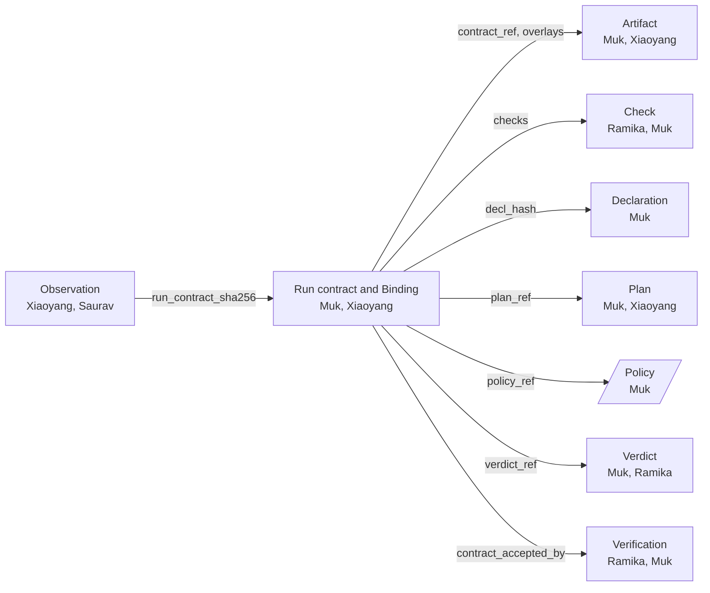

# Run contract and Binding · `cc.run_contract.v1`

**What it is.** Freeze's output. It pins exactly one capsule per step, by hash, together with the Verdict that allowed it, everything dispatch needs to run it, and the policy the run follows. Each per-step entry is a **Binding**. The run contract is written once; after it, nothing is chosen again.

**Rules that matter most here:** INV-2, and INV-5. This page holds the only allowed *frozen copies*: each copied field says where it was copied from.

Every record this one points at, and every record that points at it (generated from the field tables; the whole picture is the [schema map](schemas.md#how-the-schemas-relate)):

<!-- sync:neighbours -->

<!-- /sync:neighbours -->

## What: the core

Extends [`cc.common.v1`](common.md), with `scope.run_id`.

| Field | Type | Req | From | State | Description |
|---|---|---|---|---|---|
| `plan_ref` | `Ref(plan)` | req | B1 | proposed | The Plan it freezes |
| `contract_ref` | `Ref(artifact)` | req | B1 | proposed | The accepted `semantic_contract` Artifact: in M1 the Research Brief |
| `contract_accepted_by` | `Ref(verification_result)` | req | B1 | proposed | Requirement acceptance's result that accepted it: in M1 the Evaluator gate's `pass` on the Research Brief, or a person's `pass` at triage. Its hash chain (request, `invocation_ref`, Observation) pins the `requirement_capsule` version that ran before freeze. Freeze refuses a contract without one |
| `policy_ref` | `object` | req | B1 | proposed | The policy every gate and dispatch follows in this run: `{epoch, sha256}` |
| `policy_ref.epoch` | `string` | req | B1 | proposed | The policy epoch name. Example: `b1` |
| `policy_ref.sha256` | `sha256` | req | B1 | proposed | The policy document's hash |
| `evaluator_version` | `string` | req | B1 | proposed | The evaluator code version, so planning and dispatch provably used the same one. Example: `cc@1a2b3c4` |
| `vocabulary_version` | `integer` | req | B1 | proposed | The port type vocabulary version |
| `library_snapshot` | `string` | req | B1 | proposed | Copied from the Plan: what the planner could see |
| `effect_ceiling` | `enum(pure, read_only, idempotent, compensable, irreversible)` | req | B1 | proposed | Copied from the contract's `scope`. Example: `compensable` (the POC step writes the workspace) |
| `yields` | `list<object>` | req | B1 | proposed | Copied from the Plan: which step output answers each `want` |
| `bindings` | `list<object>` | req | B1 | proposed | One per step; the rows below |
| `bindings[].step_id` | `id` | req | B1 | proposed | The Plan step this Binding is for. Example: `search` |
| `bindings[].decl_hash` | `sha256` | req | B1 | proposed | The capsule version bound to it |
| `bindings[].code_sha256` | `sha256` | req | B1 | proposed | What the loader checks. The Declaration has exactly one of three: with a `carrier`, `carrier.sha256`; with a `body`, the hash (INV-15) of the `body` list sorted by `path`; with a `remote`, the hash of `{endpoint, version}`, which proves only what was pinned, not what the service runs. The loader fetches each file from the code store by that file's own sha256, then checks this value |
| `bindings[].verdict_ref` | `Ref(verdict)` | req | B1 | proposed | The Verdict that admitted it |
| `bindings[].level` | `enum(provisional, certified, exempt)` | req | B1 | proposed | Copied from the Verdict (`provisional` before B3) |
| `bindings[].standing_at_bind` | `reg(standing_state)` | opt | B3 | proposed | The capsule's state when bound, so a later revocation can be found to affect this run |
| `bindings[].effect_class` | `enum(pure, read_only, idempotent, compensable, irreversible)` | req | B1 | proposed | Copied from the Declaration: dispatch applies the policy's retry rules to it |
| `bindings[].bind` | `list<object>` | req | B1 | proposed | Copied from the Plan step: where each input comes from |
| `bindings[].predicates` | `list<Predicate>` | req | B1 | proposed | The Declaration's `needs.when` together with the step's `requires.when`, for the evaluator |
| `bindings[].checks` | `list<object>` | req | B1 | proposed | The node gate's full list, assembled once here from every check whose `applies_at` is `node` or `both`: each `{check_id, source}` with `source` `step`, `capsule` or `type`. At least one, since every type has a `node` check (INV-9). A `must` requirement with `applies_to: run` has its checks added to the last step's Binding, so they run on the finished run. Dispatch copies the list into each Verification request |
| `bindings[].over` | `string` | opt | B3 | proposed | Copied from the Plan step: fan-out |
| `bindings[].fallbacks` | `list<object>` | opt | B3 | proposed | The only alternatives dispatch may try. Each is `{decl_hash, code_sha256, verdict_ref}`, with `verdict_ref` a `Ref(verdict)` |
| `bindings[].overlays` | `list<Ref(artifact)>` | opt | B3 | proposed | Experience or guidance loaded with the capsule for this run. Nothing else is loaded |
| `bindings[].model_constraints` | `json` | opt | B3 | proposed | Copied from the Declaration's `needs.model`, for routing at dispatch |
| `verifier` | `object` | req | B1 | proposed | The `verifier_capsule` version every Evaluator gate of this run calls in tier 2, pinned like a Binding. Freeze refuses when requirement acceptance used a different version |
| `verifier.decl_hash` | `sha256` | req | B1 | proposed | The verifier version, from its Standing |
| `verifier.code_sha256` | `sha256` | req | B1 | proposed | What the loader checks before each verifier call |
| `verifier.verdict_ref` | `Ref(verdict)` | req | B1 | proposed | The Verdict that admitted it |
| `verifier.budget` | `object` | req | B1 | proposed | The limit per verifier call, from policy `routing`: `{tokens, time_s, money}`. Example: `{"tokens": 20000}` |
| `bindings[].budget` | `object` | opt | B1 | proposed | The step's limit, set by the policy's `routing` section: `{tokens, time_s, money}`. From B1 the Evaluator gate checks the step's Observations against `tokens` (the PRD's budget ceiling). Example: `{"tokens": 60000}` |

`run_contract_sha256` is the hash of this record (INV-15). Observations cite it; other records of the run reach it through their `scope.run_id`.

**Freeze refuses** when: the contract has no accepting `contract_accepted_by`; a step's input names differ from the bound capsule's `Port.name`s (`PORT_MISMATCH`); or the acceptance requests' `policy_ref` differs from the one it pins, so the stages and the run always follow one policy epoch.

## How: lives elsewhere

| Was here | Now lives in |
|---|---|
| `settings.generalists`, `generalist_cap`, `authoring` | policy `generalists` |
| `settings.require_supported_delivery` | policy `delivery` |
| `settings.unattended` | the RawIntent's `source_ref.identity_origin` (a fact about the request); what it implies is in policy `gates` |
| retry rules, parallelism, when to use a fallback | policy `dispatch` |
| several capsules in one step (Directive 2026-09-22) | through B3: `fallbacks` and fan-out (`over`). After M1: a composite capsule bound as one (Directive 2026-09-23, leaf or composite) |

## Reuse

| Existing | Where | Verdict |
|---|---|---|
| graph version, `SourceSnapshot` | agent-core `symphony/orchestration/contracts.py:16`; `symphony/models/capability.py:84` | **adapt** for `library_snapshot` |
| `CapabilityDescriptor.content_hash` | `symphony/models/capability.py:74` | **do not reuse** as the code pin; at most a cross-check |
| a binding record | none in Symphony or agent-core | ours |

## Extension points

- New run behaviours are policy sections pinned by `policy_ref`; the run contract does not change.
- Binding roles `context` and `dependency` are reserved (after M1).
