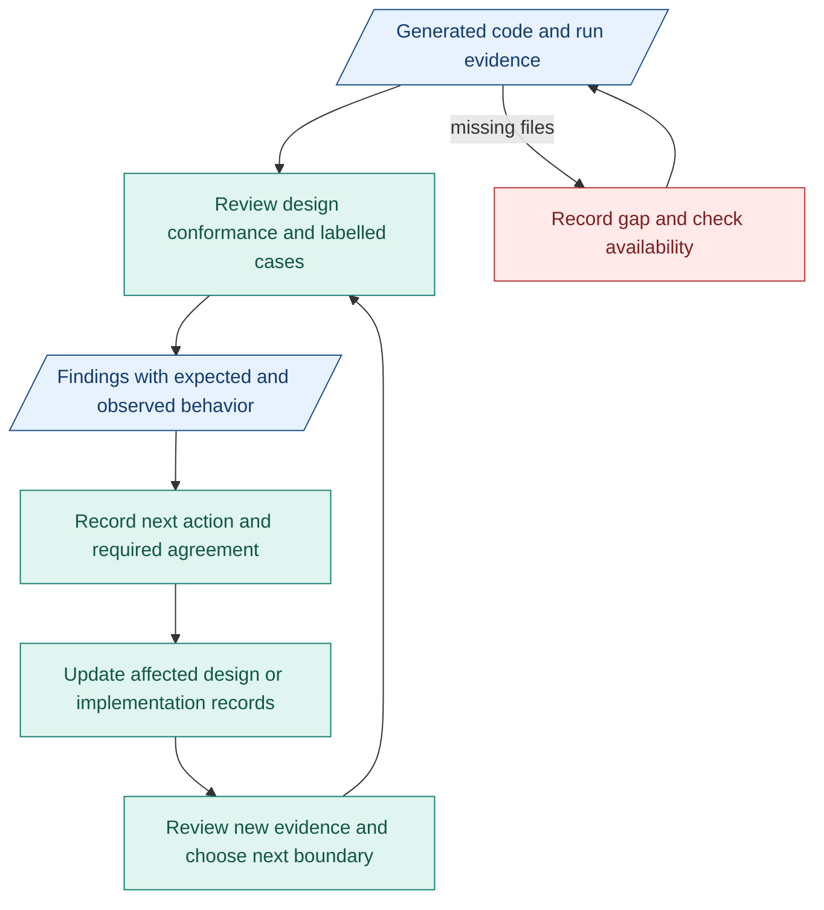

# My architecture plan toward M1

**Design is ready to build. Next, check the code and verification.** Full builds look promising. Quality still needs broader testing.

## SMART review targets

| When | I will | Result |
|---|---|---|
| Before next week's review | Receive code and logs from all four builds. | List each build, its versions and missing files. |
| Next week | Review both compiler verifiers in available full builds. | Record what they check, their reasons and whether gates behave correctly. |
| By next week's end | Prepare four cases: clear request, unclear intent, conflicting constraints and malformed output. Review available results. | Expected/actual behavior and evidence for each case. Count wrong decisions, blocked and unrun cases. |
| As each capsule is built | Review its inputs, outputs, checks and connections. | One connected case reviewed, with remaining gaps listed. |
| Each progress review | Record findings and choose the next work. | Each issue has a next action and any agreement needed. |

**Unusable intent must stop before Requirements.** Four cases are a starting point, not proof of quality. [Test details](../reference/compiler-verification.md#cases-and-evidence).

## Agreement needed

- **Scope changes:** agreement from people working on requirements and affected components.
- **Shared interfaces/checks:** agreement from people working on the connected components and verification.
- **Review timing/files:** agreement from people working on the build/run.

Keep decisions and evidence links in existing issues/PRs and TASK records.

## Review and update flow

Blue: records. Teal: review/update work. Red: missing evidence.

## Risks and effort

- **Missing code/logs:** check availability early. List gaps.
- **Wrong verifier decisions:** compare test results and reasons with agreed expectations.
- **Too much process:** fix blocking questions first. Keep AI CI small.

Spend most effort on verifier review and implementation blockers, then [CC connections and RSI readiness](07-m1-capsules-and-rsi.md). Update only affected design. A delay alone changes planning, not required behavior or checks.
