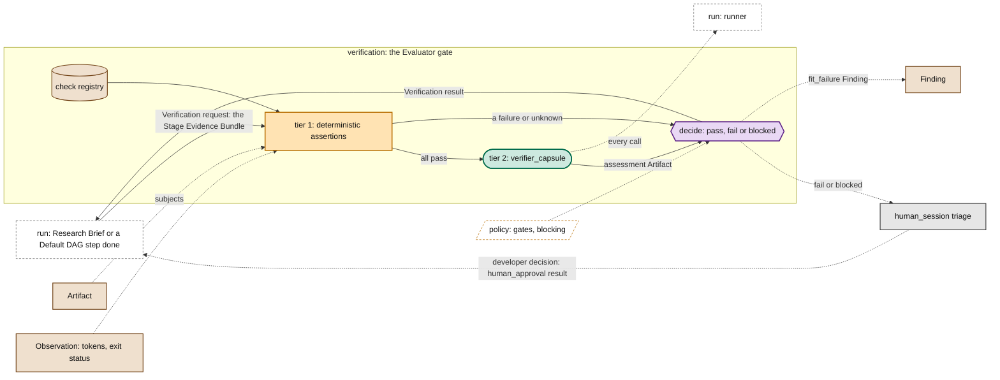

# Verification

> **Owner:** Ramika · **Build steps:** B1 the Evaluator gate after every step; B3 held-out suites and calibrated judges

Owns the PRD's **Evaluator gate**: the synchronous gate on the Research Brief (as requirement acceptance, before freeze) and after every Default DAG step, before the next one starts. It checks the **Stage Evidence Bundle** in two tiers, deterministic assertions and then the semantic verifier, and decides `pass`, `fail` or `blocked`. `fail` and `blocked` halt the run and open JiuwenSwarm's `human_session`, where a developer triages. The same records serve `human_approval`, and from B2 `decide_acceptance`.

## Our understanding, to confirm

**For Ramika.**

- [ ] The Stage Evidence Bundle is the [Verification request](../schemas/verification-record.md): its `subjects` are the step's Artifacts; its `checks` are the capsule contract (the step's, the capsule's and the output type's checks, from the Binding); its `invocation_ref` is the call's Observation, which holds the telemetry (tokens, exit status); the token budget is the step's Binding `budget`.
- [ ] Tier 1 runs first, with no model: schema compliance, files present, non-empty bounds, token budget ceiling, plus the capsule's own deterministic checks. Any failure skips tier 2.
- [ ] Tier 2 runs the `verifier_capsule` (ported from `result-evaluator` and `citation-reviewer`) through the runner. It applies the capsule's judged checks as acceptance criteria and writes an `assessment` Artifact. **The verifier only assesses; the gate, which is code, decides.** So "nothing that decides is a capsule" holds.
- [ ] The decision is `pass`, `fail` or `blocked`, by the fold in policy [`gates`](../schemas/policy.md), which also defines `blocked`. Every step has a capsule call, so every bundle has an Observation and the generic checks can pass.
- [ ] `pass` lets Swarmflow start the next step. `fail` or `blocked` halts the run, shows in the run tree, and calls `human()` for developer triage. **M1 never repairs automatically.**
- [ ] The developer's decision is recorded as a `human_approval` Verification result: `pass` (advance anyway), `repair` (run the step again) or `fail` (end the run). A timeout counts as `fail`.
- [ ] In M1 a judged `fail` halts the run like any other, but only a person can end it: the uncalibrated verifier never ends a run on its own. A judged `pass` carries the label `judge_unmeasured` until the verifier is calibrated.
- [ ] The Default DAG script writes the request; verification writes the result. The verifier version is pinned in the run contract's `verifier`.
- [ ] No capsule is its own final judge: the verifier is a different capsule from the one it checks, and certifying needs tests written by someone else (B3).

## Inside

*Owner: Ramika · Build steps: B1 the Evaluator gate; B3 held-out suites and judges · Code: `cc/gate`, check registry, `verifier_capsule`*

- **tier 1 registry checks** (deterministic, `applies_at: node`): `check.value_matches_type.v1` (the output port type's `value_schema`), `check.non_empty.v1`, `check.within_budget.v1` (the Observation's `cost.tokens` against the budget), `check.call_ok.v1` (`unknown`, never `fail`, when the Observation's `outcome` is not `ok`); type checks such as `check.files_present.v1` for `poc_bundle`
- **from the Default DAG template**: `check.brief_matches_dag.v1` in requirement acceptance's fixed list (source `gate`); **from the Brief**: `check.metrics_reported.v1` on the `report` step (every target metric has a value)
- **tier 2**: one judged check per stage, `check.semantic_review.v1`, whose runner is the `verifier_capsule`; the capsule's acceptance rules and the Stage Evidence Bundle are its inputs
- **decide**: the fold in policy `gates`; blame from the failing check's `source`; a fit failure is a Finding (B2)
- **triage**: Swarmflow's `human()` with the result and a reply schema; the reply becomes the `human_approval` result
- **suites** (B3): sealed held-out suites, written by someone other than the builder, submitted to admission
- **judges** (B3): the verifier calibrated against a labelled set; a calibrated judge may fail a gate without a person

**Open:**

- Whether the PRD agrees with our `blocked` and triage choices: [questions back to the PRD](../process/prd-inputs.md#questions-back-to-the-prd).
