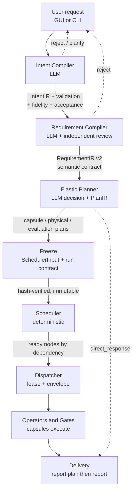
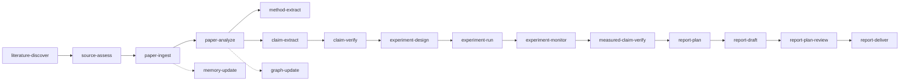

# 08 — The Workflow, End to End (narrative for report/presentation)

This is [02-architecture-pipeline.md](02-architecture-pipeline.md) retold as a
story you can present, with the capsule layer woven in. Keep 02 as the
reference table; use this for prose and slides.

## The governing idea

> **LLMs interpret semantics. Deterministic code validates structure,
> maintains references, freezes contracts, and schedules.**

Every stage below is an instance of that split. If you only get one idea
across, get this one.

## The pipeline

Dashed lines matter: **the pipeline can refuse**. Intent compilation that fails
or needs clarification must not continue, and the Planner may answer directly
without ever starting a Scheduler.

## Stage by stage, with what actually changes hands

### 1. Intake
`harness/lib/symphony/status-server.py` (HTTP, port 8765) or
`harness/solar-harness.sh` (CLI). Produces an intent request; returns
session/intake status. Attachments enter as references, not inline blobs.

### 2. Intent Compiler — *what did they actually ask for?*
`intent_gateway.py` → `intent_compiler.run_pipeline`.

Emits four separate artifacts, each with its own schema:
`intent_ir.json` (v3, with a separate model-body schema), plus **validation**,
**fidelity**, and **acceptance**. Fidelity review is *independent* of
generation — the thing that produced the IR does not get to grade it.

**Presentation point:** most systems have one "parse the request" step. This has
four artifacts because generation, structural validation, semantic fidelity,
and admission are four different questions.

### 3. Requirement Compiler — *what would satisfy them?*
`requirement_compiler/semantic.py` + `evaluator.py`.

Default is now **LLM-based** (it used to be deterministic; the old
deterministic compiler survives only for explicit legacy calls). It produces
LLM values under a shared contract v2, then runs an **independent semantic
review**.

Budgets are explicit and bounded: **one structural repair + one semantic
repair, ≤5 model calls, bounded total time.** Repair budgets are split rather
than shared — a commit in the log (`f463b861b`) specifically did that.

The original constraint AST is **preserved exactly** alongside the LLM output.

### 4. Elastic Planner — *how should it be done, and by what?*
`elastic_planner.py::run_elastic_planning_request`.

This is where capsules enter. The Planner:
- makes an LLM **decision** (including possibly `direct_response`),
- emits a **PlanIR**, plus fidelity and **binding** review,
- runs deterministic validation and acceptance,
- then **compiles and freezes** via `compile_and_freeze_execution_bundle`.

Freezing produces: capsule plan, physical plan, evaluation plan,
`SchedulerInput`, and the frozen run contract.

**Capsule selection happens here, and it is the Planner's job — not the
user's.** The user never hand-picks capsules. The Planner binds
logical operator → capsule → physical operator, honoring
`operator_compatibility.forbidden`, trust-class rank, and effect declarations.

Output obeys `capsule-plan.v1`: every node is either fully bound *or*
explicitly `unsatisfiable`. There is no third state.

### 5. Freeze — the hinge of the whole design
`SchedulerInput` + `run-contract-frozen.v2` are **immutable execution
authority**. The full chain is hash-verified before anything is projected into
runtime.

**This is the moment to emphasize in a presentation.** Before freeze, the
system is negotiating with a model. After freeze, it is executing a contract.
Nothing downstream may renegotiate. The Planner freezes *internally* — calling
`static_execution_compiler.compile_bundle` afterward would be a second
authoritative compile and is explicitly wrong.

### 6. Scheduler — deterministic from here on
`scheduler_input.py::verify_runtime_projection`, `graph_scheduler.py`,
`multi_task_runner.py`.

Validates the frozen bundle, projects a runtime graph, and keeps a **separate
mutable `task_graph_state`**. The frozen contract stays frozen; only the state
moves. Ticks nodes as dependencies clear.

### 7. Dispatcher — lease, envelope, receipt
`graph_node_dispatcher.py`, `operator_runtime.py`, `tools/operatord.py`.

A ready node plus its contract and **lease** becomes an operator request. The
`operator-inbox` filesystem queue is the language-agnostic IPC seam (also how
`codex-bridge` does TS↔Python).

Before dispatch, `capsule_execution_gate.py` applies an **idempotency
fingerprint**, dedup, and cooldown so retries don't re-run expensive capsules.
`capability_token.py` scopes the lease: file, shell, network, git allow/deny
paths.

⚠ **A submit receipt is not proof of execution.** Say this out loud in the
report — it's a documented failure mode.

### 8. Operators & Gates — capsules do the work
`harness/plugins/autosci/`, `harness/evaluators/scientific/`.

Each capsule's declared artifact routes produce domain evidence; the bound
evaluator and `test_policy` produce verdicts. Guard capsules (secret-leak) and
resource capsules (repo workspace, read-only GitHub) constrain what's reachable.

### 9. Delivery
Selected report-plan then report-draft operators, then Scheduler/Coordinator
closeout. **Report plan and report are different schemas**
(`scientific_report_plan.v1`, `scientific_report.v1`). Markdown `report.md` is
the human deliverable and does **not** replace structured evidence. Topic
relevance, evidence, and title are checked at delivery.

## The research lifecycle (the AutoSci path)

The capsule inventory reveals the intended research workflow — reading capsule
names in dependency order:

Plus idea-generation branches (`idea-generate` → `idea-evaluate` →
`hypothesis-formulate`) and reflexive ones (`workflow-evolve`,
`landscape-memory-update`, `lifecycle-run`).

Key structural point for the report: **discovery does not ingest, and ingestion
does not verify.** Each capsule's invariants forbid reaching into the next
stage's job. `cap.research-literature-discover` states outright that it "does
not ingest selected papers directly" and "does not mutate durable research
memory directly," and that scientific reliability "is not self-certified at
discovery." Separation of powers, enforced by contract.

## Two workloads, one control plane

| | Product Delivery | AutoSci / DeepResearch |
|---|---|---|
| Goal | working code | defensible findings |
| Logical operators | DeepArchitect, ImplementationWorker, PatchWorker, TestDesigner, TestRunner, Verifier, Critic, RootCauseDebugger | 20+ `Scientific*` operators |
| Workflow templates | `performance_debug`, `design_and_optimize`, `implementation`, `prototype` | capsule-composed lifecycle |
| Evidence | patch diff, tests, review | papers, methods, claims, verdicts, reports |

`logical-operators.json` also defines a **workflow vocabulary** —
`ScanContext, DebugRCA, DesignSolution, ImplementPatch, RunBenchmark,
ReviewPatch, VerifyEvidence` — and four templates built from it.

## Runtime surfaces

- **Status server** — HTTP control plane, port 8765, platform-aware binding
- **React dashboard** — `harness/status-server/react-app` (Vite; `DESIGN.md`
  tokens are mandatory)
- **tmux panes** — pane lease system for live agent terminals
- **Desktop** — Electron app
- **HIVE** — mDNS on 9876, P2P, bidding. **Decision layer only, no executor
  wired.** Do not present it as working distribution.

Runtime backend is selected by `SOLAR_PANE_RUNTIME` (`claude` | `codex`);
choosing codex re-points PM/planner/builder/eval defaults at OpenAI and adds
`--search` + reasoning-effort flags.

## What to be careful claiming

For a report, these matter:

1. The **last recorded full E2E failed** at Planner model-output schema
   admission and never reached the Scheduler. Later fixes are **source repairs
   with offline validation only** — not re-accepted online.
2. The **Discovery semantic defect was not resolved** as of the last checked
   handoff.
3. `rapid_smoke` receipts have returned PASS while handing off empty discovery.
4. Maturity is **Release Candidate** (`1.0.0-rc.9`), self-described as suitable
   for local trial and controlled experiments — not a production control plane.

Present the architecture as designed and substantially built, and the
end-to-end acceptance as **not yet demonstrated**. The repo is unusually
rigorous about this distinction; a report that blurs it is worse than the
source material.
