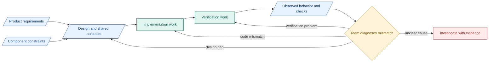

# 1. Design connections

**Design connects intent, component boundaries and evidence.** Give people and coding agents enough context for compatible changes.

## Authority and reasoning

| Source | Defines |
|---|---|
| PRD | Product outcomes and obligations |
| Design | System boundaries, interfaces, authority and failure behavior |
| Native specifications | Concrete implementation and acceptance cases |
| Runtime evidence | What actually happened |

- Follow current design for implementation guidance. Product-obligation changes need a recorded, authorized decision.
- Label requirements, decisions, representation choices, assumptions and proposals. Cite sources and state what remains unproven.
- Record the question, alternatives, chosen behavior, reason and revisit condition. Preserve superseded decisions.

## Minimum design content

- Purpose, phase, approach, inputs/producers and outputs/consumers.
- Boundaries, permissions, dependencies, limits and failure/recovery.
- Checks, release conditions, evidence and reasons for the boundary.

Define shared fields. Preserve independent checks, verifier assessment and protected durable release. See [principles](../principles.md), [contracts](../reference/README.md) and [component obligations](../research-design.md#architectural-component-obligations).

## Example coordination flow

Blue: information. Teal: work/tools. Amber: human decision. Red: unresolved. This coordination flow is separate from product gates.

**Inspired by:** [NASA systems engineering](https://www.nasa.gov/reference/systems-engineering-handbook/) for traceability and impact review. Useful because changes stay connected to their reasons. Our exploratory team uses a lighter process.
