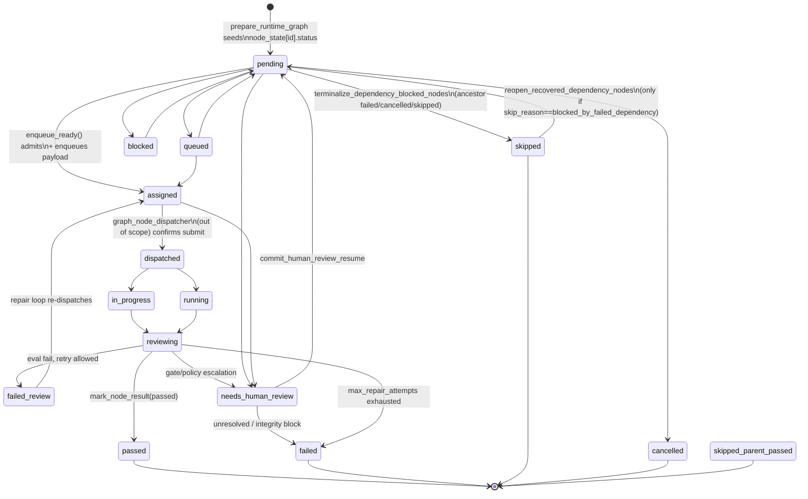
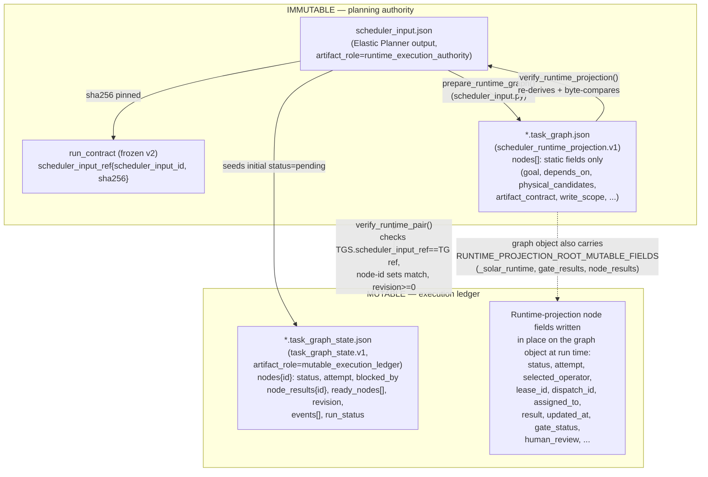

# Stage 5 — Scheduler & DAG/Task-Graph Execution

Repo: `/home/muk/work/AI4Research`, branch `openJiuwen-Solar`, HEAD `b0bf165f9`.
Scope boundary: intake through the point a node is marked `assigned` / dispatched into
the queue. Dispatch internals (`graph_node_dispatcher`, operator submission, tmux
send-keys mechanics) belong to the dispatch/operators report and are only touched
here where they explain a scheduler-level concept (lease acquisition call site,
mtime bug).

## Summary

- The frozen `scheduler_input.json` (Elastic Planner output) is projected by
  `harness/lib/scheduler_input.py::prepare_runtime_graph` into two on-disk artifacts:
  an **immutable** `*.task_graph.json` runtime projection and a **mutable**
  `*.task_graph_state.json` ledger. `verify_runtime_projection` re-derives the
  entire projection from the frozen source and byte-compares it before any run
  is trusted or resumed — this is the load-bearing anti-tamper check. [VERIFIED]
- `harness/lib/graph_scheduler.py` (5128 lines) is the actual DAG engine: topo
  sort + Kahn cycle detection (`topo_order`), readiness (`ready_nodes`,
  `node_admission_status`), write-scope conflict batching (`write_scope_conflict`,
  `_batch_ready_nodes`), worker/operator assignment (`assign_ready`,
  `assign_workers`), and the node status state machine (`set_node_status`,
  `mark_node_result`, human-review gates). [VERIFIED]
- There are **two unrelated things both called "scheduler"**:
  `harness/lib/graph_scheduler.py` (the DAG engine, in scope) and
  `harness/lib/dispatch_scheduler.py` (a legacy tmux-pane spillover/round-robin
  allocator for evaluator panes, referencing `interfaces.md §6`). They do not
  share code. [VERIFIED]
- `harness/schemas/task-graph-state.schema.json` is **not loaded by the
  executing scheduler code path**. Its own field shape (`graph_ref`, `leases`,
  `dispatch_ids` at top level) does not even match the real
  `task_graph_state.json` produced by `scheduler_input.py` (`scheduler_input_ref`,
  per-node `lease_id`/`dispatch_id`). The only load-bearing state-shape checks
  are hand-written Python assertions inside `_resume_existing_runtime_graph`
  and `verify_runtime_pair`. [VERIFIED — grep-confirmed, see Q11]
- Progress is driven by an external **poll loop**, not filesystem events: e.g.
  `harness/multi_task_runner.py::main()` runs `while True: schedule_once(); ...;
  time.sleep(interval)`. The legacy shell coordinator (documented in
  `harness/DISPATCH-PROTOCOL.md`) had a real, now-fixed, directory-mtime
  detection bug (macOS APFS content writes don't bump directory mtime) — this
  is a coordinator/dispatch-loop bug, not a `graph_scheduler.py` bug. [VERIFIED, doc says fixed]

## Mermaid: Node lifecycle (status state machine)



Status-set constants (`harness/lib/graph_scheduler.py:48-53`):
```python
TERMINAL_STATUSES = {"passed", "failed", "skipped", "cancelled", "skipped_parent_passed"}
ACTIVE_STATUSES = {"assigned", "dispatched", "in_progress", "running", "reviewing"}
READY_STATUSES = {"pending", "queued", "blocked", "worker_blocked", "failed_review", ""}
PASS_STATUSES = {"passed"}
CLOSED_NON_PASS_STATUSES = {"skipped", "cancelled", "skipped_parent_passed"}
DEPENDENCY_BLOCK_STATUSES = {"failed", "cancelled", "skipped", "skipped_parent_passed", "needs_human_review"}
```
`HUMAN_REVIEW_STATUS = "needs_human_review"` (line 54) is tracked separately from
these sets and has bespoke handling throughout (see Q10).

## Mermaid: Frozen contract vs mutable state



Key point: the on-disk `task_graph.json` object is not purely read-only in
practice — `scheduler_input.py` defines `RUNTIME_PROJECTION_ROOT_MUTABLE_FIELDS`
(`_solar_runtime`, `gate_results`, `node_results`) and per-node
`RUNTIME_PROJECTION_NODE_FIELDS` (status, attempt, lease_id, dispatch_id, result,
etc., `scheduler_input.py:42-97`) as fields *allowed* to differ from the frozen
projection during `verify_runtime_projection`. So the "immutable" graph file is
actually a hybrid: its static/topology fields are frozen and hash-verified, but
a well-defined mutable overlay is tolerated on the same object. The *separate*
`task_graph_state.json` is the authoritative ledger of record for that mutable
overlay (revision counter, events, ready_nodes).

## Detailed findings

### Q1 — Frozen SchedulerInput → runtime graph; what `verify_runtime_projection` checks

`prepare_runtime_graph()` (`harness/lib/scheduler_input.py:762-846`):
1. `load_and_validate(source, require_runtime_authority=True)` — schema validation
   (`_schema_errors`, draft 2020-12 against
   `schemas/planning/scheduler-input.v1.schema.json`) plus `semantic_errors()`
   (DAG well-formedness: `SELF_DEPENDENCY`, `MISSING_DEPENDENCY`, `DAG_CYCLE`
   via DFS with `visiting`/`visited` sets at lines 308-326, artifact
   producer/consumer ancestor checks, output-route path safety, workspace
   authority requirements, `MUTABLE_FIELD_IN_FROZEN_NODE` rejection — i.e. the
   frozen input itself must not carry any of `MUTABLE_NODE_FIELDS`
   `{status, attempt, selected_operator, lease_id, dispatch_id, assigned_to,
   result, updated_at}`).
2. Verifies `artifact_role == "runtime_execution_authority"`.
3. Computes `file_sha256(source)` and resolves workspace authority
   (`_verified_workspace_authority`), output paths (`_output_paths`),
   consume-path routing (`_runtime_route_inputs`), workspace-read hash
   verification (`_runtime_workspace_reads`).
4. Builds the `graph` dict (`RUNTIME_PROJECTION_ROOT_FIELDS`) with a
   `scheduler_input_ref{path, scheduler_input_id, sha256}` back-pointer and a
   `run_contract_ref` (verified against the run contract's own
   `scheduler_input_ref` binding — `_run_contract_ref`, raises
   `RUN_CONTRACT_SCHEDULER_INPUT_HASH_MISMATCH` on drift).
5. Seeds `task_graph_state.json` with `status: "pending"` for every node,
   `blocked_by = depends_on`, `ready_nodes` = nodes with empty `blocked_by`,
   `revision: 0`, `events: []`.
6. `_resume_existing_runtime_graph()` makes this idempotent/resumable: if a
   matching graph+state pair already exists it is reused rather than clobbered
   (protects mutable progress across re-runs of the same frozen input).

`verify_runtime_projection(graph, graph_path=...)`
(`scheduler_input.py:849-961`) is called both when resuming
(`_resume_existing_runtime_graph`) and whenever `enqueue_ready()` is invoked on
a `solar.scheduler_runtime_projection.v1` graph
(`graph_scheduler.py:4108-4116`). It checks, in order:
- `schema_version == "solar.scheduler_runtime_projection.v1"`.
- Root field set is exactly `RUNTIME_PROJECTION_ROOT_FIELDS` plus at most
  `RUNTIME_PROJECTION_ROOT_MUTABLE_FIELDS` — else `SCHEDULER_RUNTIME_ROOT_FIELDS_TAMPERED`.
- The referenced frozen source file still exists and its live sha256 still
  matches `scheduler_input_ref.sha256` (`SCHEDULER_INPUT_SOURCE_HASH_MISMATCH`)
  — re-reads and re-validates the *entire* frozen input again
  (`load_and_validate`, `require_runtime_authority=True`).
- Root scalar fields (`sprint_id`, `graph_id`, `planning_authority`,
  `test_policy`, `runtime_state_filename`) match what re-deriving from the
  frozen source would produce (`SCHEDULER_RUNTIME_ROOT_TAMPERED`).
- `run_contract_ref` recomputed and compared (`RUN_CONTRACT_REFERENCE_TAMPERED`).
- `runtime_work_dir` is absolute and, if `graph_path` given, matches the
  expected `<sprint_id>.task_graph.json` / `<sprint_id>/workdir` layout
  (`SCHEDULER_RUNTIME_ROOT_BINDING_INVALID`).
- Every `runtime_input_bindings` artifact file still exists and hashes match.
- Workspace authority reference untampered, and workspace-read hashes still
  verify.
- **Every node is fully re-projected** via `_runtime_node(...)` from the
  frozen source and diffed against the actual node in the graph file: any key
  outside `RUNTIME_PROJECTION_NODE_FIELDS` (the allowed mutable overlay) or any
  value mismatch on a static field triggers `SCHEDULER_RUNTIME_PROJECTION_TAMPERED`.

In short: this is a full re-derivation + comparison, not a shape check — the
runtime graph is recomputed from the frozen scheduler_input on every
verification and only the whitelisted mutable fields are allowed to diverge.

### Q2 — Immutable contract vs mutable state

**Immutable / frozen** (planning authority, hash-pinned):
- `scheduler_input.json` — `MUTABLE_NODE_FIELDS` are explicitly forbidden here
  (`semantic_errors`, `scheduler_input.py:234-236`).
- `*.task_graph.json` static/topology fields: `SCHEDULER_RUNTIME_STATIC_NODE_FIELDS`
  (`graph_scheduler.py:123-133`) — id, goal, logical_operator,
  dispatch_task_type, depends_on, requirement_ids, capsule_binding,
  physical_candidates, artifact_contract/routes, resource_requirements,
  effects, priority, failure_policy, read_scope/write_scope, acceptance.
- `run_contract_ref` / `scheduler_input_ref` — sha256-pinned back-references.

**Mutable** (`SCHEDULER_RUNTIME_MUTABLE_NODE_FIELDS`,
`graph_scheduler.py:79-122`, superset of `RUNTIME_NODE_SPEC_FIELDS`):
status, attempt, assigned_to, dispatch_id, lease_id, selected_operator, result,
result_path, updated_at, blocked_by, blocked_by_failed_dependency,
gate_status, human_review(+history), evaluation_* fields, eval_* dispatch
bookkeeping, retry/dispatch-failure counters, `execution_attempt`,
`closeout_receipt`, `note`, `skip_reason`, `wait_classification`,
`scheduler_candidate_observations`, etc. — plus graph-root mutable fields
`_solar_runtime`, `gate_results`, `node_results`.

**Why the separation exists** (module docstring, `scheduler_input.py:1-7`,
and design thesis in project context): "LLMs interpret semantics; deterministic
code validates structure, maintains references, freezes contracts, and
schedules." The Planner's semantic decisions (which operator, which
dependencies, which artifacts) must not be silently rewritten once frozen —
`verify_runtime_projection`/`verify_runtime_pair` exist specifically to make
tampering (accidental or malicious) with the frozen plan detectable before any
resume or dispatch proceeds. The mutable ledger is where all execution
noise (attempts, leases, transient statuses, eval retries) lives so it can
churn freely without threatening the auditable plan. `task_graph_state.json`
additionally carries `revision` (monotonic int) and `events[]` for the
transition ledger (see Q3/Q9).

### Q3 — Node lifecycle / state machine

Statuses observed across the codebase (constants + string literals used in
`set_node_status`/`mark_node_result`/human-review functions):

| Status | Category | Set by |
|---|---|---|
| `pending` (also `""`) | ready-eligible | initial seed; `reopen_recovered_dependency_nodes`; `commit_human_review_resume` |
| `queued` | ready-eligible | lease-acquire failure path in `enqueue_ready` |
| `blocked` / `worker_blocked` | ready-eligible | worker-matching logic (candidate wait) |
| `failed_review` | ready-eligible (repair loop) | eval verdict FAIL, retryable |
| `assigned` | active | `enqueue_ready()` after successful queue enqueue, before dispatcher confirms |
| `dispatched` | active | dispatcher (out of scope) after real submission — scheduler code comments explicitly avoid marking this itself (`graph_scheduler.py:4308-4312`) |
| `in_progress` / `running` | active | worker/dispatcher runtime |
| `reviewing` | active | worker submits handoff; evaluator picks up |
| `needs_human_review` | special / blocking | `enter_node_human_review()` |
| `passed` | terminal | `mark_node_result(status="passed")`, gated by `_assert_pass_mark_allowed` |
| `failed` | terminal | `mark_node_result`, repair exhaustion, human-review integrity block |
| `skipped` | terminal | `terminalize_dependency_blocked_nodes` (auto) or explicit cancellation |
| `skipped_parent_passed` | terminal | epic/parent-level short-circuit |
| `cancelled` | terminal | explicit cancel path |

Transitions are centralized through three writers, all of which append to an
append-only ledger via `_ledger_transition()`:
- `set_node_status(graph, node_id, status, pane=None, dispatch_id=None)`
  (`graph_scheduler.py:3943`) — used for dispatch bookkeeping transitions
  (pending→assigned, assigned→queued on lease failure, skip/reopen). Refuses
  to *regress* status rank unless `reopening_from_pass` (passed →
  reviewing/pending/... only in a defined repair-reopen set) —
  `_status_rank(current) > _status_rank(status)` guard, line 3953.
- `mark_node_result(graph, node_id, status, gate_status=None, note=None, ...)`
  (`graph_scheduler.py:3736`) — used for worker/evaluator-reported terminal
  and reviewing transitions; runs `_assert_human_review_status_write_allowed`
  and `_assert_pass_mark_allowed` gates first, refuses to reopen an
  already-`passed` node into a progress status (regression protection, with an
  explicit incident writeup at lines 3757-3766 about a real race that reopened
  a passed node), and refuses any progress write once the whole sprint is
  terminal (`_sprint_status_terminal`, lines 3785-3795).
- `enter_node_human_review(...)` / `commit_human_review_resume(...)` — the
  "sole authority" (docstring) for entering/exiting `needs_human_review`,
  versioned by a `generation` counter so idempotent re-observation doesn't
  fabricate spurious transitions.

Guard: `assert_node_status_write_allowed()` (`graph_scheduler.py:1740`, not
fully quoted here) is invoked by `set_node_status` before any write — additional
defense-in-depth beyond the two functions above.

### Q4 — Readiness computation, DAG traversal, cycle detection

- **Cycle detection**: `topo_order()` (`graph_scheduler.py:2008-2036`) is
  textbook Kahn's algorithm — indegree map + FIFO queue seeded with indegree-0
  nodes (sorted for determinism), each processed node decrements children's
  indegree; if the emitted order's length != node count, the leftover
  indegree>0 nodes are reported as `"cycle detected: " + ids` (a `ValueError`,
  not a soft warning). External dependency IDs (`_is_external_dependency`) are
  excluded from the internal graph. `topo_layers()` (line 2039) does a
  parallel per-layer variant for critical-path costing (`critical_path()`,
  line 2058, longest-cost-path via per-node `_estimated_cost`).
- **Readiness**: `ready_nodes(graph)` (`graph_scheduler.py:2179-2215`):
  1. `validate_graph(graph)` must be free of non-`parallelism_quality:` errors
     (raises `ValueError` otherwise — validation failure hard-stops scheduling).
  2. If any `blocked_external_prerequisites(graph)` exist, returns `[]`
     (nothing is ready while an external prerequisite is unmet).
  3. Iterates nodes in `topo_order()`; a node qualifies if its status is in
     `READY_STATUSES` and not `TERMINAL_STATUSES`/`ACTIVE_STATUSES`, **and**
     every internal dependency is either `_is_passed` or is itself
     `needs_human_review` under the "non-blocking" contract policy
     (`_human_review_is_integrity_block` / `_human_review_blocks_dependents`
     both false — i.e. `on_human_review: warn_and_continue` on a
     gate-ledger-contracted graph). This lets a downstream node proceed past a
     human-review checkpoint that the node's own contract marked
     non-blocking, while still cascading a genuine block.
  4. `node_admission_status()` (line 2103) is the fuller per-node admission
     check used at dispatch time — same logic plus richer diagnostic reasons
     (`dependencies_unmet`, `external_prerequisite_blocked`, `admitted`).
- Traversal order for readiness itself doesn't need topo order semantically
  (a pure dependency check would suffice), but iterating in topo order keeps
  output deterministic and cheap to reason about.

### Q5 — `write_scope` and conflict prevention

`write_scope` is a frozen field per node (`SCHEDULER_RUNTIME_STATIC_NODE_FIELDS`,
`scheduler_input.py:447-448`: `"write_scope": [produce_paths.get(item) or item for item in produces]`
— i.e. derived deterministically from the node's declared
`artifact_contract.produces` and its resolved output paths at projection time).

Conflict logic (`graph_scheduler.py:2218-2244`):
```python
def write_scope_conflict(a: dict[str, Any], b: dict[str, Any]) -> bool:
    a_scopes = _scope_list(a)
    b_scopes = _scope_list(b)
    # Missing write_scope means exclusive writer. It cannot safely share a batch.
    if not a_scopes or not b_scopes:
        return True
    return any(_scope_overlap(sa, sb) for sa in a_scopes for sb in b_scopes)
```
`_scope_overlap(a, b)` treats scopes as path prefixes: exact match, or one is a
directory-prefix of the other (`a.rstrip('/')+'/'` startswith check both ways).
`_batch_ready_nodes()` (line 2277) greedily bin-packs ready nodes into batches,
placing a node in the first existing batch where it conflicts with *no* other
member on write_scope **or** `effect_conflict` (exclusive side-effect classes:
`secrets_access`, `destructive_shell`, `git_push`, `patch_scope_drift`, or a
`repo.worktree` write co-occurring with any `execute` effect —
`_node_has_exclusive_effect`, lines 2261-2270), else opens a new batch (subject
to `max_parallel`). A node with no declared `write_scope` is always treated as
an exclusive writer and gets its own batch (`validate_graph` also emits a
warning: `"{node_id} missing write_scope; scheduler will serialize it"`, line
1954). This is purely an in-memory batching heuristic at schedule time — it is
not a runtime file lock; the actual mutual exclusion depends on the batches
being respected by whatever assigns nodes to workers (`assign_ready`/`enqueue_ready`).

### Q6 — Lease model at the scheduler level

Two lease concepts exist, both at the dispatch boundary rather than deep
inside graph traversal, but both invoked from `graph_scheduler.py`:

1. **Pane lease** (`harness/lib/pane_lease.py`) — a filesystem JSON lease per
   tmux pane under `run/pane-leases/<pane>.json`, with 3-state classification
   (`no_pane` / `busy` / `dead`), `DEFAULT_TTL = 600`s, `acquire(pane,
   sprint_id, dispatch_id, ttl)` / `release(...)` / `reap()` (expire stale
   leases) / `list_leases()`. `enqueue_ready()` calls this directly
   (`graph_scheduler.py:4123-4126, 4266-4286`) when `lease=True` and the
   target pane is a real tmux pane (not `operator-pool:*` or `operator:*`
   virtual panes, which skip pane leasing entirely because their process-safe
   lease is acquired later by `operator_runtime.submit`). Lease failure
   pushes the node back to `queued` with `blocking_reason` set to the lease
   failure reason (line 4276-4285) — it does **not** fail the node, just
   defers it to the next tick.
2. **Graph/runtime dispatch lease record** — `scheduler_input.py::write_dispatch_records`
   (lines 1022-1073) writes a GUI-readable `lease_record.json` with schema
   `solar.lease_record.v1` (`lease_id`, `node`, `attempt`, `operator_id`,
   `issued_at`, `expires_at`, `heartbeat_at`, `fencing_token=attempt`,
   `status: "active"`) alongside a `dispatch_record.json`. `fencing_token`
   uses the attempt number, i.e. lease fencing is attempt-scoped — a stale
   lease from an earlier attempt cannot be honored once a new attempt starts
   (classic fencing-token pattern).
3. `DEFAULT_GRAPH_LEASE_TTL_SECONDS` (`graph_scheduler.py:59-64`) — a
   separate, env-overridable (`SOLAR_GRAPH_LEASE_TTL_SECONDS`, floor 30s,
   default 180) TTL used by `enqueue_ready(..., ttl=DEFAULT_GRAPH_LEASE_TTL_SECONDS)`
   — distinct from `pane_lease.DEFAULT_TTL` (600s). [Note: two different
   default TTL constants for what is nominally the same lease call — worth
   flagging as a minor inconsistency, not confirmed to cause a bug.]

At the scheduling layer proper (`ready_nodes`, `assign_ready`, batching),
there is no lease/locking abstraction — leases only enter once a node is
being turned into a dispatch payload in `enqueue_ready`.

### Q7 — Concurrency controls

- **`max_parallel`** — plumbed through `make_batches(graph, max_parallel)`,
  `_batch_ready_nodes(nodes, max_parallel)`, and `assign_ready(..., max_parallel)`
  (`graph_scheduler.py:3131-3203`: `max_selected = effective_max_parallel if
  effective_max_parallel and effective_max_parallel > 0 else len(ready)`).
  Default resolved via `_effective_graph_max_parallel()`
  (`graph_scheduler.py:149-158`), which imports `concurrency_policy` and calls
  `concurrency_policy.effective_max_parallel(default or 8, scope="graph")`.
- **`concurrency_policy.py`** (`harness/lib/concurrency_policy.py`) is a
  config-driven policy layer, not a scheduler component per se:
  - `load_policy()` reads `concurrency-policy.json` (env override
    `SOLAR_CONCURRENCY_POLICY`, else `HARNESS_DIR/config/...`, else a built-in
    fallback with `active_level: "normal"`, `graph_max_parallel: 4`).
  - `active_level()` supports an env override
    (`SOLAR_CONCURRENCY_LEVEL`), or a **dynamic concurrency snapshot**
    (`dynamic_concurrency_config` + `_dynamic_snapshot_level`, TTL-gated file
    read of a `recommended_level` written by some external backlog watcher),
    falling back to the static `active_level`.
  - `effective_max_parallel(default, scope)` maps `scope in
    {"graph","builder","drain"}` to policy keys `graph_max_parallel` /
    `builder_dispatch_limit` / `drain_max_items`.
  - **Backlog autoscaling**: `_backlog_autoscaling_snapshot()` re-invokes
    `backlog_autoscaler.refresh_snapshot(policy)` when a TTL-gated snapshot
    file is stale, then `effective_profile_max_parallel` /
    `effective_logical_max_parallel` / `effective_global_max_workers` read
    per-profile/per-operator-type/global limits from that snapshot — i.e.
    concurrency limits can be adjusted at runtime by an external process
    without editing the static policy file.
  - **Builder pool / singleton-like grouping**: `infer_builder_group(op)`
    classifies an operator into pools by provider/model substring matching
    (`glm-5.1`, `sonnet`, `thunderomlx`, `deepseek-v4-flash`,
    `codex-gpt-5.3-spark`, `codex-gpt-5.5-medium`,
    `antigravity-gemini-3.5-flash`); `is_pool_member`, `pool_group_priority`,
    `pool_group_desired`, `builder_pool_desired_total` implement a
    desired-replica-count model per pool (akin to singleton/limited-instance
    operator pools) rather than a hard `max_parallel: 1` singleton flag.
- **Effect-based exclusivity** (`effect_conflict`, Q5) acts as an additional,
  non-write_scope concurrency control: any node with a `destructive_shell` /
  `git_push` / `secrets_access` / `patch_scope_drift` effect, or a
  `repo.worktree` write + any execute effect, cannot share a batch with
  anything else regardless of write_scope.
- No explicit "singleton operator" flag was found in `graph_scheduler.py`
  itself; singleton-like behavior is implied by builder-pool `desired` counts
  and by the exclusive-writer default (no `write_scope` ⇒ always its own batch).

### Q8 — What drives the tick

- **No event-driven / inotify / fs-watch mechanism was found in
  `graph_scheduler.py`.** It is a pure library of functions (`ready_nodes`,
  `assign_ready`, `enqueue_ready`, `mark_node_result`, ...) invoked by callers;
  it has a CLI (`main()`, `argparse`) for one-shot invocations
  (`ready`, `batches`, `assign`, `enqueue`, `mark`, `doctor`, ...).
- **`harness/multi_task_runner.py`** is one caller that *does* run a loop:
  `main()` (line 2774) — for `args.cmd in {None, "start"}`:
  ```python
  while True:
      result = schedule_once(args)
      render_result(result, args)
      if args.once:
          return 0
      time.sleep(max(1, int(args.interval)))
  ```
  (`multi_task_runner.py:2877-2884`). `schedule_once()` (line 1537) calls
  `ready_nodes(graph)` per tracked graph file, applies a `launch_guard`
  (memory/quota/cooldown), a `scope_conflicts_with_active` write-scope check
  against already-active tasks, and `launch_node()` per admitted node — this
  is a **polling loop with a `--interval` sleep**, default `DEFAULT_INTERVAL`
  (used by `screen`/`start` subcommands), not fs-mtime or inotify driven.
- The **legacy shell coordinator** (`coordinator.sh`, documented in
  `harness/DISPATCH-PROTOCOL.md`, not a `.py` scheduler file) *did* drive its
  loop off `stat -f %m` directory mtime and had the documented "Bug 2: mtime
  目录级检测漏检" — on macOS APFS, writing file *contents* does not bump the
  parent directory's mtime, so the coordinator could miss `status.json`
  changes entirely. The fix (already applied per the doc) switched to scanning
  `max(mtime)` across all `sprint-*.status.json` files individually rather
  than trusting the directory mtime. This is a **dispatch/coordinator-layer**
  bug (bash `coordinator.sh`), not inside `graph_scheduler.py`'s Python state
  machine — flagging per the task's own scoping note, since `graph_scheduler.py`
  has no mtime-based readiness logic at all; it is called synchronously by
  whatever polls it (coordinator.sh or multi_task_runner.py).
- The same doc records a related, more general lesson relevant to "what
  drives progress": Bug #5 (`运行时补偿失效根因`) — a long-running bash
  process holds its script text in memory at start, so a coordinator process
  running for 28+ hours silently kept executing *stale* code after
  `coordinator.sh` was edited on disk; a periodic branch (`% 30` loop count)
  added post-launch never actually ran because the running process pre-dated
  the edit. Documented fix: log a source-file md5 at startup and require
  restart after edits. [DOC-CLAIM, marked "已修复" — process restart
  discipline, not a code fix in `graph_scheduler.py`]

### Q9 — Failures, retries, requeues, downstream propagation

- **Repair/retry loop**: `REPAIR_ACTIVE_STATUSES` (`graph_scheduler.py:134-146`)
  = `{failed_review, reviewing, assigned, dispatched, in_progress, running,
  pending, queued, blocked, worker_blocked, ""}` — the set of statuses a node
  can be in while still eligible for repair activity (i.e. not yet terminal).
  A node's `failure_policy` (frozen, from `scheduler_input.json`) carries
  `max_attempts` and `on_exhausted`; the runtime projection derives
  `max_repair_attempts = max(0, max_attempts - 1)` and
  `on_failure_exhausted = failure_policy.on_exhausted`
  (`scheduler_input.py:445-446`). Nodes track `execution_attempt`,
  `repair_attempts`, `dispatch_failure_streak`, `failure_policy_exhausted` as
  mutable fields.
- **`failed_review` → `assigned`**: an evaluator FAIL verdict with retries
  remaining reopens the node for another attempt via `set_node_status`'s
  "reopening" exception path (not from `passed`, so the normal rank-guard
  doesn't block it).
- **Terminal failure cascade**: `terminalize_dependency_blocked_nodes(graph)`
  (`graph_scheduler.py:3979-4012`) walks every non-terminal, non-active node
  and, for each internal dependency that `_dependency_blocks()` (terminal
  status in `DEPENDENCY_BLOCK_STATUSES = {failed, cancelled, skipped,
  skipped_parent_passed, needs_human_review}`), marks the dependent `skipped`
  with `skip_reason = "blocked_by_failed_dependency"` and records the specific
  `blocked_by` list. This is explicit, one-shot DAG failure propagation — the
  docstring notes it exists so runners "stop cleanly instead of spinning
  forever with downstream nodes left as pending."
- **Recovery**: `reopen_recovered_dependency_nodes(graph)`
  (`graph_scheduler.py:4015-4072`) reverses exactly that auto-skip if every
  recorded blocker later becomes healthy (e.g. after a human-review resume
  flips a blocking dep back to a non-blocking state) — but *only* for
  scheduler-authored `blocked_by_failed_dependency` skips; explicit user
  cancellations and other terminal skips are untouched (comment: "remain
  frozen").
- **Gate propagation on failure**: inside `mark_node_result`, if a node has a
  `gate` and the incoming status is `failed`/`cancelled`, the corresponding
  `graph["gate_results"][gate]` is set to `{"status": "blocked", "reason":
  f"node_{status}", ...}` immediately (lines 3813-3821) — gates fail closed on
  first bad member rather than waiting for every sibling to finish.
- **Regression protections**: two explicit anti-regression guards inside
  `mark_node_result` (documented with incident narratives in code comments,
  lines 3757-3795): (a) refuse a "progress" status write
  (`reviewing/pending/queued/assigned/dispatched/in_progress/running`) onto a
  node already `passed` (a genuine production race where a late worker-runner
  mark reopened an already-passed node), and (b) refuse any progress write
  once `_sprint_status_terminal(graph)` is true (a straggler repair writer
  reopening an already-terminal sprint). Both return
  `parent_ready_check(graph)` annotated with a `refused_*` diagnostic instead
  of raising, so callers can detect the refusal without crashing.

### Q10 — Human gates / approval gates

- `needs_human_review` is a first-class status with its own schema
  (`HUMAN_REVIEW_SCHEMA_VERSION = "solar.human_review.v1"`) and a **sole
  authority** entry point, `enter_node_human_review()`
  (`graph_scheduler.py:3316-3399`), requiring non-empty `reason`,
  `next_action`, `writer`. It is idempotent under re-observation (keeps the
  same `generation` if already blocked in the "blocked" state) and versions
  genuine re-escalations with a monotonically increasing `generation`
  (`human_review_generation()`), keeping up to `HUMAN_REVIEW_HISTORY_LIMIT =
  20` prior records in `node["human_review_history"]`.
- Exit is via `validate_human_review_resume()` /
  `commit_human_review_resume()` (lines 3402-3593, not fully quoted) which
  presumably re-validates whatever needed human sign-off before flipping the
  node back to `pending` (see the lifecycle diagram edge
  `needs_human_review --> pending`).
- **Whether a human-review dependency blocks its dependents is policy-driven,
  not universal**:
  - `_human_review_is_integrity_block(graph, dep_node)`
    (`graph_scheduler.py:3594-3608`) — true if the dep carries an
    `eval_integrity_block` or a reason string starting
    `eval_integrity_block:` — an unverified-artifact-bytes case that always
    blocks regardless of policy.
  - `_human_review_blocks_dependents(graph, dep_node)`
    (`graph_scheduler.py:3612-3630`) — off the "contracted" gate-ledger path
    (`_gate_ledger` unavailable, disabled, or graph not `contracted`), a
    `needs_human_review` dependency **always** blocks (legacy/global
    behavior via `DEPENDENCY_BLOCK_STATUSES`). On the contracted path, the
    dependency node's own `on_human_review` field is consulted:
    `"warn_and_continue"` lets dependents proceed past the review gate;
    anything else (including absent) keeps the blocking default
    (`block_dependents`).
  - Both `ready_nodes()` (lines 2200-2213) and `node_admission_status()`
    (lines 2145-2158) implement this exact same non-blocking carve-out so
    downstream nodes can become ready even while an upstream node sits in
    `needs_human_review`, provided the contract explicitly opted into
    `warn_and_continue` and it isn't an integrity block.
- Interruption point in the graph: a human gate interrupts exactly one node
  (the one placed into `needs_human_review`); whether the interruption
  cascades to the rest of the DAG depends entirely on the policy check above
  — this is a deliberate, documented departure ("design §2 change 2") from a
  strict block-everything default, aimed at avoiding what the code calls "an
  R7 violation" (silent pending wedge) while still supporting hard blocks for
  genuinely load-bearing gates.
- `gate` (deterministic/shared-gate) handling is separate from
  `needs_human_review`: `mark_node_result` maintains `graph["gate_results"]`
  keyed by a node's `gate` field, requiring every sibling gate-member node to
  reach `passed` and every member's verdict (`_gate_verdicts_ok`) to be
  affirmative before the gate itself flips to `passed`; any member `failed`/
  `cancelled` flips the whole gate to `blocked` immediately.

### Q11 — Is `task-graph-state.schema.json` actually loaded/enforced?

**No — confirmed not loaded on the executing path.** [VERIFIED]

- `grep -rn "task-graph-state.schema" .` across the repo (excluding
  node_modules) shows the file is referenced only as a *string* inside test
  fixture/documentation JSON (`tests/platform/phase22/l2_atomic_source.json`,
  `tests/foundation/data_foundations/phase22_*_management_cases.json`,
  `harness/metadata/migration-closure-20260830.json`) — all of these are data
  listing "relevant schemas" for a test case, never a `jsonschema.validate(...,
  schema=...)` call against this specific file.
- No `.py` file anywhere in the repo opens or references
  `schemas/task-graph-state.schema.json` by path. `scheduler_input.py` only
  loads `schemas/planning/scheduler-input.v1.schema.json`
  (`SCHEMA_PATH`, line 23-30) via `jsonschema.Draft202012Validator`.
- The project's own maintainer note in
  `harness/metadata/NEW-MACHINE-START-HERE.md:92` states this explicitly:
  > "runtime projection / task_graph_state | `scheduler_input.py::verify_runtime_projection`；`graph_scheduler.py`；参考定义 `harness/schemas/task-graph-state.schema.json` | 当前实际执行代码校验；未发现该 JSON Schema 被这条路径直接加载，不能宣称其字段约束均已执行"
  (translation: "currently the actual executing code performs validation; this
  JSON Schema was not found to be loaded directly by this path — its field
  constraints cannot be claimed as enforced").
- Additionally, the schema's own shape is stale relative to the real runtime
  ledger: it requires top-level `graph_ref`, `leases`, `dispatch_ids` as
  *objects*, but the actual `task_graph_state.json` produced by
  `prepare_runtime_graph()` (`scheduler_input.py:818-831`) has
  `scheduler_input_ref` (not `graph_ref`), no top-level `leases` or
  `dispatch_ids` maps at all (lease/dispatch IDs live per-node inside
  `nodes[id]`), and additional required fields (`ready_nodes`, `revision`,
  `run_status`) the schema doesn't even mention. This is strong corroborating
  evidence the schema is either aspirational, superseded, or was written
  against an earlier design and never kept in sync — enforcement would likely
  fail validation against real runtime files even if it were wired in.
- The actual enforcement of the mutable-ledger shape happens via hand-written
  Python boolean checks inside `_resume_existing_runtime_graph()`
  (`scheduler_input.py:739-752`) and `verify_runtime_pair()`
  (`scheduler_input.py:996-1013`) — both check `schema_version ==
  "solar.task_graph_state.v1"`, `artifact_role ==
  "mutable_execution_ledger"`, `scheduler_input_ref` match, node-id-set
  equality across `nodes`/`node_results`, `ready_nodes` ⊆ node ids,
  `revision` is a non-negative int, `events` is a list — a hand-rolled,
  narrower reimplementation of what the JSON Schema file nominally describes.

### Q12 — Known bugs/limitations

From `harness/DISPATCH-PROTOCOL.md` (legacy shell coordinator, all marked
fixed/已修复 as of the doc's dates, 2026-04-17 through 2026-04-25):
- **Bug 2 (mtime detection)**: macOS APFS directory mtime doesn't change on
  file-content writes; coordinator polled `stat -f %m "$SPRINTS_DIR"` and
  missed `status.json` content changes. Fixed by scanning
  `max(mtime)` across individual `sprint-*.status.json` files (~24ms/round
  for 24 files — "acceptable" per the doc).
- **Bug #5 (运行时补偿失效根因)**: a long-running bash coordinator process
  keeps its script text in memory from launch; edits to `coordinator.sh` on
  disk are invisible to an already-running process (observed: 13+ hours
  uptime, 3766+ polls, a `% 30` handle_passed branch added *after* launch
  never fired once). Prevention documented: log the running script's md5 at
  startup, restart after every edit, add low-frequency PROBE logs on
  long-lived branches.
- Several "stuck state" bugs (Bug A "plan-review 卡死", Bug C "last_state 只记单个 sprint")
  where the coordinator's single-scalar `last_state` comparison caused it to
  miss a state transition on one sprint while reacting to a different sprint
  — fixed by moving to a per-sprint state dict.
- **Row 31 in `pre-scheduler-stabilization-log-20260829.md`** ("Watchdog
  historical-sprint revival"): a Coordinator restart could cause an unrelated
  historical sprint to be woken and dispatch a spurious Builder task,
  temporarily blocking the *current* research DAG, because the watchdog
  trusted stale `.pane-assignments` and any pane lease was treated as
  admission permission. Fixed with a short-lived, atomically refreshed
  durable Coordinator admission lease so restart-triggered wakes require an
  unexpired admission lease rather than stale pane state.
- The searched log has **no literal "Scheduler continuous tick" entry** — that
  exact phrase was not found anywhere in the repository (`grep -rn` over
  `*.md` returned nothing). [Could not confirm — the task prompt's suggested
  citation does not exist verbatim; closest related material is the mtime and
  stale-process bugs above.]
- Log-wide framing: the log's own header states "Scheduler and later-stage
  defects are report-only" for that document, meaning most entries (rows
  1-46) are Planner/discovery/report-pipeline defects *upstream* of the
  scheduler, not scheduler bugs — only a few (rows tagged "Scheduler artifact-route
  consumption", "Scheduler claim-verification registry dispatch", row 31
  watchdog) actually touch scheduler/dispatch behavior, and those are
  described as fixed with regression evidence (git commit hashes cited).

## Node state reference table

| State | Terminal? | Active? | Ready-eligible? | Set by | Notes |
|---|---|---|---|---|---|
| `pending` / `""` | no | no | yes | seed; reopen; resume | default/initial |
| `queued` | no | no | yes | lease-acquire failure | retried next tick |
| `blocked` / `worker_blocked` | no | no | yes | worker matching | candidate wait states |
| `failed_review` | no | no | yes | eval FAIL w/ retries | repair-eligible |
| `assigned` | no | yes | no | `enqueue_ready` | queued for dispatch, not yet confirmed |
| `dispatched` | no | yes | no | dispatcher (out of scope) | confirmed submit |
| `in_progress` / `running` | no | yes | no | worker runtime | executing |
| `reviewing` | no | yes | no | worker handoff | awaiting evaluator |
| `needs_human_review` | no | no (special) | conditionally (policy) | `enter_node_human_review` | may or may not block dependents |
| `passed` | yes | no | no | `mark_node_result` | protected from regression |
| `failed` | yes | no | no | `mark_node_result` / exhaustion | propagates via `terminalize_dependency_blocked_nodes` |
| `skipped` | yes | no | no | dependency-block cascade or explicit | reversible if scheduler-authored |
| `skipped_parent_passed` | yes | no | no | epic/parent short-circuit | not reversible |
| `cancelled` | yes | no | no | explicit | not reversible |

## Key code references

- `harness/lib/scheduler_input.py:849-961` — `verify_runtime_projection`
- `harness/lib/scheduler_input.py:762-846` — `prepare_runtime_graph`
- `harness/lib/scheduler_input.py:688-759` — `_resume_existing_runtime_graph`
- `harness/lib/scheduler_input.py:964-1019` — `verify_runtime_pair`
- `harness/lib/scheduler_input.py:32-97` — `MUTABLE_NODE_FIELDS`, `RUNTIME_PROJECTION_NODE_FIELDS`, `RUNTIME_PROJECTION_ROOT_FIELDS`, `RUNTIME_PROJECTION_ROOT_MUTABLE_FIELDS`
- `harness/lib/scheduler_input.py:206-363` — `semantic_errors` (DAG/contract validation, cycle detection via DFS)
- `harness/lib/graph_scheduler.py:48-146` — status-set constants
- `harness/lib/graph_scheduler.py:2008-2036` — `topo_order` (Kahn's algorithm + cycle detection)
- `harness/lib/graph_scheduler.py:2103-2176` — `node_admission_status`
- `harness/lib/graph_scheduler.py:2179-2215` — `ready_nodes`
- `harness/lib/graph_scheduler.py:2218-2293` — `write_scope_conflict`, `effect_conflict`, `_batch_ready_nodes`
- `harness/lib/graph_scheduler.py:3131-3241` — `assign_ready`
- `harness/lib/graph_scheduler.py:3736-3861` — `mark_node_result`
- `harness/lib/graph_scheduler.py:3943-3976` — `set_node_status`
- `harness/lib/graph_scheduler.py:3979-4072` — `terminalize_dependency_blocked_nodes`, `reopen_recovered_dependency_nodes`
- `harness/lib/graph_scheduler.py:3316-3399` — `enter_node_human_review`
- `harness/lib/graph_scheduler.py:3594-3630` — `_human_review_is_integrity_block`, `_human_review_blocks_dependents`
- `harness/lib/graph_scheduler.py:4100-4319` — `enqueue_ready` (lease acquisition call site, "assigned" boundary)
- `harness/lib/concurrency_policy.py:86-99` — `effective_max_parallel`
- `harness/lib/concurrency_policy.py:136-194` — backlog autoscaling snapshot
- `harness/lib/concurrency_policy.py:243-320` — builder pool grouping
- `harness/lib/pane_lease.py:34, 151, 200, 231` — `DEFAULT_TTL=600`, `acquire`, `release`, `reap`
- `harness/multi_task_runner.py:2877-2884` — poll-loop tick (`while True: schedule_once(); sleep(interval)`)
- `harness/multi_task_runner.py:1537-1605` — `schedule_once`
- `harness/lib/dispatch_scheduler.py` — unrelated legacy tmux-pane scheduler (not the DAG scheduler)
- `harness/schemas/task-graph-state.schema.json` — present, not loaded (see Q11)
- `harness/metadata/NEW-MACHINE-START-HERE.md:92` — explicit maintainer note that the schema isn't enforced on the execution path
- `harness/DISPATCH-PROTOCOL.md` — legacy coordinator mtime bug + stale-process-memory bug writeups

## Notable code quotes

```python
# harness/lib/scheduler_input.py:1-7
"""Validate frozen SchedulerInput and project it into Solar's runtime graph.

``scheduler_input.json`` is immutable planning authority.  The projection made
here is a compatibility view for the existing graph scheduler; all mutable
state is written to a separate ``task_graph_state.json`` ledger.
"""
```

```python
# harness/lib/graph_scheduler.py:8-13
"""Core guarantees:
  - invalid DAGs fail fast (missing deps, cycles, duplicate nodes)
  - ready nodes require all dependencies to be passed
  - nodes with overlapping write_scope never share a batch
  - nodes without declared write_scope are treated as exclusive writers
  - parent sprint cannot pass until every node and required gate has passed
"""
```

```python
# harness/lib/graph_scheduler.py:2241-2244
    # Missing write_scope means exclusive writer. It cannot safely share a batch.
    if not a_scopes or not b_scopes:
        return True
    return any(_scope_overlap(sa, sb) for sa in a_scopes for sb in b_scopes)
```

```python
# harness/lib/graph_scheduler.py:4308-4312
            # Queueing is not dispatch. The graph node becomes "dispatched"
            # only after graph_node_dispatcher writes the instruction file and
            # successfully submits it to the pane. Marking it dispatched here
            # creates a false-positive state when queue drain/send fails.
            set_node_status(graph, node_id, "assigned", pane=pane, dispatch_id=dispatch_id)
```

```markdown
# harness/DISPATCH-PROTOCOL.md — Bug 2 (mtime), root cause
macOS APFS 文件系统行为: 修改文件**内容** (echo/python写status.json) **不更新父目录的 mtime**。
只有创建/删除文件才会更新目录 mtime。协调器依赖 `stat -f %m "$SPRINTS_DIR"` 检测变化，
导致内容修改被漏检。
```

```markdown
# harness/metadata/NEW-MACHINE-START-HERE.md:92
runtime projection / task_graph_state | ...参考定义 `harness/schemas/task-graph-state.schema.json`
| 当前实际执行代码校验；未发现该 JSON Schema 被这条路径直接加载，不能宣称其字段约束均已执行
```

## Open questions

1. `dispatch_scheduler.py`'s relationship to `graph_scheduler.py` in
   production: the former looks like an earlier/parallel design
   (`interfaces.md §6 + OQ-04`) for pane spillover scheduling; it is unclear
   whether it is actually wired into the live coordinator path or is
   vestigial/tested-in-isolation only — no call site into it was found from
   `graph_scheduler.py` or `multi_task_runner.py` during this pass. Worth a
   targeted grep for its importers in the dispatch-focused report.
   [INFERRED — not confirmed either way]
2. Two different default lease TTLs exist for what is conceptually the same
   pane lease (`pane_lease.DEFAULT_TTL = 600`s vs
   `graph_scheduler.DEFAULT_GRAPH_LEASE_TTL_SECONDS` default `180`s, passed as
   the `ttl` argument into `pane_lease.acquire`). Not confirmed to be a bug —
   `enqueue_ready`'s default `ttl` parameter is `DEFAULT_GRAPH_LEASE_TTL_SECONDS`,
   which is what actually gets used, but the naming mismatch could confuse a
   maintainer reading `pane_lease.py` in isolation.
3. Could not verify at what cadence/trigger `graph_scheduler.py`'s functions
   are invoked in the *current* live coordinator (only `multi_task_runner.py`'s
   explicit poll loop was found in this pass); a fuller answer would require
   tracing `coordinator.sh` (bash, not read in this pass — only its
   documented bugs were read via `DISPATCH-PROTOCOL.md`) or
   `graph_node_dispatcher` (explicitly out of scope per the task boundary).
4. The literal phrase "Scheduler continuous tick" cited in the task prompt as
   an example entry in `pre-scheduler-stabilization-log-20260829.md` was not
   found in that file (863 lines, fully scanned via grep) or anywhere else in
   the repo — flagging in case it exists in a different file the task author
   had in mind.
