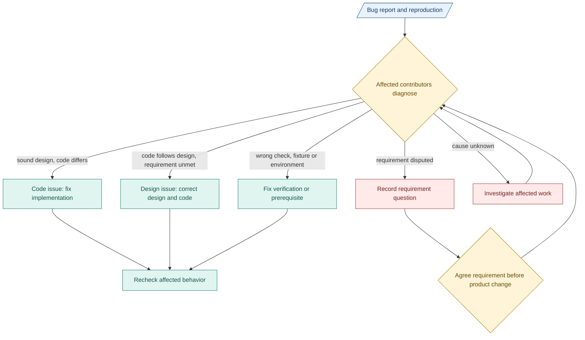

# 2. Changes and diagnosis

**Find the mismatch before changing behavior.** Compare requirement, design, code and checks at their recorded revisions.

## Bugs and issues

Blue: records. Teal: work/tools. Amber: human decisions. Red: unresolved.

- **Issue:** reproduction, expected/observed result, code commit, PRD revision, check evidence, affected modules and next action.
- **Design link:** commit-pinned file plus section/lines. For an uncommitted draft, attach exact bytes/hash and label it.
- **Notify:** affected implementation/check contributors. Add design contributors for disputed design, requirement contributors for disputed obligations. Link existing TASK/specification records.

## Change trace

- Trace affected producers, consumers, permissions, deployment, exports and evidence.
- Update definitions, versions/migration, summaries and diagrams together.
- Preserve sources and old runs. Mark affected evidence stale. Repeat affected checks.

## Timelines and phases

| Change | Design response |
|---|---|
| Date only | Update planning. Keep target, forecast and estimate assumptions distinct. |
| Scope, boundary or exit | Update affected design. Affected contributors agree commitment changes. |
| M1 to M2 | Carry evidence, unfinished work, blockers and changed assumptions forward. |

**Example:** credentials arrive late. Resequence independent work or revise the target. Mock results cannot meet a live-integration exit.

[Phase exits](../delivery-phases.md) · [Failure handling](../failure-and-human.md)
