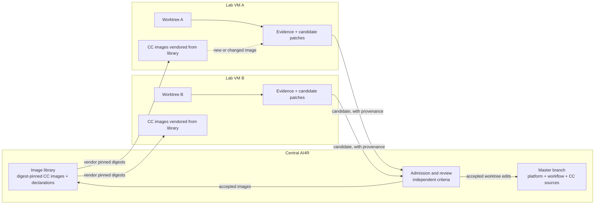

# AI4R lab: every CC as a container image

Links: [[Designs/cc-containerization-and-lab-isolation]] · [[Designs/Lab Progression]] · [[Amendments/Container CC Pilot/README]] · [[Designs/AI4Research Capability Growth]] · [[Designs/Paper2Agent Briefing/1 Decision brief]]

This is a proposal. It records Muk's idea and the notebook's reading of it. Nothing here is built, measured or accepted.

## What Muk said

From [[Sources/Prompts/2026-10-21-lab-containers-and-source-of-truth.txt|the exact message]] (wording kept, typos aside):

1. Look into an "ai4r lab" idea.
2. Turn all the CCs into their own containers.
3. There would be many VMs.
4. A central image library could vendor different CCs to different labs.
5. Each lab modifies and creates new CC images.
6. Each lab also modifies itself.
7. Certain worktree edits get merged back into the master branch.
8. The current jiuwenswarm edits are not claimed correct. A design-package already exists, built to match the old AI4R project's performance. The future goal is a lot better: a self-improving AI4R.

## The shape, in one picture

A lab never writes to the master branch or the image library. It exports candidates. Central review decides what lands.

## Clarification (second message)

[[Sources/Prompts/2026-10-21-lab-vm-master-and-cc-as-universal-component.txt|Muk then added]]: each lab is a VM holding an AI4R instance plus the resources of what it is building. The lab derives its capabilities from the "master branch", defined as the latest well-tested branch, whichever that is. The lab's AI4R uses those capabilities and its setup to modify itself: add CCs, improve CCs, adjust the workflow. A pilot is fine, but full containerization is likely.

This settles one gap: master is defined by a property (latest well tested), not by a named repository. It opens another: who defines "well tested", and where those tests live. See [[Designs/CC as Universal Component]] for that gap and the self-improvement comparison.

## Reading of each point

| Muk's point | Notebook reading | Already in the notebook |
|---|---|---|
| Every CC is a container | A CC image is a digest-pinned container that carries one capability and its declaration hash. The image is the dependency closure. | [[Amendments/Container CC Pilot/README]] pilots exactly one stateless CC. This note widens the direction; it does not widen the pilot. |
| Many VMs | One lab per VM. Labs share nothing except what the image library vendors. | [[Resources/lab/README]] is a single-host manager with no registry and no GPU. |
| Central image library vendors CCs to labs | A registry keyed by CC name, version, declaration hash and image digest. A lab pulls pinned digests only. | None. This is new. |
| Labs create new CC images | A lab builds a new image from a changed CC. It stays a candidate with provenance. | The lab CLI already exports a candidate patch plus change manifest. |
| A lab modifies itself | The lab edits its own worktree: workflow, planning, lab tooling. Same candidate rule as for CCs. | [[Designs/AI4Research Capability Growth]] covers system-change candidates. |
| Worktree edits merge to master | Only reviewed edits merge. The merge is a decision by central review, not by the lab. | [[AGENTS]]: lab changes remain candidates and are not silently promoted. |

## How this connects to Paper2Agent

- A Paper2Agent-style factory produces wrappers with real dependencies. A container image is the cleanest way to ship that dependency closure, and it answers the "dependency burden" question in the pasted [[Sources/Prompts/2026-10-21-pasted-architecture-review.txt|review]].
- A generated product CC becomes an image candidate in a lab. It enters the central library only after independent admission. Image existence is not admission.
- Source acquisition (find and pin a repository) runs best inside a lab. A lab can have network access that central does not, and the pinned snapshot travels as a resource.

## What to keep separate

- **Image library vs capability library.** The library holds images. Admission standing is a separate record. A stored image has no permission to run.
- **Container vs permission.** A container is an isolation boundary. Grants, budgets and bindings still come from the host.
- **A lab changing itself vs the criteria that judge it.** A lab may propose changes to its own tooling. It may not change the checks, held-out cases or acceptance rules that judge that change. Those live centrally.
- **Lab evidence vs central claims.** What a lab observed is a lab observation until central review replays or accepts it.

## Notes vs Muk: gaps to resolve

| Gap | Where they differ | Proposed resolution |
|---|---|---|
| All CCs vs one CC | Muk: full conversion is likely; a pilot is fine. The notebook's pilot is one stateless CC, gated on evidence. | Treat full conversion as the expected outcome. Keep the pilot as the first step and record the decision when evidence exists. |
| "Master branch" | Muk: the latest well-tested branch, whatever that is. Which repository, and who certifies "well tested", is still open. | Treat master as a role. Tests and referee that certify it are frozen per epoch and outside every lab's write reach. Nothing is merged by a lab. |
| "Modifies itself" | Could mean tooling inside the lab, or the AI4R platform as a whole. | Treat as both, as candidates. Platform and evaluator changes need separate evaluation releases. |
| Existing design-package vs current jiuwenswarm edits | Muk says the edits are not claimed correct. The design-package targets old-project parity. | Record both as inputs. Judge each against the new self-improvement goal, not against parity alone. |
| Decision register | "Per-CC containerization" is listed as open. | Leave it open. Add this note as the direction. |

## Open questions

1. What identifies a lab, and what may it fetch from the library?
2. Who builds images: the lab, or a central build service from a lab's source? Locally built images are harder to trust.
3. How do labs get GPU and model access without sharing credentials?
4. How are diverging labs reconciled when two candidates change the same CC?
5. What replays a lab's evidence centrally before a merge?
6. Does an image carry its tests so a lab and central run the same checks?

## Status

Proposed. No registry, vendoring, multi-VM run or image-per-CC measurement exists. The only lab evidence is the single-host Docker smoke campaign in [[Designs/Lab Progression]].

## October 21 detailed planning clarification (historical direction)

The October 21 request proposed the detailed target: every lab is a VM, AI4R contains a local independent factory with Docker images, and full CC containerization is intended. Earlier questions about whether to convert all CCs are superseded as direction; the bounded pilot still proves implementation. [[Designs/Lab Capsule and Factory Design Plan]] owns the next-work sequence. Images capture packaged software; external resources and hardware retain explicit reproducibility pins.

## Current high-level application view

[[Designs/Labs and Capability Capsules]] now supplies the application-facing logical boundaries and leaves deployment details open. The VM/container/factory proposal above remains a possible detailed realization; it is not a fixed requirement for simulator authors or runtime evidence.
