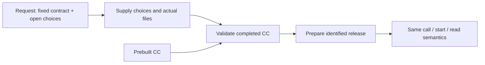
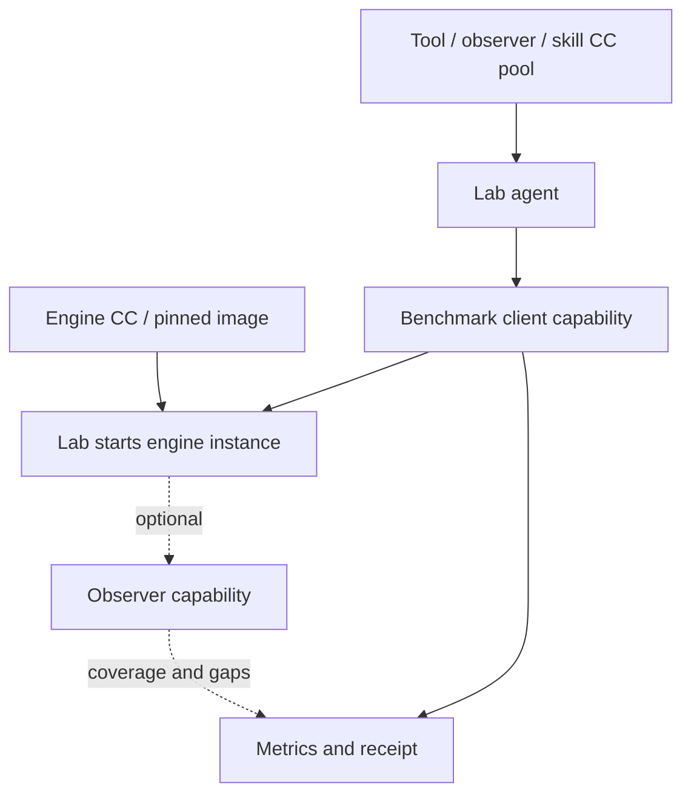

# Worked use cases

All packages use [the completed declaration schema](schemas/cc.schema.json). Native/image/delegate describe bindings; runtime-built/prebuilt describe delivery timing. Readiness, execution and scientific acceptance are distinct.

## 1. Minimal native action

Receive [trim](examples/trim/cc.yaml), `tool.py` and inputs. It needs Python and a small local runner, without network, registry, MCP or agent framework. Choose `trim`, supply `text`, receive `trimmed`. It declares no external effects. All-space input returns a valid empty string; missing/wrong input is invalid; a crash is execution failure. It starts per call and leaves retained records/artifacts rather than a service.

```text
python reference/ccv2.py run examples/trim trim --inputs examples/trim/inputs.json --trusted-local
```

This is reference CLI syntax, not a mandatory SDK. An independent runner implements [USAGE](USAGE.md).

## 2. Passive methodology library

Receive [library](examples/library/cc.yaml) and `SKILL.md`. Prepare and read `method`; no executable or execution grants are required. Its bytes supply context, not authority to run tools. Source edits after preparation do not change previous material identity. There is no process to stop. An active internal search library would expose a normal query capability or service, with network effects if it contacts outside sources; no database technology is prescribed.

## 3. Request to runtime-built CC

Receive [trim-request.json](examples/trim-request.json), not executable software. Resolve its sole open binding with [the answers](examples/trim-answers.json), provide the real `tool.py`, validate and prepare the completed [trim package](examples/trim/cc.yaml). Reusing the request makes it a template.



Changing a fixed port/effect requirement means revising the request. Identical completed bytes yield the same release and usage regardless of when they were built. A missing implementation choice cannot execute. Construction may need an authorized coding environment; consuming the resulting CC does not require its Factory.

## 4. An entire application

CC supports the inference engine ontology in a request CC. Obtain its definition from the person responsible for that ontology; CC provides the [construction-material mechanism](FORMAT.md#externally-defined-construction-material).

Receive [service](examples/service/cc.yaml), implementation and API document. Choose `api`, authorize persistent process/listening effects, start it and retain instance identity. Connect to its returned HTTP endpoint: `/health` establishes availability and `/compute?x=3` returns synthetic data. Choose `inspect` to get package information without starting the service; it inherits no service permissions.

[image.yaml](examples/service/image.yaml) selects the same API through a pinned image, requiring a compatible provider and locally available image or authorized pull. Use that declaration as `cc.yaml` in a separate package copy. An image with its own complete entrypoint/CMD can omit `command`; this fixture supplies an explicit command because it uses the Python base image. It mounts supplied implementation bytes; it does not impose the finite process packet on the service. The basic Docker bridge exposes egress and therefore requests outbound-network authority; an enforcing provider could supply narrower controls.

Inspect state/logs and stop the owned generation. Clean uninstall is optional; shared images/volumes remain separately owned. This is a synthetic application, not inference. A valid image declaration is not evidence the image executed.

## 5. Coding subagent

Receive [coding](examples/coding/cc.yaml). The host registers its generic delegate, supplies an assigned workspace handle and authorizes the selected task. Choose `repair`, provide workspace/task and receive evidence plus actual test results. Native sessions, tools and direct editing remain inside that task; each internal edit need not become a CC call.

Preserve preexisting dirty/untracked files. Coordinate writers, record base/result identities, changed files, actual checks and remaining issues. Model use, dependency installation, publication and deployment require their own authority when used. Interrupted work retains partial changes and logs; do not replay edits blindly. An agent's completion message alone is not test evidence. Stop/cancel through the native owner and retain uncertainty when cessation is unconfirmed.

## 6. Stateful paper method

Receive [paper-method](examples/paper-method/cc.yaml), implementation and dependency lock. With its MAPIE dependencies installed, `fit_calibrate` takes split data and returns a model artifact; `predict_intervals` takes that artifact/data and returns intervals; `evaluate` takes intervals/labels and returns coverage, width and count. State crosses ports as explicit artifacts, not hidden Python objects.

Poor coverage is valid result data. Record method/version, splits, seeds, environment and omitted methodology; this fixture does not reproduce every paper claim. Serialized model artifacts require trusted producers: identity does not make an untrusted pickle safe. Calls are finite; retain desired artifacts without a model service to uninstall.

## 7. Lab composition

The Factory can deliver an engine CC referencing a pinned image plus source/diff/build evidence. The Lab admits the image and external model/configuration, starts the engine capability and retains its actual loaded generation. Pool CCs supply tools, observers and skills. Clients use host-issued resources or admitted native interfaces. The complete [Lab client package](examples/lab/cc.yaml) takes an `engine` handle registered by the host with kind `environment`, actual `url` and instance identity. `benchmark` also takes `workload: {points: [1,2,3]}` and returns client metrics; it needs `network.request`. `observe` needs no network permission and returns a partial coverage report without a trace, because this fixture has no internal tracer. The benchmark continues independently. Both are finite calls; stop the separately owned engine after retaining metrics.



The benchmark client owns workload requests and returns raw metrics. Optional profilers identify target, attachment effects, sampling, perturbation and complete/partial/unavailable coverage. Candidate self-tests and independent Lab acceptance have different owners. The user-named SOL suite must be pinned before claims about it. Cleanup affects only owned experiment resources, preserving borrowed engines/data and desired evidence.

Incus, Strata/Muse, GPU admission, native MCP discovery and cleanup providers are implementation choices in [IMPLEMENTATION](IMPLEMENTATION.md). None is required for ordinary local CC use.

## Interpret and recover

| Observation | Caller response |
|---|---|
| Invalid input or missing dependency | Repair it or select a compatible capability. |
| Useful partial evidence | Retain it with its stated gaps. |
| Optional review/telemetry unavailable | Preserve completed outputs and limit claims. |
| Scientific negative | Preserve the metric; assess the candidate separately. |
| Lost reply / unknown effects | Lookup and reconcile the original execution before retry. |
| Missing required downstream output | Block that consumer, not unrelated work. |
