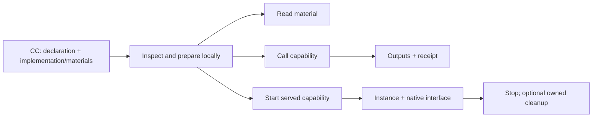

# Capability Capsules — CC v2 draft

Software, agents and methodologies arrive with inconsistent interfaces, dependencies, usage instructions and evidence. **CC supplies a common description and usage boundary so people and agents can understand, prepare, use and trace them.** It packages useful software and knowledge without prescribing their internals.

A recipient should quickly know what is provided, what it needs, what it can change, how to use it and what its results establish.

**[Declaration schema](schemas/cc.schema.json) · [Format and field dictionary](FORMAT.md) · [Invocation and lifecycle](USAGE.md) · [Complete examples](EXAMPLES.md)**

## Terms

| Term | Meaning |
|---|---|
| Capsule | Versioned package of capabilities and/or materials. |
| Capability | An action or an interface provided over time. |
| Material | Passive skills, instructions, methodologies or reference bytes. |
| Binding | How an implementation is executed or reached. |
| Access | Reading material, calling an action or connecting to a served interface. |
| Call | One invocation with actual inputs and authority. |
| Instance | One running service generation. |
| Receipt | The runner's known execution facts and result references. |



## A small CC

A package is a folder containing `cc.yaml` and its declared files:

```yaml
cc: '2'
id: text.trim
version: 1.0.0
bindings:
  default:
    kind: native
    command: ['{python}', '{bundle}/tool.py']
capabilities:
  trim:
    does: Remove surrounding ASCII spaces; all-space input returns an empty string.
    takes: {text: text}
    gives: {trimmed: text}
```

The [complete package](examples/trim/cc.yaml) includes the implementation. Supply `{"text":"   "}`; receive a present empty string, not a missing output. Inputs and outputs belong to each capability. Shared packaging does not grant sibling authority.

## Three delivery situations, one usable format

- **Request CC:** desired contract and explicit unresolved choices; cannot execute.
- **Runtime-built CC:** implementation completed during a task, then prepared and used normally.
- **Prebuilt CC:** implementation already supplied or pinned, then prepared and used normally.

A running instance is execution state, not another package form. A template is a reusable request. [FORMAT](FORMAT.md#request-cc) defines construction; [EXAMPLES](EXAMPLES.md) walks each situation.

**Describe what should be built.** CC supports the inference engine ontology in request CCs. Its definition is maintained by the person responsible for that ontology. This is one use of CC's general construction contract alongside tools, agents, services and methodology libraries.

## Independent and lightweight

CC requires no Factory, Lab, agent framework, registry, network service or telemetry collector. Local use works offline when its declared software and assets are available. A passive library needs no executable. Native and image bindings are execution choices; finite actions and persistent services are lifetime choices.

The host authorizes effects; the runner records known identity and execution state. Domain JSON stays open unless deliberately constrained. Semantic verification, internal telemetry and clean uninstall are optional. Unknown effects remain unknown; successful execution can report poor scientific results.

Read [FORMAT](FORMAT.md) to build a CC, then [USAGE](USAGE.md) to consume one. [IMPLEMENTATION](IMPLEMENTATION.md) separately describes the experimental runner, adapters and strategy. This is a draft, not production certification.
