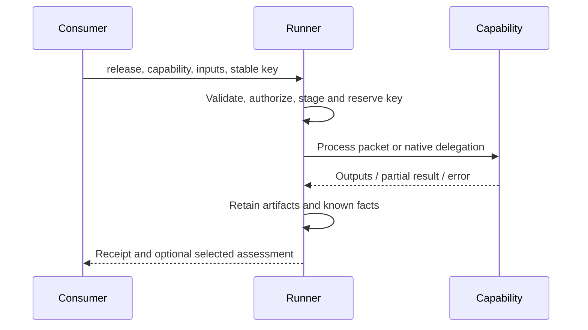
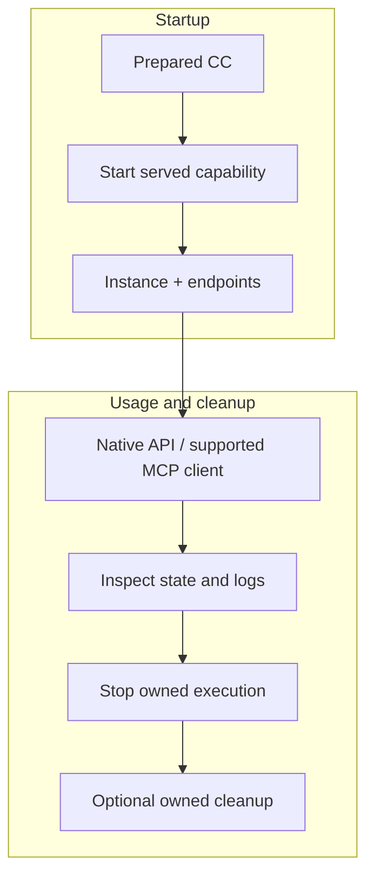

# Access, execution and lifecycle

## Responsibilities and independence

A producer supplies the contract and its files. A consumer selects an entry and supplies inputs. A runner prepares the package, binds actual resources/authority, executes through a supported binding and records known facts. A runner MUST reject unsupported bindings/resources rather than silently substitute another implementation.

Reading passive material needs only a file consumer. Managed execution needs a local runner and the selected runtime/dependencies; images need a container provider, delegates need their registered host. Offline use works with locally available assets. No registry, Factory, Lab, agent framework or telemetry service is required. Software MAY also expose its ordinary CLI/API directly; direct use does not fabricate CC receipts or replay protection.

## Prepare and authorize

The preparer MUST validate the declaration, references, included files and portable index in [FORMAT](FORMAT.md). It SHOULD identify missing dependencies before dispatch. Preparation MUST NOT silently install software or grant network, workspace or model access. Authorized setup MAY install dependencies into the chosen environment.

The host supplies principal, authorized resources and effect grants. Session authorization MAY be reused. The selected capability MUST NOT inherit sibling authority. Explicit grants can narrow existing authority, never widen it. Runners MUST distinguish declared, granted, observed and enforced effects. Trusted native execution provides no OS isolation; providers record actual controls and limitations.

## Finite invocation

| Call field | Required / default | Meaning |
|---|---|---|
| `release` | Required digest | Immutable package identity. |
| `capability` | Required ID | Selected finite action. |
| `inputs` | Required object | Named plain argument values. |
| `key` | Required nonempty text | Stable host/caller invocation identity. |
| `grants` | Optional | Narrow host authorization; otherwise inherit selected capability's authorized effects. |
| `timeout` | Optional / host policy | Positive execution deadline in seconds. |
| `checks` | Optional / empty | Selected advisory semantic checks. |
| `require_checks` | Optional / false | Explicit acceptance policy for selected checks. |

If admission cannot create a call, a CC transport MAY return `{error:{code,message,path?}}`, defined by `transportError` in the message schema. Once a call exists, its receipt records execution errors. Native service APIs retain their own business error formats.

See [call schema](schemas/messages.schema.json#/$defs/call). The trusted caller/host MUST choose the key before transport dispatch. Identical duplicates observe the existing execution; changed bound inputs/policy under the same key MUST conflict. A deliberate new execution uses a new key. Keys are scoped to the trusted host/principal namespace; callers SHOULD use globally unique values for new invocations. Transport IDs and trace IDs are not invocation keys.

| Port | Caller supplies | Implementation receives |
|---|---|---|
| JSON | Ordinary JSON | Same value, optionally schema-validated. |
| Text | String | Same string. |
| Artifact | `{uri, sha256}` | Verified staged `{uri, sha256, path}`. |
| Handle | Host-issued string | Host-resolved resource binding under admitted policy. |

Artifact `uri` is a nonempty locator; `sha256` identifies exact bytes with 64 lowercase hex characters. Access locations can change without changing identity. Reference-shaped JSON on a JSON port remains JSON. Handles/references do not grant access by themselves.

## Native/image process contract

The runner sends one JSON document to stdin and EOF. Required fields are `call` (execution ID), `attempt` (positive integer), `capability` (selected ID), `inputs` (staged map), `output_dir` (writable output directory), and `resources` (host bindings). The directory is also `CC_OUTPUT_DIR`. Callers do not manage container-specific paths.

The process MUST write exactly one result JSON document to stdout; logs go to stderr. Result fields are `outcome` (`ok`, `partial`, `error`), `outputs` (required for ok/partial), `reason` (required nonempty explanation for partial) and `error` (required `{code,message,path?}` for error). Unknown protocol fields fail. An `ok` result MUST supply required output ports. Partial/error results retain valid available outputs and diagnostics. Nonzero exit remains execution failure even when useful partial data exists.

Artifact outputs are `{path: relative-file}` beneath `output_dir`. The runner MUST reject escapes, links and special files, verify input artifact identity and persist immutable output references. Tools MUST NOT author authoritative runner receipts. [Process/message definitions](schemas/messages.schema.json) define structural types.

## Receipts and interpretation

| Receipt field | Required / type | Meaning |
|---|---|---|
| `cc` | Required string `2` | Protocol version. |
| `call`, `key`, `release`, `capability` | Required strings | Execution, deduplication, package and action identities. |
| `attempt` | Required positive integer | Actual execution attempt within the call. |
| `state` | Required enum | running, succeeded, failed, blocked, cancelled, unknown. |
| `completeness` | Required enum | none, partial, complete promised-result coverage. |
| `reason` | Required nonempty code | Machine-readable explanation. |
| `outputs` | Required object | Named returned values/artifact references. |
| `assessment` | Required `{verdict, checks}` | Verdict: not_requested, pending, not_run, passed, failed, inconclusive. Pending means requested checks have not completed; not_run means execution ended before checks could run. Checks is a list of observations. |
| `provenance` | Required object | Known inputs, actual binding/environment/configuration, execution identity/times and artifact links. |
| `effects` | Required object | Selected declarations/grants and actual enforcement/observation limits. |
| `diagnostics` | Required list | Failures/gaps and recovery context; export no secret values. |
| `reconciliations`, `late_observations` | Optional lists | Retained recovery history. |

The [receipt schema](schemas/messages.schema.json#/$defs/receipt) fixes this envelope. Host-specific provenance/effect observations remain open JSON. The runner MUST retain known identity and honest state even when internal telemetry is absent. Missing observations do not establish absence of effects.

Execution success is not semantic correctness. Failing tests or poor coverage can be valid returned data. Missing required outputs block their dependent consumers, not unrelated work. Requested advisory check failures/unavailability/exceptions MUST preserve completed execution and outputs. Missing explicitly required checks block before execution; failed post-execution acceptance remains separate from successful execution. A separate verification capability MAY consume saved outputs without rerunning the producer.

## Service startup and access

A start binds release, capability, setup inputs, grants, startup timeout and stable key. It returns `cc-instance/2`, not a finished business response. Ongoing traffic follows the native contract. The producer MUST NOT maintain a second CC method list when native discovery already supplies it.

| Instance field | Required / type | Meaning |
|---|---|---|
| `format` | Required `cc-instance/2` | Instance record format. |
| `id`, `key`, `release`, `capability` | Required strings | Instance, start-deduplication, package and entry identities. |
| `state` | Required enum | preparing, running, exited, stopped, failed, unknown. |
| `readiness` | Required enum | not_checked, ready, not_ready, failed. |
| `endpoints` | Required URL map | Resolved native interfaces. |
| `identity` | Required object | Generation-aware process/container/provider identity. |
| `inputs`, `effects`, `provenance` | Required objects | Bound configuration, admitted effects, actual provider/environment facts. |
| `diagnostics` | Required list | Known failures and gaps. |
| `logs` | Optional object | Available stream locations. |
| `reconciliations`, `late_observations` | Optional lists | Recovery history. |

See [instance schema](schemas/messages.schema.json#/$defs/instance). A health probe establishes startup availability, not loaded model identity, continuous health or benchmark correctness. The provider MUST record actual configuration/generation as far as observed.

Consumers MUST be able to look up the original start by key after a lost reply, inspect state/logs and request stop. Stop MUST confirm cessation of the owned generation or retain uncertainty. A missing parent PID alone does not establish that children stopped. Providers MAY add supervisors/restarts/remote execution, with specified semantics; the baseline does not invent those services.

## Interruption, cleanup and observation

A timeout/disconnect does not prove cessation. The runner MUST NOT automatically replay uncertain edits, startups or external effects. Reconciliation records actual cessation/effect evidence and retains previous/late observations. Workspace writers require host coordination; unrelated stores/programs are outside a local ledger's assurance.

Clean uninstall is optional. Providers offering it MUST distinguish owned from borrowed/shared resources, preserve desired outputs/evidence, report remaining resources and obtain authority before removing shared engines, weights or user data. Removing a container cannot undo remote writes or shared-volume changes.

Internal logs, metrics, traces and exporters are optional. Observers SHOULD identify subject, source, scope, coverage/gaps and retained signal artifacts. Trace context correlates work; it is not authority or proof of completeness. [Optional profiles](profiles/README.md) supply stronger evidence only when selected. A Lab MAY require evidence for a particular claim without imposing that requirement on every ordinary capability.
