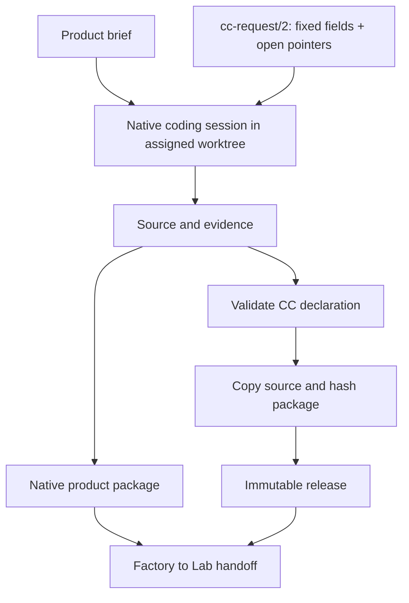

# Factory construction, requests and sealing

The Factory turns a brief into a software product and, where useful, reusable capsules. It can return **zero CCs**. A release is one deliverable format; a native inference-engine component is another.



The session can inspect, plan, edit, test and delegate using native tools. A task becomes a CC when its reusable call boundary adds value.

## Release construction

Validate identity, ports, binding selection and supported requirements/effects/checks. Copy source into sealed storage and hash the declaration and included material. Return release identity and available build lineage. Admit against the actual adapter before calling.

```text
python reference/ccv2.py validate PACKAGE/cc.yaml
python reference/ccv2.py seal PACKAGE --store STORE
```

Sealing captures required source, including binary/untracked material, rather than identifying a dirty checkout only by its commit. Later author-workspace edits cannot alter sealed execution. A source digest does not pin the entire host OS. Native sealing captures the resolved executable hash, and calls verify the current executable. Installed dependency versions are observed; full wheel-file integrity and the whole host environment are not sealed. File snapshots exclude dependency/cache directories such as `.venv`; ordinary file modes and Git HEAD/index identity are captured separately.

The [reference runtime](reference/ccv2.py) is a validator/sealer and call host, not a full compiler/build system. Its callable API starts with `Host(store, resources=None, delegates=None, checkers=None, python=None)`. `seal(bundle)` seals a package; `call(release, capability, inputs, key=None, grants=(), timeout=60)` binds a capability, inputs and host policy. The callable API executes trusted local code; callers must establish that trust before using it. Consult its implementation/help for exact supported options.

## Requests are work, not callable releases

`cc-request/2` reuses desired v2 fields and explicitly lists open choices. Fixed values remain fixed. An implementer supplies real code and answers; the resolver does not invent implementation from prose.

```json
{
  "format":"cc-request/2", "kind":"request", "id":"team.trim.001",
  "desired":{
    "cc":"2", "id":"text.trim", "version":"1.0.0", "bindings":{},
    "capabilities":{"trim":{"does":"Trim ASCII spaces.","takes":{"text":"text"},"gives":{"trimmed":"text"}}}
  },
  "open":{"/bindings/default":{"owner":"implementer","question":"Provide the executable binding and package source."}}
}
```

Pointers are relative to `desired`. Each names an absent field whose parent exists. Reject overlap and implicit holes; null is not an unresolved marker. Fill exactly declared pointers, preserve fixed content, then validate the complete declaration. Changed fixed requirements create a revised request linked to its predecessor. Instantiate a template before materializing it.

The reference resolver performs bounded generic pointer filling. It cannot interpret arbitrary external constraints, choose a scientific method, write source automatically or prove the command implements `does`. Keep original request, answers, normalized declaration, source, build evidence and release linked. Build authority comes from the Factory session/call, not request text.

## Deliverables

| Requested output | Factory supplies |
|---|---|
| Reusable CC | Complete contract, sealed implementation, release and evidence. |
| Native product | Native manifest, immutable payload, lineage and compatibility. |
| Source/patch | Exact base plus all reconstruction/build material. |
| Interrupted work | Actual partial artifacts, remaining questions and diagnostics. |

Text diffs can omit untracked files, binary bytes, modes, submodules and LFS objects. Supply them or declare an incomplete handoff. Preserve Strata's native `engine-component.json` format. Lab verifies the actual loaded binary/configuration and generation; see [04](04-provenance.md) and [11](11-factory-lab-handoff.md).
