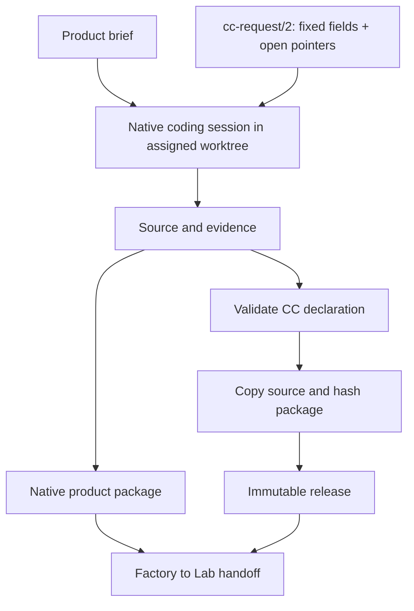

# Factory construction, requests and sealing

The Factory turns a brief into software. A CC can wrap the resulting application, expose reusable tools, or do both. A raw product can still contain zero embedded CCs; wrapping its delivery does not change its internal API or native manifest.



The session can inspect, plan, edit, test and delegate using native tools. A task becomes a CC when its reusable call boundary adds value.

## Release construction

Validate identity, ports, binding selection and supported requirements/effects. Guarantee IDs advertise checkable commitments; checker availability is checked only when a caller explicitly requires that verification. Copy source into sealed storage and hash the declaration and included material. Return release identity and available build lineage. Admit against the actual adapter before calling.

```text
python reference/ccv2.py validate PACKAGE/cc.yaml
python reference/ccv2.py seal PACKAGE --store STORE
```

Sealing captures required source, including binary/untracked material, rather than identifying a dirty checkout only by its commit. Later author-workspace edits cannot alter sealed execution. A source digest does not pin the entire host OS. Native sealing captures the resolved executable hash, and calls verify the current executable. Installed dependency versions are observed; full wheel-file integrity and the whole host environment are not sealed. File snapshots exclude dependency/cache directories such as `.venv`; ordinary file modes and Git HEAD/index identity are captured separately.

The [reference runtime](reference/ccv2.py) is a validator/sealer and call host, a bounded reference host plus an optional Git-change materializer, not a universal compiler/build system. Its callable API starts with `Host(store, resources=None, delegates=None, checkers=None, python=None, session_grants=None)`. Ordinary development uses `run(bundle, capability, inputs, ...)`, which seals the current implementation automatically. `seal(bundle)` and `call(release, capability, inputs, key=None, grants=None, timeout=60, checks=(), require_checks=False)` remain available for explicit release management. The callable API executes trusted local code; callers must establish that trust before using it.

## Requests are work, not callable releases

`cc-request/2` reuses desired v2 fields and explicitly lists open choices. Fixed values remain fixed. An implementer supplies real code and answers; the resolver does not invent implementation from prose.

```json
{
  "format":"cc-request/2", "kind":"request", "id":"team.trim.001",
  "desired":{
    "cc":"2", "id":"text.trim", "version":"1.0.0", "bindings":{},
    "capabilities":{"trim":{"does":"Trim ASCII spaces.","takes":{"text":"text"},"gives":{"trimmed":"text"}}}
  },
  "open":{"/bindings/default":{"owner":"implementer","question":"Provide the executable binding and package source."}}
}
```

Pointers are relative to `desired`. Each names an absent field whose parent exists. Reject overlap and implicit holes; null is not an unresolved marker. Fill exactly declared pointers, preserve fixed content, then validate the complete declaration. Changed fixed requirements create a revised request linked to its predecessor. Instantiate a template before materializing it.

The reference resolver performs bounded generic pointer filling. It cannot interpret arbitrary external constraints, choose a scientific method, write source automatically or prove the command implements `does`. Keep original request, answers, normalized declaration, source, build evidence and release linked. Build authority comes from the Factory session/call, not request text.

## Deliverables

| Requested output | Factory supplies |
|---|---|
| Reusable CC | Complete contract, sealed implementation, release and evidence. |
| Native product | Native manifest, immutable payload, lineage and compatibility. |
| Source/patch | Exact base plus all reconstruction/build material. |
| Interrupted work | Actual partial artifacts, remaining questions and diagnostics. |

Text diffs can omit untracked files, binary bytes, modes, submodules and LFS objects. Supply them or declare an incomplete handoff. Preserve Strata's native `engine-component.json` format. Lab verifies the actual loaded binary/configuration and generation; see [04](04-provenance.md) and [11](11-factory-lab-handoff.md).

## Source and executable handoff

Use **both when useful**: source is the change/rebuild representation; a pinned native payload or image is the execution representation. Do not require every small tool to ship a repository or every experiment to build an image. The Factory builds once per candidate, then the Lab starts that identified result. A new patch/configuration creates a new release and instance.

| Representation | Good use | Insufficient by itself |
|---|---|---|
| Exact base + complete patch/materials | Coding, inspection, local improvement, rebuild | A diff without its base/dependencies cannot run. |
| Native executable/source bundle + lock | Fast local CPU experiments and existing host runtimes | Host/ABI/dependencies still need admission. |
| Pinned image + external assets | Repeatable Lab setup with system dependencies | Images do not identify external weights, data, drivers or actual loaded component. |

The companion `cc-source-change/1` has exactly these fields:

| Field | Required type and meaning |
|---|---|
| `format` | Literal `cc-source-change/1`. |
| `repository` | Nonempty Git locator; retrieval location, not identity. |
| `base` | Full 40-character lowercase Git commit ID. |
| `patch` | Standard artifact reference to a binary-capable Git patch, including additions/deletions/modes. |
| `tree` | Full 40-character expected Git tree after applying the patch. |
| `build` | Object with `command` (nonempty argv), `output` (relative payload directory), optional `lock` (relative dependency-lock file). |

The materializer checks out the exact base in a new directory, validates/applies the patch to the index, verifies the expected tree, hashes the lock if supplied, executes the authorized build argv, rejects changed tracked source/index, and copies the nonempty payload into a completed package template. It never applies changes to the caller's working repository. `{python}` chooses the configured interpreter. Dependencies are not installed implicitly. The current profile rejects submodules and linked payload files; LFS/weights and environment closure require separately resolved materials and a qualified builder.

```text
python reference/ccv2.py materialize TEMPLATE CHANGE.json --output NEW_PACKAGE --store STORE --trusted-build
python reference/ccv2.py prepare NEW_PACKAGE --store STORE
```

Template identity, bindings and application contracts are complete; only `payload/` is supplied by this build. Unresolved contracts use `cc-request/2` first. A `cc-build/1` record is generated and linked through package `provenance`; it records the source-change document, observed base/tree, dependency-lock hash or null, command, interpreter path/hash, payload file identities, step outputs/exit codes, completion time and environment limitations. Authors do not maintain these observations twice. Build logs must exclude credentials before export.

The reference materializer builds native payloads. Existing image builders may emit an immutable image binding and equivalent build evidence; this does not prescribe a new Docker/build language. Reproducible-build services, signatures and registries remain optional integrations.

Distinguish **build success**, **startup readiness**, **qualification** and **installation eligibility**. A built program may be incompatible with a Lab; a healthy service may return a scientifically poor result. Qualification is evidence, and installation eligibility is the receiving host's policy. None is inferred from another.

Every authorized materialization retains `cc-build-attempt/1` at `STORE/builds/ATTEMPT/attempt.json`: ID, state, source-change input, start/completion times, step argv/stdout/stderr/exit and error/result. Errors carry that path. Failure does not discard build logs. Timeout is `unknown`: the direct subprocess is stopped, but native grandchildren may continue. Inspect/reconcile effects manually before a deliberate retry; this materializer has no automatic retry or background-build recovery service. Build logs are local and may be sensitive; review before publishing. Empty patches support rebuilding the exact base. Unresolved tracked LFS pointers and submodules are explicitly rejected by this profile.
