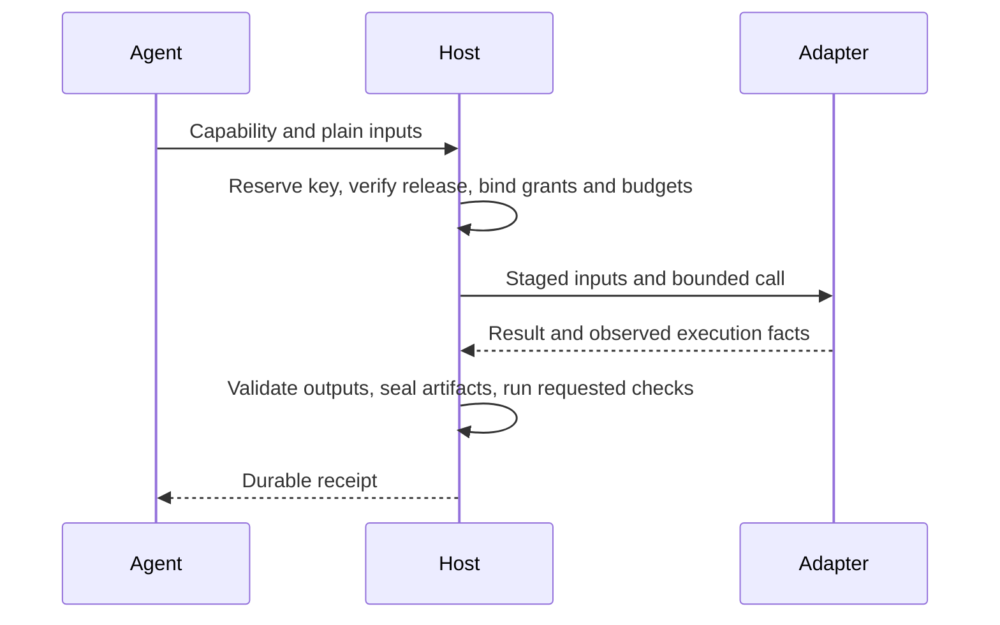

# Call a capability and interpret its receipt

The logical call is `{release, capability, inputs, key}`. `inputs` is a port-name map of **plain argument values**. The host supplies the key or accepts it through its trusted calling API; model arguments do not choose principal, grants or budgets.

Ordinary development can use `Host.run(bundle, capability, inputs, ...)`; it seals current source and calls it without manual release/key plumbing. `Host.call` remains the lower-level API for pinned releases. Configure `session_grants` on the Host once, or use CLI `--session FILE` / `CC_SESSION` with a JSON object containing `grants` and optional `resources`. These are already authorized host settings, not model-authored arguments. Call-level grants can narrow those permissions.

## Verification is opt-in

`Host.call` and `Host.run` accept `checks=()` and `require_checks=False`. Default calls run zero semantic checkers. A declaration's `guarantees` list does not change that default.

| Caller choice | Behavior |
|---|---|
| No checks | Execute normally; assessment `not_requested`. |
| `checks=[...]` | Run advisory checks after valid outputs exist; retain outputs and successful execution on check failure/unavailability/exception. |
| `checks=[...], require_checks=True` | Missing required checker blocks before execution. Failed/inconclusive post-execution assessment prevents acceptance while execution remains succeeded. |

The chosen policy is recorded in `provenance.verification` and participates in the invocation fingerprint. Changing it under the same key conflicts. Host callbacks may return `PASS`, `FAIL`, `INCONCLUSIVE` or `UNAVAILABLE`; exceptions become `CHECKER_ERROR`, never a fabricated execution failure. Checkers receive copies of the result packet; this is data protection, not an OS isolation guarantee for arbitrary host code.

Explicitly requested callbacks run synchronously in this prototype. Advisory means they do not gate acceptance or erase results; it does not introduce a background verification service. Ordinary calls invoke none.

CLI `--check ID` requests a checker and `--require-checks` requires the selected checks. No check means no semantic verification. `core.complete` is an optional built-in completeness check; domain checkers are registered by the host application. Normal call/run exit status is 0 for usable execution, including advisory failure or valid partial evidence; 1 for failed/blocked/unknown execution or explicitly required-check failure; 2 for malformed CLI input/configuration.

```json
{"release":"SEALED_RELEASE","capability":"trim","inputs":{"text":"   "},"key":"HOST_KEY"}
```

## Values, artifacts and handles

| Kind | Caller value | Tool receives |
|---|---|---|
| JSON | JSON accepted by optional schema. | The same value. |
| Text | String. | The same string. |
| Artifact | `{"uri":"LOCATOR","sha256":"64_HEX_DIGEST"}`. | Verified staged `{"uri":"LOCATOR","sha256":"64_HEX_DIGEST","path":"HOST_STAGED_PATH"}`. |
| Handle | Host-issued string. | Host-resolved resource binding under adapter policy. |

The host verifies artifact bytes and resolves handles against its resource policy. Ref-shaped JSON on a JSON port remains JSON. Optional ports may be absent; required ports may not. The host does not invent domain defaults. A media-type label does not prove actual content inspection.

For native/image execution, stdin is one JSON packet and EOF. The packet identifies call, attempt and capability, carries staged `inputs`, and supplies `output_dir`. That directory is also in `CC_OUTPUT_DIR`. Logs go to stderr; stdout carries one result document:

```json
{"outcome":"ok","outputs":{"trimmed":""}}
```

Tools return plain JSON/text values. Artifact outputs are `{"path":"relative-file"}` below the output directory. The host rejects path escapes, links and special files and persists immutable `{uri,sha256}` references. Tools do not author authoritative receipts. `outcome: "partial"` preserves valid available outputs and a reason; `outcome: "error"` preserves failure diagnostics. Invalid output and process failure remain visible.

## Receipt

Every host receipt contains:

```text
cc, call, key, release, capability, attempt,
state, completeness, reason, outputs,
assessment: {verdict, checks}, provenance, effects, diagnostics
```

| Dimension | Meaning |
|---|---|
| `state` | running, succeeded, failed, blocked, cancelled or unknown. |
| `completeness` | none, partial or complete coverage of the promised result. |
| `reason` | Runtime's machine-readable explanation. |
| `assessment` | Separate semantic checks; empty checks mean `not_requested`. |
| `provenance` | Release, inputs, adapter and actual execution lineage. |
| `effects` | `declared`, `granted`, `observed`, `enforced`, `assurance` and `observation_limits`; native admission is not OS monitoring. |
| `diagnostics` | Errors and recovery context; no secret bytes. |

A successful process does not establish semantic correctness. A valid test report can say tests failed. Partial evidence can support bounded diagnosis while failing full-window policy. Required but unavailable evidence cannot produce an invented pass.

## Execution and authority



| Mode | Honest boundary |
|---|---|
| Native `trusted_local` | Team-trusted arbitrary code. Admission and observations are useful; no OS isolation is claimed. A workspace diff is incomplete evidence of possible effects. |
| Image baseline | No network without a network grant. Actual mounts and controls must match recorded enforcement. Container availability alone proves no broader boundary. |
| Registered JiuwenSwarm | Native permissions/provider enforce what they support. Registration is not a deployed integration test. |

Record **declared**, **granted**, **observed** and **enforced** separately. Do not infer no effects outside a workspace from file-change observation. Refuse unsupported boundaries or explicitly admit trusted-local mode. Child processes and model invocations remain relevant effects.

## Retry and interruption

Bind a key to immutable call contents before dispatch. Identical duplicates observe the existing call/receipt; changed contents conflict. A deliberate new execution needs a new key. Keep call IDs separate from transport IDs, agent task IDs and attempts.

A lost reply, disconnect, crash or timeout does not prove cessation. If process stopping and relevant effects cannot be established, retain `unknown` and reconcile the original execution. Never automatically replay an uncertain effect. Confirm cancellation only with execution-owner stop and effect reconciliation; cancellation cannot erase a completed effect.

Workspace leases reject overlapping canonical paths. An unknown call retains its leases until reconciliation; a new call cannot bypass an unresolved writer.

An operator who has established that execution stopped can use `Host.reconcile(key, stopped=True, note="actual stop/effect evidence")`, or:

```text
python reference/ccv2.py reconcile KEY --store STORE --stopped --note "Actual stop and effect evidence"
```

This changes the current state to `failed` with reason `RECONCILED_STOP`, retains the original attempt receipt and appends reconciliation evidence. The operator assertion does not convert uncertain work into successful execution or authorize blind replay.

A late adapter response cannot replace that reconciliation. Store it as a separately hashed late observation and retain the reconciled terminal state and history. The reference host serializes finalization and reconciliation through the same local ledger.

Native sessions can carry many calls. Conversation pause, input-required state, rejection and confirmed cancellation are distinct observations. Preserve interrupted work, partial artifacts and diagnostics. [09](09-upstream-coding-integration.md) identifies pinned-upstream bridge requirements.

## Recover without blocking unrelated work

| Observation | Caller action |
|---|---|
| Missing/wrong required input | Repair the named argument or select a compatible capability. |
| Execution failure | Inspect retained logs/results; repair or choose another tool. Do not call it success. |
| Optional check failed or unavailable | Keep using the result where its evidence is sufficient; optionally review later. |
| Partial evidence | Retain it with its stated limitation; require completeness only where needed. |
| Missing output needed by another call | That dependent consumer cannot proceed until supplied; unrelated work need not stop. |
| Unknown effects | Reconcile the original attempt before replaying it. |

Scheduling and graph propagation belong to the caller. This revision does not change M1's old scheduler or node adapter. Its former verifier-blocking behavior must be migrated explicitly rather than assumed fixed by a v2 declaration.

The synchronous reference callback demonstrates completed native tasks and deadline uncertainty. It does not implement a general background-job service, pause/resume API or cancellation forwarding service; those controls remain owned by the native session integration and must be qualified before being advertised. The local ledger is single-user, with leases scoped to that store. Separate stores or external programs do not participate in its concurrency control.
