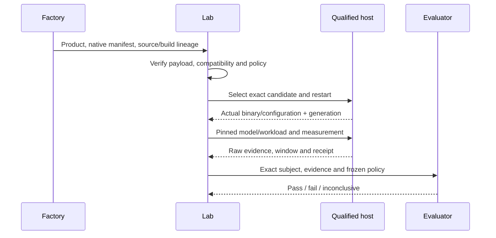

# Provenance and Lab measurement

A receipt records execution; assessment interprets evidence; promotion chooses adoption. Keep distinct records joined by immutable references.

| Owner | Records |
|---|---|
| Factory | Source tree including dirty changes, material, recipe/toolchain, tests and product. |
| Sealer | Declaration/source hashes and release identity. |
| Call host | Key/call/attempt, release/adapter, inputs, handles, grants, limits and enforcement. |
| Executor | Actual provider/environment, time, outputs, observations, diagnostics and interruptions. |
| Lab | Delivered candidate, actual loaded binary/component, effective configuration, generation and window. |
| Evaluator | Frozen workload/baseline/criteria, exact evidence, coverage limits and verdict. |

Never substitute requested revision for executed identity. Digests establish only the bytes covered. Missing logs, unknown effects and incomplete lineage stay explicit.

## Native Strata handoff

Preserve Strata's existing native engine package. The reviewed basis was revision `c62d5e3a15b40ea51c96aae9e8d36928965f53ab`: `engine-component.json` schema 2 records file hashes/sizes, entrypoint, platform/backend, architecture targets and runtime/driver requirements. Its file-hash set excludes the manifest itself; an outer artifact reference identifies delivered archive bytes. This pinned source finding is not a GB10 execution result.

The engine can contain zero CCs; builder, profiler or evaluator may be reusable CCs. Factory authority does not transfer to Lab calls.

For a locally changed Muse instance, join parent component → source/configuration delta → resulting tree/configuration → built binary → restart → process generation → measured window. Pin weights, tokenizer, quantization, workload, cache policy and environment separately. Multiworker subjects need rank-to-binary/configuration and generation. Worker replacement changes the subject. JIT/generated kernels and selected backends need identity evidence where relevant.

| Observation | Interpretation |
|---|---|
| Source without toolchain | Not yet runnable; preparation blocked/incomplete. |
| Missing binary/untracked material or wrong patch base | Reject reconstruction; no fuzzy apply for scored candidates. |
| Wrong ABI/architecture/driver or unavailable model | Block admission; no silent substitute. |
| Loader selected previous engine | Candidate mismatch. |
| Config edited without restart | Stale instance; verify effective configuration/generation. |
| Generation changes during capture | Split evidence or mark coverage inconclusive. |
| Profiler perturbation/shared GPU/cache mismatch | Retain contamination and follow frozen policy. |
| Timeout/disconnect after restart/publication | Reconcile original effects before replay. |
| Valid result misses target | Execution can succeed while evaluation fails. |

Retain raw measurements and limitations. Thresholds must not change after viewing a candidate. Promotion is separate from `state: succeeded`. [11](11-factory-lab-handoff.md) provides the short checklist.

The reference host records native delegate/checker module, name and loaded-code hash, plus a source-file hash where available. This identifies the host adapter code without copying closures or secret configuration into receipts. Actual model/deployment settings, child interpreters and external provider revisions require the adapter's own binding evidence; a callback name alone does not establish them.
