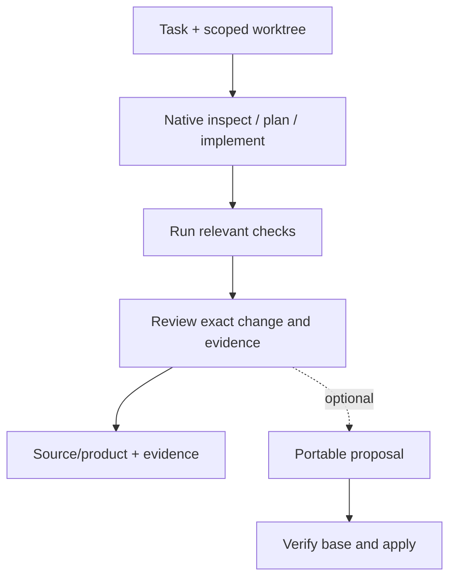

# Coding agents and reusable boundaries

The default coding workflow is **direct editing in the assigned worktree**. Keep native session context, checkpointing, permissions and subagent delegation. Wrap useful reusable task boundaries in CC; ordinary internal reads, commands and agent tools need no separate capsule.

| Role | Useful output | Relevant effects |
|---|---|---|
| Inspect | Findings and source references. | workspace.read; process.exec when tools run. |
| Plan | Steps and acceptance criteria. | model.invoke when used. |
| Implement | Actual edited source and summary. | workspace.write, process.exec; dependency.install if needed. |
| Test | Observed report and raw evidence. | process.exec; workspace.write for actual test changes. |
| Review | Findings tied to exact change and evidence. | workspace.read; process.exec/model.invoke where used. |
| Propose | Portable changes for another target or review. | Actual model/workspace/tool effects. |
| Apply | Materialize eligible changes at verified base. | Scoped workspace.write; process.exec where used. |

These are roles, not mandatory capsules or a universal pipeline. One native task can perform several. Publication and deployment require separate `git.publish` and `deploy` authority. Model invocation remains a separate effect with provider/data policy.

## Illustrative reusable task

```json
{
  "cc":"2", "id":"coding.task", "version":"1.0.0",
  "bindings":{"default":{"kind":"jiuwenswarm","agent":"coding-worker"}},
  "capabilities":{
    "implement":{
      "does":"Implement directly in the assigned worktree and report changes and observed checks.",
      "takes":{"workspace":"handle","task":"text","options":{"kind":"json","optional":true}},
      "gives":{"summary":"text","evidence":"json"}, "needs":["workspace"],
      "changes":["workspace.read","workspace.write","process.exec","model.invoke"]
    }
  }
}
```

The host must register `coding-worker`, resolve the handle, scope the worktree and authorize model access. This illustration is no deployed upstream integration claim. `evidence` deliberately accepts broad JSON; consumers can require stronger schema/checks where useful.

## Concurrency and evidence

Assign a worktree or nonoverlapping paths per writer. Record starting commit **and dirty state**; preserve unrelated edits. Before integrating parallel work, verify target freshness and resolve conflicts. A commit alone does not identify a dirty tree.

Capture tracked changes, untracked files, binary bytes, modes and required external objects. Record command/configuration, exact tested source, environment, raw logs, exit status and skips. A plan, model assertion or interrupted test is not a passing check. Preserve partial edits/evidence and remaining uncertainty after interruption.



## Optional propose/apply

Use proposals for another target, review before mutation or a portable Factory/Lab handoff. Identify the exact base and complete edit/blob material. Apply checks current base and path grants immediately before mutation. Stale base means reconciliation, never overwriting concurrent work.

If partial application is possible, retain a transaction/effect journal and reconcile actual state. A lost reply must not trigger blind reapplication. Protected acceptance tests remain independent of candidate code; self-tests do not promote a product. See [07](07-quality-and-improvement.md) and [09](09-upstream-coding-integration.md).
