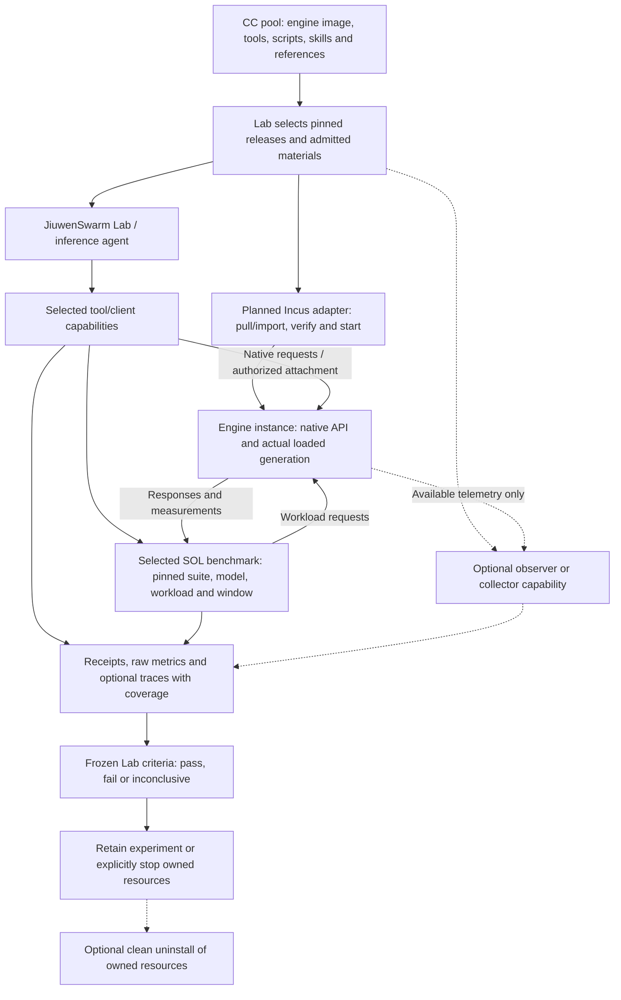

# Lab composition and optional telemetry

## 1. Package the interface; preserve the implementation

The Lab obtains an engine image through a CC, starts an admitted instance, and connects selected tools to its native interface. The shared pool can also supply scripts, skills, reference documents, benchmark clients and observability services. Each experiment chooses what it needs.

| Package content | Canonical declaration | Consumer behavior |
|---|---|---|
| Finite action | Named entry in `capabilities` with its own inputs/results | Make a call and retain its receipt. |
| Running application | Named capability with `serves: {interfaces, ready}` | Start/manage an instance; use its published native API. |
| Skill or reference material | Named entry in `materials` | Resolve/read the selected bytes; a passive-only package needs no executable binding. |
| Mixed delivery | Capabilities and materials in the same package | Select each independently; shared packaging grants no extra authority. |

An application is a capability that serves an interface over time. Its startup result identifies an instance and endpoints; later engine requests follow the native API contract. A skill may guide a coding session, a script may implement a callable capability, and a collector may run as another serving capability. A passive reference does not need a fabricated process.

CC specifies packaging, discovery, invocation and evidence boundaries. It does not require the engine or a coding agent to reorganize its internals, instrument every function, adopt a pipeline language, or replace its own manifest. MCP resources provide URI-addressed contextual material; a future projection can expose selected passive CC materials through that interface. Such publication is separate from executing a tool. See the [MCP resources specification](https://modelcontextprotocol.io/specification/2025-11-25/server/resources).

## 2. Proposed Incus experiment flow



The SOL benchmark is the user-named target; its exact suite/revision/configuration must be selected and retained before any execution claim. The composition above is a proposed Lab workflow, not a new mandatory CC orchestration format. The Lab wires instance references, endpoints and artifact outputs explicitly. When a service exposes MCP, the agent uses its supported MCP client to discover methods from that server; CC supplies the admitted endpoint/release/instance link rather than requiring a second hand-maintained method schema list. An HTTP engine can instead be driven by a benchmark capability using its native API. The current generic CC MCP bridge projects finite capabilities only; direct service-client/Incus wiring is qualification work. A sidecar may be a separate managed instance connected to the engine; it need not share the engine's process or container. Device access, network reachability and attachment permissions are admitted separately.

Incus documents system containers, application containers and virtual machines; it also documents consuming application images from OCI-compatible registries. The planned adapter must select and record its supported instance/image path rather than assume all image formats have identical startup semantics. See [Incus instances](https://linuxcontainers.org/incus/docs/main/explanation/instances/).

**The Incus adapter is planned and unexecuted.** Existing native or Docker results establish only those tested paths. A Docker image declaration or Docker lifecycle test is not Incus execution evidence. No Incus, GPU, loaded inference-engine or GB10 pass is claimed here.

## 3. Bind configuration at the right boundary

| Boundary | Examples | Identity/evidence responsibility |
|---|---|---|
| Package defaults and contracts | Executable/image identity, API description, bundled reference bytes | The sealed release identifies the delivered material. |
| Instance setup inputs | Model artifact, tokenizer, quantization, backend, device assignment, permitted mounts, service configuration | The start request binds supplied values; the adapter records effective configuration and generation. |
| Native request inputs | Prompt, batch, decoding options, request-specific task data | The engine API owns validation; the benchmark retains exact workload/request records. |
| Measurement policy | Warmup, cache policy, sample window, baseline and acceptance criteria | The Lab/evaluator freezes policy independently of the candidate. |
| Optional observation setup | Collector endpoint, sampling policy, profiling window | The observer records its configuration, scope and perturbation. |

Keep ordinary request data in ordinary JSON/API payloads. Data does not grant installation, device, attachment or network authority. Credentials are resolved by the host's authorized setup; receipts should identify the binding without copying secret values.

Record effective settings rather than assuming requested settings were loaded. A configuration change or worker replacement can change the measured subject; retain that transition and split the measurement window or report incomplete coverage. External weights and datasets keep their own immutable identities. Strata's native component manifest remains authoritative for its engine files and compatibility; see [04](04-provenance.md) and [11](11-factory-lab-handoff.md).

## 4. Optional trace links and honest coverage

Tracing is optional. A useful first experiment can retain request timings, logs and benchmark artifacts without modifying the engine internally. A proxy or client can observe the external request boundary; an authorized profiler may observe another scope. Neither observation demonstrates unobserved internal execution.

Where supported and enabled, propagate W3C `traceparent` and `tracestate` at HTTP boundaries using established OpenTelemetry integrations. OpenTelemetry describes injecting/extracting context to correlate work across services; W3C defines the HTTP context representation. These are correlation mechanisms, not execution identity or authorization. See [OpenTelemetry context propagation](https://opentelemetry.io/docs/concepts/context-propagation/) and [W3C Trace Context](https://www.w3.org/TR/trace-context/).

The proposed optional evidence linkage is:

| Retained identity | Purpose |
|---|---|
| CC release, call/attempt and instance generation | Join observations to the admitted software and execution. |
| Benchmark run, request IDs and measurement window | Join response metrics to the actual workload. |
| Trace/span IDs or exported telemetry artifact references, when available | Link available observations across participating boundaries. |
| Observer/collector version and configuration | Identify how evidence was gathered. |
| Coverage, sampling, loss and perturbation notes | State what was observed, missing or affected by observation. |

These are proposed evidence links, not extra mandatory declaration fields. Record `not enabled`, `unsupported`, `sampled`, or the specific known coverage when applicable. An absent span does not establish that work did not happen. A complete external trace does not establish complete internal coverage. Retain the raw export or its immutable reference where reproducibility matters, rather than relying only on a mutable dashboard URL.

For asynchronous agents, retain provider task/context identifiers alongside CC call/instance identifiers when the provider exposes them. A2A defines tasks, messages, artifacts and task-update operations; an adapter can link those native records without equating their identifiers to a CC invocation key or trace ID. This is a planned integration choice, not a claim that the current host implements every A2A operation. See [A2A v1.0.1](https://a2a-protocol.org/v1.0.1/specification/).

### 4.1 Optional portable observation manifest

When a producer elects to publish a portable telemetry index, use `cc-observation/1` as an ordinary JSON output or artifact. This is an optional evidence profile, not a required declaration field, telemetry SDK or core process envelope. Raw signals retain their existing formats.

| Field | Rule when this profile is used |
|---|---|
| `format` | Required literal `cc-observation/1`. |
| `subject` | Required object with `release` and at least one `call` or `instance` identity. Optional `attempt`, `capability`, `benchmark_run` and `request` link more precisely. Runner/observer generates identity links; authors do not duplicate declarations. |
| `source` | Required object: `id` identifies the emitting component; `kind` is `runner`, `tool` or `observer`. The receiver records who supplied it; self-labeling does not establish trust. |
| `coverage` | Required object with text `scope`, `status` (`available`, `partial`, `unavailable`, `not_requested`) and optional `reason`, `window`, `sampling`, `loss`, `perturbation`. Scope/limitations must not imply unobserved internals were checked. |
| `signals` | Optional list, default empty. Each entry has `kind` (`logs`, `metrics`, `traces`, `profiles`), `format` and an `artifact` reference to retained bytes. A dashboard/access URL may be supplementary; it is not byte identity. |
| `trace_context` | Optional W3C `traceparent`/`tracestate`; validated/propagated by supported transport instrumentation, never interpreted as permission or an invocation key. |

For OpenTelemetry signals use custom attributes such as `cc.release.id`, `cc.capability.name`, `cc.call.id`, `cc.attempt.id` and `cc.instance.id` only where known. These are CC linkage conventions, not official OpenTelemetry semantic-convention names. Preserve standard trace/span IDs and native timestamps. Do not replace OTLP or invent another trace engine.

No manifest means no supplied internal telemetry; the runner can still retain its own execution record. A malformed or unavailable optional telemetry export yields an observation diagnostic, not loss of completed tool outputs. A Lab may explicitly require a coverage profile for a particular measurement claim; failure then limits that claim's acceptance, not unrelated capability execution. Redact secrets and sensitive payloads before exporting; trace IDs are not authentication.

## 5. Lifecycle ownership and optional clean uninstall

The adapter keeps a ledger of resources it actually creates or explicitly adopts: instance identity/generation, sidecars, allocated endpoints, mounts, temporary storage and other provider objects. Ownership and borrowing are distinct. Starting a tool against an existing engine does not transfer ownership of that engine.

| Action | Required scope |
|---|---|
| Inspect or collect logs | Observe the identified instance and preserve coverage limits. |
| Stop | Confirm cessation of the owned execution; retain uncertainty if stop cannot be established. |
| Retain | Keep the instance or artifacts when requested by the experiment policy. |
| Optional clean uninstall | Remove only the identified owned installation/resources under explicit cleanup authority; report what remains or failed. |
| Shared asset/cache removal | Separate policy; never implied by stopping one experiment. |

Automatic container deletion is optional. A clean-uninstall capability may be supplied when useful, with its own effects and inputs. Preserve requested results, receipts and raw evidence before cleanup. Keep shared images, weights, datasets and user-owned files unless separately authorized for removal. A lost cleanup reply requires lookup/reconciliation of the original operation before repeating it. Container removal alone does not prove that every associated resource was removed.

## 6. Qualification plan and completion evidence

1. **Pin and admit.** Select a real Incus host/version and supported image path. Resolve the engine image identity, external assets, instance profile, architecture, runtime/driver, resources and authority. Preserve the existing engine manifest.
2. **Exercise one serving capability.** Pull/import through the adapter, start the selected engine, retain provider operation/instance identities, and verify actual loaded component/configuration/generation as well as readiness.
3. **Compose the pool.** Connect one selected tool or benchmark client through the native engine API. Demonstrate reading a passive reference/skill without requiring a process. Add a sidecar only if the experiment needs it.
4. **Measure independently.** Use frozen workload/baseline/cache policy and retain exact requests, raw metrics, window and interruptions. Demonstrate a valid negative result as well as successful execution.
5. **Exercise optional observation.** Compare tracing disabled and enabled. Verify any propagated context links and record sampling, missing spans, collector failures and measurement overhead. Benchmark completion must remain possible when optional tracing is unavailable.
6. **Exercise lifecycle failure and cleanup.** Lose a reply, inspect the original generation, stop/reconcile it, then demonstrate optional cleanup within the ownership ledger. Verify borrowed/shared resources remain intact.

Completion requires retained observations from the actual Incus path, with failures and unsupported cases alongside successes. Host admission, engine readiness, loaded identity, benchmark execution and scientific assessment remain separate facts. Until those observations exist, this page is a focused implementation and qualification plan.

## 7. Current optional-observation demonstration

[The observation exporter](reference/integrations/observation_demo.py) consumes the saved synthetic native product report and emits `cc-observation/1` plus a metrics artifact. It does not rerun the producer or require instrumentation inside the service:

```text
python reference/integrations/observation_demo.py --run-report PRODUCT_REPORT.json --store STORE --report OBSERVATION.json
```

The retained metric is one loopback HTTP client duration including client overhead. Coverage is `partial`: no engine-internal trace/span coverage is claimed. This demonstrates portable evidence linkage, not an OpenTelemetry collector, real inference benchmark, Incus adapter or automatic tracing implementation.
