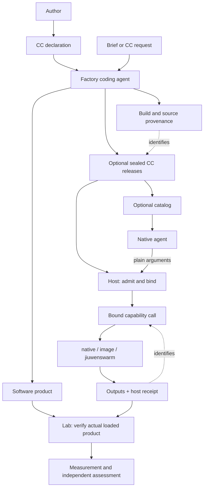

# Capability Capsules  -  v2

A **Capability Capsule (CC)** is a versioned package of callable capabilities. A declaration describes behavior and ports; a sealed release fixes contract and implementation bytes; a call selects one capability; a receipt records what happened. A capsule is a reusable tool. The software product it produces can contain **zero CCs**.



The host owns identity, grants, budgets, resource handles and receipts. Native coding sessions, worktrees and subagent delegation remain native; ordinary internal tools do not each need a capsule.

## Reading route

| Read | Purpose |
|---|---|
| [01  -  Declaration](01-declaration.md) | Author a contract and choose a binding. |
| [03  -  Calls](03-calls-and-receipts.md) | Supply values and interpret effects and receipts. |
| [02  -  Factory](02-compiler-and-release.md) | Materialize requests, seal source and deliver products. |
| [08  -  Coding agents](08-coding-capsule.md) | Direct edits and optional propose/apply workflows. |
| [04  -  Lab and provenance](04-provenance.md) | Connect products to actual execution and measurement. |
| [05  -  Examples and evidence](05-examples-and-conformance.md) | Run examples and understand qualification limits. |

[06](06-distribution-and-interoperability.md), [07](07-quality-and-improvement.md), [10](10-requests-and-materialization.md) and [11](11-factory-lab-handoff.md) are focused companions. [09](09-upstream-coding-integration.md) retains pinned upstream findings.

## Small declaration

```json
{
  "cc":"2", "id":"text.trim", "version":"1.0.0",
  "bindings":{"default":{"kind":"native","command":["{python}","{bundle}/tool.py"]}},
  "capabilities":{
    "trim":{
      "does":"Remove leading and trailing ASCII spaces; all-space input returns an empty string.",
      "takes":{"text":"text"}, "gives":{"trimmed":"text"}
    }
  }
}
```

The package includes `tool.py`. For all-space input it returns `{"outcome":"ok","outputs":{"trimmed":""}}`. See [calls](03-calls-and-receipts.md) for the packet and artifact rules.

The prepared local experiments can be repeated with one command from this folder:

```text
python reference/run_experiments.py
```

It selects the prepared isolated environment, writes a new report directory, and prints each stage's result. An unavailable container engine is reported separately; native experiments still run. See [environment setup and scope](reference/integrations/README.md).

For ordinary development, run directly from the package folder. The host seals the current source, generates a key, and records its release automatically:

```text
python reference/ccv2.py run reference/examples/portable trim --inputs INPUTS.json --trusted-local
```

`INPUTS.json` contains `{"text":"   "}`. State is stored under `.cc-state` by default; use `--store` to choose another location. No semantic checker runs, even if the capability advertises guarantees. JSON payloads stay open unless their author supplies a schema.

Optional advisory checking adds `--check core.complete`. Add `--require-checks` only when completeness should gate acceptance. `core.complete` checks completeness, not semantic correctness. Host applications can register domain checkers and select them through `Host.call(..., checks=["check-id"])`.

For reproducible callers that already manage releases, the lower-level interface remains:

```text
python reference/ccv2.py validate PACKAGE/cc.yaml
python reference/ccv2.py seal PACKAGE --store STORE
python reference/ccv2.py call RELEASE trim --inputs INPUTS.json --store STORE --trusted-local
```

Replace uppercase placeholders with real paths/identity. `INPUTS.json` contains plain values, such as `{"text":"   "}`. [The runtime](reference/ccv2.py) owns executable behavior and help. Sealing copies and hashes source so later working-directory edits do not alter a release. Native `--trusted-local` runs team-trusted arbitrary code and provides **no OS isolation**.

## Meaning of success

Execution, completeness and semantic assessment are separate. A test runner can execute successfully and report failing tests. Empty semantic checks mean `not_requested`. Hashes establish byte identity, not correctness. Declared, granted, observed and enforced effects are separate facts.

Semantic verification is **only on request**. Missing or crashing advisory checkers preserve successful execution and its outputs. Missing explicitly required checkers block before execution. A failing post-execution check reports failed assessment while preserving the completed result. See [quality and defaults](07-quality-and-improvement.md) and the [result-first example](reference/integrations/ease_of_use_demo.py).

This route replaces active v1 syntax. Migration reports unsupported semantics rather than discarding them. Local reference checks do not establish deployed JiuwenSwarm, remote recovery, GB10 measurements or enterprise isolation. Run evidence belongs in [05](05-examples-and-conformance.md).

[The previous draft](history/README.md) is preserved with byte hashes. [The final experiment summary](reference/integrations/final-run-summary.json) distinguishes the passing local/upstream paths from the blocked image experiment.
