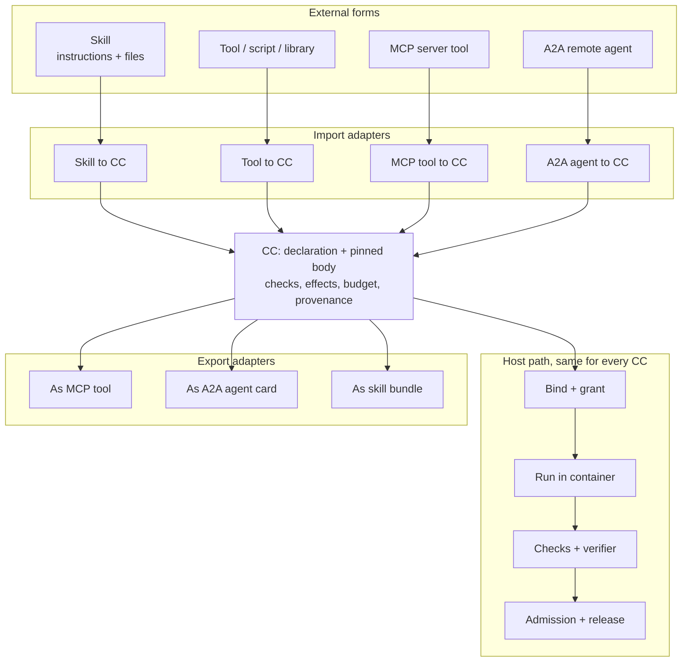

# CC as the reusable component, and the self-improvement comparison

Links: [[Designs/AI4R Lab and CC Images]] · [[Designs/skills-to-cc-mapping]] · [[Designs/AI4Research Capability Growth]] · [[Designs/CC Reference]] · [[Designs/Paper2Agent Briefing/2 Agent architecture]]

Proposal only. Nothing here is built or measured. External protocol details (MCP, A2A) are from general knowledge and were not re-checked against current specs in this session.

## What Muk said

From [[Sources/Prompts/2026-10-21-lab-vm-master-and-cc-as-universal-component.txt|the exact message]]:

- Each lab is a VM. Each VM holds an AI4R instance plus the resources of whatever it is building.
- The lab's capabilities derive from the "master branch", whatever that is. Master is the latest well-tested branch.
- The lab's AI4R uses those capabilities and its setup to modify itself: add CCs, improve CCs, adjust the workflow, and so on.
- A pilot is fine, but a full containerization conversion is likely.
- Compare this with the self-improvement goals.
- Make CC the reusable component for skills, tools, MCP and A2A.

## The core idea

A CC is already the right shape: a versioned declaration (ports, needs, effects, budgets, checks) plus a pinned body. Skills, tools, MCP servers and A2A agents differ in how they are reached, not in what a host needs to know to govern them. So make the **declaration the universal contract** and treat each ecosystem as a carrier or an adapter behind it.

The container is the carrier common to all of them. Tool, MCP and A2A CCs differ in what the container may reach (a local process, a pinned MCP server, a named remote endpoint), and the declaration states that as an effect.

## Import: what each form becomes

| External form | What the CC wraps | What the declaration must add | Main risk |
|---|---|---|---|
| Skill | Instructions and bundled files become the body of a bounded agent CC. | Typed ports, tools needed, budget, effects, checks. A skill states none of these in an enforceable way. | A skill that "works" in prose has no conformance test. The CC needs one. |
| Tool, script or library | A tool CC, run in its container. | Input and output schema, determinism, resource caps, dependency lock. | Hidden network or filesystem effects. |
| MCP server tool | A tool CC whose body calls one pinned MCP tool. | Server identity and version, the one tool name, schema copied and hashed, effect class, credential by name. | Tool descriptions and results are untrusted input. A server can change its tools after approval, so pin and compare. |
| A2A remote agent | A CC whose body delegates to one named remote agent. | Endpoint identity, the skill used, task and artifact schema, timeout, what data may leave. | The remote side is outside our containers and checks. Its output is an untrusted claim. Data egress is the real cost. |

Import rule: the adapter produces a **candidate** declaration. A human or a protected process admits it, as with any CC. Wrapping a thing does not make it trusted.

## Export: CCs offered to others

- **As MCP tool:** the host exposes an admitted CC's declaration as a tool. Calls still go through bind, grant, run and checks. The export does not bypass the host.
- **As A2A agent:** an agent card is generated from the declaration. A2A tasks map to CC invocations. This lets outside agents call our CCs, and lets labs call each other.
- **As skill bundle:** a CC's declaration and instructions render as a skill for agent hosts that only read skills. This is a lossy view: enforcement does not travel with it.

Exports are views of the declaration. The declaration stays the single source.

## Where this meets the review's single-runtime point

The pasted [[Sources/Prompts/2026-10-21-pasted-architecture-review.txt|review]] asked for one typed workflow runtime where tool, agent, approval, verification and nested workflow are all node kinds behind one contract. That is the same move one level up. A CC is the contract. A node in a workflow graph is a CC invocation. Skills, MCP and A2A are then three more ways to fill the body. This gives one validation, dispatch and audit path for all of them.

## Comparison with the self-improvement goal

Goal (from [[Designs/AI4Research Capability Growth]] and Muk): a self-improving AI4R that does a lot better than the old project's performance target.

| Lab loop step | What the proposal gives | Current support | Gap |
|---|---|---|---|
| Lab starts from master | VM pulls digest-pinned CC images and the workflow from master. | Lab CLI pins a commit and image digest per experiment. | No registry or vendoring. "Master" has no definition of "well tested" yet. |
| Lab adds a CC | Wrap a skill, tool, MCP or A2A target, or author a new one, as a candidate. | Skills-to-CC mapping is a design aid only. | No import adapters. No author-time declaration tooling beyond the compiler candidates. |
| Lab improves a CC | New version, new image, tested against the CC's declared checks. | RSI exists for Screening only (`may_change`). | Whole-capability and multi-CC evolution are outside M1. |
| Lab adjusts the workflow | Change a workflow profile or plan as a candidate. | Profiles proposed in the Capability Growth note. | Needs the typed-graph runtime and a binder amendment. |
| Lab modifies itself | Candidate changes to lab tooling and AI4R platform code. | Candidate patch plus change manifest from the lab CLI. | The judge must not be inside the lab's write reach. |
| Return to master | Central review replays evidence and merges. | Rule: labs do not promote. | No replay procedure; no definition of the merge gate. |

## Four gaps to resolve

1. **"Well tested" needs an owner and an epoch.** If master is the latest well-tested branch, then the tests, held-out cases and referee that define "well tested" must be frozen per acceptance epoch and held outside every lab. A lab that can edit its own tests can pass itself. This is the most important gap for self-improvement.
2. **Lab VM trust.** A lab runs a modifying AI4R next to real resources. It needs its own credentials, network rules and model access. Separate labs must not share secrets, and a lab compromise must not reach master or the library.
3. **Divergence.** Many labs improving the same CC will produce competing versions. Merging needs a rule: the version that wins on the frozen checks, with provenance kept for the others. Conflicting workflow edits need a human or protected decision.
4. **Import trust.** Skills, MCP tools and A2A agents are the most likely route for untrusted content into the library. Each import needs pinned identity, a hashed schema, and a declared effect class, and starts unadmitted.

## Containerization: from pilot to full conversion

Muk expects full conversion. The reasoning supports it: one carrier for every form, the image as dependency closure, and the same isolation for imported and generated code. The [[Amendments/Container CC Pilot/README|pilot]] still earns its place as the test of cost and failure behavior (cancellation, partial output, stale responses, overhead). Keep its acceptance criteria. Treat adoption of the container carrier for all CCs as the likely outcome of that pilot, and record the decision once evidence exists.

## Suggested first mapping cases

Pick one of each and write the candidate declaration, with no code changes:

- **Skill:** a research skill already in use, written as an agent CC with ports, budget and checks.
- **MCP tool:** one read-only tool from a pinned server, as a tool CC.
- **A2A agent:** one remote agent with a single named skill, as a delegating CC, plus a statement of what data leaves.

The result tells us whether the CC declaration is expressive enough, before any adapter is built.

## Status

Proposed. Open questions: what the declaration schema lacks for MCP and A2A (streaming, long-running tasks, auth), whether export adapters belong in M1 or later, and how a lab's CC changes interact with the Paper2Agent factory.
