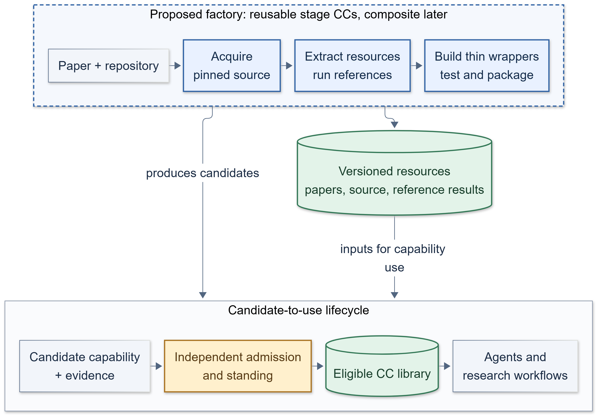
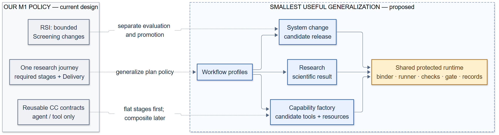

# Paper2Agent: investigate the pattern

**Decision: yes—investigate it with one bounded pilot.** Paper2Agent offers a source-to-resource/tool factory pattern that may fill a capability-development gap. This merits comparison; it does not show AI4Research already supports the workflow, prove Paper2Agent outputs reliable, or justify wholesale adoption. CCs and research automation are already in our design; test whether these stages improve preparation, verification, and admission.

The diagrams are simplified proposed flows. Member checks still apply; factory evidence and independent admission have different owners.

**Freshness:** the original architecture comparison used October 21 source. [[Activities/2026-10-23 Required M1 Planner]] and [[Resources/Current Baseline]] record later generic typed planning; this brief now distinguishes that source integration from remaining factory/composite work. This text refresh does not revise or revalidate the final presentation deck.

## Talking points

1. **The useful contribution is a repeatable path from sources to candidates.** Paper2Agent routes paper inputs into a reviewed reading resource and repository inputs through source inspection, reference execution, thin tool wrappers, independent checks, runtime calls, and a portable package. The stages leave evidence behind, so a later user can inspect what a candidate came from. This workflow pattern is the practical value; CCs themselves are already part of our design vocabulary.

   *Speaker note:* At pinned commit `8c2d059`, instructions, scripts, and verification contracts were read but not run; scientific accuracy was not established. The authors’ description is in [Nature](https://www.nature.com/articles/s41586-026-11044-y); our [source review](../../Resources/review-batches/2026-10-21-paper2agent/paper2agent-source-review.md) separates inspected behavior from untested claims.

2. **Keep three outputs distinct.** Factory-stage CCs do bounded authoring/checking; generated product CCs are candidate scientific tools; resources hold versioned sources, reading packages, reference results, environments, and reports. Candidates still require admission; code in a resource grants no execution permission.

   *Speaker note:* This extends our CC and library concepts. Admission evidence can use richer provenance while library standing remains protected and separate from factory preparation.

3. **Source discovery could be reusable beyond this factory.** Authorized acquisition can pin repository identity/revision, provenance, and license/access findings, then hand off a stable snapshot. M1 does not authorize arbitrary intake cloning and Builder is offline, so preparation needs its own approved workflow-policy amendment.

   *Speaker note:* `jiuwenswarm`/`ai4r_muk` is our modified AI4Research design, not upstream JiuwenSwarm. Captured M1 implementation `d3d7f56` is separate evidence.

4. **Generic planning and factory support are different claims.** The October 21 fixed-shape assessment predates integrated generic typed graphs and one bounded structural correction. Scientific work retains Evaluation/Delivery obligations. Factory lifecycle, source preparation, build permissions and admission still need their own contracts; composite creation/execution remains deferred. M1 RSI is narrower than the whole-system target. No implemented factory is claimed.

   *Speaker note:* Compare a flat pilot with the integrated contracts first. Identify needed factory lifecycle, terminal, permission and binding changes rather than assume generic graphs are absent. Product-obligation changes need their owning process; independent M2 prototypes follow their own authorization. Consider a composite only if repeated value and member-level enforcement justify it.

5. **Independent checking must match the claim.** Paper2Agent’s fresh verifier traces wrappers to pinned source, runs upstream references, compares changed inputs and relevant failures, then checks the installed tool. AI4Research’s semantic Verifier is output-only: it reviews a declaration and exact output. It cannot silently inherit source-reading or runtime-verification duties; any new verifier needs a declared contract, inputs, and evidence.

   *Speaker note:* Calls and package checks establish selected-tool runtime behavior, not scientific correctness or whole-repository validity.

6. **Start with a comparison that can change the decision.** Pick one pinned scientific repository with a runnable reference. Compare direct use, a governed wrapper, and a CC-admitted wrapper under matched checks. Reuse acquisition in a second job; inspect the original workflow beside our adapter before broad changes.

   *Speaker note:* Check source traceability, changed-input behavior, failures, setup, provenance, and whether the wrapper merits maintenance. No numeric thresholds are set.

7. **Let evidence decide whether to continue.** Continue if useful source-linked candidates and checks fit protected admission with manageable dependencies. Narrow or stop if licensing, data, environment, reference execution, or fidelity fails—or a wrapper adds little. Passing tests cover tested cases, not scientific truth.

   *Speaker note:* Record failures and skipped checks. Development retries may add source-reading checks, but cannot silently change the runtime verifier’s role or turn output-only review into scientific validation.

## Pilot controls added after outside review

The pilot is a thin slice of the factory workflow. It cannot show the factory generalizes or that its tools are scientifically trustworthy. Hold constant: repo, data, model access, permissions and evaluation set. Give direct use and the wrapper a comparable preparation budget, and report any amortized gain separately. An evaluator fixes required capabilities and hidden changed-input tests before generation. Missing required capabilities count as failures. Record preparation cost, coverage, admission outcome, downstream success, recovery, dependency and maintenance burden, skips and manual steps.

Packaging generated tools as container images in an AI4R lab is a separate proposal: [[Designs/AI4R Lab and CC Images]].

## The decision gap and minimum resolution

| Current M1 shape | Gap | Minimum proposed resolution |
|---|---|---|
| Fixed research workflow, one Delivery leaf | Factory needs a different terminal product and stage links | Amend workflow policy with a capability-factory profile and typed bindings; pilot a flat plan |
| Agent/tool CCs only; composition deferred | No factory composite today | Use flat orchestration first; separately decide on composite DAGs after pilot evidence |
| Offline Builder; intake excludes direct repository cloning | No general source-acquisition route | Define an authorized preparation/acquisition handoff with pinned provenance, access and license findings |
| Narrow Screening RSI target | Factory may touch resources, CCs, or plans | Keep target scope explicit and separately governed; don't imply whole-system RSI authority |

These proposals are not adopted M1 behavior. A generic test pass does not establish scientific correctness beyond its tested obligations; fresh installation and calls cover tested runtime behavior. Source access, licensing, data, credentials, dependencies, and hardware may limit reproducibility or distribution; record blockers or narrowed scope.

**Practical next step:** authorize reconnaissance for one pinned repository and the matched comparison above. Reconcile the new workflow profile and source-preparation boundary with PRD V10 and the maintained M1 decisions before the pilot begins. The [capability-growth note](../AI4Research%20Capability%20Growth.md) and [factory design](../Paper2Agent%20Capability%20Factory.md) hold the longer architecture discussion; this brief is the decision route, not an implementation claim.

For the agent-use question, read [2 Agent architecture](2%20Agent%20architecture.md). The three diagram assets are available as [fit SVG](diagrams/01-fit.svg), [gap SVG](diagrams/02-gap.svg), and [agent-use SVG](diagrams/03-agent-use.svg); PNGs are embedded for reading and `.mmd` sources sit beside them. Longer source links are optional background.
