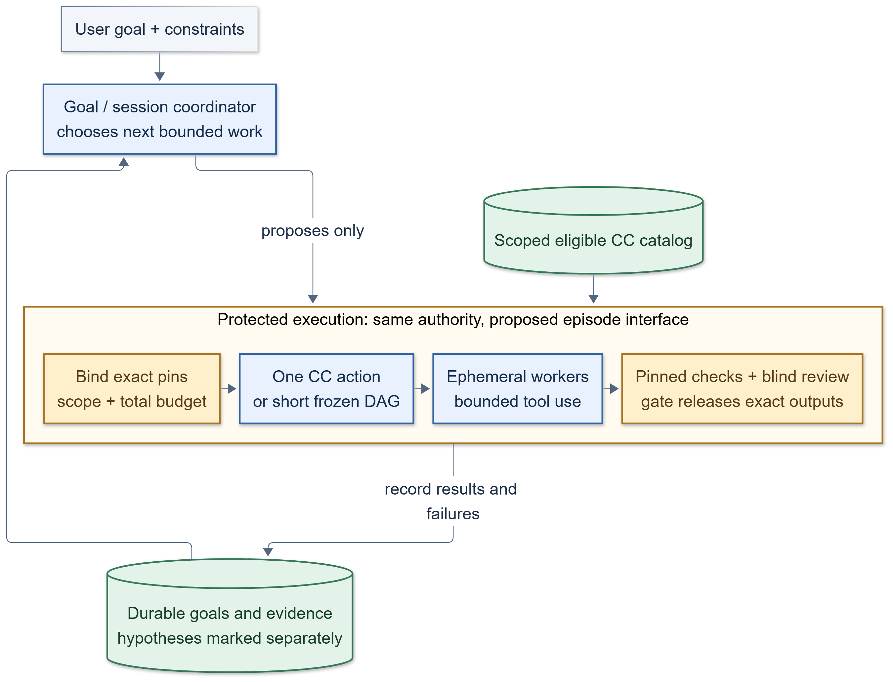

# Agent architecture: durable goals, bounded episodes

**Recommendation:** add a durable goal/session coordinator outside each workflow episode, with ephemeral bounded workers inside. Persist goal state and evidence between episodes; rehydrate the coordinator for each model turn. This needs no permanently running process or always-open model session. This is proposed architecture, not current M1 behavior or a Paper2Agent claim.

| Pattern | What it handles well | Main limitation |
|---|---|---|
| DAG only, ephemeral workers | A frozen, inspectable episode with explicit order and bounded work | Workers alone provide no cross-episode continuity; an external record/controller must supply it |
| One persistent agent owns planning and execution | A continuous interaction with tools and remembered context | Risks stale context and difficult recovery; execution and acceptance must still remain host-controlled |
| Hybrid: durable goal/session plus bounded DAG episodes | Maintains the user's goal and verified progress while each work episode remains frozen and attributable | Requires an explicit session record and a host-controlled transition from one episode to the next |

The coordinator observes released results and failure records, updates hypotheses and next steps, and requests clarification when a material choice remains unresolved. It may propose the next bounded plan. It owns no gate, referee, or scheduler; those remain trusted host services. The coordinator is an ordinary authenticated client, invoked by the host and discarded after its turn.

Persist the accepted user goal, constraints, source receipts, accepted evidence references, completed episode IDs, and unresolved questions. Keep model-generated hypotheses and proposed actions visibly marked as untrusted. Rehydrate only the scoped session view needed for the next turn. Profile-scoped memory may help retrieve relevant prior work, but it is neither an authoritative source nor a channel to hidden fixtures, answer keys, or evaluation evidence. Every episode gets a fresh capability snapshot and current policy/resource inventory; missing capability factory support requires preparing and admitting a new candidate, not pretending it is live.

**A CC packages a reusable capability; its body may be code or a bounded agent.** It is not synonymous with a spawned worker. Agents can select CCs through callable interfaces, and CCs can later be composed. Current M1's agent/tool carriers are concrete; a composite CC carrier remains future work. One host-protected service should run all of these as the same kind of thing: a typed workflow graph. A one-action call is a graph with one node; a short episode is a small frozen graph; a composite CC is a versioned, reusable graph package (when admitted). See the review revision below. The agent selects from a scoped catalog that the host has already filtered. The host owns authorization, binding, dispatch, cumulative session/call budgets, and release. A CC's reusable contract does not grant its caller authority. Expose compact capability cards (purpose, ports, prerequisites, effects, standing); fetch the selected declaration on demand rather than loading every implementation into the agent context. Deterministic CCs run as tools; spawn a worker only when the work benefits from a separate reasoning or isolation boundary.

Bounded inner tool loops are reasonable where that CC's own contract defines their tools, effects, and limits. This does not authorize arbitrary nested CC dispatch. If nested CC calls are supported, each must go through protected binding, execution, and checking under the selected profile and grant; no CC call may be hidden from this path. This preserves reuse without turning the coordinator into an executor or a second policy system.

The source evidence supports this separation. The exact OpenJiuwen agent-core pin reviewed for M1 provides `DeepAgentSpec`, `LeaderHarness.run_once`, `AgentBackend`/`run_workflow`, Symphony `CapabilityProvider`, stateful sessions (F37), and workflow journal persistence (F38). `run_once` bypasses the supervisor; the Deep Agent task-loop flag selects one ReAct round or a self-driving loop. F37 supports session context recovery, but its feature record says cross-process/restart checkpointer wiring remains; F38's workflow journal is a separate layer. These are useful native interfaces, not a complete durable user-goal coordinator. Symphony snapshots enumerate candidates but do not establish effect isolation or authority.

M1 intentionally configures its Planner with no tools, MCPs, subagents, rails, or skills, disables task loop/planning, and constrains its bridge to one text call. Its DAG adapter fixes serial order, cap one, zero retries, and no journal resume. These are Planner/workflow restrictions, not a claim that all M1 agents lack tools: Builder already has a single synchronous invocation with an internal tool loop bounded by D43/D45's call and workspace/network policy. None of these settings are upstream limitations. The source review distinguishes modified Stellven checkouts from actual upstream JiuwenSwarm.

| Current gap | Proposed resolution |
|---|---|
| One-shot Planner has no cross-episode goal-management role | Add a host-managed durable session record and a rehydratable coordinator turn |
| Frozen workflow cannot decide what to do after a result | Let the coordinator propose a new bounded episode from recorded outcomes, within session limits |
| Agents, tools, and reusable CC contracts are conflated | Catalog CC carriers by scoped contract; let the agent select, while host authorizes and dispatches |
| No composite carrier in M1 | Keep composite closure as a future admitted carrier; begin with single CC and frozen DAG episode modes |
| Coordinator could drift into gate or scheduler authority | Keep gate, referee, budget, binding, and release in the trusted host path |

Test against an all-ephemeral baseline with the same model, CC catalog, grants, tools, and checks. Include repository/tool discovery, multi-episode work, and changed goals. Compare quality, clarification, cost/calls, repeated work, context drift, recovery, and unauthorized-call rejection. Keep this experiment separate from Paper2Agent's factory-value claim; evidence for one does not prove the other.

Start as a host-invoked authenticated client, outside mandatory hot paths. Keep candidate creation and updates behind current authority, independent checking, and explicit release. This proposal does not alter M1.

This also gives self-improvement a place to operate: the system can propose capability, workflow, coordinator, or platform changes as versioned candidates. Evaluate them in an isolated lab against independently fixed criteria, then promote a release for future episodes. The improvement proposer cannot approve its own changes. See [1 Decision brief](1%20Decision%20brief.md) for the separate Paper2Agent investigation decision.

## Revision after outside review (2026-10-21)

A [pasted review](../../Sources/Prompts/2026-10-21-pasted-architecture-review.txt) agreed with the durable-goal, bounded-episode, host-owned-authority core. It asked for these changes. They are adopted here as proposals, not as decisions.

| Change | What it means |
|---|---|
| One typed workflow runtime, not three call modes | One validation, dispatch, resume and audit path. Node kinds: tool, bounded agent, human approval, verification, nested workflow. Pilot with a flat graph. |
| Revisions, not live edits | The coordinator proposes a graph or a revision. The host validates, freezes and runs it. A mid-run change is a new revision or episode. |
| Contract before carrier | Each CC states inputs, outputs, effects, permissions, budgets, dependencies, provenance, what its checks do not show, and revocation status. Tool, agent and composite are forms behind that contract. |
| Claim-specific verification | Each candidate lists obligations (source traceability, fresh install and calls, changed-input tests, scientific review). The verifier reports passed, failed and skipped. |
| Goal record vs episode journal | The goal record is the product source of truth. An episode journal holds resumable execution state. They are different stores. |
| Side effects on resume | Each operation declares an idempotency strategy or is marked non-retryable and reconciled before rerun. This matters for GPU jobs, duplicate artifacts and workspace writes. |

Pilot controls the review added: same repo, data, model and permissions on every path; comparable preparation budget; an evaluator fixes required capabilities and hidden tests before generation; a missing required capability counts as a failure. See [[Designs/AI4R Lab and CC Images]] for the container and lab direction.
