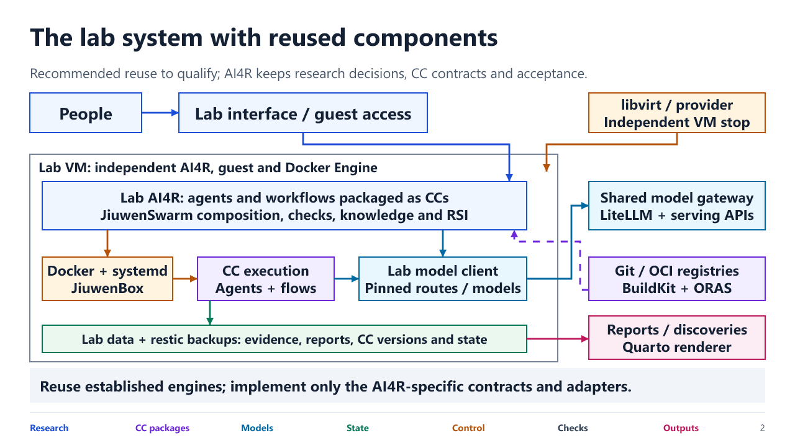
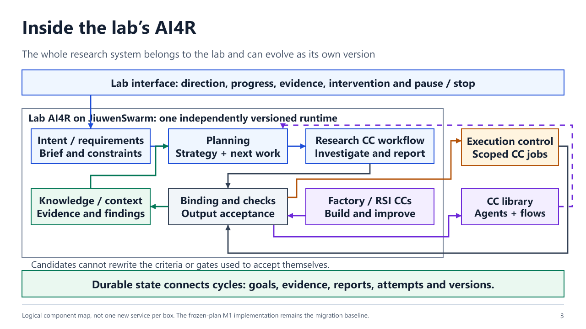
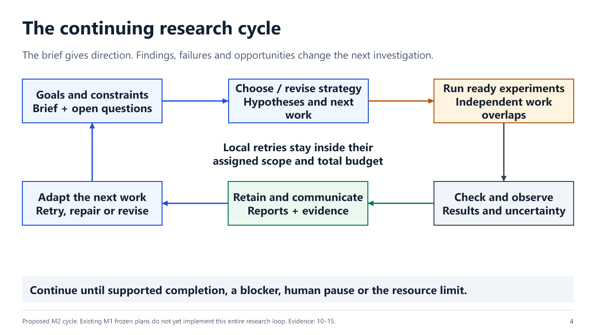
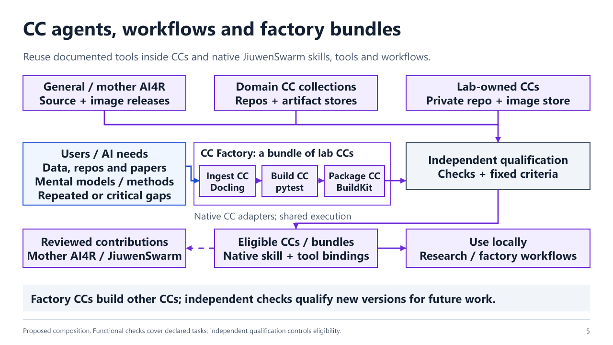
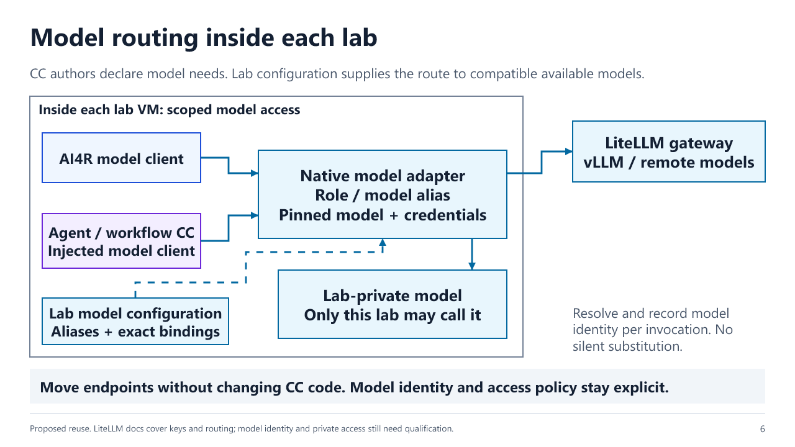
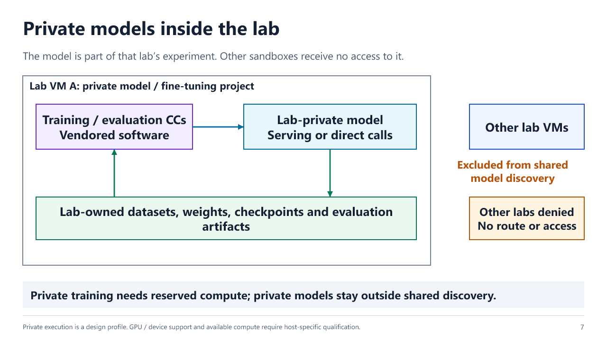
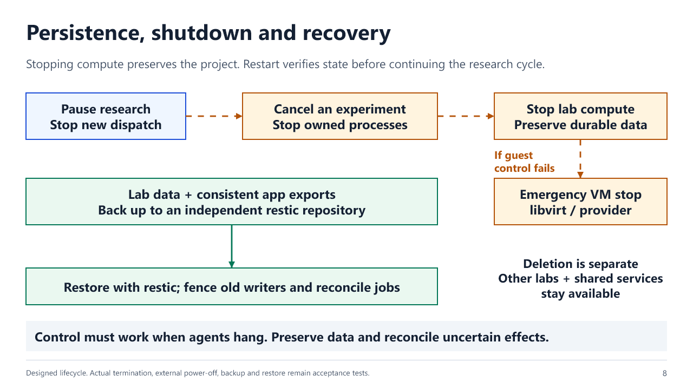

# Sandbox design presentation

**Current, 2 November: thirteen-slide native Linux revision.** The main argument is now application-first: one normal Linux lab per team, AI4R adapts its own harness and builds capsules inside it, reports/findings return through Central, and complete restore points support broad experimentation. A full workflow diagram makes those activities visible. Existing applications keep normal installation and image semantics; original/mother files remain outside writable lab mounts. Sources are integrated beside lifecycle, networking, image and research-workflow decisions, and the final page ties each established-tool precedent to work avoided. The shortlist explicitly follows a 28-option documentation survey with targeted source inspection, without claiming a benchmark or audit of every option.

 One unprivileged Incus system container contains a native AI4R/JiuwenSwarm service with Local Manager, normal Linux applications and private Docker for unchanged capsule images. Central remains the owner of registries, snapshot policy, protected records and whole-lab recovery. This replaces the inner worker-container default with a normal editable Linux development environment.

OpenSandbox plus Incus was investigated at commit `f26a716a11238b88d13a56242104e93e9d01c37d`. Its extra bootstrap and service would require another integration/launch contract. Following the user's preference for a single standard path and no exceptions, it is not selected. The source review does not claim OpenSandbox is incapable, cloud-only or lacks snapshots; its API convenience is distinguished from native compatibility.

The chart now compares **system capability versus operational complexity** using explicit qualitative criteria, with Incus plus OpenSandbox at the same outer Linux scope and more layers than Incus plus ordinary Docker. No numeric security/effort scores are asserted. The main diagrams show native services and one standard Docker capsule path. Lor/ArkenOS methods and infrastructure/adoption precedents remain as supporting material.

[Current editable PowerPoint](../../../../outputs/lab-manager-incus-20261102/rsi-revision/output/AI4R%20Lab%20Sandbox%20Design.pptx) · [Current design](../../../../AI4Research-Development/jiuwenswarm-m1-current/docs/architecture/lab-manager/incus-whole-lab.md) · [OpenSandbox source review](../../../../outputs/lab-manager-incus-20261102/opensandbox-incus/output/OpenSandbox%20review.md).

All thirteen slides were rendered and visually reviewed. The PowerPoint structure/layout/font/re-import checks pass. The existing research executor is process-based; the proposed lab-local Docker capsule provider still needs integration, rather than being presented as completed code. No runtime or capsule-library implementation was changed. Earlier deck/design bytes are retained as history. The live Spaces deck remains the older version because its editing tool is unavailable.

## Historical presentation deliveries

**Current: ten slides, system design first.** Added an Ansible-inspired idempotent environment definition and plan/apply contract; unchanged state means no changes. Research submissions remain separate and never replay on environment apply. [Design contract](../Lab%20Desired%20State%20and%20Safe%20Reapply.md).

The first three full diagrams remain at the front. Slides 4–10 use the same quick explanation format: what the source does, a workflow, what we reuse, why that part helps and why the whole stack is unnecessary or unsuitable. Order: Ansible, Compose/Docker (with native AI4R reuse), JiuwenBox, Lor, ArkenOS, Kubernetes and OpenSandbox. Sources and caveats remain in speaker notes. All ten slides were rendered and visually reviewed; Lor's workflow box was shortened and re-rendered. Previews: `review-idempotent-20261030`. Earlier notes below are history. No runtime files changed.

## Prior eight-slide design and review history

**Container and reuse placement:** main slide now shows Compose project boundaries, AI4R worker containers, sibling CC/private-model containers, Docker job versus Compose service lifecycle, lab-owned bind mounts/volumes, native AI4R HTTP relay and host Python/SQLite. Lor outcome and ArkenOS event methods are labeled as patterns, JiuwenBox as candidate tool reuse inside images. No vendor cloud or mandatory extra isolation layer is introduced. State 82 was rendered and visually reviewed.

**One-way authority clarification:** slide 1 now separates downward commands/base copying from upward status/reference-only reporting. Lab candidate paths end at the human write gate; only the human-approved adoption path reaches mother AI4R. No runtime changes. The changed slide was rendered and visually reviewed.

**Luna presentation walkthrough, October 30:** a `gpt-6-luna` reviewer read all eight slides as a presenter and first-time audience, wrote spoken scripts and questions, and traced request, capsule install/use/removal and human adoption. The review found ambiguous execution ownership, scientific-check ownership and pre-approval transfer. The revised deck explicitly retains central scoped host execution, local AI4R scientific verification, reference-only review before approved transfer, and manual adoption. Capsule lifecycle and reuse status labels are clearer. Speaker notes now contain slide-specific spoken scripts rather than repeated global notes. The deck remains eight slides: design 1–4 and question/reference material 5–8. No runtime implementation is authorized by this presentation review.

[Presenter script](presenter-script-luna-20261030.md) · [Original Luna review](luna-review-20261030.md). Updated render set: `review-luna-20261030`.

**Current: eight slides, complete architecture first.** The first three slides explain the system, image-based capability capsules, and request/execution/recovery. Slide four maps implementation ownership and reuse. Slides five through eight answer methodology questions without delaying the core design.

1. Complete system: one Central Lab Manager per machine, Local Lab Manager inside every worker, isolated labs, assigned catalogs and human approval for central writes.
2. Capsule images: pinned dependencies and versions, lab-owned instances, install/attach and uninstall/withdraw while retaining evidence.
3. Cross-system request, execution, progress, output verification and recovery.
4. Reuse inventory, responsibility boundaries and approval conditions.
5. JiuwenBox: command/file/background-job APIs, process control, compatible native reuse, durable-evidence and isolation qualification work.
6. Lor: outcome delegation, durable asynchronous work, separate observable workers and selective controls. Public methodology only, with our own infrastructure.
7. ArkenOS: persistent goals and context, explicit completion evidence, cheap event checks and inspectable tasks. Native scientific records stay inside each lab.
8. Infrastructure: Compose/Docker as the foundation, Kubernetes controller patterns, Ansible installation/repair and optional OpenSandbox execution. Paired-manager communication and native AI4R semantics remain our integration work.

The audience-facing deck uses capability-capsule terminology directly. It introduces no M2a project name. Source notes distinguish inspected local code from vendor documentation and proposed adaptation. No hardware-capacity or cost material is included. All eight slides were rendered and visually reviewed, including a second render after shortening Lor's control box. Previews: `review-reuse-20261030`. Prior deck and README bytes are preserved in `outputs/lab-manager-reuse-20261030` outside the notebook. This task changes presentation/documentation only, not runtime or capsule-library code. Design remains proposed for approval.

## Prior four-slide version

The earlier four-slide design concentrated architecture, capsule ownership, communication/recovery and reuse boundaries. It is preserved as a native snapshot in the dated review output.

## Prior ten-slide version

**Current, October 30: design for approval.** [Live editable deck](https://chatgpt.com/space/page_7a233186a3548191869c85106fc552b4).

The ten main slides now lead with goals and design:

1. Independent labs and reusable capabilities.
2. Central AI4R, Lab Manager and independent labs.
3. AI4R worker, scoped host execution and lab-owned CC containers.
4. One pinned capsule image, many independent instances.
5. Attach, use and withdraw capsules without losing evidence.
6. Simple native research workflow.
7. Human review and manual contribution.
8. Clear responsibility boundaries.
9. Feature sources: existing AI4R, Compose, M2a, JiuwenBox, Lor and ArkenOS.
10. Design decisions and first integration scope.

The capacity-cost and detailed GPU-phase slides were removed, including from the hidden appendix. OpenSandbox and other reference details remain supporting slides. The in-progress M2a library is not modified. Its source files and the pasted chat are captured in the dated source receipt; this briefing only specifies the environment/provider support needed around it.

[Container ownership diagram](review-m2a-20261030/slide-3.png) · [Image versus instances](review-m2a-20261030/slide-4.png) · [Capsule support note](../../../../AI4Research-Development/jiuwenswarm-m1-current/docs/architecture/lab-manager/capsule-support.md)

All ten main slides are rendered and visually reviewed. The prior deck and entrypoints are preserved in the October 30 review batch. No runtime files or M2a library files were changed.

## Prior October 29 briefing

**Latest phase correction:** design approval only. The live deck now has twelve main slides, including explicit host/lab placement, adapter responsibilities, an OpenSandbox alternative and native request recovery. Research communication, runtime control and model traffic are separate interfaces. The OpenSandbox server proxy’s native bearer limitation is stated; a direct discovered endpoint is the proposed route in that alternative. The four superseded diagram slides were captured in a hashed native snapshot before replacement. No runtime code was changed for this clarification.

**Current, October 29:** the [live editable presentation](https://chatgpt.com/space/page_7a233186a3548191869c85106fc552b4) now selects the single-host Compose Lab Manager, superseding the older VM-per-lab presentation below. It has ten visible slides: requirements; Lor; ArkenOS; complete architecture; writable lab anatomy; lifecycle/relay; GPU phases; manual contribution; reuse; demonstration/qualification. Option comparisons and earlier diagrams remain hidden supporting/history slides. The Lor and ArkenOS investigation states the public-code limits and the methods selected for reuse.

[Current architecture preview](review-compose-20261029/slide-4.png) · [GPU phases](review-compose-20261029/slide-7.png) · [[Designs/Sandbox Lab Design]]

All ten main slides and the changed comparison table were rendered and visually reviewed. The maintained generator is in the implementation review output, not the old rev11 generator. Current evidence distinguishes local fixtures/real Docker from actual native-model, Linux/ARM64 and GPU qualification.

[Current adapter boundary diagram](review-approval-adapter-20261029/slide-7.png) · [Current source/state mounts](review-approval-adapter-20261029/slide-5.png)

## Historical October 27 delivery

The files and description below preserve the earlier VM design; they are not the selected deployment.

[PowerPoint: AI4Research Sandbox Design rev11](output/AI4Research%20Sandbox%20Design%20rev11.pptx). [Live editable deck](page://page_7a233186a3548191869c85106fc552b4).

Nine main slides and six hidden appendix slides, reduced from seventeen total. The complete lab system is the primary diagram. The source/factory view now shows general, domain and lab-owned storage; user/AI and source-driven factory creation/upgrades; independent qualification; local use; and separately reviewed contributions. Native JiuwenSwarm Skill/tool/evolution mechanisms are the preferred integration surface.

The purpose-first opening, attributed Karpathy quote, recurring research cycle, lab VM ownership, private/shared model policy and independent stop paths remain. The workload example remains removed. Parallel work and scoped retry are folded into the cycle; the dedicated navigation slide is removed. The upstream original figure and our native integration mapping remain adjacent for comparison.

| Slide | Content |
|---|---|
| 1 | Purpose and AI4R value |
| 2 | The complete lab system |
| 3 | Inside the lab AI4R |
| 4 | Continuing research cycle |
| 5 | CC sources, factory bundle and local reuse |
| 6 | Model routing for AI4R and CCs |
| 7 | Private models |
| 8 | Persistence, stop and recovery |
| 9 | Reuse-first proposed stack and our integration boundary |
| 10 | Original OpenJiuwen system diagram |
| 11 | Native JiuwenSwarm integration |
| 12 | Open-source component evidence and integration limits |
| 13 | Acceptance scenarios |
| 14 | Larger platforms: value and adoption cost |
| 15 | JiuwenBox requirements fit |

## Core diagram previews

### The complete lab system

### Inside the lab AI4R

### Continuing research cycle

### CC sources, factory bundle and local reuse

### Model routing for AI4R and CCs

### Private models

### Persistence, stop and recovery

The Factory is explicitly a bundle of lab CCs, not a new execution layer. The factory view expands illustrative ingestion, build/test and packaging CCs and shows their shared lab execution/model routing. Research and factory workflows use the same CC machinery. A bundle can expose a composite CC interface while its parts remain reusable. Checkers can be CCs; independent criteria and admission authority still apply.

## Native integration and evidence

JiuwenSwarm source pin `02b37f47fbefe80a58e4ed88606120818ca44ac3` provides Skill discovery/install, a local library with role visibility, config/tool/MCP integration and native skill create/evolution rails. The factory should emit compatible guidance and tool bindings with packaged implementation. A Skill is not an OCI image; a CC adds pinned execution and AI4R obligations. Qualify these adapters rather than introducing a parallel skill manager. Detailed source scope and limits are on slides 11–15 and in notes.

Mental-model Skills provide source-inspired perspectives and methods. Claims of faithful person emulation or superior decisions require evidence. Functional qualification covers specified task behavior, compatibility and regression criteria. It does not establish general research benefit. A specialist replaces a generalist only after a matched assessment supports it. Local usefulness does not automatically publish a CC. Mother AI4R release adoption and generic JiuwenSwarm upstream contribution are separate review paths.

Both AI4R and CCs use injected model routing. Endpoint relocation can preserve code and model identity; model substitution follows explicit policy. Private models remain lab-scoped. JiuwenBox offers execution, stop and proxy mechanisms; Docker owns OCI and the provider owns VM power control. Integration, actual termination, privacy, GPU support and research improvements remain unverified.

- JiuwenSwarm: https://github.com/openJiuwen-ai/jiuwenswarm . Exact source paths are retained in notes and the dated source receipt.
- JiuwenBox: https://github.com/openJiuwen-ai/jiuwenswarm/blob/develop/jiuwenbox/README.md . Graceful shutdown and signal escalation are source-backed, not a deployment test.
- Karpathy publisher transcript: https://www.dwarkesh.com/p/andrej-karpathy , October 17, 2025. Persistent external state addresses continuity, not weight-level continual learning.
- OpenJiuwen Figure 2: https://arxiv.org/html/2608.27969v1 , August 28, 2026. The original diagram is reproduced with attribution; similarity does not validate our complete deployment.
- Stable-interface precedent: https://www.anthropic.com/research/managed-agents , April 8, 2026.
- Serving/routing precedents: https://docs.vllm.ai/en/latest/serving/online_serving/openai_compatible_server/ and https://docs.litellm.ai/docs/proxy/model_management . No gateway product is newly selected.
- Host controls: https://docs.docker.com/engine/security/ , https://docs.docker.com/engine/containers/resource_constraints/ and https://libvirt.org/manpages/virsh.html . Effective configuration requires qualification.

## Reusable source

`factory_bundle.mjs` updates the current fifteen-slide deck with the explicit Factory composition; `export_bundle.mjs` exports the reviewed state. `cc_factory_native.mjs` contains the current diagram/native integration callbacks and one-time compaction of the prior seventeen-slide deck. Do not rerun `compact` against an already compacted deck. It uses native helpers from `system_deck.mjs`. Earlier callbacks describe the previous ordering and should not be replayed over the current deck. The earlier `export_native.mjs` exports the reviewed saved state to PowerPoint and embeds the attributed original image. The external live session supports PNG previews but not direct PPTX export. Current renders are in `review-rev11/`; earlier renders and exports remain as revision history. Page ID: `page_7a233186a3548191869c85106fc552b4`.

Slide 6 placement correction: private model and lab configuration sit explicitly inside the VM boundary; shared inference stays outside. `private_model_placement.mjs` holds this targeted edit and `export_placement.mjs` exports rev7.

Reports and discoveries are explicit outputs on slides 1–4, with a deliverable box on the overall diagram and retained reports/evidence feeding the cycle. `research_outputs.mjs` applies this targeted update; `export_reports.mjs` exports rev8. No slides were added.

Agent packaging clarification: slides 2, 3, 5, 6, 9 and 11 explicitly identify CCs as packages for AI4R agents, skills, tool code and workflows. `agent_cc_clarity.mjs` applies the update; `export_agent_cc.mjs` exports rev9. Still fifteen slides.

## Visual conventions in rev10

Blue identifies research/orchestration; violet CC packages/composition; cyan model access; green persistent state; amber execution/control; slate checks; rose reports/discoveries. The core diagram includes a role legend. Solid arrows show requests, results, control or data; dashed arrows show configured references/imports, contribution proposals or optional escalation. Labels and boundaries also communicate each role.

The internals diagram routes dispatch through binding/checks, returns job results to checking, and passes factory candidates through qualification before admission to the library. Imported packages enter lab selection/qualification before execution. These clarify the existing acceptance responsibilities rather than claiming new runtime functionality. The library supplies future selection and active work remains pinned. Larger native text, stronger strokes and larger arrowheads preserve editable diagram content. Fifteen slides remain.

`visual_routing.mjs` applies the visual pass and final label repairs; `export_visual.mjs` exports the reviewed live state. All slides were rendered and inspected, with remaining label wraps repaired. Current renders are in `review-rev11/`. The upstream original figure retains its original colors; our callouts follow the deck conventions. This review is not a native PowerPoint application test or a runtime validation.

## October 27 open-source hunt

[[Designs/Sandbox Open Source Reuse]] is the detailed decision note. Slides 2, 5, 6, 8 and 9 now name documented reuse candidates; slides 12–14 show evidence, remaining tests and platform adoption gates. Native JiuwenSwarm remains the integration surface. LiteLLM is a recommended gateway candidate with explicit PostgreSQL/feature/model-binding costs. Docling/Paper2Agent/pytest/BuildKit/ORAS/Quarto are tools or recipes used by CCs, not mandatory new control services. restic needs consistent exports and independent storage; MLflow remains optional. The deck stays at fifteen slides. `open_source_reuse.mjs` applies this revision and `export_open_source.mjs` exports rev11. No installations or runtime tests were performed for the hunt.
