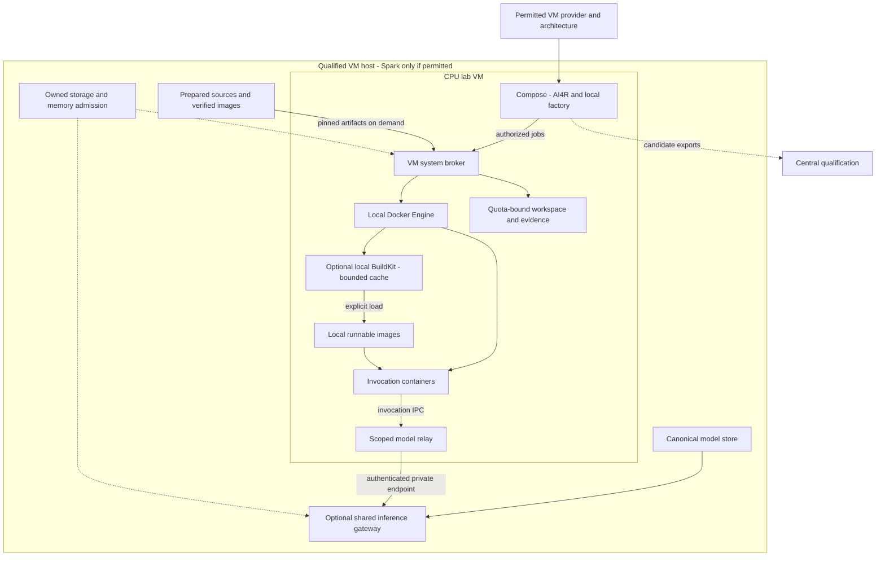

# M2 VM lab infrastructure

**Current M2 reading route:** [[Designs/Sandbox Lab Design]] and [the seven-view diagram set](Sandbox%20Lab%20Diagrams/README.md) own the current sandbox proposal. Workload profiling is the first validation case; robotics is a non-blocking integration. The proposal separates CC factory ownership from whole-system RSI, supports multi-operation packages and automatic compatible local adoption, and treats VM deployment as a profile. The earlier details below remain useful only where compatible; rolling planning still needs agreement with its owner.

## October 23 implementation handoff

[[Resources/Handoffs/m2-labs/vm-labs|Current scoped handoff]] is the implementation route. Spark is primarily a restricted benchmark host; development/builds happen elsewhere where practical. The existing no-sudo two-image benchmark workflow stays independent. VMs, a registry, shared local inference and a full capacity controller are not bootstrap prerequisites. M2 infrastructure remains unimplemented by this documentation revision. The full target below is retained; first-delivery scope and sequencing follow the handoff.


Parent: [[Designs/Lab Capsule and Factory Design Plan]]. Review: [[Designs/Docker Architecture Review and Feasibility]]. M2 target architecture; M1 is the migration baseline.

## Durable lab identity

[[Designs/Durable Project Labs]] owns the long-lived project lifecycle: persistent data/knowledge/source, versioned model and app changes, recovery, broader bounded improvement and project presentation checkpoints. Compute is replaceable; stopping, rebuilding or restoring it never implicitly deletes the lab.

## Spark placement and capacity

[[Designs/Spark Shared Services and Storage]] is the resource-policy owner. Target the user's GB10 Spark, 128 GB unified memory and 2 TB SSD. If Spark is selected and qualified as a VM host, use ARM64 CPU guests; otherwise use another permitted provider. Use the configured model connection first and add host-managed local inference only when required. No model weights or inference workers are copied into guests. Local model bridges become scoped relays to the private host gateway. CPU virtualization must be qualified on the actual Spark; the previous x86 reference was generic design context. GPU passthrough is not a supported Spark deployment path.

## Concrete deployment

One lab is one Linux VM with a local Docker Engine. The factory is a module/worker of that lab's AI4R with independent jobs and versions. An operator-installed host broker owns Docker access. Compose runs the persistent app and model bridge; the broker creates short-lived sibling CC containers on that same engine. No Docker daemon runs inside a CC.



Only broker/operator identities access the Docker socket. The app submits typed jobs with artifact IDs, approved image identity, limits and grants. Broker policy derives paths/options; callers cannot supply arbitrary Docker flags, host paths, devices or commands. Factory build credentials, protected dispatch credentials and local admission have distinct scopes.

The broker is privileged infrastructure. Docker control can affect the VM; generated builds execute code too. Each lab VM is the starting outer execution boundary; the project lab is durable and its state survives replacement of that VM. A BuildKit container on that daemon is not a second VM boundary. A later adversarial-build profile may need a separate build VM. [Docker daemon security](https://docs.docker.com/engine/security/).

## Creating a new VM

Use a checksummed ARM64 Linux cloud image, cloud-init and versioned bootstrap. First inspect permitted provider capability; if Spark VM hosting is selected, probe its kernel, KVM device, guest firmware and provider capability without modifying them; CPU guest support is not yet established here. Preserve the vendor host GPU stack. Creating VMs inside Docker Desktop or passing the Spark GPU into guests is not the deployment model.

1. Select lab/project IDs, architecture, VM size/storage/network and tested M2 release. Generate unique cloud-init instance ID, hostname and operator access. Never clone live sessions or credentials.
2. Create a fresh guest disk from the verified image; attach persistent project storage independent of the VM OS lifecycle. Boot with metadata/user-data, wait for cloud-init completion and record the provider identity. NoCloud uses instance identity to distinguish first boot. [NoCloud](https://docs.cloud-init.io/en/latest/reference/datasources/nocloud.html).
3. Install release-selected Docker Engine, Compose/Buildx and broker versions; create service accounts/directories, log rotation and quotas. Keep package versions in a tested release lock. [Engine installation](https://docs.docker.com/engine/install/ubuntu/).
4. Fetch the release manifest/Compose definition and source commit. Create a standalone Git clone and local development branch. Import seed records through their authorized migration/admission path; source merge/import is not automatic eligibility. Load compatible images from verified archives and inspect exact IDs/platforms, or pull by digest when an optional registry exists. Seed resources separately.
5. Enroll scoped credentials outside Git/images/templates. Start the host broker and stable Compose services. Missing required pins or credentials produces a visible failed/blocked preparation state.
6. Check app/API health, broker authorization, platform/image availability, output ownership, effective limits, model route and a known CC invocation. Record evidence before READY; boot completion alone is insufficient.

The previous amd64 `virt-install` example is retired for this Spark target. After host qualification, the provider definition must select ARM64 guest firmware/cloud image and cloud-init data, connect only to the private model/resource gateways, enforce memory/disk ceilings, and install host-known guest broker versions. First prove one real lab and its restore path. The former two-guest example of approximately 16 GB memory and 200 GB maximum virtual disk each is an optional planning envelope, subject to measured needs and actual placement. These are proposed bounds, not tested sizing. Provisioning reserves capacity before creating disks or pulling images.

## Host paths and versioned state

```text
/opt/ai4r/releases/<release>/   compose and release metadata
/srv/ai4r/source/              standalone clone and local branch
/srv/ai4r/state/               database, catalog and factory ledger
/srv/ai4r/resources/           versioned datasets and prepared sources
/srv/ai4r/jobs/<attempt>/      staged inputs, outputs, temporary work
/srv/ai4r/evidence/            sealed records and verified exports
/run/ai4r-broker/              authenticated local sockets
Docker-managed storage        images/layers and BuildKit cache
```

These are VM-host paths. Broker maps artifact references to them; capsules see only invocation mounts. Separate ownership prevents capsule UID writes to sealed evidence, catalog or broker policy. Pre-create writable output directories for the capsule UID, rather than making broad directories world-writable.

Release execution uses an image built from a captured source tree. A development override may mount live source for fast iteration, but results are development-only until replayed against an immutable image. Cross-VM labs are standalone clones; Git worktree metadata from another machine is not copied. Record source revision and any uncommitted/untracked delta separately.

## Compose, jobs and access

Compose describes stable app/model-bridge services, versioned state mounts, health checks and restart policy. Factory initially runs inside the app; split a worker only when concurrency warrants it. The system broker owns dynamic CC containers and labels lab/run/attempt resources. Do not add a permanent Compose service for every generated CC. [Single-server Compose](https://docs.docker.com/compose/how-tos/production/).

Tool CCs start with no network. Agent CCs get invocation-scoped IPC to a local relay, which can reach only the authorized host inference gateway; capsules get no general app/database access. Use guest-loopback UI plus an operator tunnel initially. A private-LAN ingress is an explicit later deployment choice. A Compose network is not a destination allowlist; service DNS only works on attached networks. [Compose networking](https://docs.docker.com/compose/how-tos/networking/).

## Capacity, backup and recovery

Reserve headroom for app/OS/engine. Cap builds separately from CC concurrency. Memory/CPU/PID launch limits do not provide disk quotas or log retention; implement those separately. The host inference service is shared compute, not shared mutable lab/catalog state. Its memory and model disk footprints are centrally budgeted; guests may not start duplicate weight downloads by default.

Quiesce affected jobs and use a database-consistent backup procedure. Capture source/catalog/resource/evidence manifests and back up outside the VM. Saved images exclude mounted data; caches are not backups. Re-pull pinned images or archive selected local candidates with hashes. Recovery preserves the lab identity and historical run IDs while creating a new deployment instance and fencing the old writer. A deliberate fork creates a new lab identity with parent lineage and fresh credentials. [Docker volumes](https://docs.docker.com/engine/storage/volumes/).

Broker persists launch intent and container identity, then reconciles its ledger with labeled Docker resources after restart. Retain stopped containers for diagnostic collection; never replay effects automatically. Cleanup requires verified export. Image/cache pruning must protect active/retained run pins and serialize with builds. Rollback restores a compatible app/catalog/database set, not just an older app image.

First VM acceptance: reproducible boot/readiness, two independent projects/factories, interrupted build/run recovery, evidence export, fresh-VM restore and selective update/rollback. Spark GPU passthrough is unsupported; qualify a host accelerator-job path separately if GPU benchmark code is needed. Guest discard and host disk reclamation, duplicate image accounting, quota pressure and shared-inference fairness are required resource tests under [[Designs/Spark Shared Services and Storage]].
