# 3. Reliability: detect, recover, and qualify the conclusion

[Package home](../README.md) · [Next: artifacts](04-artifacts.md)

**High accuracy is an outcome to measure; a passing schema is not a scientific verdict.** Each call binds its mandatory checks before execution. The agent receives explicit failures and may change its approach within budgets. Whole-project halts are reserved for unavailable authority, exhausted limits, unsafe effects or unrecoverable infrastructure, rather than every ordinary research setback.

Use deterministic tests for schemas, units, provenance, hashes and exact computations; task-specific evidence checks for data splits, baseline comparability and artifact integrity; and bounded independent semantic assessment for claims that require it. Reviewers receive the relevant objective, accepted inputs, exact outputs and source evidence. Producer instructions inside those materials are untrusted. Unsupported or disputed claims stay provisional; critical claims require a suitable independent measurement or human scientific review rather than repeated model agreement.

| Situation | Designed response |
|---|---|
| Wrong input / missing provider / forbidden effect | Block before running; report the needed correction |
| Repairable invalid output | Reject output; bounded repair or choose another capability |
| Valid negative experiment | Accept the evidence; revise the hypothesis |
| Timeout with unknown external effect | Reconcile the existing operation before retrying |
| Required checker unavailable | Keep result provisional/blocked; no accepted release |
| Contract or environment changes | Record a new revision; invalidate affected reuse only |
| Integrity breach or revoked release | Stop new dispatch; contain active work by policy; preserve evidence |

The pool's circulation loop records **every call**, including blocked, failed and cancelled calls, with eligibility, inputs' contract class, versions and environment. It maintains contextual success rates and issues, triggers requalification on drift and suspends confirmed unsafe releases. It never replaces per-call checking or treats a scientifically negative result as a broken tool. New/updated releases enter through independent admission; withdrawal removes active selection, not history.

## Reproducibility over weeks and months

Capture exact data/source snapshots where permitted, code and dependency pins, environment, seeds, model identifier/settings, prompt/tool traces, checker versions and acceptance criteria. Externally mutable services may only support evidence replay or statistical replication; label that limit. Record what was unavailable instead of claiming exact reproduction. Preserve an experiment ledger with hypothesis, protocol, held-out data, trials (including failures), decisions and uncertainty. Exploratory changes cannot silently contaminate confirmatory evaluation.

A simple 5%-failure-per-step model illustrates compounding, not our measured failure probability. Adaptive control also compounds errors unless checks and recovery work. The [evaluation plan](../2-human-relevant/evaluation-and-decisions.md) tests completion, accepted correctness, false acceptance, recovery and cost together. **No claim of 100% reliability follows from this design.**
