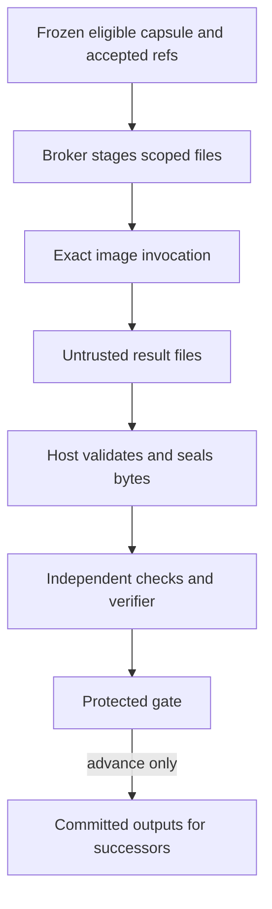

# Implementation handoff: container capability capsules

## For human and AI

Package implementation/environment as an immutable image and execute each
invocation in a short-lived container, preserving its declaration, checks, gates
and evidence. Start with one real stateless tool on a development Docker host.
Do not convert every capsule at once or require VMs, a factory or registry first.

Read [shared contracts](contracts-and-boundaries.md), [source status](implementation-status.md)
and [validation](validation.md). Current M1 modules are not a proven per-capsule
container runtime. Keep the working source carrier available during migration.

## First implementation

1. Inspect one actual stateless tool/declaration, preferably `utility.calculate` or table normalization when present. Freeze ports, semantics and positive/negative examples before carrier authoring. Candidate source is not admission.
2. Add a narrow image entrypoint and host carrier/broker operation. Inputs: `/inputs/invocation.json` and scoped immutable files. Outputs: `/outputs/result.json` and declared files. Scratch: bounded `/tmp`. No database/store objects or ambient app filesystem capability cross this boundary.
3. Specify versioned manifests: invocation identity, exact capsule/image/platform, accepted refs/hashes/relative files, outputs and limits; results repeat identity and give status plus path/media/schema/hash/size descriptors. Freeze examples in the native interface process and reject unsupported versions. Exit status/self-tests cannot replace the manifest or acceptance.
4. Capture narrow context/locked dependencies, build once on the build host, explicitly load on the target and inspect the immutable ID. Reuse images across invocations. No weights, complete repositories/datasets, credentials or results in layers. ARM64 needs real evidence, not an AMD64 test or mutable tag.
5. Broker derives daemon-host paths/options from frozen grants. Initial tool profile: non-root, read-only root, dropped capabilities, no-new-privileges, no network, bounded CPU/memory/PIDs/scratch/deadline, no automatic restart/remove. No agent-supplied flags or mounts. Qualify the actual engine profile.
6. Persist create intent, reconcile labels/container ID, then start. Supervise cancellation/timeout/OOM, seal partial observations/logs, and import validated output bytes into separate custody before checks/gates. Cleanup only after required evidence is durable.

## Integration and verifier conversion

Select the carrier by exact declaration identity, not model-written Docker
commands. Preserve Binder type/schema/dependency/coverage and scientific checks.
A capsule becomes plannable through normal qualification/admission/activation;
no new hardcoded complete workflow choice. Frozen DAGs never swap image pins.

After the tool works, convert one agent through invocation-scoped model IPC/relay:
role, budget, cancellation and revocation remain enforced without leaking provider
or Docker credentials. Then convert a verifier, providing only the pinned work
declaration and exact output. Host checks keep original inputs/runtime evidence.
Reject attempts to add worker inputs/traces to semantic context. Private held-out
tests stay outside author/producer containers. Shared models do not share sessions.

## Recovery and evidence

Missing image/platform blocks preparation; no rebuild/fallback. On restart,
reconcile uncertain containers/effects before another attempt. A timed-out CLI
does not prove the job stopped. Confirm owned termination and preserve actual
exit/OOM/log/hash/image evidence. Host persistence failure prevents acceptance
even after exit zero. Protect dependencies of active/retained runs, or record a
verified external recoverable copy; manifests alone do not preserve replay.

## Acceptance

Run the actual tool container through host runner/check/gate integration and
compare meaningful outputs/failures with the existing carrier. Test wrong schema/
pin/platform, denied mounts/network, linked/corrupt/hash-changing outputs,
timeout/OOM/cancel, restart with unknown state and output-storage failure.
Repeated invocations have separate workspaces and preserve user sentinels.

Measure build/transfer/start/execute/check/disk separately. Do not assume overhead
is negligible or that containers prove scientific reproducibility. Rerunning an
image, rebuilding software and reproducing scientific findings are separate claims.
