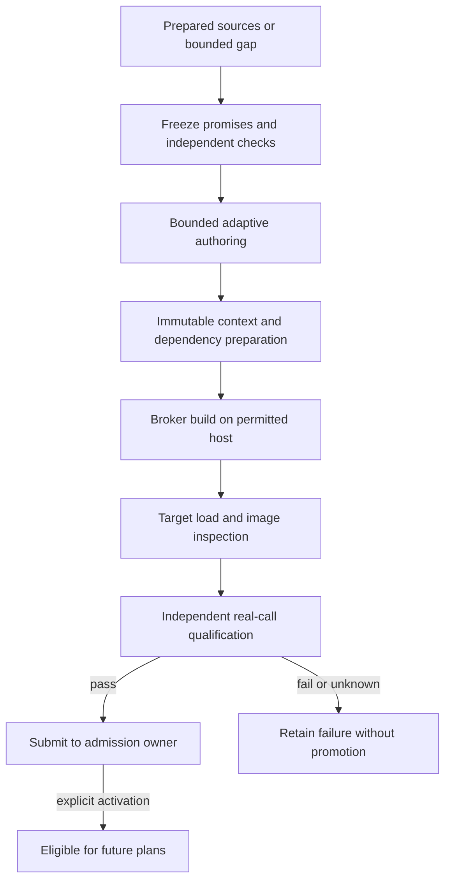

# Implementation handoff: independent local capability factories

## For human and AI

Build a factory owned by each lab's AI4R, turning prepared sources or an observed
capability gap into reviewable candidate packages. **Use both fixed control and
adaptive work:** a fixed durable lifecycle contains bounded adaptive agents.
Neither an unrestricted agent nor a one-repository hardcoded script is sufficient.
First prove the manual path, then automate authoring.

Read [shared contracts](contracts-and-boundaries.md), [container carriers](container-capsules.md),
[source status](implementation-status.md) and [validation](validation.md).

## First useful delivery

1. Add a module/worker to each lab AI4R with independent job ledger, template version, source/candidate history and budgets. No separate permanent service is required initially.
2. Define one request: intended capability, prepared repo commit/tree or paper/resource refs, allowed operations, target platform/interface, lineage and finite attempts/time/calls/bytes. Missing access, data, licensing or runtime narrows or blocks the output; never invent evidence.
3. Manually capture/build/load/invoke/independently qualify one capsule and submit it through normal Library admission. Use operator-owned Dockerfile templates and pinned dependencies. Record context/recipe/declaration/source/image/check identity. Repo-only input can yield a tool; paper-only input may yield a reviewed resource. Do not claim whole-repository equivalence.
4. Add bounded adaptive stages for operation discovery, contract drafting, implementation, dependency repair and proposals. Generalist gap runs can request capabilities for future runs, not spawn recursive factories or patch the running DAG. Freeze promises/independent checks before authoring; changed contracts are new candidates.

## Fixed durable lifecycle

Specify versioned stages such as REQUESTED, PREPARED, CONTRACT_FROZEN, AUTHORING,
BUILDING, BUILT, QUALIFYING and AWAITING_ADMISSION; record FAILED, BLOCKED,
CANCELLED or candidate-ready outcomes explicitly. Admission and activation are
external authority records, not a factory's self-declared success state.

Persist attempts, source/context hashes, broker operation IDs, stage artifacts,
checks, resource reservations and cancellation state before effects. Resume
reuses verified immutable artifacts. Unknown builds/effects are reconciled, not
duplicated. Changed inputs invalidate dependent evidence. Cap cumulative retries,
bytes and model calls including failures; never repair by weakening criteria.
Unknown state prevents expiry and automatic retry of uncertain effects.

## Where builds run

Factory controller/history belongs to the lab; builds can execute on a permitted
workstation/CI or namespaced shared BuildKit backend. Spark is primarily for
benchmark execution. A dedicated per-lab builder is an option on a qualified
development VM, not mandatory Spark infrastructure. No sudo/install workaround.
Independent contexts/jobs and scoped credentials remain even on a shared backend.
Account for caches where built and loaded images in every guest that imports them.

The broker controls contexts, bases/frontends, dependency preparation, egress and
entitlements. Build-step `network none` is not a complete offline policy.
Buildx's docker-container driver has separate cache/content; explicitly load and
inspect the result in the target engine. Verified archives suffice initially;
registry optional. Online preparation has its own grant/provenance, separate
from runtime permissions. Agents get neither Docker control nor privileged builds.

Apply shared peak-space/retention rules. Keep compact deltas/logs, not unlimited
clones/images/archives. Weights stay outside products; do not duplicate model
stores per lab. Use the existing model route first; add shared inference on demand.

## Qualification and exchange

Independent checks cover changed inputs, errors, actual calls, clean package/
install, dependencies, denied effects and carrier protocol. Input-dependent
fidelity is host-owned; semantic review stays output-only. Held-out tests and
answers stay outside author/build inputs. Merge, build, self-test, Generalist
completion and publication never grant eligibility. Retain current human M1
activation until an explicitly authorized M2 policy changes it.

Export source/patch/tree including uncommitted deltas, recipe/locks, image/platform
relationships, checks/evidence/limitations and lineage. B independently imports/
rebuilds/qualifies; A's eligibility is not B's. Central qualification tests the
actual release artifact, including a new digest after rebuild. Platform/factory/
Planner changes are separate candidates with compatible state migration/rollback.
No upload silently updates labs or already frozen runs.

## Acceptance

A builds one useful capsule, rejects a bad candidate and invokes the good one
after normal admission. Resume an interrupted build without duplicate effects
and reject over-budget work. B independently qualifies/imports without changing
unrelated project state. Prove no promotion after failure/inconclusive checks,
private evidence separation, verified export and distinct central adoption.
Manual container operation must work first; fixture packaging is not factory
acceptance, and no source merge is proof of capsule effectiveness.
