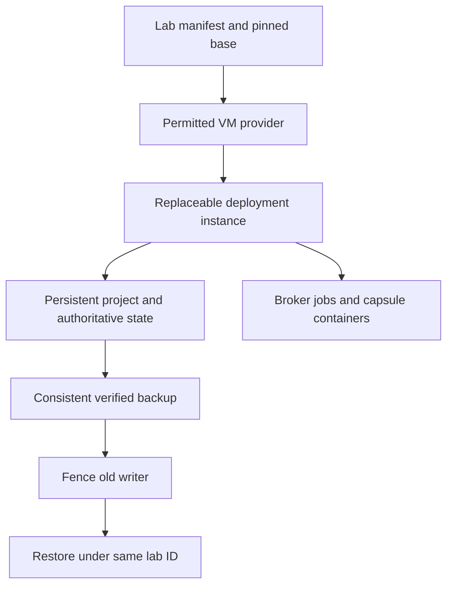

# Implementation handoff: durable VM labs

## For human and AI

Build one long-lived project lab whose data survives stop/start, app replacement
and VM restore. Each lab owns its evolving AI4R, factory history, catalog and
image references. Use a permitted VM/provider first; do not require Spark VM
hosting, sudo or hypervisor installation in M1 startup.

Read [shared contracts](contracts-and-boundaries.md), [source status](implementation-status.md)
and [validation](validation.md). This is M2 work, not proof of VM readiness.

## First useful slice

1. Inspect actual provider/access, architecture, disks and repository. Select one supported adapter and record permissions/version. Without authorized access, implement manifest/command fixtures, mark provisioning BLOCKED, and continue carrier work on Docker. Do not substitute a container for a VM.
2. Ship repository-owned manifest/registry and idempotent create, inspect, start, stop, checkpoint, restore and export commands. Refine names in the native spec; supply help/examples and nonzero failures. No private scripts or fleet service.
3. Separate lab/deployment/run IDs. Capture base/app/factory/broker/protocol pins, source deltas, model routes and project/state/evidence disks. Enroll credentials separately; clone no live sessions. Use unique cloud-init instance IDs and private/tunneled access.
4. On a clean permitted guest, use a checksummed cloud image and versioned cloud-init/bootstrap. Installation uses only provided administrative/provider capability. On restricted hosts, consume preprovisioned guests rather than escalating. Preserve the host GPU stack.
5. Compose runs persistent services; the local broker creates dynamic sibling CC containers. Reuse app/runner contracts, not another benchmark scheduler. The first lab can run the existing app pair before M2 carriers/factory automation.
6. Implement database-consistent backup/restore and enforceable single-writer fencing. Project state survives VM OS replacement. A verified copy on another device/service is required for SSD-loss recovery; a second local folder is not independent backup.

## State, upgrades and resources

Persist brief/backlog, curated knowledge, source changes, resource manifests,
catalog/factory history, model configuration, evidence and versioned demo bundles.
Process memory, caches and provider sessions are not the knowledge store. Stop
preserves data; deleting unique data is a separate explicit operation. Unknown
jobs prevent destructive cleanup or effect replay.

Switch models or platform releases for new runs only. Reconcile/drain affected
jobs, checkpoint before migration and qualify forward/rollback compatibility.
Do not assume a model/provider session can migrate. A fork gets a new lab ID
and fresh credentials; restore preserves historical run IDs.

Keep the first lab small and measure actual disk allocation. The earlier pair
of 16 GB/200 GB Spark CPU guests is a planning example, not a mandatory allocation
or measured fit. Prove one restore path before scaling. Shared inference is
optional; if used, weights stay outside guests/images and access is scoped.

## Deliver and prove

Deliver provider/config adapter, versioned manifest examples, checked-in commands,
runbook, backup manifests, source/image identity and an environment-specific
evidence report. First acceptance: one real lab, preserved sentinel/database/
evidence through stop/start and app replacement, fenced restore into a new VM,
model-route switch for a new run and a project export. Then demonstrate a second
lab with independent writable state/credentials/catalog and selective import.

Corrupt/incomplete backup, missing images, disk pressure, stale writer or provider
permission denial stays visibly blocked, not READY. Keep actual restore evidence;
a successful backup command alone is insufficient.

## Spark boundary

Spark is benchmark hardware, not the default development/provisioning host.
CPU VM support and permission need actual qualification. NVIDIA's inspected
support documentation does not support GPU passthrough; do not depend on it.
Use an approved host inference service when needed, or another CPU VM host.
No driver change, unattended provider install or escalation is part of this
handoff. Report the provider gap; ordinary Docker benchmarking stays independent.

Primary references checked for this handoff: [cloud-init NoCloud](https://docs.cloud-init.io/en/latest/reference/datasources/nocloud.html) and [NVIDIA Spark support](https://docs.nvidia.com/dgx/dgx-spark/support.html). Provider/CPU guest support remains unqualified here.
