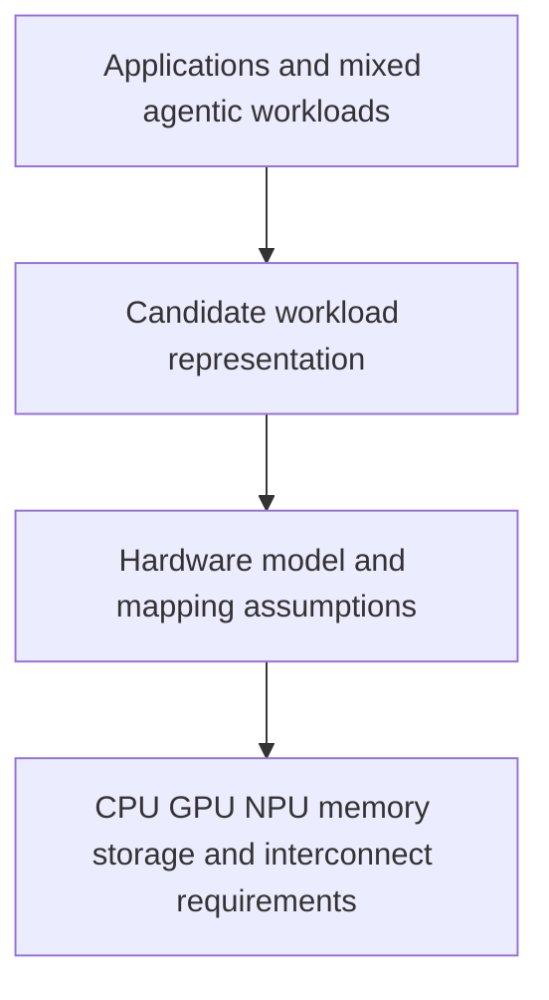

# Workload characterization for future hardware

A workload-profiling application can be installed alongside an AI4R fork in a lab sandbox and exposed through CCs; [[Designs/Labs and Capability Capsules]] defines those component boundaries. This placement does not resolve the research question below or establish any profiling result.

**Current first-lab objective:** investigate standard units of workload/performance that can predict the hardware requirements of a task with minimal actual hardware access. A concrete target is predicting low-level resource usage on another machine using historical profiling data, reducing the need for fresh measurements on every target. [[Sources/Prompts/2026-10-25-multi-lab-workload-scope.txt]] clarifies this goal; the units, mapping method, calibration needs, and predictive accuracy remain research questions. The broader future-hardware question remains relevant.

The meeting describes mixed training, inference, video rendering for physical AI, and other work, potentially running at the same time. An inference-only benchmark would cover only part of that demand. Profiling known hardware is useful evidence, but does not by itself answer the future-hardware question.

## Working model to investigate

The middle representation is an open research choice. A proposed “standard workload unit” must specify what it preserves, what it loses, and how its mappings could be tested. Do not treat it as an established standard or assume a vector-operation representation covers the workload.

## Questions before building a profiler

- What chip-design decision should the output support: capacity, bandwidth, latency, concurrency, power, or another constraint?
- What workload structure can be observed independently of a specific device?
- How are scheduling, memory hierarchy, communication, and overlapping tasks represented?
- What measured or simulated evidence could falsify a proposed hardware mapping?

Container-level observation is a candidate measurement boundary motivated by the complexity of whole tasks. It may need lower-level traces or models to explain bottlenecks; the right depth remains an experimental question.

## Ownership and connection

The meeting assigns workload profiling to Xiaoyang and lab infrastructure to Muk. Those are captured meeting statements, not an independently verified current staffing allocation. The lab can host these studies. GB10 can supply one calibration environment, with all assumptions and limits recorded.

Historical source: [October 15 workload-profiling note](<../../jiuwenswarm/docs/architecture/notes/workload-profiling-source-2026-10-15.md>). It is personal context awaiting integration, not a replacement for this broader problem definition.
