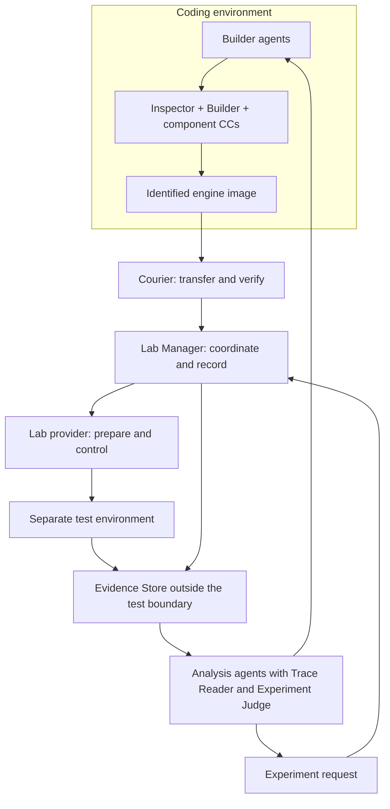
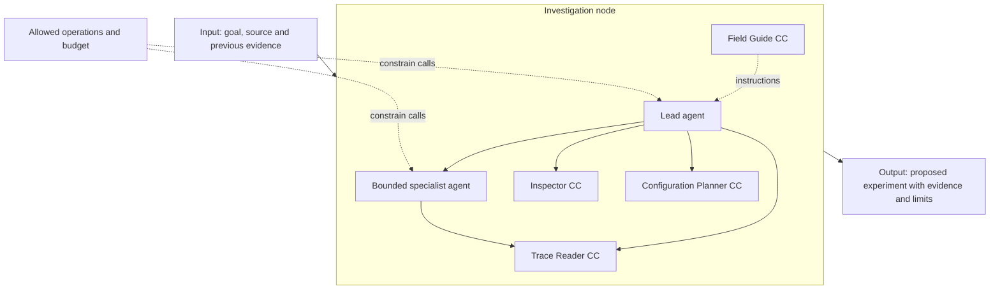
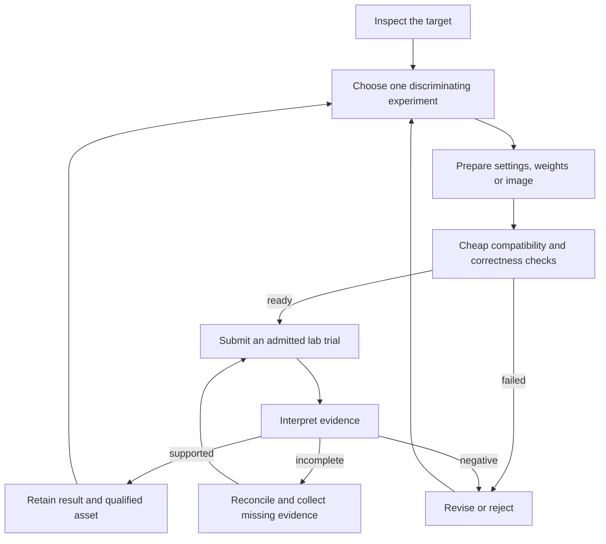
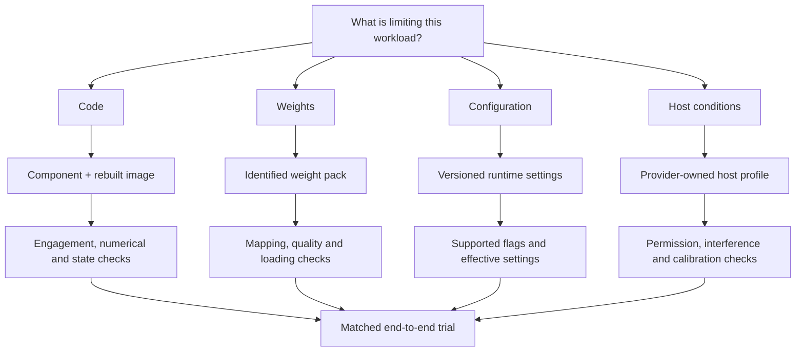
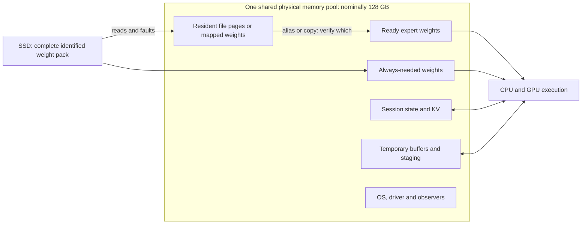
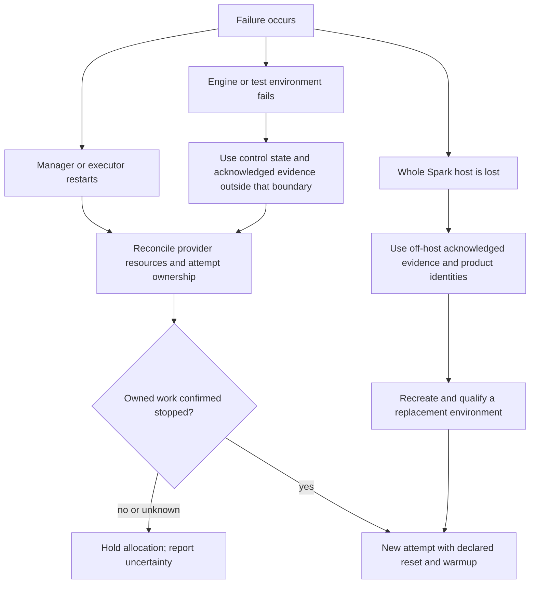

# Muse on DGX Spark: a practical software-factory handbook

**Target:** Muse Spark Open inference on one DGX Spark with 128 GB of shared CPU/GPU memory. **Updated:** November 10, 2026. **Audience:** feature owners, engine developers, lab developers and the agents doing this work.

This is a working guide and preliminary capability catalog. It describes what to build, reuse and investigate. It does not claim that the proposed packages are implemented or that Muse has been qualified on our Spark. Source details and older technical identifiers are in the appendix.

## Executive summary

**We want a factory that improves inference through experiments and retains what it learns.** Agents should be able to inspect an engine, propose a change, construct an identified product, ask the lab to test it, and decide what the evidence supports. The reusable output includes engine components, reliable tools and useful engineering procedures—not just the final engine image.

For Muse on this machine, start with three questions: **Can the chosen runtime execute the actual model correctly? Which weights and working data must stay in memory? Can the remaining weights arrive from storage quickly enough?** The whole model's stored weights are much larger than its active computation per token. A setting that limits an expert cache is not a measurement of the whole machine's memory use.

The most important lessons from the existing RTX and Jetson campaigns are:

- **Try cheap, supported changes early.** Existing runtime settings, weight representations and deployment choices can be valuable experiments before writing new engine code. That is a search order, not proof that code changes are always low-value.
- **Measure the intended change.** An enabled flag does not prove the relevant code ran. A fast isolated operation does not establish faster full inference. Check engagement, correctness and whole-request behavior separately.
- **Keep the experiment honest.** Identify the image, weights, settings and workload. Watch interference and state. Missing evidence remains missing; a valid slowdown is different from a broken test.
- **Give each node a toolkit.** An agent can use Inspector, Trace Reader and the Field Guide together. Another node can use Builder, Instrumenter and a component package. Several CCs assigned together do not become one giant CC.
- **Separate tools from the engine parts they help create.** Builder produces an image; Weight Workshop produces a weight pack; an Execution Module becomes part of engine behavior. Manager coordinates lab work and evidence rather than acting as an optimization agent.

**First actions:** harden and demonstrate Trace Reader on a saved profile; adapt Inspector and Builder from existing campaign code; independently establish the Muse checkpoint/reference and Spark lab capabilities. Use the results to select the first engine intervention. Do not launch a broad optimization search before these prerequisites are clear.

**Friday:** one useful CC is enough. The smallest strong demonstration is an agent using Trace Reader to explain a real saved profile, expose an unavailable measurement and reject malformed input. A live Muse run, component integration and complete lab are optional additions, not implied achievements.

**Still unresolved:** the approved checkpoint and accepted correctness reference, the working Muse runtime/format, the supplied benchmark's exact acceptance policy, and actual Spark resource/profiling qualification. RTX/Jetson results help us choose tests; their speedups and compatibility do not transfer automatically.

### How to read this guide

Read the overview to understand the factory. Use the playbook when choosing an experiment. Use the named capability cards to assign work. The examples and backlog are ready to turn into bounded agent tasks. The appendix preserves detailed evidence, source pins and implementation limits.

## The factory: nodes, agents and reusable packages

A **node** is a job in a task graph: it has a purpose, inputs, agents, an assigned toolkit and an expected output. It is not necessarily a machine, container or long-running service. Several nodes may use the same host at different times. A lab job can continue asynchronously after the agent's submission call returns.

An **agent** does the reasoning and uses allowed capabilities. A **CC**, or Capability Capsule, is a versioned package that makes a useful capability available: tools, instructions, an integration, component assets or bounded agent behavior. A **node toolkit** is an assignment of several CCs to a node. Each package keeps its own version and permissions.

An **engine component** is an asset integrated into the engine's operation: source, a patch, a library, a module or a runtime-loaded binary with integration instructions. It need not be compiled directly into one executable. An **artifact** is an output such as a weight pack, configuration, image, trace or report. Producing an artifact does not automatically make that artifact another executable CC.

An **MCP interface** is a way for an agent to discover and call capabilities. It does not decide what belongs in one package. A **skill or method** explains how to do the work. A **bounded agent capability** can contribute reasoning, but must have explicit inputs, outputs, limits and allowed tools.

### Factory overview

The coding side changes the engine and produces an image. Our Manager coordinates identified experiments. The other team's provider prepares and controls the test environment. Agents analyze retained results and decide what to try next. The Evidence Store is a logical responsibility; it does not require inventing another storage product.

**Text fallback:** build an image → verify delivery → Manager admits a request → provider runs it separately → evidence is retained → agents assess it and propose the next change.

### Several CCs inside one node

Both agents can use the same package. The lead may delegate a narrow analysis without handing over the entire campaign. The assigned packages do not grant unrestricted access: an analysis node can read a saved report without being allowed to start a profiler or stop a container.

**Text fallback:** one node contains agents plus several independently versioned CCs; permissions constrain the calls; the node returns a defined result.

This is the intended usage model. It is not a claim that current task scheduling already implements every assignment, inheritance or permission rule. Use the existing runtime's actual binding and grant support; identify missing integration instead of inventing declaration fields.

### The experimental task graph

Every cycle should answer a question. A failed hypothesis and an invalid experiment need different follow-ups. A negative result might end that candidate; an interrupted test might need recovery rather than a new optimization. Returning to the lab always means a recorded attempt, not silently repeating uncertain work.

**Text fallback:** inspect → choose → prepare → cheap-check → test → interpret; keep supported results, revise rejected ideas, and reconcile incomplete execution before retrying.

## Intervention playbook: what can we change?

### Four kinds of change

These change different things and produce different evidence. A setting for an upstream feature is not newly written engine code. A new weight pack is not automatically an engine component. A runtime-loaded library can be a component even though it is not compiled into the main binary. An instrumentation helper can be integrated into a diagnostic image while remaining a tool-support asset rather than a production optimization.

**Text fallback:** change code, weights, settings or host conditions → identify the resulting asset → apply the appropriate checks → run the same agreed workload.

Do not interpret “host conditions” as permission to stop unrelated services, drop shared caches or change system-wide settings. Such experiments belong to a declared provider operation. Observation, calibration and mutation are different capabilities.

### Where the memory goes

These boxes show kinds of data, not counters that can simply be added. Mapped file pages and an expert view might refer to the same bytes; staging might create another copy. CPU and GPU share the physical budget. A mapping's virtual size does not establish how many pages are resident or whether a GPU can use them safely.

**Text fallback:** weights live on SSD; some become resident or are staged for execution; weights, state, temporary data and system overhead compete for one shared memory pool.

### Prove the baseline

**When to use it:** before optimizing an unfamiliar model/runtime pair.

**Inspect:** authorized checkpoint files, tokenizer/processor, chat template, tensor names/shapes/types, model operators, engine source and supported command options. Muse's routing, normalization and attention must not be replaced by superficially similar operations from another MoE.

**Try:** create a compatibility map, compare rendered token inputs, then test selected intermediate outputs and prefill/decode behavior against an identified reference. If a full reference cannot run on this Spark, use an authorized qualified reference elsewhere or matched saved fixtures and say what they cover.

**Tools and components:** Inspector, Correctness Kit, Builder and Field Guide; Weight Reader only when a loader adaptation is necessary.

**Measure:** operator coverage, numerical differences, request behavior and whether the declared workload runs within the budget.

**Stop when:** required files, a trusted reference or required operators are unavailable. A small synthetic fixture can still teach us about one operation, but it cannot become a Muse baseline by changing its label.

**Record:** checkpoint/source/image/template identities, actual settings, unsupported cases and the first divergence. Model-name recognition, successful compilation and plausible text are insufficient.

### Establish a trustworthy measuring setup

**When to use it:** before claiming a fit, speedup or lower memory use.

**Inspect:** actual host, tool versions, CPU placement, storage, available counters, other work, and the proposed workload/state policy.

**Try:** run the same baseline repeatedly before comparing changes. Separate loading, repacking, warmup, prompt processing, token generation and shutdown. Compare observation enabled/disabled where it might affect results. Qualify bounded, touched allocations through supported pageable, mapped, pinned, device and managed paths.

**Tools and components:** Resource Watch, Capture Kit when needed, Experiment Judge and Field Guide. The provider controls allocation and isolation; Manager records eligibility.

**Measure:** observed phase peaks, swap and faults, CPU/memory/storage pressure, external GPU work, clocks/thermal changes and evidence-storage headroom. State each counter's scope, units, cadence and gaps. Do not add overlapping memory views or treat a sampled maximum as a guaranteed instantaneous peak.

**Stop when:** interference, missing measurements or state drift invalidate the comparison. Keep the run as unscored evidence. Do not select a universal “win percentage” before understanding noise and the acceptance policy.

**Record:** raw samples, configured versus observed limits and why a trial was included or excluded. Fresh process, warm application cache and cold storage are different conditions.

### Shrink the weight representation

**When to use it:** stored weights, resident weights or repacking buffers dominate.

**Inspect:** actual per-tensor types, scales, metadata, loader expansion and conversion workspace. A pack called “Q8” can contain other tensor types.

**Try:** one supported quantization or mixed-precision recipe. Use existing converters first. Preserve source-to-output tensor mapping and calibration identity. Account for original, converted and temporary files existing together.

**Tools and components:** Inspector, Weight Workshop, Correctness Kit, Builder, Experiment Judge and possibly Weight Reader.

**Measure:** pack bytes, conversion/load peaks, runtime memory, quality and matched latency/rate. A smaller file may expand into a much larger runtime representation.

**Stop when:** the converter/kernel path is unsupported, shape mapping is wrong, quality fails or the resource budget is exceeded. A smaller model or pruned variant is a changed model, not automatically equivalent execution.

**Record:** recipe, pack hashes, tensor inventory, quality policy and the trade-off. The lab tests identified packs; it does not silently reconvert them.

### Remove duplicate copies

**When to use it:** memory seems larger than the required data suggests.

**Inspect:** the path from file to mapping, staging buffer, execution view and dequantized data. Mark who owns each allocation and when it can be freed.

**Try:** an existing supported mapped/shared path before designing another cache. Confirm whether each step aliases data or makes a copy. Test alignment, lifetime, readers and cancellation.

**Tools and components:** Instrumenter, Resource Watch, Trace Reader, Correctness Kit, Weight Reader and Expert Store.

**Measure:** load/serve peaks, resident pages, copy evidence, faults and latency under the same cache conditions.

**Stop when:** a removed copy causes stale data, invalid access, hidden replacement allocation or unacceptable latency. Shared-memory hardware is not automatic proof of a safe or faster zero-copy implementation.

**Record:** ownership diagram, measured coverage and the confirmed change in physical residency.

### Feed the experts from storage

**When to use it:** the model does not stay resident or execution waits for expert weights.

**Inspect:** routed expert demand by layer/request/token, complete trace coverage, access sizes, storage latency and the mandatory resident set. Keep accepted-token work separate from speculative/rejected work.

**Try:** bounded residency and a reliable miss path first. Evaluate cache policy on separate design and held-out traces. Then test coalesced reads and prefetch only where prediction arrives early enough. A replay predicts demand behavior; it does not automatically include scheduling, I/O and memory overhead.

**Tools and components:** Instrumenter, Resource Watch, Capture Kit, Trace Reader, Configuration Planner, Correctness Kit, Weight Reader and Expert Store.

**Measure:** requested versus effective cache capacity; non-routed/KV/scratch/staging headroom; hit/miss and eviction counts; useful/late/wasted reads; read sizes, queueing, stalls, TTFT and token rate.

**Stop when:** trace coverage is inadequate, admission would threaten the host, or the policy worsens the accepted end-to-end objective. A higher hit rate or fewer read bytes is not itself a win.

**Record:** trace and profile hashes, cache state, held-out workload, effective policy and costs. Strata's default profile construction can leave an artifact unchanged; inspect whether the proposed intervention actually changed anything.

### Change how the engine executes an operation

**When to use it:** a real graph region is expensive, repeated preparation is visible or current dispatch looks inappropriate.

**Inspect:** graph path, dtype, shape, layout, buffer ownership, stream use and graph-capture behavior. Distinguish prompt processing from single-token generation.

**Try:** one bounded dispatch, fusion or reuse change with fallback outside its supported cases. Add engagement evidence showing eligible work actually used the changed path. Test mutation, stale inputs, aliasing, lifetime, shape switches, graph replay and concurrent execution where supported.

**Tools and components:** Instrumenter, Builder, Capture Kit, Correctness Kit, Trace Reader, Experiment Judge and an individually versioned Execution Module.

**Measure:** numerical behavior, engagement, whole-region work, extra memory and matched unprofiled request performance. Choose the same semantic/token region for diagnostic comparisons; the same launch count can cover different computation after an optimization.

**Stop when:** the path never engages, correctness fails, unsupported cases lack safe fallback, or full inference regresses. Passing isolated operation tests does not prove a graph-level change works.

**Record:** exact patch/base, conflicts, eligibility, engagement evidence, failures and target-specific acceptance. RTX Q8 reuse and Orin fusion changes are examples to investigate, not drop-in Muse/Spark qualifications.

### Flatten temporary-memory peaks

**When to use it:** load or prompt processing fails despite acceptable steady token-generation memory.

**Inspect:** simultaneously live buffers, library scratch, padded shapes, staging and allocator behavior.

**Try:** supported prompt chunking and workspace controls before a custom allocator. Reuse storage only when lifetimes permit. Preserve total input length and intended computation.

**Tools and components:** Inspector, Configuration Planner, Instrumenter, Resource Watch, Correctness Kit, Experiment Judge and Memory and State Modules if code is needed.

**Measure:** load/prefill peaks, allocation failures, chunk-boundary outputs, TTFT and steady performance. Include outlier shapes within the agreed workload.

**Stop when:** chunk boundaries change required results, buffer reuse is unsafe or TTFT violates the policy.

**Record:** shape/lifetime assumptions, effective chunk/workspace settings and memory-latency trade-offs. Lower decode memory does not cure a load-time failure.

### Keep sessions correct while managing their state

**When to use it:** context memory grows, sessions interfere or repeated trials inherit hidden state.

**Inspect:** actual attention layer schedule, keys/values, positions, masks, sampler/RNG, pending work, prefix caches and graph state. Expert-weight cache and KV cache are different things.

**Try:** compare one-shot execution and chunked cached appends at the same token frontier, including window boundaries. Run fresh A, then B, then A again; interleave sessions and exercise supported cancel/resume/save/load/rewind behavior.

**Tools and components:** Correctness Kit, Instrumenter, Resource Watch, Builder, Experiment Judge and Memory and State Modules.

**Measure:** intermediate/logit behavior, continuation, per-session growth, reset coverage and cleanup. KV quantization or approximate eviction needs a declared quality policy.

**Stop when:** state ownership or reset is unknown. Restart clean rather than claim reuse is safe. Unsupported save/load is an explicit limitation, not a mandatory feature to implement first.

**Record:** state ownership, supported lifecycle, context/session policy and fresh-reference comparison. Reducing context is a changed workload unless explicitly authorized.

### Overlap useful work and schedule requests

**When to use it:** GPU idle gaps, storage waits or queues dominate latency.

**Inspect:** client queue time, CPU dispatch, GPU work, I/O dependencies and extra in-flight data. A host annotation is not a GPU completion timer.

**Try:** existing scheduler, thread, batching or overlap settings first. Introduce new streams/staging only after data ownership and dependencies are clear. Host-level tuning is a scoped provider operation, not an automatic agent command.

**Tools and components:** Configuration Planner, Instrumenter, Resource Watch, Capture Kit, Trace Reader and Experiment Judge; Expert Store or Memory and State Modules only for demonstrated implementation gaps.

**Measure:** per-request TTFT and latency distribution, aggregate output rate, peak memory and interference under the same arrival process, concurrency and output policy.

**Stop when:** added buffers exceed the budget, behavior changes or apparent throughput comes from a different workload.

**Record:** operating point and effective settings. More containers do not create additional physical GPU capacity.

### Try speculative or approximate work selectively

**When to use it:** a correct baseline exists and evidence suggests saved work could outweigh extra cost.

**Inspect:** compatible upstream strategies, actual draft/verification behavior, model support, sampling policy and spare memory. Do not assume Muse has an MTP head or a supported drafter.

**Try:** a supported existing strategy before inventing a component. Distinguish exact sampling behavior from approximate changes such as altered routing or fewer experts. Preserve reasoning effort and output policy in matched comparisons.

**Tools and components:** Inspector, Configuration Planner, Correctness Kit, Instrumenter, Trace Reader and Experiment Judge. Add a component only if a real integration gap is identified.

**Measure:** proposed/accepted/rejected work, drafter and verification memory, rollback cost, quality, TTFT and actual rate on held-out tasks.

**Stop when:** it is unsupported, quality is unacceptable or gains exist only on an unrepresentative task. Copy-heavy gains do not establish general chat gains.

**Record:** strategy, artifacts, exact policy and workload-specific outcome. Keep this behind the viable-baseline and weight-access work in priority.

### Deliver, recover and retain the lesson

**When to use it:** every submission, failed build, interrupted trial and final assessment.

**Inspect:** image/binary/model identities, required outputs, transfer completeness, ownership and the failure boundary.

**Try:** verified handoff, asynchronous submission and durable event/artifact recording. On interruption, reconcile existing work before retry. Separate execution outcome, evidence validity, scientific merit and cleanup status.

**Tools and components:** Builder, Courier, Campaign Notebook, Experiment Judge and Field Guide. Manager owns coordination; the provider owns actual resource control.

**Measure:** whether the receiver has the required bytes, what interval was captured, whether owned work stopped, and whether the next attempt duplicated uncertain work.

**Stop when:** ownership, cleanup or retained evidence is uncertain. Quarantine the allocation or block admission rather than manufacture a successful result.

**Record:** prediction, actual outcome, costs, failed steps, missing tools and the next discriminating question. Every useful negative should explain where it applies and what would justify revisiting it.

## Named CC catalog: packages that make sense together

Group capabilities that share a useful job, dependencies, authority and lifecycle. A common topic or Python dependency is not enough. Conversely, related inspection operations do not need a capsule per command. The cards below are proposed boundaries; an existing script is a starting point, not proof of a finished CC.

### Inspector — know what you are working with

**Kind and users:** read-only tool CC for investigation, construction and analysis agents.

**Takes → returns:** config, tokenizer, tensor index/pack and engine build/help information → model inventory, supported-option report, compatibility gaps and declared-versus-observed settings.

**Reuse:** campaign `cc/model_inspect`, format readers and Strata's bounded GGUF preflight pattern. Metadata inspection should not read the whole model into memory. Executing an unfamiliar binary to probe its options requires an authorized environment; it is different from reading files.

**Build next:** model/runtime adapters, bounded parsing and explicit unsupported outcomes. **First check:** one real fixture plus malformed input, a wrong model/runtime pairing and an unsupported flag. **Limit:** recognizing a model or inspecting GGUF does not convert or qualify Muse.

### Weight Workshop — produce an identified weight pack

**Kind and users:** expensive construction tool CC; distinct from lightweight inspection.

**Takes → returns:** authorized weights, conversion recipe, calibration and target format → pack, tensor mapping, hashes and conversion record.

**Reuse:** the chosen runtime's converter and quantizer; existing conversion environments. **Build next:** supported recipe selection, storage/memory budgeting and output checks. **First check:** a real tensor subset against reference, followed by full-pack loading and quality when prerequisites exist.

Conversion may require a GPU and substantial temporary storage. Those resources require their own authorization/admission. Model variants remain identified artifacts; changing their representation or pruning them introduces a separate quality obligation.

### Builder — turn identified source into an engine image

**Kind and users:** privileged development-host tool CC for construction agents.

**Takes → returns:** source revision, patch/component set, target recipe and pinned dependencies → image, actual executable/library identities, build logs and failure records.

**Reuse:** both campaign versions of `cc/build_engine`, BuildKit/Bake, CMake/Ninja or upstream Make, and ccache. Reconcile existing x86/Jetson target support rather than start again. Neither target recipe qualifies Spark.

**Build next:** a common contract, qualified Spark recipe and honest long-job lifecycle. **First check:** clean/cached build, bad input, timeout, verified transfer and target smoke launch. The current MCP call interface cannot simply accept an invented longer timeout field; use an explicit supported adapter/host route or asynchronous job integration.

Builder does not perform final lab admission. A successful image build and provenance record do not establish numerical correctness.

### Instrumenter — make the important behavior observable

**Kind and users:** construction tool/skill CC with reusable compiled helpers where appropriate.

**Takes → returns:** source map and questions → instrumentation patch/helpers, marker map, diagnostic build identity and coverage expectations.

**Reuse:** NVTX, existing engine traces and counters. **Build next:** request/layer/phase correlation and engagement signals that distinguish enabled, eligible, executed and fallback cases. **First check:** a known path, early exits and disabled/enabled overhead.

Do not add device-wide synchronization merely to line up a timeline. Rich diagnostic tracing usually belongs in a separate identified build; small useful counters may ship when their overhead and behavior are qualified. “Instrumentation never ships” is too absolute.

### Resource Watch — observe the whole shared budget

**Kind and users:** lab/provider tool CC with separately admitted calibration recipes.

**Takes → returns:** attempt, owned process/cgroup/device scope and sampling recipe → resource timeline, observed peaks, capability gaps and host-profile/calibration records.

**Reuse:** campaign resource observers, Linux process/cgroup views, psutil and qualified NVIDIA interfaces. Storage or bandwidth fixtures may reuse established tools such as fio; use safe bounded fixtures, not destructive device defaults.

**Build next:** Spark-aware observation and allocation-accounting probes. **First check:** touched known allocations, unavailable counters, process exit and observer overhead. **Limit:** global device reads do not attribute overlapping activity, and configured cgroup limits do not prove every CUDA allocation is capped.

Calibration can consume substantial resources. It is valid only for the recorded hardware, software, storage and operating conditions; recheck it after material changes. A hardware-probe/calibration capability belongs here initially, not in a separate permanent “run once” CC.

### Capture Kit — collect the diagnostic evidence

**Kind and users:** provider-side tool CC with distinct recipes/grants for each backend.

**Takes → returns:** admitted attempt, exact target, capture region and tool recipe → raw profile/diagnostic report, command/version and completeness information.

**Reuse:** Nsight Systems, Nsight Compute and Compute Sanitizer. **Build next:** bounded capture, individual capability probes, cancellation and export. **First check:** a known CUDA fixture; denied counters; interrupted and timed-out captures.

These tools do not all need the same privileges. Do not grant blanket administrator access because one profiler recipe needs it. Keep optional bpftrace/uprobes outside the initial package unless a question cannot be answered with already qualified tools. Profiling can replay or perturb work; its timing is not the release speed measurement.

### Trace Reader — turn saved reports into trustworthy observations

**Kind and users:** portable read-only tool CC for analysis and investigation nodes.

**Takes → returns:** saved report/export and identity/coverage information → unit-correct observations, missing-data warnings and reproducible summaries.

**Reuse:** campaign `cc/profilers/ncu_summary.py` and supported vendor export tools. **First release:** bounded long-form NCU CSV only, without GPU, Docker or network authority. Later Nsight Systems, routing and cache-replay backends need their own fixtures and dependency decisions.

**Build next:** strict headers and numeric formats, process-scoped launch keys, input/row limits, finite aggregates and unavailable values. **First check:** independent arithmetic, a real hashed export, malformed rows and truncation limits. A complete-looking CSV cannot prove it includes every intended launch without additional evidence.

It reports what a capture supports. It does not decide that an optimization won. This is the recommended first demo CC.

### Correctness Kit — check numbers, behavior and state

**Kind and users:** shared qualification package for construction and lab nodes, with pure comparison available independently.

**Takes → returns:** candidate/reference, fixtures and declared numerical policy → scoped correctness, coverage and state-lifecycle results.

**Reuse:** runtime backend tests, token/logit dumps, reference execution, pytest/NumPy and the agreed evaluator. **Build next:** Muse adapters, realistic graph/layer cases, reset and alias/state tests. **First check:** injected numeric error, stale state and a known correct fixture.

Cheap CPU comparison and GPU fixture execution have different permissions. Quality policy must account for the reference's own numerical variation. A recorded quality floor is not permission to invent a universal tolerance, and zero executed cases is not a passing test.

### Experiment Judge — say what the comparison supports

**Kind and users:** CPU-only read-only assessment CC for analysis agents.

**Takes → returns:** identities, raw samples, workload and frozen policy → evidence validity plus supported/negative/inconclusive assessment of memory, quality and performance.

**Reuse:** campaign `cc/verdict` and ordinary statistical tooling. **Build next:** separate invalid evidence from a valid slowdown; preserve paired order, warmup, variability and sample hierarchy. **First check:** positive, negative, missing-data, mismatched-setting and policy-replay cases.

The agent proposes hypotheses; the judge applies declared policy. It must not silently choose a new threshold after seeing the result. A profiler summary is not sufficient input for a full-engine speed verdict.

### Courier — deliver the right bytes and confirm receipt

**Kind and users:** transfer/verification CC for construction and receiver nodes; read-only checking and authorized delivery are separate capabilities.

**Takes → returns:** image/archive and required-material manifest → verified receiver identity, missing-object report and acknowledged transfer record.

**Reuse:** campaign `cc/engine_handoff`, OCI tools, ORAS where useful and scoped storage clients. **Build next:** completeness and receiver verification. **First check:** corrupted/missing blob, interrupted transfer and duplicate receipt.

Archive hash, local image/config identity and registry manifest digest are different facts. Models can remain separate read-only assets. A Git push or valid ZIP hash does not establish that every referenced raw result was included. Credentials remain external to the package.

### Configuration Planner — propose settings worth testing

**Decision:** add a separate, preliminary offline tool CC. Its useful output is an experiment proposal, not control over execution.

**Takes → returns:** inspected model/runtime capabilities, dated host calibration, workload requirements, previous evidence and budgets → supported configuration candidates, estimated costs, uncertainty and a discriminating experiment for each.

**Reuse:** campaign `cc/moe_planner`, byte/bandwidth reasoning, existing configuration recipes and retained negative cases. **Build next:** exact-version flag adapters, effective-setting checks and levers justified by evidence, including cache shares, prompt chunks, threads and conditional speculation. Do not import one model's constants into another silently.

The retained planner already includes a byte/bandwidth model; the historical large prediction error is not evidence that this correction is still absent. Qualify the remaining transfer error and levers. Keep training dependencies separate from a small inference-time estimator when they differ.

**First check:** replay a historical case, reject stale/incompatible calibration, identify an unsupported flag and explain an intentionally wrong prediction. Compare predicted and observed quantities after the real trial; keep uncertainty visible.

The planner is CPU analysis. It does not change host settings, provision a lab, adjust the acceptance standard or replace Experiment Judge. Early versions may be a small deterministic estimator plus method material, with an agent selecting among the proposals.

### Campaign Notebook — remember the work, including failures

**Decision:** add a separate, preliminary operation-recording and evidence-index CC. Keep it small and use existing storage; it is not a new telemetry platform or Manager database.

**Takes → returns:** operation inputs/outcomes, artifact references, predictions and decisions → linked campaign record, missing-evidence list, cost summary and next-agent handoff.

**Reuse:** campaign operation wrappers, decision logs and evidence/cost indexing scripts after source review. **Build next:** namespaced campaign/node/attempt links, explicit uncompleted operations and independent verification of referenced artifacts. Record only necessary data and keep secrets out; do not rely on raw private reasoning transcripts.

The existing `run_op` wrapper executes commands; reuse its receipt pattern, not arbitrary command authority in a record/index capability. Adapt hard-coded paths in the existing indexing/cost tools. Duplicate ingestion must be safe, conflicting records must remain visible, and overlapping operation durations must not be summed as total campaign elapsed time.

**First check:** record a failed command, interrupted operation, revised prediction and missing artifact; reconstruct the next action without inventing an outcome. It may reference Manager receipts but cannot overwrite job ownership or certify remote durability from a local log.

### Weight Reader — the engine's pack and tensor access boundary

**Kind:** component family; specific releases depend on the chosen runtime.

**Takes → returns inside the engine:** identified pack/index and tensor request → correctly typed and laid-out weight view with explicit lifetime.

**Reuse:** selected runtime loader and layout/index code; Strata and DwarfStar provide patterns, not a Muse adapter. **First integration:** a real layer/tensor mapping with reference reconstruction, alignment/lifetime tests and no hidden full-copy expansion. Depends on Inspector, Weight Workshop when conversion is needed, and Builder.

Keep preparation separate: Weight Workshop produces the pack; Weight Reader consumes it.

### Expert Store — keep and fetch the right expert weights

**Kind:** component family for bounded residency, backing access and optional staged/coalesced reads.

**Takes → returns inside the engine:** selected experts, backing store and budget → ready weight views plus demand, stall and eviction observations.

**Reuse:** suitable engine-native cache/mapping paths before a custom loader. **First integration:** correct bounded misses/hits/evictions, requested/effective budget and real inference under a fixed workload. Preserve routing semantics and include staging costs. Prefetch is an optional later mechanism, not a required first version.

A cache flag alone is not this component. The implementation must actually own lifetimes, miss completion and budget behavior.

### Execution Modules — narrowly qualified changes to computation

**Kind:** a family of independently versioned components, not one universal optimizer.

Examples include activation-preparation reuse, a dispatch substitution or a particular fusion change. Each release declares its base, dtype/shape/backend, graph/state assumptions, conflicting patches and fallback.

**Reuse:** retained RTX Q8 reuse and Orin gate/up dispatch assets as scoped examples. **First integration:** exact patch/base identity, changed-path engagement, targeted numerical/state checks and an unprofiled comparison on the actual target. An inherited “enabled” environment flag must not accidentally turn the OFF control on.

A failed patch remains valuable evidence. It is not a universal blacklist: preserve the circumstances, failure mechanism and what new evidence would justify trying again.

### Memory and State Modules — explicit ownership and safe reuse

**Kind:** component families for demonstrated workspace, KV, reset or chunking boundaries.

**Takes → returns inside the engine:** shapes, session lifecycle and resource policy → correctly owned working/session data with documented lifetime.

**Reuse:** existing allocator, state and scheduler implementations first. **First integration:** a measured lifetime problem, one-shot/chunked equivalence, fresh-reference A–B–A reset and cancellation within the supported scope.

Allocator and session-state code should become separate packages if ownership, dependencies or release cadence differ. Do not combine everything involving memory simply because it shares a name.

### Field Guide — the reusable engineering method

**Kind:** passive methodology/skill CC, available to many nodes.

It contains this playbook in operational form: experiment brief, prediction record, measurement rules, stopping conditions, source-review prompts and worked positive/negative/invalid cases. It grants no execution authority.

**First check:** another agent can use it to turn saved evidence into a falsifiable next experiment, distinguish invalid evidence from a rejected idea and preserve the known gaps. Split a substantial independent workflow later; do not begin with a separate skill for every command.

### Specialist — bounded reasoning when a node needs it

**Kind:** optional agent package or, initially, passive agent-role material.

**Takes → returns:** a bounded evidence/source packet, one question, allowed tools and budget → referenced analysis, ranked proposals or an integration review with unresolved work.

It may use Inspector, Trace Reader or Field Guide alongside the node's other CCs. Model/runtime dependencies, parent/child authority, state, deadline and cancellation must be explicit. Existing host-registered delegation is not proof that any arbitrary agent declaration can launch automatically.

**First check:** one real bounded invocation that produces an inspectable result without unauthorized lab activity. Keep the main campaign context with the lead orchestrator; a specialist need not inherit everything.

### Assign toolkits to nodes

| Node and expected output | Agents and assigned CCs | Permission boundary |
|---|---|---|
| **Investigate:** explain the bottleneck and knowledge gaps | Lead plus optional Specialist; Inspector, Trace Reader, Configuration Planner, Field Guide, Campaign Notebook | Read approved evidence/source. No implicit GPU launch or system tuning. |
| **Construct:** identified candidate settings, pack or image | Builder agent plus bounded implementer; Inspector, Builder, Instrumenter, Correctness Kit, Courier; Weight Workshop and selected components as needed | Write owned construction inputs/outputs; use only authorized build resources. |
| **Request a trial:** complete experiment proposal and job receipt | Experiment-planning agent; Inspector, Configuration Planner, Field Guide, Campaign Notebook; scoped Manager submission interface | Request work within budget. Manager/provider decide actual admission; a returned job ID is not completion. |
| **Execute in the lab:** raw outcomes and capture coverage | Deterministic executor; optional lab agent for provider tasks; Resource Watch, Correctness Kit, conditional Capture Kit, Courier | Only admitted target operations. No engine source edits or unrelated host control. |
| **Interpret:** scientific assessment and next question | Analysis agent plus optional Specialist; Trace Reader, Correctness Kit's comparison tools, Experiment Judge, Field Guide, Campaign Notebook | Saved-evidence access. Cannot silently change acceptance policy or previous result bytes. |
| **Coordinate:** state, budget and resumable handoff | Lead orchestrator; Campaign Notebook, Field Guide, Configuration Planner and scoped Manager status/cancel | Track work and request cancellation; provider observations establish actual termination. |

Manager operations can be exposed through the supported integration interface; a new “Manager CC” is not required just to draw this graph. The lab/provider team decides its execution implementation. Avoid installing a second competing executor because a capability card uses the word “run.”

## Worked examples and the next development tasks

These are proposed procedures, not new Muse results. All examples assume their listed prerequisites are available; otherwise the correct outcome is a specific blocked or unsupported report.

### Example: try a setting before writing a patch

**Question:** can a supported prompt-processing chunk setting reduce the measured peak without exceeding the TTFT limit?

1. The investigation node receives a valid baseline report. Inspector confirms the exact engine supports the control. Configuration Planner proposes two settings within the agreed workload/budget; Field Guide requires fixed prompt/output lengths and state policy.
2. The construction node produces two identified configuration artifacts using the same engine image and weights. No new component is needed. Inspector records the effective values, not merely the requested command line.
3. The trial-request node submits repeated baseline and candidate runs under the frozen order/warmup policy. Manager checks provider fit and resources; the lab executes them with Resource Watch and Correctness Kit.
4. Experiment Judge compares validity, peak memory, quality and TTFT. A setting that uses less memory but breaches latency is a valid negative under that policy. A run disturbed by other GPU work is unscored.
5. Campaign Notebook records the prediction, settings, observations and decision. Configuration Planner keeps the case as evidence, without making it a universal setting for other workloads.

**Done means:** an identified configuration proposal was actually exercised and independently assessed. If no supported control exists, return that limitation and investigate whether code work is justified.

### Example: integrate an execution component

**Question:** does one eligible operation avoid repeated preparation without changing required results?

1. Inspector and Instrumenter establish the actual graph path and a measurable opportunity. Select an Execution Module only if its base, type, shape and state assumptions fit. The existing RTX Q8 patch is a historical example, not an assumed Muse module.
2. A bounded implementer integrates the payload in the coding environment. Builder creates identified OFF and ON configurations/images as appropriate. Preserve patch conflicts, inherited environment and binary hashes.
3. Correctness Kit checks the mechanism's failure modes: stale data, aliasing, buffer lifetime, shape switches and supported graph/stream behavior. Instrumenter provides an eligible case and a noneligible fallback case; zero hits is not success.
4. Capture Kit collects a matching semantic region for diagnostics. Trace Reader checks whether the intended work was removed or reused. A separate unprofiled trial measures actual request behavior.
5. Experiment Judge applies the quality/resource/performance policy. Courier and Campaign Notebook retain the product and evidence whether accepted or rejected.

**Done means:** a real consumer integrates the component, the changed path engages, the scoped tests pass and the target comparison supports the stated conclusion. A successful patch application or backend-op suite alone does not finish this task.

### Example: an interrupted test that remains auditable

**Setup:** use a bounded synthetic fixture to qualify recovery before risking a large Muse run. Job `trial-example` names fixed image, materials and workload. Attempt A owns a specific provider allocation and process/container generation. Its control records and acknowledged evidence live outside the candidate's failure boundary.

1. The off-host receiver acknowledges log segments one through eight. The engine crashes while segment nine is being produced. Preserve the eight acknowledged segments. Label segment nine and an unfinished binary profiler report incomplete or unparseable as appropriate.
2. Manager records the attempt as interrupted, with evidence coverage separate from cleanup. If Manager also restarts, it reads durable state and asks the provider what still exists. It does not infer completion from a missing heartbeat.
3. The provider confirms the owned descendants have stopped. If it cannot confirm, quarantine the allocation from new scored work and reconcile; do not start a replacement on top of uncertain GPU work.
4. Only after reconciliation does policy allow attempt B, with a new identity/generation and the declared reset/warmup. Keep attempt A immutable. A late result from A is retained for diagnosis but cannot replace B's accepted result.
5. Campaign Notebook explains the interruption and evidence loss. Experiment Judge does not treat A as a valid speed sample. A whole-host loss preserves only evidence acknowledged in the independent failure domain, not bytes still buffered on Spark.

**Done means:** no duplicate execution, truthful partial coverage, confirmed or explicitly unknown cleanup, and a resumable handoff. Recovery restarts declared work; it does not restore live CUDA state.

The survival boundary matters more than whether something is called a sidecar, container or backup. An evidence service on the same machine might survive an engine crash but not host loss. A partially written profiler report may remain unusable even when its bytes were saved.

**Text fallback:** identify the failed boundary → recover acknowledged evidence/control state → reconcile or recreate resources → confirm old work cannot conflict → start a new identified attempt if policy permits.

### The first actionable development backlog

| Deliverable and owner | Reusable starting point | Output and smallest acceptance check |
|---|---|---|
| **Trace Reader first release — CC developer** | Existing NCU CSV parser, real saved export and local adversarial probes | Bounded long-form CSV analysis with explicit unavailable data; independent arithmetic, malformed-input tests and one actual agent/CC call returning a receipt/artifact. No GPU needed. |
| **Inspector baseline packet — engine/research agent** | Model inspector, pinned Muse reference, exact-engine help and format readers | Checkpoint/operator/option compatibility packet; detect one unsupported pairing and one bad flag. Report missing access/reference instead of substituting a model. |
| **Builder target adapter — build developer** | Existing x86 and Jetson builders plus upstream build files | Reconciled contract and proposed Spark recipe; preserve cold/warm/failed build records. A target smoke run is a separate required qualification before calling the recipe supported. |
| **Trial and recovery seam — our Manager owner with lab-provider owner** | Existing request/attempt concepts, provider APIs and retained failure cases | One identified fixture submission, status/result and interrupted-attempt reconciliation. Receiver acknowledges evidence; duplicate/stale work cannot silently become accepted. |
| **Resource Watch Spark qualification — lab-provider owner** | Existing observer and Linux/NVIDIA tools | Allocation/counter/control capability matrix with gaps and overhead. Demonstrate known fixture behavior; do not assert GPU memory enforcement from configuration alone. |
| **Configuration Planner first slice — analysis-tool developer** | Existing planner and historical prediction failures | One supported lever with dated inputs, uncertainty and an experiment proposal. Reject stale/unsupported inputs and compare a retained prediction with observation. |
| **Campaign Notebook first slice — factory tooling owner** | Operation wrapper, decision/evidence/cost records | Recoverable handoff from a failed/interrupted fixture; missing artifact and unknown outcome remain visible. No new storage service required. |
| **First engine component — engine owner, after baseline evidence** | Choose only the applicable Weight Reader, Expert Store, Execution Module or state implementation | One consumer integration, negative/fallback case, engagement and scoped correctness; qualified target A/B before a performance claim. No predetermined winning patch. |

The first three software tasks can make progress while the provider qualification is pending. Live scientific trials depend on the appropriate prerequisites; they are not replaced by mocks. One failed assumption should produce a smaller next question, not a larger platform project.

## Friday: demonstrate one useful capability clearly

**Recommended story:** “An agent receives several engineering tools. It uses Trace Reader to understand a saved profile, notices what was not measured, and proposes a precise next experiment.”

Prepare the modified CC runtime, a hardened Trace Reader package, the hashed real long-form NCU CSV, a malformed fixture and an example result beforehand. The current campaign parser still needs the fixes listed in the backlog. Use the existing supported call path; upstream JiuwenSwarm without our CC additions is not the same consumer.

A five-to-eight-minute presentation can show:

1. **The job:** reduce a specific observed cost, with Inspector, Trace Reader and Field Guide assigned to the node.
2. **The useful call:** agent invokes Trace Reader; show the input identity, result and CC receipt.
3. **The trust check:** uncollected writes appear as unavailable, and malformed input is rejected. Explain why neither means zero hardware work.
4. **The next action:** agent proposes a matched engagement experiment instead of declaring a speedup from a profile.

Label the capture as historical RTX data. Explain its missing engine/profiler identity where relevant; a known file hash does not repair missing capture provenance. If agent integration is unavailable, a CLI demonstration is a narrower tool demonstration and must be described that way.

Optional additions are a component material package, existing build receipt or mock Manager exchange. They must not imply that Muse runs, that Spark is qualified or that the whole factory is finished. A live component demo is an alternative only after its exact target, engagement and correctness checks pass.

## Appendix

The appendix holds identifiers, detailed source-grounded constraints and research receipts. Main-text names are the preferred vocabulary. No component declaration or new task-graph protocol is specified here.

### Name cross-reference

| Earlier identifier | Preferred name | Role |
|---|---|---|
| T01 | Inspector | Tool |
| T02 | Weight Workshop | Tool |
| T03 | Builder | Tool |
| T04 | Instrumenter | Tool/skill with support assets |
| T05 | Resource Watch | Observation and admitted calibration tool |
| T06 | Capture Kit | Provider-side diagnostic tool |
| T07 | Trace Reader | Read-only analysis tool |
| T08 | Correctness Kit | Qualification tool |
| T09 | Experiment Judge | Read-only assessment tool |
| T10 | Courier | Verification and authorized transfer tool |
| New: T11 | Configuration Planner | Proposed offline planning tool |
| New: T12 | Campaign Notebook | Proposed operation/evidence-recording tool |
| C01 | Weight Reader | Component family |
| C02 | Expert Store | Component family |
| C03 | Execution Modules | Separately versioned component family |
| C04 | Memory and State Modules | Component families, split when boundaries require |
| M01 | Field Guide | Passive methodology |
| A01 | Specialist | Conditional agent capability |

Earlier procedures map in order to: P01 Prove the baseline; P02 Establish a trustworthy measuring setup; P03 Shrink the weight representation; P04 Remove duplicate copies; P05 Feed the experts from storage; P06 Change how the engine executes an operation; P07 Flatten temporary-memory peaks; P08 Keep sessions correct; P09 Overlap useful work; P10 Try speculative or approximate work; P11 Deliver, recover and retain the lesson. These are cross-reference labels, not new protocol fields.

### Assessment of the newly supplied campaign feedback

The attachment is an agent-authored campaign interpretation with visibly damaged tables and truncated text. Its surviving prose is useful feedback; incomplete numerical rows are not reconstructed as evidence. Retained raw campaign records and audited summaries take precedence for quantitative claims.

**Keep:** the distinction among code, weights, configuration and host changes; early exploration of supported settings; quiet-host discipline; engagement checks; real image identity; quality-reference calibration; and prediction-versus-observation records. These fit the previous evidence and now appear explicitly in the playbook.

**Revise:** “only compiled code can be a component” excludes runtime-loaded libraries and other integrated payloads. “One benchmark package gets a trustworthy number” hides separate control, capture, quality and assessment authority. The same dependencies do not erase those boundaries. A node can receive several packages instead of merging them all.

**Do not generalize:** historical settings gains do not establish that engine code is always low-return; calibrated host constants do not remain valid forever; profile data does not make a planner the final authority; a rejected component is not proven useless on every system. A cooperative allocation shim must not be presented as hard unified-memory enforcement.

**Packaging decisions:** add Configuration Planner and Campaign Notebook as bounded proposed CCs. Keep host observation and admitted calibration together initially, with their authority differences explicit. Keep routing instrumentation in Instrumenter and saved-route analysis as a future Trace Reader backend; do not require a third package just because they concern routing. Keep engine-development guidance in Field Guide plus Inspector, Instrumenter, Correctness Kit and Builder until a distinct maintained capability justifies another CC.

### Plain-English glossary

| Term | Meaning in this handbook |
|---|---|
| Prefill | Process the input prompt and prepare its attention state. |
| Decode | Generate subsequent tokens using the existing context. |
| TTFT | Time from the declared request start until the first output token; include/exclude queue time only according to the stated policy. |
| KV cache | Stored attention keys and values for previous tokens; different from cached expert weights. |
| Residency | Which data is actually present in physical memory now. |
| Engagement | Evidence that the proposed mechanism actually executed on eligible work. |
| Matched comparison | Baseline and candidate run under the same agreed workload and conditions except the declared change. |
| A/A | Repeat the unchanged baseline to understand noise and state behavior. |
| A/B | Compare baseline and candidate under a declared ordering and measurement policy. |
| Generation | An ownership identity used to distinguish an old attempt/controller from a current one. |
| Immutable image | Identified release bytes that the lab does not rebuild or silently replace. |
| Evidence acknowledgement | The receiver confirms identified bytes were retained; it does not by itself certify scientific truth. |
| Qualification | Tests establishing that a capability works within a specified scope, not universal certification. |

### Target facts and evidence labels

- The [official model card](https://huggingface.co/meta-models/Muse-Spark-Open-816B-A42B), accessed November 10, describes an 816B-total/42B-active MoE. Its conventional deployment guidance exceeds this machine's memory. This is not evidence that a bounded-residency implementation is impossible, nor that such an implementation already exists.
- The card's tensor summary and headline parameter count differ. Use the authorized checkpoint's tensor inventory, not a rounded model label, for a capacity plan. Selected checkpoint bytes/config/tokenizer and an accepted reference are still missing from this qualification task. Framework names on the card do not demonstrate support at a particular source revision, precision or on Spark.
- Illustrative arithmetic: 816 billion parameters at four bits require 408 billion bytes before scales, metadata, buffers and state; two bits require 204 billion bytes. These are representation estimates, not measured pack sizes. Active parameters describe computation, not total weight storage.
- [NVIDIA's hardware documentation](https://docs.nvidia.com/dgx/dgx-spark/hardware.html) specifies a 20-core Arm CPU, Blackwell GPU and 128 GB unified memory. CPU and GPU do not provide two independent 128 GB pools. The existing project brief supplies 2 TB SSD; verify actual device capacity, free bytes and performance rather than substituting a vendor SKU.
- No Muse correctness, memory, profiling or performance result on the assigned Spark is established here. Text-first diagnostic fixtures are useful, but do not silently remove modalities or change the supplied acceptance workload.

#### Evidence labels

| Label | Meaning |
|---|---|
| TARGET | Measurement on the identified Muse/Spark configuration. None established by this handbook. |
| OTHER | Measured on an identified RTX/Jetson or other system; no transferred speed or compatibility claim. |
| REPLAY | Offline arithmetic, parsing or simulation over retained inputs; not fresh hardware execution. |
| SOURCE | Source code or documentation establishes a mechanism/API, not successful target execution. |
| PROPOSED | Our design or experiment recommendation. |
| MISSING | Needed evidence was not collected, retained, accessible or reviewed. |

Recommendations also distinguish **reuse now**, **wrap/adapt**, **qualify first**, and **research later**. “Reuse now” can mean reusing a tool or source pattern; it never means the resulting engine is already qualified.

### Existing software and current interface limits

| Existing software | What it saves | What stays ours / decision |
|---|---|---|
| BuildKit/Bake, upstream build files, CMake/Ninja/Make, ccache | Build graph, compilation and caches. | Target recipes, identity, deadline/cleanup, resource cost and qualification. Prefer this foundation before another build service. |
| Incus API/events and Docker SDK | Provider instance/container operations, logs and status. | Cross-boundary job ownership, admission/reconciliation and truthful cleanup/evidence. Provider team decides and qualifies deployment. |
| Nsight/NVTX/Compute Sanitizer | Traces, kernel metrics, annotations and diagnostic checks. | Semantic correlation, bounded recipes, permissions, coverage, validation and evidence export. |
| GenAI-Perf or existing benchmark client | Serving load/latency machinery where protocol fits. | Supplied benchmark adapter, tokenizer/reasoning/output policy and workload identity. Do not replace benchmark acceptance. |
| KernelBench patterns and runtime backend tests | Cheap operator correctness/timing fixtures. | Muse graph/layer coverage, realistic activations and full-engine validation. KernelBench is not a Muse acceptance suite. |
| BenchExec patterns | Process/resource isolation and repeatable experiment discipline. | GPU/UMA attribution and actual Spark provider support; borrow patterns before adopting the whole runtime. |
| OpenTelemetry | Structured observation/export and configured queues/retries. | Accepted scientific evidence, immutable raw objects, acknowledgements and missing intervals. A buffered log is not an accepted result. |
| ORAS/OCI transport; restic backup | Artifact transfer/association and separate backup concerns. | Registry support qualification, required-object manifests, receiver checks and restore drills. Backup does not replace per-attempt evidence registration. |
| Testcontainers | Disposable CPU/service integration fixtures. | GPU/provider qualification; test fixtures do not prove Incus/Spark deployment. |
| Dagger, Temporal, dstack, SkyPilot, MLflow, ReproZip | Potential pipeline/workflow/job/tracking/dependency-capture reuse. | Defer adoption until a named missing capability outweighs service and ownership cost. Review independently; none is assumed to solve GPU ownership, numerical validity or host-loss recovery. |

Current CC source reviewed at `Stellven/jiuwenswarm` commit `2889a1d6342e9baa7721648eca196bbce79a31d4` is a deliberately reduced CC-v2 branch, not the old M1 compiler/research architecture. Do not restore removed subsystems just to package these tools.

- Materials-only packages can carry component/method assets; no full new declaration schema is required to document this catalog.
- Native calls are trusted-local execution, not an OS isolation boundary. Current finite image calls do not provide a general GPU or Docker-host handle; portable saved-report analysis fits more readily than live profiling/building.
- The CC source materializer is not an engine OCI image builder. Builder remains a real build operation with separate permissions and cost.
- A receipt replay for the same call key is not a new scientific trial. Manager attempt IDs and experiment repetition must remain explicit.
- Client timeout does not establish that subprocesses, containers or BuildKit work stopped. Runtime/provider receipts must say what was observed.
- The reviewed host call defaults to 60 seconds, while MCP `cc_call` exposes no timeout argument. Long builds need a deliberately configured host/adapter or an asynchronous route; do not invent a timeout field in the existing MCP interface.
- Desired agent packaging, grants and GPU/provider integration must be checked against implemented runtime support, not assumed from older design prose. Credentials stay outside CC payloads.

### Detailed Manager and recovery responsibilities

Manager is the factory's asynchronous lab gateway. It need not reason about optimization or implement the lab team's provisioning system. The following are minimum information/behavior requirements, not a new wire schema.

**Request information:** objective/hypothesis; engine/image and model/material identities; workload/reference/acceptance-policy identities; effective launch configuration; required hardware/tool capabilities; resource/time/storage limits; state/warmup policy; measurement recipe; outputs/coverage expected; allowed retry policy.

**Provider fit response:** accepted, rejected or needs information, with observed environment/profile identity and reasons. Manager records the decision and refuses execution without accepted fit. Capability is not inferred from “Ubuntu,” “ARM64” or CUDA visibility alone.

**Attempt records:** job/attempt/generation identity; provider allocation and owned process/container identity; phase/status events; log/artifact references; execution outcome; evidence completeness; assessment outcome; cleanup state. Preserve these as distinct facts. A process can exit zero with incomplete evidence, and a valid experiment can reject the candidate.

**Scheduling:** reserve the actual shared resource. For one Spark, scored GPU timing and diagnostic profiling receive exclusive execution slots; staging/analysis can overlap only when admitted memory/storage/CPU interference permits. Prevent duplicate submission/retry from claiming the same allocation concurrently. A lease expiry alone is not proof that old GPU work stopped.

**Cancellation:** record request, executor action, observed exit and confirmed cleanup separately. If termination is unconfirmed, quarantine the allocation from new scored work and reconcile through the provider. Do not reboot or stop unrelated owner services as an implicit recovery step.

**Evidence acknowledgement:** register required artifacts only after identity/hash checks, retain producer completion and coverage separately, and report missing bytes/intervals. Protect unacknowledged staging. If retained evidence fills storage, apply backpressure/reject new work rather than silently delete required records.

Bind submission idempotency to request content; changed content must not silently reuse an old job. Fence stale generations from overwriting accepted results, while retaining late evidence for diagnosis. Provider events help responsiveness but reconnect requires state reconciliation; an event stream alone is not a durable job journal. For streamed evidence record the last receiver-acknowledged segment/time and missing intervals. Retained bytes from an interrupted profiler may be unparseable and must be labelled accordingly.

| Failure domain | What must survive / recovery rule | What is NOT established |
|---|---|---|
| Engine process/container | External executor's job state and already exported logs; confirm owned process exit, preserve partial report, restart clean if permitted. | Unflushed buffers or a valid profiler report after arbitrary interruption. |
| Entire test environment | Manager/executor and acknowledged evidence outside it; recreate identified environment and new attempt after reconciliation. | Merely placing another container on the same failed boundary is sufficient. |
| Executor or Manager restart | Durable attempt ownership and event history; query provider and adopt/reconcile existing work before retry. | In-memory queue or PID alone prevents duplication. |
| Whole Spark host/storage loss | Off-host acknowledged records and reconstructable image/material identities; re-provision qualified host and restart declared trial. | Local staging or a second local disk is automatically host-loss-safe. |

Add a bounded recovery fixture before scientific use: terminate an owned synthetic workload, interrupt export, restart the coordinator, and check that the result is incomplete where appropriate, cleanup is confirmed or explicitly unknown, and no duplicate GPU job is admitted. This can qualify coordination behavior without pretending to qualify Muse inference.

### Retained campaign evidence

These results are useful for choosing tests; none predicts Spark speed.

| Retained observation | Design consequence |
|---|---|
| RTX release-1 Q8 reuse saved comparison: roughly +2.17%, three samples per arm. Isolated MUL_MAT tests passed, but did not exercise a reuse hit. | Instrumenter must observe engagement; Correctness Kit needs mechanism-specific tests beyond successful operator suites. Do not call the component generally qualified. |
| Orin graph unfusion: saved arithmetic approximately +19.21% BF16, +23.64% Q4_K and −6.21% Q8. | C03 must be dtype/graph/backend-specific; fewer fused kernels is not an automatic win. Numerical equivalence policy differs by change. |
| Orin cache/prefetch examples improved hits or reduced bytes while slowing execution. | Trace Reader/P05 must include access granularity, queueing, lead time and end-to-end cost. Cache hit rate is diagnostic, not the objective. |
| Existing profile parser emits zero for uncollected writes; malformed numeric and aggregate-overflow cases were found. | Trace Reader needs explicit unavailable values, input grammar, finite outputs and coverage provenance. |
| Warm compiler invocation time was much shorter than full release-call latency; native target builds differ greatly. | Builder records phase and total time; timeout policy cannot be inferred from a warm subcommand. |
| Jetson watchdog reported a kill despite broken command/exit-zero behavior; process-name polling stalled work. | Manager records intent/action/observation separately and uses explicit owned attempt identity. |
| Jetson snapshot lacks 376 referenced lab-output files. | Courier inventories required objects; a Git push or valid ZIP checksum alone does not establish complete evidence. |

Saved local correctness and quality checks have limited coverage; identical tested output is not proof of bit-exact behavior for every input. Cross-host model hashes differ. Do not combine those campaigns as a controlled comparison or fill one host's missing evidence with another's files.

### Source map and evidence locations

Use pinned sources for mechanism claims; latest official pages establish current documentation only. Access date for fresh checks: 2026-11-10. No model weights were downloaded or hardware experiments run for this handbook.

#### Model, engine and protocol references

- [Muse model card](https://huggingface.co/meta-models/Muse-Spark-Open-816B-A42B): public description; selected checkpoint access/identity still required. Earlier observed repository revision `0fb02478b02565b2ce7fc57e6051c91172774ac9` is not an approved experiment checkpoint.
- [Pinned Transformers Muse operator source](https://github.com/huggingface/transformers/blob/fd3cf0140de03f7619ac95b5cfed05b711ff9e22/src/transformers/models/muse_spark/modeling_muse_spark.py) and [configuration](https://github.com/huggingface/transformers/blob/fd3cf0140de03f7619ac95b5cfed05b711ff9e22/src/transformers/models/muse_spark/configuration_muse_spark.py): structural/numerical reference, not an optimized Spark runtime. Local installed modeling source differs from this pin; do not label installed bytes as that commit.
- [Strata at ffa80d7](https://github.com/Niko1221/Strata/tree/ffa80d73133ea5c548aefe57889a16e8085a938f): `docs/DGX_SPARK_LINUX.md`, `strata_control/gguf_preflight.py`, `strata_control/engine_component.py`, `serve/telemetry.py`, `tools/make_profile.py`. Mapping, packaging, bounded inspection and tracing lessons; no established Muse backend. Default profile construction can be a no-op: inspect whether an artifact actually changed.
- [DwarfStar at b3f5018](https://github.com/antirez/ds4/tree/b3f50180ec2c7324892be1f50bc83555ccb8d5e7): `docs/DGX_SPARK.md`, `docs/MODELS.md`, `docs/TESTING.md`, `docs/SPECULATIVE_DECODING.md`, `ds4_linux_memory.h`. Engine-specific storage/state/numerical diagnostic patterns; not interchangeable Muse components.
- [Our CC-v2 branch source pin](https://github.com/Stellven/jiuwenswarm/tree/2889a1d6342e9baa7721648eca196bbce79a31d4): local review uses `AI4Research-Development/ccv2-work`. This is our modified JiuwenSwarm, not upstream develop or an assumed Friday M1-compatible merge.

#### Tool and method references

- [Buildx Bake](https://docs.docker.com/build/bake/), [build provenance](https://docs.docker.com/build/metadata/attestations/slsa-provenance/), [build cache backends](https://docs.docker.com/build/cache/backends/): reusable build configuration, caching and process metadata. None validates numerical output.
- [DGX Spark hardware](https://docs.nvidia.com/dgx/dgx-spark/hardware.html), [known issues](https://docs.nvidia.com/dgx/dgx-spark/known-issues.html), [Linux cgroup v2](https://docs.kernel.org/admin-guide/cgroup-v2.html): capacity/accounting background; actual enforcement requires target probes.
- [Nsight Systems](https://docs.nvidia.com/nsight-systems/UserGuide/index.html), [Nsight Compute profiling](https://docs.nvidia.com/nsight-compute/ProfilingGuide/index.html), [Compute Sanitizer](https://docs.nvidia.com/compute-sanitizer/ComputeSanitizer/index.html), [NVTX](https://nvidia.github.io/NVTX/): diagnostics and annotations, not a complete experiment system.
- [Incus API](https://linuxcontainers.org/incus/docs/main/rest-api/), [GPU devices](https://linuxcontainers.org/incus/docs/main/reference/devices_gpu/), [Docker SDK](https://docker-py.readthedocs.io/en/stable/containers.html): provider building blocks; granting device access is not a GPU memory quota.
- [GenAI-Perf](https://docs.nvidia.com/deeplearning/triton-inference-server/user-guide/docs/perf_analyzer/genai-perf/README.html), [KernelBench](https://github.com/ScalingIntelligence/KernelBench), [BenchExec](https://github.com/sosy-lab/benchexec): load/testing/measurement references; use within their actual scope.
- [OpenTelemetry resilience](https://opentelemetry.io/docs/collector/resiliency/), [ORAS](https://oras.land/docs/quickstart/), [restic](https://restic.readthedocs.io/en/stable/040_backup.html), [Testcontainers](https://testcontainers-python.readthedocs.io/en/latest/): observation, transport, backup and fixture responsibilities remain distinct.
- [Reliable Benchmarking](https://www.sosy-lab.org/research/pub/2019-STTT.Reliable_Benchmarking_Requirements_and_Solutions.pdf): process/resource/interference discipline. [MLPerf Inference](https://arxiv.org/abs/1911.02549): separate workload generation from the system under test. [FlexGen](https://arxiv.org/abs/2303.06865), [Fiddler](https://arxiv.org/abs/2402.07033), [MoE-Infinity](https://arxiv.org/abs/2401.14361): tier placement and expert-access mechanisms, not predictions for Muse/Spark. [Together Compiler](https://www.together.ai/blog/together-compiler-continual-compilation-for-ai-inference): cheap screening plus realistic validation; experiment throughput is not inference speed.

#### Local evidence identifiers for follow-up

These paths locate retained research in the originating workspace; the conclusions needed for this handoff are summarized in this document. They are not promised public downloads.

- `research/lab-manager-reuse-20261109`: 27 software dossiers, 13 paper dossiers, pins/licenses/captured sources, Strata study. Existing dossiers are dated research, not fresh compatibility qualification.
- `research/inference-campaign-closeout-20261110`: x86 source snapshot `ecaa4b0d1ed134d598993ca9f26e21745b0bbd4e`; `followup-evidence/design-analysis.md`, parser probes and raw receipts correct earlier closeout summaries.
- `research/jetson-campaign-closeout-20261110`: committed campaign `73484492c67cbf5b38d2cd8522f7f780975907aa`; `assessment.md`, `record-audit.json`, J-E007 raw records and `cc/moe_dispatch_sm87/patches/03-unfuse-ids-by-type.patch`. Patch 03 replaces earlier variants; folder naming alone is not an architecture guard.
- `AI4Research-Notebook/Designs/Muse Spark - CC and Lab Workshop`: current asynchronous Manager proposal, engine/lab boundaries and earlier model-specific research.

Concrete code starting points inside the preserved campaign snapshots: `cc/build_engine` (both hosts), `cc/profilers/ncu_summary.py` (x86), `cc/verdict`, `cc/resource_observe`, `cc/model_inspect`, `cc/engine_handoff`, `cc/q8_reuse` (x86) and `cc/moe_dispatch_sm87` (Jetson). Inspect the relevant branch before adapting; do not edit preserved snapshots. A possible prototype location is `demo/ccs/research/<capability>` in an agreed CC-v2 development branch, not automatically the historical snapshot or a new protocol repository.

The November 10 review used three GPT-6.1 Sol agents for mechanisms, CC construction and lab behavior, followed by cross-review. The lead reconciled their findings. Review records, captured-source hashes and validation receipts are retained alongside this handbook; they do not claim GPU qualification.

The illustrated revision also assessed the supplied campaign-agent feedback. Two GPT-6.1 Sol reviewers checked the planner/recording boundaries and lab recovery example; the lead incorporated their corrections. Earlier review records refer to the first edition and remain historical. No new GPU run, engine build or target acceptance is claimed.
