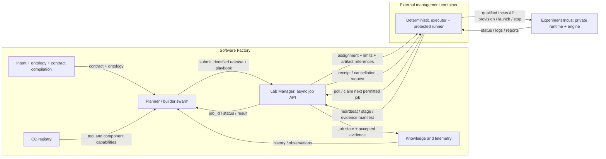

> **Continue here:** [[Resources/Handoffs/muse-design-20261109/Start here]]. Input label: **System ontology + plaintext***. *The ontology format is unknown at time of writing; no delivered template is assumed.*

# Asynchronous lab control: feasibility and starting recommendation

**Recommendation for discussion:** expose a small asynchronous lab-job API through the Factory Lab Manager and run a deterministic executor outside the experiment Incus instance. A resident reasoning agent is optional. This is the proposed answer to the [user’s design question](../../Sources/Prompts/2026-11-09-async-lab-manager-request.txt), not an accepted implementation or a claim that the lab exists.

## One Factory boundary and one lab gateway

Intent/compiler, ontology, contract compiler, planner/builder, CC registry, lab manager and durable knowledge/telemetry belong in one Software Factory boundary. The Lab Manager is the logical gateway for lab job control and result registration. The external management container hosts the executor and protected runner; the experiment Incus instance hosts the private runtime and immutable engine. The builder does not acquire a direct shell or administrative connection into the experiment.

The Manager can issue scoped artifact-upload URLs and register their manifests. Bulk bytes may use an authorized storage endpoint without adding a second control authority; the Manager validates completion and gives the receipt. The logical gateway need not proxy every trace byte through its own process.

## API, executor and agent are different concerns

| Option | What it enables | Added work / limitation | Proposed use |
|---|---|---|---|
| Builder directly runs synchronous lab commands | Quick manual prototype | Builder must track long-running work, interruption, retries and partial export; couples reasoning lifetime to execution | Qualification/debugging only |
| Async Manager + deterministic executor | Builder submits several jobs and continues other work; recorded state survives client disconnects | Durable job table, claims/leases, reconciliation, cancel/timeout and export logic still required | Starting system |
| Async Manager + reasoning lab agent | Selects novel diagnostics or interprets evidence near execution | Adds model/tool context, permission policy, action logging and reproducibility concerns; still needs the executor/job machinery | Later, if fixed playbook branches cannot cover useful work |

An API is the caller interface, not the long-running execution mechanism. A resident LLM is unnecessary for stage sequencing, timeouts, retries and fixed diagnostic branches. Keep analysis in existing Factory agents first. They can inspect saved evidence and submit another bounded job. If an autonomous lab agent later proves valuable, it uses the same API and limits rather than bypassing them.

## Small job contract

| API concept | Minimal behavior |
|---|---|
| Submit | Validate image/model/configuration/workload/tool/playbook references and budgets, persist job, return stable `job_id`; an idempotency key avoids duplicate submissions after a client retry |
| Status | Return recorded job/stage/attempt, current resource identity, heartbeat freshness and any missing evidence; job ID is distinct from an Incus operation ID |
| Cancel | Record cancellation requested and notify executor; return canceled only after owned work is confirmed stopped and partial evidence is handled |
| Result | Return terminal outcome, assessment/coverage, artifact manifest and evidence receipt, including failed or inconclusive outcomes |

One durable database table can serve as the first queue and job record; reuse the Software Factory’s existing dispatch mechanism if suitable. Otherwise, executor-initiated polling is a simple starting transport that avoids requiring inbound connectivity to every lab. Choose one dispatch path initially. This is an engineering proposal, not a measured implementation-effort estimate.

Keep executor ID, claim/lease generation, job and attempt IDs, resource names, deadlines, completed stage records and pending exports durable. A lease expiry means ownership is uncertain, not that the old GPU work stopped. Reconcile actual instances/processes and fence stale ownership before reassigning exclusive hardware. Every rerun has a new attempt/generation and follows the declared clean-state/warmup policy.

## Parallel submission and resource admission

One builder can have multiple submitted jobs without waiting in a model/tool call. Queue depth and actual hardware concurrency are separate. Independent qualified hosts can execute jobs in parallel. On one DGX Spark, scored timing and profiler runs receive an exclusive GPU slot; extra containers do not create extra GPU capacity. CPU analysis or staging can overlap only where resource budgets and measurement interference allow it. Memory, storage and report-retention admission still apply per host.

## What Incus already provides, and what remains ours

Incus provides asynchronous operations with IDs and polling or notification support. Those operations manage infrastructure; the proposed lab job must still track the full intake, correctness, timing, profiling and export lifecycle. [Incus REST API](https://linuxcontainers.org/incus/docs/main/rest-api/)

Incus events are a live stream. After a disconnect, state must be fetched again because missed events are not resent. Use events as a responsiveness aid, not the only durable source of job truth. [Incus events](https://linuxcontainers.org/incus/docs/main/events/)

Remote Incus access uses authenticated HTTPS. Restricted TLS credentials can be limited to selected projects and prevent global/project-limit changes. Pair that with restricted project configuration and narrow lab actions; never mount an unrestricted admin socket into the candidate. [Authentication](https://linuxcontainers.org/incus/docs/main/authentication/), [authorization](https://linuxcontainers.org/incus/docs/main/authorization/)

## Recovery and evidence remain explicit

- Engine or experiment-instance loss: executor preserves available logs/reports, confirms stop, records failed attempt, and recreates identified software only within retry budget.
- Executor loss: Manager stops trusting stale heartbeats and reconciles actual resources before a new executor resumes control.
- Network loss: preserve local bounded reports and retry registration; do not declare a completed export until acknowledged.
- Host/kernel/GPU-driver failure: suspend admission and invoke qualified platform recovery. A separate container on the same host does not survive every such fault.

Workflow checkpoints recover control state and stage progress, not live CUDA allocations, KV state or CUDA Graphs. Missing buffered trace data remains missing coverage. No new lab, API, dispatcher or crash-recovery implementation was built by this presentation revision.

## Minimum implementation shape

Reuse an existing Factory service and database where available. A single durable job table can provide the first queue; no separate Redis/message-broker dependency is required by this proposal. Public submit/status/cancel/result calls can be exposed to builder agents as tool CC capabilities. This does not wrap the engine product as a CC.

The per-host executor contains the Incus adapter and fixed stage wrappers. The protected trial runner can be a subprocess in the management container rather than another network service. Factory analysis agents inspect retained reports and submit bounded follow-up jobs through the same Manager API. Release the GPU slot while reasoning or waiting for a new approved attempt.

This establishes orchestration feasibility from existing primitives, not empirical runtime qualification. The nested Docker/Incus GPU and profiler path on the actual Spark remains a principal qualification risk. A known CUDA fixture can test that path but cannot validate Muse correctness or performance.
