> **Latest feasibility recommendation, November 9:** [[Asynchronous lab manager and executor]] proposes a Factory Lab Manager API plus deterministic external executor. The earlier always-present reasoning lab agent is optional, not a starting requirement. The Manager is the Factory’s logical lab gateway. This recommendation remains a design proposal.

> **Post-presentation revision, November 9:** [[Post-presentation design revision]] is the current conceptual reference. Contract, CC and release image are distinct. Tool/skill CCs support agents; component CCs supply engine functionality. The lab agent now sits outside the experiment Incus instance in a separate management container. Earlier diagrams/specimens below remain historical where they disagree.

# Immutable image deployment

**Starting proposal:** the builder submits an immutable ARM64 OCI engine release image. A Factory lab manager coordinates with a deterministic executor in a separate management container outside the experiment Incus instance. The experiment instance runs the private Docker runtime and engine on DGX Spark. Builder edits/instruments/builds; lab control stages, launches, tests, observes and returns evidence. No in-lab source workbench, rebuild or binary substitution.

**Software Factory owns the durable knowledge and telemetry plane.** Every raw trace, event/counter record, correctness result, assessment, failed/partial attempt and coverage gap returns there with identities, hashed manifest and export receipt. Lab storage is protected staging. Stop owned processes on completion/timeout; retain unexported files and do not clean them until receipt. Bounded retries/retention capacity can block new admission rather than discard evidence.

TKCC-style persistent execution is a valuable evolution. It adds engine-specific loading/reset/graph-recapture/recovery work and is not an initial dependency. No actual Muse engine/factory, Spark profiling qualification or measured performance is claimed here.

```mermaid
flowchart LR
 B[Builder with tool / component CCs] -->|release digest + contract + manifest| M[Factory lab manager]
 M -->|playbook + budgets| A[Executor: management container]
 A -->|scoped provisioning / launch / stop| I[Experiment Incus instance]
 I --> D[Private Docker runtime]
 D -->|normal / nsys / ncu launch| E[Engine app: read-only root]
 E -->|partial reports + logs| S[Protected staging]
 S -->|artifacts + manifest| F[Factory knowledge + telemetry]
 F -->|durable receipt| A
 A -->|stage / attempt checkpoints| M
```

No host Docker/Incus administrative socket is mounted into the candidate. An authorized management interface supplies qualified GPU/library/mount/profile grants and returns current endpoint/generation. The executor and protected client live outside the experiment failure scope. The executor does not receive unrestricted host administration merely by running in another container. A live HTTP endpoint alone is insufficient for Nsight injection. Code/input/tool mounts are read-only; runtime state/scratch/cache/output paths are explicit. JIT/autotuning caches may be written by declared engine operation, not used for agent-authored code replacement.

Direct Incus OCI is officially supported, but would require a different provider and agent/peer-instance mapping. A whole Incus image couples engine and lab base delivery. The selected private-runtime path fits the current image-binding foundation; it is not a claim NVIDIA mandates nested Docker or that GB10 qualification has passed.

See [[Resource provisioning]] and [[Lab and experiment]].

Recovery confirms previous process termination, invalidates stale endpoints and creates a new attempt/generation. Durable workflow checkpoints support reconciliation and clean rerun; they do not restore live CUDA state. Shared host/kernel/driver failures still need external platform recovery. See [[Post-presentation design revision]].
