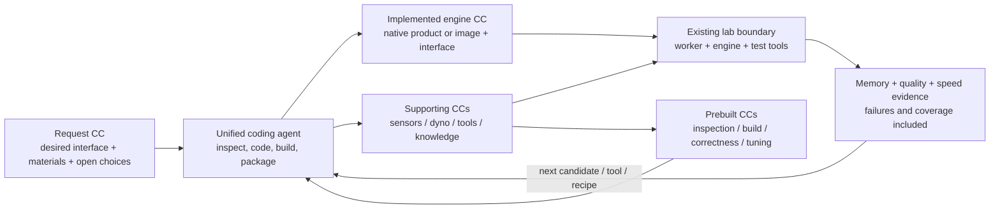
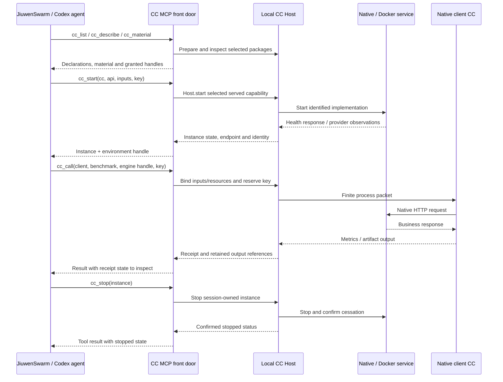
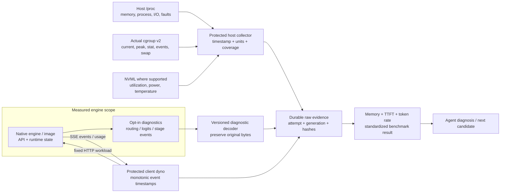
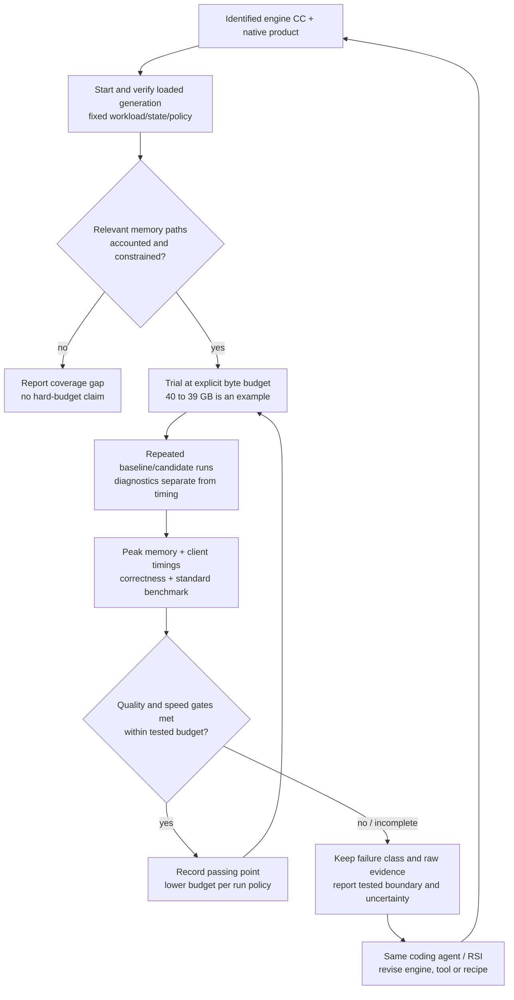
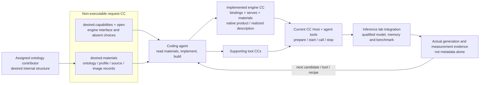

> **Post-presentation revision, November 9:** [[Post-presentation design revision]] is the current conceptual reference. Contract, CC and release image are distinct. Tool/skill CCs support agents; component CCs supply engine functionality. The lab agent now sits outside the experiment Incus instance in a separate management container. Earlier diagrams/specimens below remain historical where they disagree.

> Retained detailed context. Current November6 direction is [[Alignment and decisions]]: immutable submitted images, test-only lab, and Factory-owned knowledge/telemetry. Earlier local-workbench/native-first options are superseded, not implementation evidence.

**Current presentation revision (November 5):** [[Design rationale]] and [[Inference layers and profiling]] record the compatible Builder, optional ontology, scoped lab build/debug loop, nested Docker/Incus capture and current terminology. [[Build challenges]] and [[Data to collect]] distinguish proposed integrations from qualified evidence. The retained detail below predates that presentation revision where its scope differs.

# Five concrete views for the deep dive

These diagrams explain our CC/lab modules under a working unified coding-agent flow. They do not claim adoption of a complete system architecture or runtime validation. Use request/schema and sensor/dyno views in the main talk; keep broad context brief.

## 1. Full CC spectrum in one coding-agent flow

[SVG](diagrams/01-system.svg) / [PNG](diagrams/01-system.png)

A separate CC implementation factory is not required by this working model. Architecture adoption remains with its responsible owner.

## 2. Lab calls and runtime communication

[SVG](diagrams/02-deployment.svg) / [PNG](diagrams/02-deployment.png)

This is the implemented local tool/runner/service route. The retained demo uses synthetic HTTP compute, not inference streaming. A real inference engine can keep its native HTTP/SSE API; the remote Spark/Incus worker is a separate lab integration, not this local Host.

## 3. Sensors and dyno inside the lab

[SVG](diagrams/03-evidence.svg) / [PNG](diagrams/03-evidence.png)

This is the proposed inference observation boundary, not a claim that the synthetic demo already provides these GPU/host sensors. The engine may provide diagnostics but cannot author protected host/client measurements. Missing coverage stays visible.

## 4. Dyno, memory budgets and feedback

[SVG](diagrams/04-budget-loop.svg) / [PNG](diagrams/04-budget-loop.png)

The inference-lab design requires this operation; the current synthetic client demo does not qualify GPU memory budgets. Exact experiment choice, repetitions and budget policy belong to project planning. A tested boundary is not a universal minimum.

## 5. Request ontology to implemented engine CC

[SVG](diagrams/05-ontology.svg) / [PNG](diagrams/05-ontology.png)

Current schema support is `desired.materials` and capability `serves`; no new root `system` field is needed. A synthetic request-built service and local lifecycle were demonstrated. The real inference ontology, backend and lab measurements remain future qualification.
