> **Post-presentation revision, November 9:** [[Post-presentation design revision]] is the current conceptual reference. Contract, CC and release image are distinct. Tool/skill CCs support agents; component CCs supply engine functionality. The lab agent now sits outside the experiment Incus instance in a separate management container. Earlier diagrams/specimens below remain historical where they disagree.

# Post-presentation: contract, ontology, capabilities and package

Captured November6 after the presentation. More meeting notes are expected. These are new terminology/design directions and open questions, not a revised implementation or revised slide deck. The delivered PPTX and Spaces deck remain unchanged.

Original wording: [meeting notes](../../Sources/Prompts/2026-11-06-post-presentation-contract-notes.txt), retained verbatim with a capture hash.

## Main correction

**Do not call the whole engine specification a CC. Temporarily call it a detailed contract.** The contract describes what needs to be delivered; capability capsules describe individual reusable capabilities. The release package/image is the assembled usable software and the artifact sent to the lab.

The meeting's requested replacement label is **“system ontology / intent compiler output”** rather than “request CC.” Record this for a future slide revision. The exact diagram/title location can be settled with the incoming notes; it must not make the ontology and the whole contract indistinguishable.

| Entity | Current meeting interpretation | Relationship |
|---|---|---|
| Natural-language intent | What the user wants, initially perhaps only model and hardware | Intent compilation turns it into structured information and asks for missing facts. |
| Intent IR | Structured representation of the intent | Add/integrate the system ontology and compile the associated requirements. |
| System ontology | Structured description of the inference system, components, environment and relevant properties/relations | Part of the intent/contract specification; model checkpoint, resources, environment constraints and requirements must be connected. |
| Detailed contract | Definition of the intended inference-engine release: requirements, constraints, dependencies, gates and verification rules | Compiled from intent/ontology/requirements; references or assembles multiple relevant CCs. It is not itself a CC. |
| Agent system + CC registry | Receives the contract and plans how to build the engine using shared capabilities | Selects/composes CCs and produces the deliverable. A useful higher-level CC may itself combine other CCs. |
| CC | Unit describing/providing a particular reusable capability or functional module | May support the factory production process or implement part of the delivered engine. |
| Release package / image | Assembled usable software that fulfills the contract | Contains the built application and relevant component implementations; the immutable image goes to lab testing. |
| Realization space | Requested output concept/name from the discussion | Exact meaning, contents and producing stage remain to be specified; do not invent a schema or silently equate it with the image. |

An image is the packaging/deployment unit; CC is the capability unit. The image is not a synonym for one CC. This is a conceptual distinction, not a claim that an existing implementation binding cannot use an image or that every package must contain a fixed number of CCs.

## Intent-to-delivery workflow

```mermaid
flowchart LR
 U[Natural-language intent] -->|model + hardware + known constraints| I[Intent compiler]
 Q[User or other sources] -->|missing requirements / environment facts| I
 I --> IR[Intent IR + system ontology]
 IR -->|structured requirements / constraints| C[Requirements compilation]
 C --> K[Detailed contract]
 K -->|requirements + dependencies + gates + verification rules| A[Agent system: plan and build]
 R[CC registry] -->|relevant factory tools and component capabilities| A
 A --> P[Completed release package / image]
 P -->|identified submission| L[Incus lab: run / test / observe]
 L -->|results + telemetry + failures + coverage| F[Factory knowledge and telemetry]
 F -->|evidence for next contract / plan / component or tool improvement| A
```

Minimum initial context to collect together:

1. Model, including the required checkpoint/representation as it becomes known.
2. Hardware system.
3. Environment requirements and limitations.

The user should not need to know all details at entry. Intent compilation obtains missing information from the user or other sources. The requirements compiler makes the contract and ensures relevant capabilities/dependencies are accounted for. No new runtime/compiler interface or mandatory schema fields are implemented by these notes.

The existing `cc-request/2` implementation and completed-CC schema remain their pinned source of truth. This meeting changes the proposed top-level artifact framing; it does not rename existing APIs or prove that the new contract compiler already exists.

## Separate two uses of CC

| Production-line capabilities | Product-component capabilities |
|---|---|
| Tools used by the factory to inspect sources, add/check instrumentation, build/package images, execute tests or analyze evidence | Functional pieces assembled into the inference engine: for example an implemented expert-execution, weight-access or scheduling module, where a suitable interface is defined |
| Improve how the factory produces and verifies software | Improve what the delivered engine does |
| Normally invoked during construction/evaluation; need not be baked into the engine image | Relevant implementations/dependencies may ship inside the release image |

Use the meeting analogy: robotic arms on the production line versus parts of the car. A CC for building an image is different from a component included in that image. A contract can assemble many capabilities; its deliverable is the whole package. Retain the exact distinction in future diagrams and examples rather than putting both under one “tool CC” label.

## Router, experts and continued monitoring

Keep the proposed investigation of per-layer experts, hot/cold residency, expert location and orchestration. Separate the learned token-router's expert selection from where selected weights are resident or fetched. Moving expert weights and changing placement policy are not automatically changes to model routing semantics. Whether actual token-routing behavior should change is an open design/verification question.

When the implementation/image changes, Factory monitoring and experiment history continue through contract, release/image, configuration and run/generation identities. Compare separately identified submissions; do not silently modify the currently measured image. This maintains the agreed immutable-image baseline unless a later explicit design revises it.

## Open question: crashes, repeated failures and restoration

**User question:** how should the Incus lab handle crashes, constant crashing and restoration?

The following is a candidate recovery approach for later discussion, not an adopted or qualified implementation:

| Failure boundary | Proposed behavior | Evidence / stop condition |
|---|---|---|
| Engine process / workload container | Trusted worker detects exit, timeout or failed health check; marks that attempt failed/unknown; confirms stop; recreates from the same identified image and clean declared state when policy permits | exit/startup logs, partial profiler output, OOM events, input/tool/image IDs and new generation; never count a restart as an uninterrupted successful run |
| Lab agent / inner runtime / Incus instance | Recovery control lives outside that failed scope. Recreate the lab from a known base/profile and restage immutable inputs/tools | preserve/export available files before destructive cleanup; invalidate old handles/endpoints; check readiness and GPU health before accepting another job |
| Repeated candidate failure | Finite retry budget plus backoff; stop retrying the same failing release and return a reproducible failure bundle to the factory | record actual attempts, fault signature and last known state; no unbounded restart loop |
| GPU driver or host health failure | Suspend new GPU trials; use host diagnostics and an explicitly qualified platform recovery procedure | recreating Incus alone is not assumed to repair the shared driver/GPU; no blanket automatic GPU-reset/reboot promise |

Prefer clean recreation and rerun for the initial immutable lab. A filesystem snapshot can restore supported filesystem/configuration state; it must not be assumed to restore an active CUDA context, graph, KV cache or all external mounted data. Stateful container restore has CRIU limitations. Snapshot, backup, process restart and GPU recovery are distinct operations.

Keep Factory knowledge/telemetry durable outside the lab. A crash can lose buffered/unflushed trace data; record that coverage loss explicitly. Retain available partial evidence and protect staged files until export receipt. Do not require the lab agent itself to survive in order to detect or record a lab-level failure.

Sources for these recovery considerations: [Incus instance backup/restore](https://linuxcontainers.org/incus/docs/main/howto/instances_backup/), [NVIDIA Xid guidance](https://docs.nvidia.com/deploy/xid-errors/analyzing-xid-catalog.html). Driver/GPU support and the exact retry/reset policy still require target qualification.

## Queue for the next revision

- Replace the top-level “request CC” framing with intent/compiler/ontology output and the detailed contract.
- Separate ontology/requirements specification, capability composition and release packaging.
- Show factory-tool CCs separately from engine-component CCs.
- Clarify “realization space,” contract/subcontract boundaries and compilation stages when more notes arrive.
- Work through crash/retry/restoration policy and its host-versus-container failure boundaries.
- Preserve immutable-image testing and Factory-owned knowledge/telemetry unless explicitly revised.
