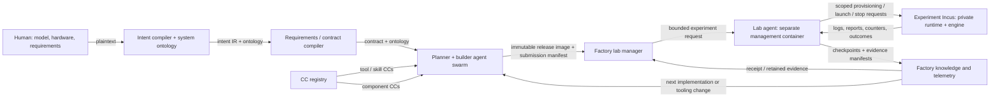

> **Latest feasibility recommendation, November 9:** [[Asynchronous lab manager and executor]] proposes a Factory Lab Manager API plus deterministic external executor. The earlier always-present reasoning lab agent is optional, not a starting requirement. The Manager is the Factory’s logical lab gateway. This recommendation remains a design proposal.

# Post-presentation design revision

This interpretation applies the November 6 workshop takeaways supplied on November 9. The [original attachment](../../Sources/Prompts/2026-11-09-post-presentation-workshop-takeaways.txt) is preserved byte-for-byte. It supersedes the earlier whole-engine “request CC” framing and placement of the lab agent inside the experiment Incus instance. It does not modify the pinned CC implementation or claim that the proposed factory or lab has been built.

## Common vocabulary

| Entity | What it does in the proposal | What passes onward |
|---|---|---|
| Plaintext human input | Names the model, hardware and known environment requirements; missing facts can be obtained from the user or other sources | Natural-language intent |
| Intent compiler + system ontology | Structures intent against an initial domain-specific ontology | Intent IR, ontology references and unresolved facts |
| Requirements / contract compiler | Compiles the requested product behavior, constraints, dependencies, gates and verification rules | Detailed contract plus ontology |
| Planner / coding-agent swarm (builder) | Plans and assembles the implementation using reusable capabilities | Code, release metadata and immutable engine image |
| Tool/skill CC | Helps agents perform factory work such as inspection, instrumentation, building, testing or analysis | Checked patches, build artifacts, reports or other declared outputs |
| Component CC | Describes reusable functionality incorporated into engine code through a suitable interface | Versioned module/source/library and its tests/integration information |
| Release package / image | Assembled usable engine product fulfilling the contract | Identified executable image for the lab; the engine has its own runtime interface |

The contract is not a CC. The engine image is not wrapped as one whole CC in this revised proposal. CC metadata can still describe tools or components and identify their implementation bindings. Several CC implementations can share packaging. Artifacts such as traces and weight packs do not become CCs just because they are retained.

## Reuse the factory workflow

CC Factory denotes capability production within Software Factory. The proposed direction reuses factory planning/build/evaluation workflows, adds source-specific agents, and composes workflows through shared orchestration. All-to-CC turns papers, repositories and code into reusable capabilities. CC2CC may assemble a temporary workflow or produce a persistent composite CC. Neither activity requires treating the complete engine contract as a capsule.

Two improvement loops remain separate in evidence: improving the production tools/workflows and improving engine components. Both use Factory execution history. The next design work is an actionable policy that connects a diagnosed issue to a permitted target/change/test. Fundamental requirement changes require human approval; permitted implementation or capability-selection changes can stay inside the current contract. SkyDiscover and multi-iteration campaigns are possible investigations, not dependencies or validated integrations.

## Failure boundaries and recovery

The Factory lab manager requests experiments and retains their durable history. The lab agent runs in a separate management container outside the experiment Incus instance. This avoids requiring the agent on the raw host and keeps an engine/experiment-instance failure from directly terminating it. Placement on the same physical Spark does not make it survive host failure, shared-kernel failure or host-wide memory exhaustion.

The agent requests narrowly scoped provisioning operations through an authorized management interface. A container boundary alone does not constrain an unrestricted Incus admin socket. The candidate receives neither that socket nor the Factory evidence store's write authority. Protected client/trial control stays outside the candidate's failure boundary. GPU device/library exposure and profiling permissions still require qualification on the actual Spark.

| Failure / state | Recovery proposal | Durable record |
|---|---|---|
| Engine process exits or times out | Confirm stop, retain partial output, restart the same identified image with declared clean state if the playbook allows | Failed attempt, fault signature, input/image/tool identities, fresh generation |
| Experiment instance fails | Management agent recreates the experiment from the identified base/profile and restages inputs | Provisioning checkpoint, resource settings, retained mounted reports and export status |
| Management agent fails | Factory manager reconciles its recorded job state with actual resources before resuming control | Experiment ID, stage, lease/generation, deadline, completed stages and pending export |
| Repeated candidate crash | Finite retry budget and backoff; stop admission for this candidate when budget is exhausted | Failure bundle and reproducible request to builder |
| Host or driver fault | Stop GPU admission and use qualified platform recovery; no assumption that container restart repairs the driver | Host/GPU health events, unknown/incomplete coverage and affected attempts |

“Checkpoint recovery” means resuming the experiment workflow from durable stage/state records. It is not a promise to restore CUDA contexts, live KV cache, CUDA Graphs or arbitrary in-memory process state. Retries produce separately identified attempts; a crash does not become an uninterrupted successful trial. Recovered scored trials rerun the declared warmup and state policy. Buffered trace data may be lost and must appear as missing coverage.

The durable knowledge and telemetry plane stays in Software Factory. Export hashes/manifests and receive acknowledgment before deleting local evidence. Bound scratch, cache and report storage separately. Capacity pressure can stop new trials rather than silently discard unexported evidence.

## Runtime policy versus release change

| Change | Treatment |
|---|---|
| Contract-permitted cache budget, batching or scheduling setting | New identified configuration/attempt using the same image; reset/warmup as declared |
| Source, kernel, marker placement, implementation or dependency change | Builder creates a new immutable image; lab evaluates it |
| Fundamental product requirement or acceptance rule | Explicit contract revision with human approval |

Within each Muse layer, the router selects experts for tokens. Residency/placement policy determines where selected weights are and how they are retrieved. The presentation must not conflate moving expert weights with changing learned routing semantics. Benchmarking supplies TTFT, token timing and throughput; profiling plus engine hooks explains causes. Nsight alone cannot reconstruct expert cache misses or residency intent.

## Status and evidence

This is a design proposal and presentation revision. The current CC schema/runtime and prior local demonstrations remain pinned implementation evidence. The old completed-engine-CC specimen is historical and no longer the proposed product delivery contract. New release-contract examples are illustrative, not a claim of schema acceptance or successful engine launch. NVTX tool CC examples remain capability examples.

Official background retained from the previous research: [Incus GPU devices](https://linuxcontainers.org/incus/docs/main/reference/devices_gpu/), [Incus backup and restore](https://linuxcontainers.org/incus/docs/main/howto/instances_backup/), [NVIDIA Xid guidance](https://docs.nvidia.com/deploy/xid-errors/analyzing-xid-catalog.html). Actual driver allocation accounting, profiler behavior, runtime setup and recovery remain target-qualification work. No Muse benchmark or DGX Spark experiment was performed for this revision.

